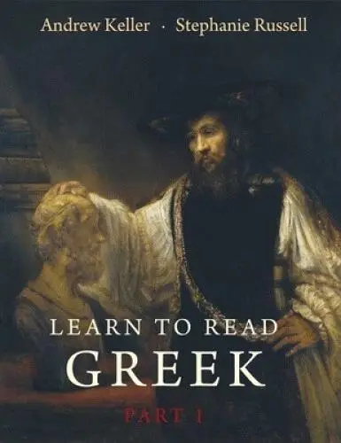

# 元数据

> [!abstract] Learn to Read Greek Workbook  Textbook
> - 
> - 书名：Learn to Read Greek Workbook  Textbook
> - 阅读进度：0%
> - 阅读时长：55分钟
> - 最后阅读：2026-09-17
> - 微信读书：https://weread.qq.com/book-detail?type=1&v=85042a23643425f423268394e54394f3547645436796c36777734577644504ce1e

# 高亮划线

> 这本书目前没有个人划线。
