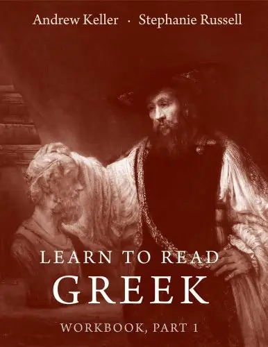

# 元数据

> [!abstract] Learn to Read Greek Workbook
> - 
> - 书名：Learn to Read Greek Workbook
> - 阅读进度：0%
> - 阅读时长：4分钟
> - 最后阅读：2025-09-24
> - 微信读书：https://weread.qq.com/book-detail?type=1&v=c0d42033643425f36385942623842647a47645436796c36777739633834756869d

# 高亮划线

> 这本书目前没有个人划线。
