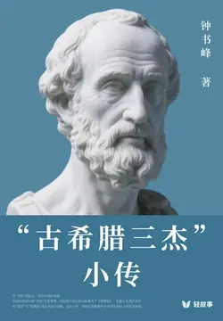

# 元数据

> [!abstract] “古希腊三杰”小传：苏格拉底、柏拉图和亚里士多德（轻哲学）
> - 
> - 书名：“古希腊三杰”小传：苏格拉底、柏拉图和亚里士多德（轻哲学）
> - 作者：钟书峰
> - 简介：【在“无知”的起点，寻找永恒的真理】
>   你是否想过，自称“一无所知”的苏格拉底，为何能成为柏拉图的老师？热爱诗歌与摔跤的文艺青年柏拉图，为何最终成了写出《理想国》的哲学家？而说出“吾爱吾师，吾更爱真理”的亚里士多德，又如何在继承与批判中开创自己的学派？
>   他们的生命轨迹与思想求索，最终指向一个永恒的命题——人如何在有限的生命中，朝向无限之善。
> - 出版时间：2025-12-15 00:00:00
> - 分类：社会文化-社科
> - 微信读书评分：92%
> - 阅读进度：100%
> - 阅读时长：42分钟
> - 最后阅读：2026-11-15
> - 微信读书：https://weread.qq.com/book-detail?type=1&v=19c32db0813abaefeg0140a3

# 高亮划线

## 附录：永远的争议，永恒的魅力

> 📌 理想国》的文体，是文学著作，还是哲学著作
> ⏱ 2026-11-15 00:43:29
> 💭 为什么一定要强行区分呢？《道德经》《逍遥游》等等，是文学作品，还是哲学作品，还是两者皆是？
> 🕰 2026-11-15 00:43:40

> 📌 在《理想国》中，柏拉图就不时借机进行控诉。可见，柏拉图对老师苏格拉底的感情，是多么深厚。
> ⏱ 2026-11-15 00:43:24

> 📌 柏拉图虽然拒绝加入“三十僭主”主导的统治集团，但是，恐怕也是默许甚至是支持其统治的，而且“三十僭主”的主要成员中，有些人就是他的至亲，比如他的舅舅。
> ⏱ 2026-11-15 00:43:22

> 📌 不少人评价，《理想国》是乌托邦的鼻祖，尤其认为，柏拉图关于哲学家治国的设想即哲人王思想，是完全无法实现的空想。
> ⏱ 2026-11-15 00:43:18

> 📌 理想的模板，是追求的目标，不能非要按图索骥，在现实中找到一模一样的东西，才叫实现。
> ⏱ 2026-11-15 00:43:08

> 📌 何况，认真对照分析如今各国的政治现实，再好好想想，其实，《理想国》中的诸多设想，都已经实现，或者已经在不同程度上实现了；即使没有实现的，也许将来也有可能实现。
> ⏱ 2026-11-15 00:43:15

> 📌 著名思想家爱默生甚至说：“烧掉所有图书馆吧，因为它们的价值都在《理想国》里。”
> ⏱ 2026-11-15 00:42:57

> 📌 真理，掀起反对自身的风暴；风暴，将真理种子，播撒到天涯海角。
> ⏱ 2026-11-15 00:43:03
