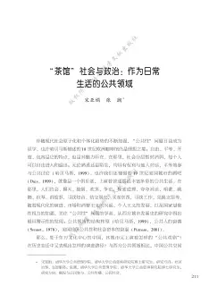

# 元数据

> [!abstract] “茶馆”社会与政治：作为日常生活的公共领域 (1)
> - 
> - 书名：“茶馆”社会与政治：作为日常生活的公共领域 (1)
> - 作者：作者
> - 阅读进度：0%
> - 阅读时长：0分钟
> - 最后阅读：2025-09-19
> - 微信读书：https://weread.qq.com/book-detail?type=1&v=72d42e13643425f323568316c33316c39476c6836796a367777434b6432484a9b5

# 高亮划线

> 这本书目前没有个人划线。
