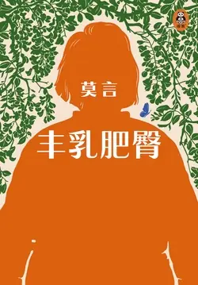

# 元数据

> [!abstract] 丰乳肥臀【中国诺奖得主代表作】
> - 
> - 书名：丰乳肥臀【中国诺奖得主代表作】
> - 作者：莫言
> - 简介：莫言曾坦言：“你可以不看我所有的作品，但你如果要了解我，应该看我的《丰乳肥臀》。”
>   本书是莫言1995年创作的一部波澜壮阔的“史诗性”长篇小说。作者以母亲的一生为缩影，还原了近代中国一个世纪的起伏变迁，多层次地描写了母亲与她生养的众多子女的命运。
>   文中的母亲饱经苦难，她含辛茹苦地抚育着九个子女和女儿们的子女，在战乱中用生命保护孩子们避难、逃荒。她的女儿们一个个长大，跟着她们爱上的男人加入不同的政治势力，不可抗拒地被卷入政治历史舞台。在这个大家庭内部投射出各种力量之间的角逐与厮杀、牺牲与冷漠、荣耀与耻辱。大起大落后，母亲始终如坚硬的河床承受着一切，保护着一切。她见证了战争与饥饿，也见证了荒唐与耻辱。
>   莫言以超乎常人的想象力和魔幻现实主义的笔法，将一个家族的受难史、一个国家的变迁史、一个民族的苦难史记录下来，苦难之极，荒诞之极，魔幻之极。
>   在这里，爱与欲、生与死、鲜血与肉体、饥渴与奢侈，都以魔幻现实主义的方式爆发出来……
> - 出版时间：2017-01-02 00:00:00
> - ISBN：9787533960216
> - 分类：精品小说-年代小说
> - 出版社：浙江文艺出版社
> - 微信读书评分：85%
> - 阅读进度：58%
> - 阅读时长：1小时33分钟
> - 最后阅读：2026-11-12
> - 微信读书：https://weread.qq.com/book-detail?type=1&v=ea532d2071938fb5ea51430

# 高亮划线

## 新版自序

> 📌 书中的母亲，因为封建道德的压迫做了很多违背封建道德的事，政治上也不正确，但她的爱犹如澎湃的大海与广阔的大地。
> ⏱ 2026-11-11 01:15:55

## 主要人物表

> 📌 母亲——上官鲁氏。乳名璇儿。自幼丧母，随姑父于大巴掌和姑姑长大，嫁给铁匠儿子上官寿喜。晚年信仰基督教，寿九五而终。
> ⏱ 2026-11-11 01:32:50

> 📌 四姐——上官想弟。生父乃一个走街串巷的江湖郎中。在生活最困难的时候，为了救全家，她自卖自身进了妓院。后流落他乡，音信全无。“文革”中被遣返还乡，多年积攒的财物被洗劫，并遭受残酷批斗，后旧病复发而死。
> ⏱ 2026-11-11 01:34:04

> 📌 五姐——上官盼弟。生父乃杀狗人高大膘子。少年时自愿参加爆炸大队，后嫁给爆炸大队政委鲁立人，生女鲁胜利。曾经当过卫生队长、区长、农场畜牧队长。改名马瑞莲。“文革”中自杀身亡。
> ⏱ 2026-11-11 01:34:20

> 📌 六姐——上官念弟。生父乃天齐庙智通和尚。爱上了被日机击落后为司马库的部队收容的美国飞行员巴比特，结婚后的第三天即与巴比特一起被鲁立人领导的独纵十七团俘虏。逃亡后被一寡妇诱至山洞与巴比特同归于尽。
> ⏱ 2026-11-11 01:35:06

> 📌 七姐——上官求弟。母亲被四个败兵强暴所生。早年被卖给罗斯托夫伯爵夫人做养女。后改名乔其莎，毕业于省医学院，被打成“右派”，到农场劳动改造。因饥饿，暴食生豆饼胀死。
> ⏱ 2026-11-11 01:34:49

> 📌 八姐——上官玉女。与金童为双胞胎，生父乃瑞典籍传教士马洛亚。生而失明。三年困难时期，因不忍心拖累母亲，投河自尽。
> ⏱ 2026-11-11 01:34:34

> 📌 我——上官金童。母亲唯一的儿子。患有恋乳症。一生嗜乳，以致精神错乱。中学毕业后去农场劳动。后因“奸尸罪”被判刑十五年
> ⏱ 2026-11-11 01:17:00

> 📌 改革开放后刑满还乡，曾在外甥鹦鹉韩夫妇开办的“东方鸟类中心”任公关部经理，后在司马粮投资的“独角兽乳罩大世界”任董事长，因被炒、被骗而失败，终至穷愁潦倒，一事无成
> ⏱ 2026-11-11 01:17:05

> 📌 马洛亚——瑞典传教士。因战乱频仍而滞留在高密东北乡，主持大栏镇基督教堂的教务，能说流利的汉语，与当地老百姓相处融洽。与上官鲁氏发生恋情，乃上官金童与上官玉女的生身父亲。后因不堪黑驴鸟枪队的凌辱从钟楼上跳下身亡。
> ⏱ 2026-11-11 01:35:30

### 第十八章

> 📌 我扑到六姐身上，双手准确地揪住了她的乳房。我听到那两只乳房唧唧喳喳地叫着，像被耗子咬住翅膀的小雏鸡儿。六姐猛地站了起来，疼痛使她弯了腰。我使劲儿攥着她，不松手。她狭长的脸发了黄，哭叫着：“娘，娘哪，你看看他吧……”
> ⏱ 2026-11-11 01:38:14

### 第十九章

> 📌 上官盼弟浑身湿漉漉的，单薄的衣服紧贴在身上，肥大的乳房高高地挺着，诱惑着我的眼睛。她的头发里散出热烘烘的酒糟的味儿。她的枣子般的乳头在布衬衣里蠕动着。我多么想扑上去咬咬那奶头、摸摸那乳房啊，但是我不敢。上官盼弟脾气暴躁，动不动就用耳光子扇人，她可不像大姐那样良善。宁愿挨耳光，我也要摸摸你！我躲在梨树下，牙咬着下唇，下定了决心。
> ⏱ 2026-11-11 01:31:24

> 📌 第二天早晨，我们发现，母亲正在训练那只白色的奶羊，给仰躺在簸箕里的上官盼弟的女儿喂奶。
> ⏱ 2026-11-11 01:41:31

### 第二十一章

> 📌 司马库身着军服，脸上放着光彩，从主宾席上站起来。他清了清喉咙，高声说：“诸位兄弟，各位乡绅，今天，我们在这里大摆酒宴，祝贺尊贵的朋友巴比特和鄙人的小姨子上官念弟结婚，这是件天大的喜事，请大家鼓掌。”
> ⏱ 2026-11-11 01:42:08

> 📌 电灯可真是坏东西，照透了她的白裙子，使那两只红头白乳房清晰可见，变成了公共的目标。我知道，男人们都在盯着它们，连司马库都在斜眼盯着它们。它们却浑然不觉，还在那儿摇头摆尾呢
> ⏱ 2026-11-11 01:43:04

> 📌 我想骂人，骂谁呢？骂巴比特这个坏种，今天夜里，它们就被你独霸了。我的黏湿的手，在口袋里，紧紧地攥着锋利的小刀子。如果我冲上去，用小刀子，划破她的裙子，然后，贴着底盘，把它们利落地旋下来，那会出现什么情景呢
> ⏱ 2026-11-11 01:43:23

> 📌 司马库还顾得上演说吗？巴比特还顾得上激动吗？上官念弟还顾得上幸福吗？我将把它们珍藏起来，藏在什么地方？藏在草垛里？不行，黄鼠狼会吃掉它们；藏在墙洞里，老鼠会拖走它们；藏在树杈上，猫头鹰会叼走它们……有人轻轻地戳戳我的腰
> ⏱ 2026-11-11 01:43:31

> 📌 司马库的演讲继续进行，他端着一杯酒，是专门从大泽山买来的葡萄酒浆，在玻璃杯子里放着红光，举着杯子老半天了他也不嫌胳膊累得慌
> ⏱ 2026-11-11 01:44:19

> 📌 他说：“巴比特先生是从天而降，天上掉下个巴比特。他的飞行表演，诸位都亲眼目睹了，他让电灯发光，就在我的头顶上——”
> ⏱ 2026-11-11 01:44:24

> 📌 他指着房梁上的电灯泡，众人的眼睛暂时离开上官念弟那令人酥软的、销魂的、蔓延着某种感召的乳房，随着他手指的引导，去注视刺目的光明
> ⏱ 2026-11-11 01:44:31

> 📌 嘴里塞满鱼肉的同桌们手忙脚乱地站起来，他们的腮帮子上、鼻尖上，甚至额头上都沾着明晃晃的油。我身边的司马粮，匆匆把嘴里的鱼肉咽下去，并撩起桌布垂在桌下的部分，大咧咧地擦手擦嘴
> ⏱ 2026-11-11 01:46:59

> 📌 我的双手白嫩细腻，我的礼服一尘不染，我的头发金光灿灿，我的肠胃从没消化过动物的尸首，我的牙齿从没咀嚼过植物的纤维
> ⏱ 2026-11-11 01:47:07

> 📌 一片油腻的小爪子，笨拙地举着酒杯，与巴比特夫妇手中的杯子碰撞。只有我，立在桌前，痴迷地盯着上官念弟的乳房。我的双手捏着桌子的边沿，极力克制着想扑到六姐胸前去吃奶的念头
> ⏱ 2026-11-11 01:46:50

> 📌 巴比特惊讶地看着我，问：“你，为什么不吃不喝？你什么也没吃？一点儿也没吃？”
> ⏱ 2026-11-11 01:47:10

> 📌 上官念弟短暂地放下了架子，恢复了一些属于我的六姐的神情，她用那只空闲的手，摩挲着我的脖子，对崭新的夫婿说：“我弟弟是半个神仙，他不食人间烟火。”
> ⏱ 2026-11-11 01:47:18

> 📌 六姐身上浓烈的芳香熏得我心神狂荡，我的手背叛了我的意志，抓住了她的胸脯。她的绸衣是那么滑溜。六姐惊叫一声，把杯中酒泼到我的脸上。
> ⏱ 2026-11-11 01:47:29

> 📌 六姐的脸涨得通红。她把被我弄乱了的裙领往上扯了扯，低声骂道：“浑蛋！”
> ⏱ 2026-11-11 01:47:51

> 📌 红色的酒在我脸上流淌，我的眼前拉开了一道红色的透明帘幕。上官念弟的双乳像两个充足了气的红气球，与其说在我眼前，不如说在我脑子里嘭嘭有声地碰撞着。
> ⏱ 2026-11-11 01:48:01

> 📌 巴比特用他的大手拍着我的脑袋，挤眉弄眼地说：“小伙子，母亲的乳房属于你，但姐姐的乳房属于我。希望我们能成为好朋友。”
> ⏱ 2026-11-11 01:48:12

> 📌 六姐的乳房，光滑柔润，是用玉石雕成的，绝代的好宝贝，今夜就要落在这个粉脸上生着细毛的美国人手里，任他抓，随他摸，由着他揉搓
> ⏱ 2026-11-11 01:48:53

> 📌 六姐的乳房，洁白如粉团，内含两包蜜，搜遍天涯海角难得的佳肴，今夜就要掉进牙齿雪白的美国人嘴里，供他啃，让他嘬，被他吸干汁液变成两张苍白的皮。而最让我悲愤难忍的是，这一切，竟是六姐自愿的
> ⏱ 2026-11-11 01:49:01

> 📌 上官念弟，我用草缨撩你一下，你就扇我两巴掌；我用手摸你一下，你就泼我一脸酒。可是，巴比特摸你咬你，你竟然愉快地承受。这世界太不公道了
> ⏱ 2026-11-11 01:49:08

> 📌 你们这些下贱的货，为什么不理解我的苦心？这世界上，没有人比我更懂乳房更爱乳房更知道呵护乳房了，可我的好心被你们当成了驴肝肺。我委屈地哭了
> ⏱ 2026-11-11 01:49:16

> 📌 要问我为什么还不走，因为司马库宣布过，饭后，巴比特将再一次向人们显示西方的物质和文化文明。我知道他要放电影，一种据说用电催出来的活灵活现的人影子。这是二姐邀请母亲出席喜宴时说的
> ⏱ 2026-11-11 01:50:39

> 📌 母亲却说，二十年前，她就见过那东西，是德国人前来放的，为了推销他们的化肥，一种白色粉末，据说施到地里可让粮食增产，但没人相信。庄稼一朵花，全凭粪当家
> ⏱ 2026-11-11 01:50:50

> 📌 德国人免费赠送的化肥，被老百姓填到池塘里，当年夏天，池塘里的荷花长疯了，荷叶大如磨盘，又肥又厚，但荷花却很少。老百姓庆幸没有上当，德国人想来害我们，什么化肥，是只长叶子不开花当然更不能结果实的毒药
> ⏱ 2026-11-11 01:51:07

> 📌 车辕上站着一个女人，长发飘飘，但看不出颜色。她大大的脸盘，凸出的额头，美极了的眼睛，睫毛弯曲，像猫的胡子一样黑，一样硬。那嘴，大极了，嘴唇黑亮。我感到她很浪荡
> ⏱ 2026-11-11 01:57:08

> 📌 她的乳房猖狂地跳动，宛若两只被夹住尾巴的白兔子。她的乳房肥胖臃肿，超过了上官家所有的乳房。她赶着马车，对着我飞驰而来，让我心中滚烫，嘴唇发痒，双手出汗
> ⏱ 2026-11-11 01:57:23

> 📌 那女人停住马车，从车辕上跳下。她撩起裙子，闪烁着雪白的大腿，吆喝着，肯定是喊那个男人，喊着，奔跑。果然是喊他，他不理死狗熊了，扔了枪，迎着那女人跑
> ⏱ 2026-11-11 01:57:50

> 📌 脸，浓眉毛，鹰眼，油亮的络腮胡子，把眉毛和额角断开的一道亮疤。又是女人的脸。又是男人的脸。女人的甩掉鞋的脚。男人笨重的脚
> ⏱ 2026-11-11 01:57:54

> 📌 然后，女人就扑到男人怀里。她的乳房被挤扁了。她的大嘴在男人脸上一阵乱啄。男人的嘴堵住女人的嘴。然后，你的嘴在外边我的嘴在里边，我的嘴在里边你的嘴便在外边，互相喂着。哼哼唧唧的声音，是那女人发出的
> ⏱ 2026-11-11 01:58:13

> 📌 还有他们的手，搂脖子搂腰不算，还你摸我我摸你，最后，俩人一起歪倒在茸茸的草地上打起滚来，时而男的在上边，时而女的在上边。翻来滚去，滚了有一里路，后来不滚了。男人毛茸茸的大手伸进了女人的衣裙内，抓住了一只肥乳。我心中疼痛难忍，辛辣的泪水喷出眼眶
> ⏱ 2026-11-11 01:58:19

### 第二十六章

> 📌 兔子皮让人联想起疯狂恋爱的沙月亮时代。奶山羊眼睛里，盈满感激的泪水。它鼻子里发出哼唧之声，这是它的话语。它的耳朵上冻起了冻疮，四个蹄子粉红色，如同冰雕玉琢。自从对它的乳房实施了保暖措施后，它成为一只幸福的羊
> ⏱ 2026-11-11 01:24:09

> 📌 包袱皮和兔子皮在保暖的同时还起到了奶罩的托提作用。这是一个创造，后来我成为乳罩专家时，设计了一种专为高寒地区妇女使用的兔皮乳罩，灵感盖源于此
> ⏱ 2026-11-11 01:24:14

### 第二十八章

> 📌 和平年代的第一场大雪遮盖了死人的尸骨，饥饿的野鸽子在雪地上蹒跚，它们不愉快的叫声，宛如寡妇们含义模糊的抽泣
> ⏱ 2026-11-11 02:01:00

> 📌 雪后的早晨，天空好像一块透明的冰。东方红，太阳升，天地间便展开了万丈金琉璃。雪遮掩大地，人走出房屋，喷吐着粉红色的雾，踩着洁白的雪，牵着牛羊，背着货物，沿着村东的茫茫原野，往南走，翻过盛产螃蟹和蛤蚌的墨水河，到那片方圆约有五十亩的莫名其妙的高地上，去赶高密东北乡奇妙的“雪集”——雪上的集市、雪中的交易、雪的祭祀和庆典
> ⏱ 2026-11-11 02:01:14

> 📌 村中唯一的一条没疯的盲狗跟随着它的主人门圣武老道士在雪中羞羞答答地行走。高地上有一座青砖垒成的塔，塔前有三间草屋，草屋的主人就是门圣武。他已经一百二十岁了，练了“辟谷”的神功，据说已经十年没吃粮食了，据说他像树上的蝉一样，依靠着露水生存
> ⏱ 2026-11-11 02:19:44

> 📌 般。为此母亲流出了兴奋的眼泪
> ⏱ 2026-11-11 02:02:20

> 📌 我偶尔上街，女人们都用崇敬的目光看着我。“‘雪公子’，‘雪公子’，什么时候下雪呀？”她们甜蜜地问我。“我也不知道。我怎么能知道什么时候下雪？”“‘雪公子’不知道什么时候下雪？噢，天机不可泄露呀！”
> ⏱ 2026-11-11 02:02:27

> 📌 这兄弟二人，讲话都有些口吃。前几年为了逃避兵役，王太平自己剁掉了食指；王公平用巴豆涂抹睾丸，伪装小肠疝气。他们的骗局被揭穿，村主任杜宝船，用步枪指着他们，给他们指出两条路：一条是就地枪决；一条是出常备夫，上火线，抬担架，背伤兵，运弹药。他们期期艾艾，说不出一句完整话。他们的爹，修建教堂时从脚手架上掉下来跌瘸腿的泥瓦匠王大海，帮他们选择了第二条道路
> ⏱ 2026-11-11 02:04:43

> 📌 专业轿夫抬担架，抬得稳，走得快，得到好评，兄弟二人都立了功。常备夫复员时，担架团团长陆千里给他们写了亲笔信，证明他们的功绩。同他们一起出夫的杜宝船的弟弟杜金船，突发急病死了
> ⏱ 2026-11-11 02:04:52

> 📌 兄弟二人从一千五百里外，把杜金船的尸首抬回来。一路上受尽了千辛万苦，抬到杜宝船家。兄弟俩口吃说不清楚，每人挨了杜宝船两个耳光。杜宝船说他们谋害了杜金船。兄弟二人拿出立功证明和团长的信。杜宝船夺过信和证明，哧，哧，哧，全给撕成条条，然后抬手一扬，说：“逃兵永远是逃兵。”他们心里，有说不出的苦
> ⏱ 2026-11-11 02:04:32

> 📌 他们久经磨炼的肩膀像铁一样坚硬，他们的腿脚训练有素。坐在他们的抬斗里，好像坐在顺流直下的轻舟上，雪的原野，翻滚着光的波浪。狗的叫声，带着青铜的声音
> ⏱ 2026-11-11 02:04:21

> 📌 选定我做“雪公子”后，门老道便告诉过我，“雪集”的创始人，是他的师父陈老道。陈老道受太上老君的嘱托创始“雪集”，功德圆满，已羽化成仙。成了仙后，住在一座高耸入云的大山上，吃松子，喝泉水，从松树飞到柏树，从柏树飞进山洞。门老道详细向我讲解过“雪公子”的任务。第一步坐坛受祭——刚刚结束，第二步巡视雪集，正在进行中。
> ⏱ 2026-11-11 11:12:16
> 💭 那个年代太苦，太凄惨，太无奈，对美好未来的憧憬、奢望，出现了神佛一种心理寄托吧！我是这么理解本书里的成仙包括三姐鸟仙
> 🕰 2026-11-11 11:12:31

> 📌 现在回想起来，“雪集”其实是女人的节日，雪像被子遮盖大地，让大地滋润，孕育生机，雪是生育之水，是冬天的象征更是春天的信息，雪来了，生机蓬勃的春天就跨上了骏马奔驰了。
> ⏱ 2026-11-11 02:13:13

> 📌 不管是哪里来的女人，“雪公子”都应该一视同仁。我立即把双手插到面前的雪盆里，让圣洁的雪洗去我手上的污秽。然后我把手举起来，往前伸去
> ⏱ 2026-11-11 02:14:10

> 📌 按照规矩，那些祈求来年生子的女人，那些祈求奶水旺盛、乳房健康的女人应该撩起衣襟，用她们的乳房来迎合“雪公子”的双手
> ⏱ 2026-11-11 02:13:59

> 📌 第一对乳房还没摸够就飞走了，我有些失望，更充满希望，把手伸进雪里，让它们恢复干净和圣洁。我有些焦灼地等待着第二对乳房
> ⏱ 2026-11-11 02:15:39

> 📌 第二对乳房迎上来了，这次可不能让你们轻易飞走。我用僵硬的手，一下子就抓住了它们。它们小巧玲珑，说软不软说硬也不硬，像刚出笼的小馒头，我看不到它们但我知道它们很白，很光滑。它们的头儿很小，像两颗小蘑菇
> ⏱ 2026-11-11 02:15:46

> 📌 我抓着它们，心里默念着最美好的祝愿。捏一下，祝你一胎生三个胖孩子。捏两下，祝你的奶水旺盛像喷泉。捏三下，祝你的奶汁味道甜美如甘露。她低声地呻吟着，猛地挣脱了。我怅然若失，情绪受到沉重打击
> ⏱ 2026-11-11 02:15:52

> 📌 “雪公子”一视同仁，祝你实现愿望，想生儿子就生儿子，想生女儿就生女儿，想要多少奶汁，就有多少奶汁。你的乳房可以永远健康，但想恢复青春，“雪公子”却无能为力
> ⏱ 2026-11-11 02:16:15

> 📌 在门老道门前的空地上，停着一辆草绿色的吉普车，从车上跳下四个身穿黄军装、胸脯上佩戴白布标记的公安兵。他们动作敏捷，像豹子一样蹿进门老道的房子。几分钟后，手腕上戴着银色手铐的门老道被推推搡搡地押出来。他悲哀地看看我，一句话也没说，顺从地钻进了吉普车
> ⏱ 2026-11-11 02:19:06

> 📌 三个月后，反动道会门头子，暗藏的、经常站在高坡上打信号弹的特务门圣武被枪毙在县城断魂桥边。他的盲狗在雪地上追逐吉普车时被车上的神枪手打碎了头盖骨
> ⏱ 2026-11-11 02:18:58

### 第二十九章

> 📌 纪琼枝代表政府赠送给这些新组合成的夫妻毛巾和肥皂。镇长发给他们结婚证书。母亲接着毛巾和证书，满脸通红，像个羞涩的小姑娘。
> ⏱ 2026-11-11 01:25:32

> 📌 我心中燃烧着邪恶的火焰。我满脸滚烫，替母亲害臊。教堂的山墙上，当年悬挂过枣木耶稣的地方，如今悬挂着灰尘
> ⏱ 2026-11-11 01:25:37

> 📌 当年马洛亚牧师为我洗礼的讲台上，站着一群不知羞耻的男女。他们畏畏缩缩，目光躲躲闪闪，小偷似的。母亲头发花白了，竟要跟自己女婿的哥哥结婚。不，已经结婚
> ⏱ 2026-11-11 01:25:21

> 📌 亲睡在一个被窝里了。母亲肥大的乳房就要被司马亭占有了，就像司马库、巴比特、沙月亮、孙不言占有我姐姐们的乳房一样
> ⏱ 2026-11-11 01:25:42

> 📌 大姐在院子里弯曲着雪白的脖子洗她的浓密的黑发。她弯着腰时那两只粉红色的美乳愉快地唱着歌，像两只黄鹂委婉地鸣啭。她直起腰时，一串清明水珠从双乳间流淌下去
> ⏱ 2026-11-11 01:26:58

> 📌 他从怀里摸出那张结婚证，撕成纸条儿，扔在地上。他弓着腰走出了我家院子，从背后看去，他已经像个风烛残年的老人了。
> ⏱ 2026-11-11 01:26:51

### 第三十五章

> 📌 盼弟，娘究竟犯了什么罪？”盼弟看看那冷眼望着窗外高墙的区长，眼睛里泪汪汪的，她说：“娘……忍一忍吧……相信政府吧……政府绝不会冤枉好人……”
> ⏱ 2026-11-12 04:42:29
> 💭 看这本书最大的感触就是，历史是胜利者书写的。但是胜利者允许了这本书的上架
> 🕰 2026-11-12 04:42:55

> 📌 一个顶着狐狸仙位的寡妇，用一块黑色的卵石，有节奏地敲击着表彰着丁翰林嘉言懿行的青石墓碑
> ⏱ 2026-11-12 04:43:13

> 📌 “俺那个老丈母娘竟让我逃离高密东北乡，我为什么要逃离？这里是我的家，这里埋着我家亲人的尸骨，这里的一草一木一山一水都亲我，这里好耍好玩，这里还有你这个烈火一样的狐狸精，你说我怎么能离开？”
> ⏱ 2026-11-12 04:43:55
> 💭 作者对司马库的塑造是最用心的。比上官鲁氏的塑造更成功。
>
> 上官鲁氏，第一卷，第二卷的形象更好，复杂，立体，充满生命力和传统特征，后面就成了母亲的符号。
>
> 尤其是，几次反对女儿嫁人和救孩子都描写的很扁平。
> 🕰 2026-11-12 04:44:00

> 📌 没事，八路在那里被我教训了一下，那些野鸭子是被吃死尸的老鹰吓飞的。”
> ⏱ 2026-11-12 04:44:10

> 📌 ”崔凤仙挣扎着说：“没事，没事。”但司马库已经叼住了她的手指，贪婪地吮吸着。崔凤仙呻吟着，说：“你这个吸血鬼哟……”司马库吐出她的手指，嘴唇堵住了她的嘴，
> ⏱ 2026-11-12 04:44:31
> 💭 一边是严刑拷打，是风声鹤唳，一边是野外野合，生物最原始的欲望，此处充满了张力。难怪性很多时候与死的意向一起出现。
> 🕰 2026-11-12 04:44:55
> 💭 司马库都几个女人了，这更加证明了，当人很空虚的时候，最需要性吧。
> 🕰 2026-11-12 04:44:42

> 📌 那两只蛮横的大手，粗野地抓住了她的乳房。崔凤仙兴奋地扭动着，手中的竹篮落地，篮中的红皮熟鸡蛋在青砖铺就的地面上滚动。司马库抱起崔凤仙，把她安放在四独棺材那宽广的“材天”上……
> ⏱ 2026-11-12 04:45:08

> 📌 可我就管不住自己，你在前头一摇尾巴，我就像母狗一样，跟着你跑了……你说，死鬼，你用了什么邪法子，让女人不顾一切跟着你跑，明明知道前边是火坑，还睁着大眼往下跳？”
> ⏱ 2026-11-12 04:45:41
> 💭 男子气概，痞气，类似于学生时代的混混一部分人比做题的更受欢迎。冒险家气质，也算魅力的一种。虽然我觉得野就是了
> 🕰 2026-11-12 04:45:58
> 💭 布拉德皮特和姜文适合这个角色。
> 🕰 2026-11-12 04:45:52

> 📌 司马库的大手僵在崔凤仙胸前，他从棺材顶上跳下来，抱起枪，弯着腰就要往外钻。
> ⏱ 2026-11-12 04:46:34

> 📌 “听你丈母娘的话，远走高飞。只要你不嫌我累赘，我愿跟着你，走烂了脚底板也不后悔！”
> ⏱ 2026-11-12 04:47:04

> 📌 崔凤仙眼睛里含着泪，连连点头。她从头上摘下一把弯曲的牛角梳子，一点点地梳通了司马库纠结成一团的黑白参半的乱发，梳下了很多草子、小螺壳和小甲虫
> ⏱ 2026-11-12 04:47:19

> 📌 司马库坐着没动，直到她的背影消逝了很久，他的眼睛还望着在耀眼的光线里轻轻摇摆的荆棘枝条。
> ⏱ 2026-11-12 04:47:28

> 📌 他恶作剧地拨弄着裆中之物，低头观赏，赞叹不已，然后把焦灼的尿液撒入河中。伴随着尿珠落水的叮咚声，他顿喉高叫：“啊——啊——啊呀呀——”悠长亢亮的声音在辽阔的原野上回荡。
> ⏱ 2026-11-12 04:47:55
> 💭 他强奸了河，你也是人才哈哈哈哈哈
> 🕰 2026-11-12 04:48:29
> 💭 看来司马库的洋器确实很出众啊，之前上官大姐说司马库比她前夫沙月亮更猛，刚刚那个仙姑也很满足，连他自己也赞叹不已😂
> 🕰 2026-11-12 04:48:15

> 📌 操你老妈
> ⏱ 2026-11-12 04:48:58

> 📌 一九三七年，鬼子进了中原。先占了卢沟桥，又占了山海关，火车道修到了俺们济南。鬼子他放大炮，八路军拉大栓，瞄了一个准儿——嘎勾——打死个日本官，他两腿一伸就上了西天……
> ⏱ 2026-11-12 04:49:17
> 💭 小兵张嘎！本以为这歌是为了这个电视剧专门配的，原来是从以前传下来的。不一样的故事，一样的时间！
> 🕰 2026-11-12 04:49:25

> 📌 天地悠悠，万古一眨眼，他思之怆然。
> ⏱ 2026-11-12 04:49:36

> 📌 随即又想起了自己的初恋，那个修眉白脸的女人，是父亲司马瓮的相好。他最欢喜将脆骨鼻子挤在她的胸前揉搓……
> ⏱ 2026-11-12 04:49:51
> 💭 司马库的女人也是够多的，三个老婆，小老婆上官招弟，强奸了大姐来弟，骚扰了六姐念弟，刚刚的寡妇凤仙，现在又来了一个初恋…
> 🕰 2026-11-12 04:50:27

> 📌 司马库冷冷地说：“这是我的家！”
> ⏱ 2026-11-12 04:50:54
> 💭 这是我的家，你们却在我的家里残害我的家人，而我有家不能回。
>
> 这么朴素的话，竟然泪目啊
> 🕰 2026-11-12 04:51:08

> 📌 他嗅着黄花前行，嘴里哼着牧童唱过的抗日小调。他想尽量表演得潇洒，却一脚踩空，狼狈地跌进豁口前专为捕获他而挖的陷阱。
> ⏱ 2026-11-12 04:51:22

> 📌 。他痛苦地咧着嘴，骂道：“伙计们，不够意思！我来自首，你们还用野猪坑来对付我。”
> ⏱ 2026-11-12 04:51:30

> 📌 司马库大声说：“把上官家的人放了，一人做事一人当！”
> ⏱ 2026-11-12 04:51:34
> 💭 不愧是唯一一个被丈母娘认可的女婿！
> 🕰 2026-11-12 04:51:55

### 第三十六章

> 📌 为了满足高密东北乡老百姓的强烈要求，公审司马库的大会就在他与巴比特第一次露天放电影的地方召开。
> ⏱ 2026-11-12 04:52:05

> 📌 县长瞟了一眼满面喜色的宣传干事，点了点头，用很低的但让身后的人都听得清清楚楚的声音说：“这哪像召开公审大会，简直是要搞登基大典！”
> ⏱ 2026-11-12 04:52:42

> 📌 “只要能把司马库这个杀人魔王擒获归案，”杨公安员激昂地说，“别说给我记一大过，就是把我这条好腿砍掉都成！”
> ⏱ 2026-11-12 04:52:46

> 📌 “娘，他死了，我是不是要殉节？”
> ⏱ 2026-11-12 04:53:07
> 💭 大姐亲口对司马库说的“你是金刚钻，他是朽木头”
> 🕰 2026-11-12 04:53:34
> 💭 沙月亮死了，你也没说这话
>
> 一夜风流的司马库，要殉节，
>
> 是上官来弟不清楚了，还是司马库魅力大
> 🕰 2026-11-12 04:53:29

> 📌 “来弟，还要脸不要？你跟他，不过是妹夫偷了一次大姨子，见不得人的事！”
> ⏱ 2026-11-12 04:53:53
> 💭 我知道这时候笑不好，但是真的是……不好意思
> 🕰 2026-11-12 04:54:03

> 📌 我变了，也没变。这十几年里，上官家的人，像韭菜一样，一茬茬地死，一茬茬地发，有生就有死，死容易，活难，越难越要活。越不怕死越要挣扎着活。我要看到我的后代儿孙浮上水来那一天，你们都要给我争气！
> ⏱ 2026-11-12 04:54:15
> 💭 点睛之笔，一本书的眼，往往就是寥寥几句但却字字珠玑。既浅显易懂而又深沉厚重。母亲就像是《易经》里的坤，像养育滋润万物的这片大地，自己受尽苦难，却用甘甜的乳汁哺育着后代。
>
> 在她眼中的舞台，她的“子女”，一个个你方唱罢我登场，好与坏，善与恶，真与假，美与丑…对外民族战争，对内政治立场，她是局内人也像一个旁观者，默默的观看着这一出出戏码。但无论穿貂戴裘还是食不果腹，平淡祥和还是腥风血雨，她永远都在那里努力坚强的活着，并且拉扯着子孙，母亲是这片土地的人物具象化，一个普普通通的中国传统女性。
> 🕰 2026-11-12 04:54:30

> 📌 母亲说：“都收拾收拾，去送送这个人吧，他是浑蛋，也是条好汉。这样的人，从前的岁月里，隔上十年八年就会出一个，今后，怕是要绝种了。”
> ⏱ 2026-11-12 04:54:41
> 💭 完美重合
>
> 他们杀人越货，精忠报国，他们演出过一幕幕英勇悲壮的舞剧，使我们这些活着的不肖子孙相形见绌，在进步的同时，我真切地感到种的退化。
>
> ——《红高粱家族》
> 🕰 2026-11-12 04:54:57

> 📌 司马粮还想往前挤，母亲拉住他的胳膊，说：“行啦，粮儿，远远地望望就行了，近了要分他的心神。”
> ⏱ 2026-11-12 04:55:09
> 💭 最开始的感觉上官鲁氏不过是旧社会的产物，懦弱、愚昧，上官家的生产工具。一路走来，更多感受到的是她的隐忍、智慧、坚强、决断、通透。
> 🕰 2026-11-12 04:55:17

> 📌 据很多从未见过司马库的外乡百姓后来说，他们心目中的杀人魔王司马库，是一个青面獠牙、半人半兽的怪物，当他们见到真正的司马库时，不由得感到失望。
> ⏱ 2026-11-12 04:55:48

> 📌 他的样子显得朴实而憨厚，使没见过司马库的百姓产生了深深的疑惑，甚至怀疑公安局捉错了人。
> ⏱ 2026-11-12 04:55:51
> 💭 如果拍电视剧，哪个男演员配演司马库呢
> 🕰 2026-11-12 04:56:00

> 📌 “粮儿，听话，别吵，也别闹。姥姥知道你心里难过，但重要的是不要搅乱你爹的心，让他无牵无挂地干完他最后的事情。”
> ⏱ 2026-11-12 04:56:30

> 📌 背对着行刑的队员，面对着池塘，数不清的女人的脸在池塘水面上浮现出来，数不清的女人气味从池塘里漾上来，他突然产生了脆弱的感觉，平静的心里掀起了汹涌的波浪。
> ⏱ 2026-11-12 04:56:50

> 📌 “我不能让你们从我的背后开枪！”
> ⏱ 2026-11-12 04:57:01
> 💭 背后开枪死的一般都是逃兵，在逃避责任这一块来说，确实没有逃避过。
> 🕰 2026-11-12 04:57:28
> 💭 “就算死也要鸟朝天”，司马库的铮铮骨气！
> 🕰 2026-11-12 04:57:18

> 📌 执法官向他下达了死刑通知书，他愉快地接受了。
> ⏱ 2026-11-12 04:57:41
> 💭 一个人换一家子老小的命，值了。临了临了，想明白人生的意义了。人总是想要的更多，但其实最终的结果就是身边有人，桌上有饭，仅此而已。可现在的人呢，往往在舍近求远，忽视了身边的好，极力追求世俗所认定的好，这就产生了不满足的痛苦。
> 🕰 2026-11-12 04:57:49

> 📌 “这个家伙的头发比猪鬃还要硬，”剃头匠把崩裂了刃口的剃刀举到看守们面前，说，“刀子都崩了。他的胡子更硬，像钢丝刷子。这家伙还一个劲儿地往胡子根上运气。”
> ⏱ 2026-11-12 04:58:16

> 📌 孙子，不会浮水埋怨屌挂水草，我根本不知道什么叫运气。”
> ⏱ 2026-11-12 04:58:34
> 💭 不会浮水埋怨屌挂水草，睡不着觉埋怨床不正，人不行埋怨路不平…哈哈哈哈妙啊妙~(¯▽¯~)~
> 🕰 2026-11-12 04:59:07
> 💭 昨天厂子发货，我帮一个外地司机往车上抬一个箱子，那人力气不足跌倒在地，起来后居然朝我瞪着眼，气急败坏地指责我，说是我故意向他那边用力，把他压倒。我笑了，平静地告诉他因为你没劲，却在别人身上找原因。
>
> 现在看到的莫言的这句话和书友的评论，用来形容这个奇葩简直太贴切，太解气了😜
> 🕰 2026-11-12 04:58:54

> 📌 “浑蛋！”司马库说，“那是痛得我喘粗气。”
> ⏱ 2026-11-12 04:59:14

> 📌 司马库叹息道：“妈的，世界上竟然有这种货色。伙计们，给我开开铐子，我自己刮了吧。”
> ⏱ 2026-11-12 04:59:38

> 📌 司马库骂道：“操你们的妈，把当官的叫来。”他用手铐把铁窗砸得哐哐响。
> ⏱ 2026-11-12 04:59:50

> 📌 “日你祖宗，你还说我运气！”
> ⏱ 2026-11-12 05:00:06

> 📌 看守胆战心惊地打开了司马库的手铐，急忙退到一边去。
> ⏱ 2026-11-12 05:00:29

> 📌 女公安笑着说：“那样你就不是司马库了！”司马库感叹道：“想不到最理解我的，还是一个女人！”
> ⏱ 2026-11-12 05:00:45
> 💭 或许这些女人看到的从来都是司马库作为男人的本质，而不是他的外在身份
> 🕰 2026-11-12 05:00:58

> 📌 司马库色迷迷地盯着女公安坚硬的红唇，又往下关注她把土黄色制服高高挺起的胸脯，道：“大妹子，你的奶子不小啊！”
> ⏱ 2026-11-12 05:01:18
> 💭 司马库可算是丈母娘说的，以后十年八年再也出不了这样的人了，因为以后就只有羊，没有狼了。
> 🕰 2026-11-12 05:01:54

> 📌 司马库严肃地说：“大妹子，我这辈子日了那么多女人，只可惜至今还没日过一个女共党。”
> ⏱ 2026-11-12 05:02:09
> 💭 所以说，人性还是挺复杂的。一方面他为了自己的孩子免受与灾难而主动自首，另一方面他与多人发生关系，不顾伦理，甚至只是当做了炫耀的资本。
> 🕰 2026-11-12 05:02:20

> 📌 女公安满脸赤红，啐了司马库一脸唾沫，低声骂道：“骚狗，当心老娘阉了你！”
> ⏱ 2026-11-12 05:02:35

> 📌 “冤枉啊——冤枉——我是有功之臣，我跟他早就脱离了兄弟关系……”司马亭哭诉着，
> ⏱ 2026-11-12 05:03:01

> 📌 。这个哥哥其实是个忠厚的好哥哥，虽然嘴巴刁怪，但关键时刻还是向着弟弟。
> ⏱ 2026-11-12 05:03:15

> 📌 兄弟，回去跟爹说，路上遭了强盗
> ⏱ 2026-11-12 05:03:25

> 📌 兄弟，兄弟，小头舒坦，大头受罪
> ⏱ 2026-11-12 05:03:57

> 📌 一个公安干部手扶着屁股上的枪柄，训斥村干部：“胡闹胡闹！快把人拉走！一点政策观念都没有。”村干部道：“我们顺便搭车，看能不能榨出点油来！”一边说着，一边把司马亭拉走了。
> ⏱ 2026-11-12 05:04:49

> 📌 司马库直视着那些黑洞洞的枪口，脸上浮起冰一样的微笑。
> ⏱ 2026-11-12 05:05:06

> 📌 随即便是一声沉闷的枪响。司马库的头盖骨像小瓢一样被揭开，红色的血液和白色的脑浆四处飞溅。他的身体僵立了一秒钟，然后便往前栽倒了。
> ⏱ 2026-11-12 05:05:17
> 💭 第二章，我被两个厉鬼抓走，竟从一头驴的肚子里诞生了，我扑腾着两只轻快的蹄子，啊呜啊呜的叫着，变成了司马驴。
> 🕰 2026-11-12 05:05:25

> 📌 她在众目睽睽之下，把剪刀戳到了死司马库的胸脯上。然后她捂着脸，号哭着，踉踉跄跄地跑了。
> ⏱ 2026-11-12 05:05:45
> 💭 前面她问司马库有什么魔力让自己爱他爱得死去活来的时候，司马库说是自己胸膛里的真心；而司马库自首也是因为对孩子、岳母的真心（前面蒋立人他们炸弹炸死二姐，司马库也没逃，抱着二姐的尸体一夜白头）；崔凤仙爱这颗真心，也恨这颗真心把司马库害死、所以用剪刀戳烂胸膛里的真心。
>
> 前文：司马库有些伤感，但还是微笑着，把女人的手按在自己强有力地跳动着的胸脯上，说：“靠这个，心，真心，我对女人真心。”
> 🕰 2026-11-12 05:06:07

> 📌 女人是好东西吗？女人也许是好东西，女人确凿地是好东西，但归根结底女人不是件东西呀。
> ⏱ 2026-11-12 05:06:15
> 💭 作者在这里点明了自己的观点，女性被物化了几千年，哪怕一个爱女性的男性依然是物化了女性，而女性男性都会被这种感情所感动。作者不得不阐述下自己的论点，估计怕被误读吧。
> 🕰 2026-11-12 05:06:29

### 第三十八章

> 📌 他看到，脱掉衣服后的孙不言，像一只漆黑的大蜘蛛，紧紧地箍住上官来弟细软的腰肢。他的蚂蚱一样发达的嘴巴，喷吐着白沫，一会儿咬着来弟的左乳，一会儿咬着来弟的右乳
> ⏱ 2026-11-11 01:22:29

> 📌 来弟的长长的脖子搁在炕沿上，脑袋后仰着，脸像白菜帮子一样白。那两只上官金童在驴槽里见识过的丰乳，像两个发黄的馒头，软塌塌地瘫在肋骨上。她的乳头上流着血。她的胸膛上、胳膊上布满伤痕。原先光滑洁白的来弟，被孙不言整得像一条刮去鳞片的死鱼。她那两条长腿，一无遮掩地在炕上，像连枷一样抡打着……
> ⏱ 2026-11-11 01:23:09

# 章节点评与书评

## 读书笔记

最开始看到《丰乳肥臀》这个书名，真的和大多数人一样，第一眼看过去就容易想偏，觉得名字太直白、太粗犷，甚至有点俗气。它写的根本不是外表、不是情欲，就是最朴素的活着，是母亲的温柔，是普通人在乱世里硬生生撑住一生的那股劲。

丰乳，就是纯粹的养育、是拼命把家人的命保住的温柔，是最难熬的日子里唯一不图任何东西的暖意。

肥臀，就是稳稳扎根土地的踏实，是默默扛下一辈子委屈、屈辱、颠沛流离的硬脊梁。

没有什么惊天动地的英雄故事，也没有什么包装得很漂亮的人生哲理，就是安安静静记录普通人，在大时代的洪流里怎么熬、怎么扛、怎么在烂日子里也不肯放弃活着。《白鹿原》靠着一方乡土，讲透了几代人的起落、人性的拉扯与沉浮，莫言也是借着高密那片土地，把近代底层老百姓身不由己的一生，全都写尽了。

我们这代人生活过得太安稳了，很容易下意识美化过去的年代，总觉得以前的日子都是故事、都是情怀。可真实的百年动荡，真的一点都不温柔。

历史书上轻飘飘的战乱、饥荒、时代动荡，落到每一个普通人身上，就是一辈子的贫穷、离散、生离死别。放在当下对比，我们现在的焦虑，大多都是想太多、攀比太多、选择太多带来的内耗；而老一辈的苦，是实打实能不能熬过明天、能不能活下来的绝境。

现在的我们，加几天班、压力大一点、情绪低落一阵，就容易崩溃、自我否定，总觉得自己已经撑到极限了。可对比那个年代的人，他们才是真的没有任何退路，活着本身，就已经拼尽了全部力气。那种被时代裹挟、个人完全无力抗衡的无助感，《活着》里能完全体会到，很多人的一生，拼尽全力，不过是为了平安活下去而已。

上官鲁氏的一辈子。她真的把人世间能受的苦，几乎全都受了一遍。

生在封建旧时代，原生家庭不疼不爱，婆家待她刻薄冷漠，好不容易熬日子，又遇上乱世天灾人祸接踵而至。她这一辈子，从来没有一次能自己掌控人生，全程都是被命运推着往前走，所有委屈、所有磨难，只能自己硬生生咽下去、扛起来。

她早年为了摆脱婆家的磋磨、为了寻一丝活下去的依靠，被迫辗转依附不同之人，这一生的身不由己，道尽了旧时代女性毫无话语权的悲凉处境。

为了活下去，为了留住自己的孩子，她可以放下所有体面、所有尊严。一辈子九次生育，每一次都是闯鬼门关，每一次把孩子拉扯大，都是在透支自己的性命。

最残忍的是，她拼尽一生守护的家人，最后一个个离散、惨死、走错人生路。白发人送黑发人的绝望，一次又一次砸在她身上。换成现在的我们，经历一次这种级别的打击，大概率就彻底躺平、崩溃、一蹶不振了。可她从来没有倒下，就默默熬着、忍着、撑着。

这种身处绝境，哪怕命运百般磋磨，也始终不放弃生活、不放弃希望的韧劲，《额尔古纳河右岸》里的众生特别像。一辈子颠沛流离、一辈子遭遇劫难，可刻在骨子里对生命的敬畏、对生活的坚守，从来没有变过。没有轰轰烈烈的壮举，就是普通人最朴素的本能，再苦再难，也要活着，也要守住自己的牵挂。

乱世里的大多男人，都在争权夺利、互相算计、厮杀争斗，不断制造矛盾、制造破碎。只有上官鲁氏，像大地一样包容、一样宽厚，默默接纳所有苦难，包容所有缺憾。别人都在破坏生活，只有她拼尽全力，守住人间仅有的烟火与生机。

在战火纷飞、人人自危的年月里，她不顾自身安危收留流离失所的旁人，哪怕自家衣食难保，依旧愿意伸出援手，这份淳朴善良在混乱世道里显得格外珍贵。

这种底层女性在苦难中默默自愈、独自撑局的力量，《呼兰河传》旧时代的女性，没有好运、没有偏爱、没有选择人生的权利，一辈子被困在时代和世俗的枷锁里。对比现在真的很感慨，当代女生有学历、有工作、有自由、有选择权，却常常因为一点职场矛盾、一点人际关系、一点他人的眼光，就陷入无尽的精神内耗。

对比她们的一生，真的能看清我们有多脆弱。

上官鲁氏没有文化、没有本事、不懂什么大格局大道理，就是千千万万普通农村母亲的缩影。但恰恰是这些不起眼、不被夸赞、默默无闻的普通人，硬生生撑住了一整个时代。《平凡的世界》里的小人物，一生平平无奇，没有高光时刻，没有耀眼成就，却靠着一辈子的隐忍和坚持，托住了最真实、最滚烫的人间烟火。

而上官金童，是整本书最扎心、也最贴近当下现实的对照，完全就是现在很多被过度保护、迟迟长不大的成年人的真实模样。

自小被母亲倾尽所有偏爱呵护，从小远离世间疾苦与人情冷暖，长久活在母亲搭建的安稳天地里，早早埋下了懦弱怯懦、畏惧现实的性格病根。

母亲吃遍了世间最极致的苦，练就了超强的抗压能力、自愈能力，再难的绝境都能开出生路。可她拼尽全力庇护、倾尽所有宠大的独子，却懦弱、偏执、极度依赖他人，内心玻璃心到极致。

一辈子沉溺在母亲的庇护里，不敢吃苦、不敢担当、不敢直面风雨，遇事只会逃避、迷茫、退缩。

很多父母自己吃过苦、受过累，就拼命给孩子遮风挡雨，包办所有事情、铺平所有道路，舍不得孩子受一点委屈、吃一点苦头。最后养出来的孩子，物质条件极好、生活一帆风顺，却毫无韧性、抗压能力极差。日子顺风顺水时看不出问题，一旦遇到失业、挫折、碰壁、感情不顺，立刻就迷茫摆烂、自我怀疑，扛不住一点变故。

过度的庇护从来不是偏爱，是慢慢废掉一个人最隐蔽的方式。关于人性的依赖、精神的内耗、脆弱的根源，《人性的弱点》人一旦长期待在舒适区、永远有人兜底，就会慢慢丧失独立生活、独自对抗风雨的底气和能力。

这对母子截然相反的人生，苦难能淬炼人的风骨，安逸只会消磨人的底气。绝境能让人愈发坚韧，温室永远养不出能扛事的脊梁。我们现在大部分人的焦虑、脆弱、扛不住事，归根结底就是，日子太安逸，经历太少，被保护得太好。

我们平时刷短视频、看鸡汤文案、看完美人设，很容易产生错觉，觉得人生就该一帆风顺、事事圆满、永远顺遂。可真实的生活，从来都是苦乐交织、善恶并存、有遗憾、有破碎、有起落的，没有谁的人生是十全十美的。

人性更是复杂的，从来没有绝对的善与恶。有人在苦难里坚守温柔，有人在顺境里滋生贪婪，人人都在性格、欲望、命运的拉扯里挣扎浮沉。这种极致的人性百态与宿命轮回，《百年孤独》里被展现得淋漓尽致。

身处大时代之中，我们每个普通人都格外渺小。时代轻轻动荡一下，普通人的人生轨迹就会彻底被改写。以前总觉得自己能掌控人生、规划未来、步步稳赢，可真的遇到行情下行、失业变故、身体不适，才会真切感受到，个体在时代面前真的微不足道。

但渺小不代表软弱，越是无常的生活，越能看见生命本身的韧劲。那种无论被命运打压多少次，依旧想要好好活着、认真生活的生命力，《生死疲劳》轮回往复、生生不息的内核完全契合：命运可以碾压生活，却永远碾压不掉生命的韧性。

我们真的放下了很多没必要的执念和内耗。

我们现在的烦恼，大多都是贪心带来的，不够优秀、不够别人光鲜、赚钱不够多、生活不够体面，日复一日攀比、焦虑、自我内耗。

可真正看懂苦难就会懂，人生最大的成功，从来不是有钱、有名、风光无限，而是历经风雨依旧本心未改，见过黑暗依旧心怀温柔，遭遇万般委屈依旧好好生活。

真正的强大，从来不是顺境里的张扬，而是身处泥泞依旧扎根，跌入低谷依旧坚挺。《尘埃落定》里浮沉的众生，所有浮华名利终会落幕，唯独刻在骨子里的善良、坚韧与本心，能陪伴一生。

旧时代的女性，基本没有自我、没有自由、没有选择的权利。一辈子为家庭、孩子、生活牺牲奉献，默默扛下所有不公和苦难，最后还不被看见、不被理解。

几个女儿相继奔赴不同的人生结局，有的投身乱世洪流，有的困于世俗枷锁，全都逃不开时代赋予的悲情命运。

这种被时代裹挟、被命运牺牲的女性悲情，《妻妾成群》《金锁记》的故事里随处可见，是那个时代无数女性逃不开的宿命。

对比她们，我们当代人拥有太多东西，自由、教育、机会、掌控自己人生的权利。可最讽刺的是，拥有越多，我们越不知足、越容易内耗、越不懂珍惜当下的生活。

但恰恰是这些不被歌颂、不被铭记、一辈子吃苦隐忍的普通女性，撑起了一个民族的烟火延续与血脉传承。她们是母亲，是土地，是所有安稳生活背后，最沉默、最伟大的托举者。

时代起落更迭，所有恩怨、动荡、繁华，最后都会烟消云散。战乱会结束，动荡会翻篇，风光会褪色。真正能代代流传、生生不息的，是普通人的生命韧性、心底的善意，和咬牙生活的力量。《四世同堂》以一个家族的起落，乱世普通人的坚守与无奈，和这份沉淀下来的生命力量。

苦难本身不值得歌颂，从来不是什么天赐的礼物。真正值得敬佩的，是熬过苦难、顶住绝境、历经黑暗，却没有扭曲本心、没有放弃生活的自己。

我们动不动崩溃、摆烂焦虑，就是吃的苦太少，想要的太多，自己的承受能力，根本配不上自己的欲望。

真正从绝境里走出来的人，从来不会矫情，因为他们最清楚，能好好活着，就已经是莫大的幸运。

直至晚年历经半生沧桑，上官鲁氏依旧心怀热忱看待世间万物，半生磨难从未磨灭她心底最纯粹的本心。

《云边有个小卖部》人间最珍贵的东西，从来不是轰轰烈烈的风光，而是平凡烟火、至亲亲情、细碎日子里的温暖支撑。

《平凡世间》这世间最动人的光芒，永远是普通人认真生活、咬牙坚持的模样。

莫言笔下粗粝高密大地，《红高粱家族》的底色一模一样，残酷野蛮，却永远生生不息；底层小人物的悲壮与倔强，《檀香刑》里的底层内核一脉相承；普通人在时代里的漂泊无助，《食草家族》的乡土叙事里随处可见；时代变迁对人性、命运的改写与考验，《蛙》有着同样深刻的解读；清贫日子里普通人守住生活、守住本心的纯粹与执着，

《许三观卖血记》的底层坚守高度契合；而人生起落无常、平凡即是真谛的人生智慧，路遥的《人生》早已娓娓道尽。

看透人间疾苦，依旧热爱人间；历经世事沧桑，依旧纯粹善良；被命运反复打磨，依旧野蛮生长、坚挺向前。

上官鲁氏的一生，是老一辈普通人的一生，也是我们当代年轻人最该找回的、刻在民族骨血里的生命力量。

丰乳，是人间温柔的延续；肥臀，是岁月坚韧的扎根。皮囊朴素，灵魂滚烫，人间万般苦难，终抵不过生生不息。

> 记录于 2026-11-11 01:14:36
