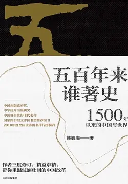

# 元数据

> [!abstract] 五百年来谁著史：1500 年以来的中国与世界
> - 
> - 书名：五百年来谁著史：1500 年以来的中国与世界
> - 作者：韩毓海
> - 简介：本书运用历史唯物主义观点，以“基层组织”“财政金融”“世界大势”为三个支点，重新审视了公元1500年以来的世界历史进程，从地缘政治的变动、财政金融体制和政治变革的角度，重新回答了“李约瑟之谜”——即“近代中国何以落伍”的问题，并进一步指出：理论与现实结合、政治与民众结合、财政金融制度与生产发展和民生结合，乃是中国复兴和中国道路的三个关键点。本书提出了一系列创新观点：诸如“官无封建、吏有封建”，“国家组织能力”，战争国债与资本主义体制，琉球及恰克图贸易对于中国发展的长远意义等，在党政干部、海内外学术界及广大读者中产生了强烈反响，列2010年度全国优秀图书排行榜总榜（《新闻出版报》），并入选《中国高层领导荐书集萃》（山西人民出版社，2010年）和2010年度图书馆文津图书奖推荐图书。
> - 出版时间：2018-07-01 00:00:00
> - ISBN：9787508689043
> - 分类：历史-世界史
> - 出版社：中信出版集团
> - 微信读书评分：77%
> - 阅读进度：0%
> - 阅读时长：11分钟
> - 最后阅读：2026-11-13
> - 微信读书：https://weread.qq.com/book-detail?type=1&v=4c932eb07197b71c4c9501a

# 高亮划线

### 第四节 回首射雕时，万里暮云平

> 📌 清代以来，特别是康熙中叶以降，清军万里西征，行军瓦剌蒙古，山西“八大皇商”[插图]和其他商贩随军贸易，“所带货物，以茶布为主”，目的就是以商利充军需
> ⏱ 2026-11-13 02:35:48

> 📌 雍正八年（1730）的布兰泰奏章中，更有商贩“借名运粮”，实际上是“货多粮少”的奏报，但朝廷依然坚持对进入蒙古地区的商人采取鼓励和保护政策，包括发给写有满蒙汉文的“龙票”，甚至给部分商人封官加爵
> ⏱ 2026-11-13 02:36:23

> 📌 乾隆初年，随着经营资本的不断扩大，旅蒙军需商人开始在张家口、归化和多伦等地区定居下来。沿着这条著名的“张库大道”，他们走向了恰克图，其中最初设于乌里雅苏台（清代设立的管理外蒙和新疆阿勒泰地区的军政机构所在地，即今蒙古国扎布罕省扎布哈朗特）的山西商号“大魁盛”，在光绪年间（1875—1908）已经积累资本白银2 000万两以上，它不但为清军包办军需，而且还为蒙古政权提供财政借款，最终包揽了蒙古地区的税收，以此方式控制蒙古地区
> ⏱ 2026-11-13 02:37:14

> 📌 以恰克图为核心的蒙古经济贸易区就是这样形成的，它是以山西为核心的北方经济贸易区的放大版或“国际版”。1689年，清俄签订《尼布楚条约》，这其实是世界上第一部跨国、跨境贸易法，而不仅仅是一部军事停战协定。雍正五年（1727），清俄再签订《恰克图条约》，此条约一方面划定了两国在西伯利亚地区的边境线，另一方面则根据《尼布楚条约》所奠定的跨国贸易法，规定原属土谢特部的恰克图地方为清俄双方政府认定的互市地点，该城（恰克图）为中俄两国共有的自由贸易区
> ⏱ 2026-11-13 02:38:23

> 📌 清俄两国商人蜂拥而至，随着北方陆上共同市场的不断扩大，特别是在1830年英法大战封锁了欧洲海路之后，欧洲对中国的贸易主要是经过蒙古和俄罗斯这个通道转运的，以恰克图为核心的北方中路贸易，是17—18世纪世界上最主要的大陆贸易商道
> ⏱ 2026-11-13 02:38:37

> 📌 西方人所知道的将世界联系起来的方式，只有战争与传教，欧洲人与外国人和异教徒（中亚穆斯林）之间的关系，只能是敌对的战争关系，而正是在恰克图这个地方，一种新的国际关系准则诞生了
> ⏱ 2026-11-13 02:39:22

> 📌 敌对关系被主客关系或者“宾客关系”替代，中俄在此地互相将对方当作“客人”，恰克图使战场变成了商场，不是战争与传教，而是贸易与互市将辽阔的欧亚大陆联系了起来。康德曾经高度评价这种宾客关系：这就是达成未来“永久和平”的国际法的基础
> ⏱ 2026-11-13 02:39:29
> 💭 康德：《论永久和平》，见《康德著作全集》第八集，中国人民大学出版社，2007年，第363—366页。
> 🕰 2026-11-13 02:39:36

> 📌 《尼布楚条约》和《恰克图条约》在国际法史上具有重要的开创作用，这种作用又主要表现在如下两点。
> ⏱ 2026-11-13 02:40:59

> 📌 第一，它结束了蒙古长期以来的内讧，缔造了蒙古内部的和平，实现了中俄两国的和平，实现了欧亚大陆北方的和平
> ⏱ 2026-11-13 02:40:53

> 📌 第二，《尼布楚条约》更为强调尊重文化、宗教和习俗的多元性
> ⏱ 2026-11-13 02:40:47

> 📌 以法律的名义确定德意志分裂的314个邦国的“主权”，恰恰是《威斯特伐利亚和约》所谓“主权平等”的真正内涵，而《尼布楚条约》却成功避免了蒙古的分裂，维护了蒙古的统一
> ⏱ 2026-11-13 02:40:06
> 💭 英国法学家威廉·特维宁在《全球化与法律理论》一书中较系统地批评了威斯特伐利亚和约体系的缺陷，指出这个体系所奠定的国内法—国际法的二元结构，将洲际法、地区法、非国家的习惯法从法律体系中排除出去，使得法律由对民众的诉求的回应变成了以国家官僚为主体的强制，香港中文大学于兴中教授对此问题也有系统研究，
>
> 参见于兴中：《威斯特伐利亚二重奏、黑箱操作及法学的北强南弱》，《法学家茶座》，2008年，第21辑。
> 🕰 2026-11-13 02:40:41

### 第七节 黄仁宇为什么要讲毛泽东的好话

> 📌 毛泽东和中国共产党改革了中国的农村，创造出一个新的低层结构，使农业上的剩余能转用到工商业。中国今后的趋向，也能从这基础上发展。其目的是根据各地区的条件，使全民就业。
> ⏱ 2026-11-13 02:50:10

> 📌 “桃花扇底说前朝”，我们重讲大明旧事对今天有什么意义呢？这自然是为了提醒我们要努力去认识我们自己的历史，特别是近代以来中国革命的历史与500年历史演化之间的关系
> ⏱ 2026-11-13 02:50:26
> 💭 每种制度都有其生长的土壤
> 🕰 2026-11-13 02:50:34

> 📌 500年来，中国的改革家和仁人志士为了使中国摆脱国家能力衰微的情势，提出了很多重要见解，综合起来，其中就有均田亩、兴民兵、办学校、开财源、简行政，与之相应的，就是要去兼并、限募兵、废科举、理财政、清吏治。从王安石、张居正到康有为、梁启超，都有这样类似的主张。
> ⏱ 2026-11-13 02:51:14

> 📌 只有实行耕者有其田，老百姓为了自己的家和田，才会组织起来“保卫胜利果实”，军队的实力靠的就是农民自己组织起来保家卫国，这才是强军之本
> ⏱ 2026-11-13 02:51:49

> 📌 只有将学问与现实中的经济、财政、司法、军事实践相结合，才能真正塑造有真才实学的一代精英，从而彻底替代地方上的吏和利益集团，这是造就人才的强国之本，而科举只能产生完全脱离现实的废物，它只能使国家日益衰弱。
> ⏱ 2026-11-13 02:51:52
> 💭 科举不论是纵向还是横向比较，都是一种较为公平的考官制度，它的问题在于考试内容高度僵化不在于科举制度本身。真知灼见👍科举是连接底层与上层的通道。
> 🕰 2026-11-13 02:52:10

> 📌 王荆公曾如此赞美《礼记》中的学校制度说：古者井天下之田，而党庠、遂序、国学之法立乎其中。乡射饮酒、春秋合乐、养老劳农、尊贤使能、考艺选言之政，至于受成、献馘、讯囚之事，无不出于学。[插图]
> ⏱ 2026-11-13 02:52:37
> 💭 王安石：《明州慈溪县学记》，见《王文公文集》，集体点校，上海人民出版社，1974年，第405页。
> 🕰 2026-11-13 02:52:46

> 📌 在他看来，周制所代表的“道统”陷于土崩瓦解，乃是国家政治持续衰败的真正原因。作为“先王之制”的周制之瓦解，又主要表现在三个方面：“学术与政治”的分离、“文治与武功”的分离、“官与吏”的分离
> ⏱ 2026-11-13 02:52:50

> 📌 首先，儒生与文吏的分别，本是自古就有的事情，“先秦，尤其是战国历史的发展进程，留下了两大政治文化遗产：专制官僚组织和诸子百家文化。前者的承载者，是一个‘文吏’群体；后者的承载者，则是士人阶层”
> ⏱ 2026-11-13 02:53:54
> 💭 公务员和公知，哈哈哈
> 🕰 2026-11-13 02:54:13

> 📌 所谓“儒生”，最初只是传承礼乐诗书的民间学者；而“文吏”则相当于职业文官，他们的技能是文书、财会和法律
> ⏱ 2026-11-13 02:54:32

> 📌 秦排儒而任吏，西汉则是儒生、文吏并举，我们所谓历史上的“儒法斗争”，其实就是指这两个阶层之间的斗争
> ⏱ 2026-11-13 02:54:37

> 📌 到了东汉之后，“儒生的文吏化”或者“文吏的儒家化”逐步完成，“王霸之道”的融合，使儒生与文吏的对立遂大致宣告结束
> ⏱ 2026-11-13 02:55:02

> 📌 此后中国政治的最大问题，乃是官僚的土族化，或曰贵族垄断官位的问题，即所谓“门阀政治”，而这种贵族垄断官位的问题，经魏晋南北朝的演变，亦终至隋唐时期以科举制的方式得到了解决
> ⏱ 2026-11-13 02:55:08
> 💭 袁行霈、严文明、张传玺、楼字烈主编：《中华文明史》，第二卷，北京大学出版社，2005年，第60页。
> 🕰 2026-11-13 02:55:14

# 章节点评与书评

## 读书笔记

作者好像是跨界的文学家，我个人觉得真正搞历史的反而要认真反思反思，为什么科班眼里的“爱好者”，“门外汉”能够带来更鞭辟入里的观点

> 记录于 2026-11-13 02:33:51

## 读书笔记

碎片化思考凑成的一本书，作者毫无历史学家的严谨，所有观点都是作者（看了某些碎片化的东西之后）想当然说出来的，然后还凑成一段一段，可怕的是上下文没什么关系，叙事逻辑根本就不存在。

可悲的是这书居然卖的不错，可见读者中无逻辑喜欢碎片内容的不在少数。

> 记录于 2026-11-13 02:33:59

## 读书笔记

《五百年来谁著史：1500 年以来的中国与世界》——历史并非宿命。500年来，西方做成的唯一一件伟大的事情就是：唤醒了中国。

1、用社会生产方式的变革来观察和解释历史。治史的三重视野：上看货币财政，下看基层建设，外看世界大势。

2、从地缘看世界交往方式之变迁，从财政金融思考顶层制度之改革，从基层组织研究国家社会组织能力之革命。

3、学问和思想的落脚点在于研究社会制度之发展。世界上并不存在所谓与社会现实相脱离的“独立之精神，自由之思想”。

4、中国之逐步衰落不是由于生产不发展、市场不发达，更不是由于什么“体制干预”过多，而恰恰是由于“体制”的无为、“无力”和低效。一是治理体系与治理能力的脱节；二是货币—财政体系混乱，金融长期依赖外部，货币体系一朝崩溃，财政体系亦随之瓦解。

三是兵农分离，中央与基层脱节。

5、明清两个帝国突然间迅速瓦解的一个最为根本的原因:一个银矿储量高度短缺的国家，竟匪夷所思地选择别的国家所富藏的白银贵金属构建自己的货币和税收体系，并维持300多年不变。

银根的短缺和外流，势必造成周期性的、剧烈的通货紧缩，成为制约明清两朝经济发展最为致命的软肋，而且随着资本主义体制在西方的形成，中国日益由一个货币短缺的国家变成了一个“资本”短缺的国家。

6、所谓“官无封建而吏有封建”，是宋明以降中国政治弊端的核心处。（柳宗元《封建论》:自秦以来，中国政治之缺失，在“政”而不在“制”。）

7、近代欧洲所采用的如下两种方式，恰是中国从来不具备的：其一是国家以发行国债的方式投资战争和殖民（这是英国最常采用的方式），其二则是国家授权公司对外战争和殖民的权力（这是荷兰东印度公司的特征）。

8、没有国家的组织，仅凭市场经济是不可能完成资本的积累和市场的不断扩大的。以为单凭市场经济本身就可以完成市场的扩张和资本积累，无论从中国还是从西方历史上看，都属于无稽之谈。

9、中国是现代世界上唯一一个没有通过剥夺农民的土地，而是通过土地的集体所有制和农民的组织化推动完成工业化的国家。

10、现代民族国家的自我建构:“无权利则不纳税”与“战争税务动员机制”。

11、致力于对战争债务“年金”的管理，这就是现代官僚制度，特别是银行制度的起源。

12、资本产生的最为必要和充分条件是国家借贷并成为永久的需求。雇佣劳动和高利贷利息，这在历史上到处都存在过，它们不可能自然地、自发地发展成为“资本”。

只有当“国家”成为借贷方时，利润和信用才成为可保障的；只有当国家的借贷成为永久的需求时，利润的积累才是可持续的。

13、资本主义起源于金融业而非一般的物质生产和市场经济（资本的真正起源是“债务利息”，资本主义从根本上是一个“债务体系”）。赌博、冒险和作弊。资本主义的基本规则其实是面对市场的习惯机制，而制造一种逆向活动，使得市场以另外的方式或者相反的方式运转。

14、历史乃是人类为争夺生产资料和剩余价值而进行的博弈。

15、在欧洲的现代性条件下，“伦理是不可能的”。从‘自然法’到‘自然权利’再到‘人的权利’的转变过程，也就是西方走向政治虚无主义的过程。”

16、“现代性”不是任何一种历史传统的延续，而是与人类所有文明传统的大断裂，更是欧洲传统自身的大断裂。

17、所谓共产主义，不是指剥夺私人财产，而是使资本成为公共的。

18、资本就是货币化的信用。信贷是对一个人的道德做出的国民经济学的判断。在信贷中，人本身代替了金属或纸币，成为交换的中介，但是人不是作为人，而是作为某种资本和利息的存在。不是货币被人取消，而是人本身变成货币，或者是货币和人并为一体。人的个性本身、人的道德本身既成了买卖的物品，又成为货币存在于其中的物质。

19、“人权”是相对于教权而言的，正是“上帝面前人人平等”这个说法深刻表明，西方“人权”思想的最终根源就是基督教。基督教是贵族阶级的经济学，“基督教国家只知道特权”，而犹太教则是市民社会的经济学，其追求的人权就是私有产权，即“自由这一人权的实际应用就是私有产权这一人权”。

20、“公民权”是相对于国家主权而言的，它的基础则是卡尔·洛维特所谓的“第三等级利益的共同性”，即“公民权”所厘定的其实就是纳税人的权利和国家的义务。

> 记录于 2026-11-13 02:34:23
