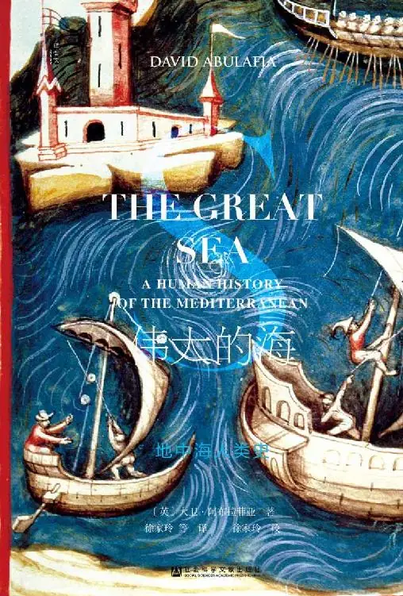

# 元数据

> [!abstract] 伟大的海：地中海人类史
> - 
> - 书名：伟大的海：地中海人类史
> - 作者：大卫·阿布拉菲亚
> - 出版社：社会科学文献出版社
> - 阅读进度：83%
> - 阅读时长：30分钟
> - 最后阅读：2026-11-13
> - 微信读书：https://weread.qq.com/book-detail?type=1&v=70a42513643425f41795942525342526543716b373765373541424668335a685fc

# 高亮划线

### 八 “我们的海”（前146～150年）

> 📌 屋大维在公元前31年获得了公开大胜，不过不是在埃及，而在希腊西北部靠近爱奥尼亚群岛的亚克兴角（Actium）海域
> ⏱ 2026-11-13 14:20:30

> 📌 安东尼拥有更大规模的舰队，拥有通向埃及的畅通无阻的补给线；他所缺少的是那些他视为盟友的人的忠诚。这些盟友在遭遇屋大维战船的包围后就开始逃跑，而安东尼带着四十艘战舰脱围而出，逃回亚历山大。这场战役是否真的规模极大，至今尚无定论，但屋大维却充分意识到了它的宣传价值
> ⏱ 2026-11-13 14:20:39

> 📌 年轻的恺撒，身着闪亮的盔甲，立于船尾，在这里引领着罗马人与他们的神明投入战斗：他所尊奉的宏伟壮丽的神庙将光辉射向远方；看啊，他的头上还悬挂着恺撒的荣耀之星。
> ⏱ 2026-11-13 14:20:45

> 📌 安东尼率领着军队一字排开，遥遥相对，他得到蛮族的帮助，带着东方诸王的军队，有附近的阿拉伯人，远方的巴克特里亚人，讲着各种不同语言的人联合一致参战：身在吵吵嚷嚷的中心，穿着华丽长袍，还有他的厄运——埃及的妻子——在旁追随。
> ⏱ 2026-11-13 14:20:52

> 📌 在早些时候，也就是前129年，埃及国王托勒密八世接待了一支来自罗马的使团，使团由征服迦太基的西庇阿率领。当托勒密八世身着丝绸（可能来自中国）制成的轻薄长袍慷慨地宴请来客时，罗马人感到十分震惊，因为他们透过那衣料不仅可以看到埃及国王肥胖的身躯，还能看到他的生殖器
> ⏱ 2026-11-13 14:58:18

> 📌 西庇阿式的朴素生活在罗马贵族中业已过时。甚至同样简朴的老加图也曾经从航运投资中购买百分之二的股份，将他的资金分散到多次航海活动中，而且他还派遣一名很得他欢心的自由民昆提奥（Quintio）作为他的代理人参与这些航行
> ⏱ 2026-11-13 14:58:11

### 八 “关闭”大议会（1291～1350年）

> 📌 如果我们失去了撒丁岛，随后将失去的就是马略卡岛，因为马略卡岛已经习惯于从西西里岛和撒丁岛获得的食物将不再运达，于是这里将不再有人居住，我们也将失去这块土地。
> ⏱ 2026-11-13 15:30:32

> 📌 热那亚人对于地中海上黑死病的到来有不察之责。腺鼠疫是由蒙古军队而非商人带到热那亚人在克里米亚的商业基地卡法的——蒙古人于公元1347年包围了卡法
> ⏱ 2026-11-13 15:09:19

> 📌 一些意大利人乘船从克里米亚发生的战争中逃出，沿水路进入君士坦丁堡，但是即便他们没有被感染，船上的偷渡者黑鼠也被感染了。这些老鼠喜欢黑海商船上装载的大量谷物，身上有传播瘟疫病毒的跳蚤，船载的大捆布匹商品为跳蚤提供了藏身之处
> ⏱ 2026-11-13 15:10:03

> 📌 肆虐，其市民开始逃离，但他们也是病毒携带者。一艘运载奴隶的船从黑海起航驶向亚历山大，船上有三百人；据阿拉伯历史学者阿里·马克里齐（al-Maqrizi）记载，当这艘船到达亚历山大港时，船上只余四十五人，而且他们也很快就死去了
> ⏱ 2026-11-13 15:10:51

## 第四部 第四地中海（1350～1830年）

> 📌 1381年后，双方细分了各自的贸易范围以及商业利益，以避免产生纠纷：威尼斯保有黎凡特商贸的主要中心，其商船前往亚历山大和贝鲁特购买香料；而热那亚人则更愿意采用圆形商船装载大宗货物——明矾、谷物和干果——并在小亚细亚、希腊和黑海搜罗这些商品；“无籽葡萄干”（currants）的名称就来源于科林斯，而位于黑海南岸的独立的希腊国家特拉布宗（Trebizond）则是榛子的主产地
> ⏱ 2026-11-13 15:02:47

> 📌 1300年前后，雄心勃勃的商业冒险冲动曾驱使热那亚人和威尼斯人深入波斯，甚至远到中国，而此时这种冲动已经消失；商人们致力于恢复横跨地中海的重要联络网
> ⏱ 2026-11-13 15:01:19

### 二 西方的变迁（1391～1500年）

> 📌 这些流亡的犹太人数量众多，更重要的是他们在地中海大部分地区引发的冲击。他们穿过意大利南部，当他们再次遭到驱逐时，就从那里继续分散出去
> ⏱ 2026-11-13 14:37:49

> 📌 有的向北前往比较友善的亲王治下的费拉拉（Ferrara）与曼图亚（Mantua）；其他人则拥向奥斯曼人的辖区，苏丹几乎无法相信，他竟然有如此好运，获得了拥有高级技术的纺织工人、商人和医师
> ⏱ 2026-11-13 14:37:58

> 📌 他们之中有各种拥有精湛技艺的人才，特别是那些被从西班牙和葡萄牙流放并驱赶出来的马拉诺，他们将给基督教世界带来危害与灾难，因为他们把各种用于战争的发明、技术以及机械教给土耳其人，如制作火炮、火绳枪、火药、炮弹以及其他军火；他们还带去了其他地区从未见过的印刷术，通过它，他们可以精美的字母随意印制各种语言的各种书籍，如希腊语、拉丁语、意大利语、西班牙语以及很自然的他们所需要的希伯来语
> ⏱ 2026-11-13 14:41:25

### 八 在俄罗斯人的视角下（1760～1805年）

> 📌 这个时候的俄罗斯人已经拥有了成百上千艘战舰，足以挑战黑海上自负的土耳其人，不过，其舰队还无法发动一场全面海战
> ⏱ 2026-11-13 14:35:49

> 📌 虽然彼得大帝有一段非常著名的经历，曾化名彼得·米哈伊洛维奇（Pyotr Mikhailovich）访问了西欧的造船厂，但俄罗斯人建造的舰船仍很糟糕。总的说来，这支舰队“纪律松弛、训练无序、士气涣散，没有操作经验，管理和装备都很混乱”；时人评论称“俄国海军管理的糟糕程度堪称第一”，因为帝国海军仓库中的大麻、焦油和钉子已经被耗尽
> ⏱ 2026-11-13 14:36:20

> 📌 俄罗斯人开始雇用苏格兰海军将领来帮他们建立现代指挥体系，他们还从英国购买海军所需物资；此外，英国与俄国间的商贸联系也进一步推动了双方的友好关系
> ⏱ 2026-11-13 14:36:34

> 📌 在遥远的东北欧，俄国女沙皇叶卡捷琳娜二世帮助她推举的候选人夺取波兰王位；在追捕反对新王一派势力的过程中闯进奥斯曼的疆域，于是公元1768年，他们发动了俄土战争。
> ⏱ 2026-11-13 15:34:50
> 💭 叶卡捷琳娜大帝在大展宏图时，乾隆皇帝正在享受“康雍乾盛世”
> 🕰 2026-11-13 15:34:59

> 📌 1766年，英国人已经与叶卡捷琳娜缔结商业协议，并坚信在谨慎的操作下，女沙皇叶卡捷琳娜能为其带来丰厚的利润。英国政府认为：俄国海上力量的扩张会增强它对英国的依赖，因为其扩张只有通过英国人的帮助才能实现
> ⏱ 2026-11-13 15:35:40

> 📌 英国政府还相信，如果俄罗斯人对土耳其人的胜利没有阻止法国人的话，那么法国商人最终也会进入黑海。英国人的政治意识当中首次出现了代理人战争的概念，即俄国的舰队将肃清地中海上那些威胁英国利益的势力
> ⏱ 2026-11-13 15:35:57

### 三 奥斯曼退出地中海（1900～1918年）

> 📌 地中海的历史已经被分成相互联系的各个阶段，并被呈现于本书中，在这些阶段中，地中海或多或少地融为单一经济区乃至政治区
> ⏱ 2026-11-13 14:34:23

### 六 碎片化的地中海（1945～1990年）

> 📌 继任的马耳他政府对遗留问题头痛不已，因为他们不知道该如何开发利用不再有英国舰队出没的大海港。海岛的不结盟地位意味着苏联舰队无法从马耳他获得多少利益。但随着与苏联的关系恶化到意识形态方面的论战，中国人开始看到了机会。渺小的马耳他和庞大的中华人民共和国正式建立了外交关系，中国人投资了对马耳他干涸码头的改造工程
> ⏱ 2026-11-13 14:59:37

> 📌 截至20世纪70年代末，中国一直享有使用阿尔巴尼亚海上军事设施的权利，阿尔巴尼亚是中国亲密的欧洲盟友，现在，它乐意拒绝向莫斯科的“修正主义社会法西斯分子”提供设施
> ⏱ 2026-11-13 14:59:44

### 七 末代地中海（1950～2014年）

> 📌 20世纪后期是地中海移民的大时代之一。前面的章节已经论述了来自北非和进出以色列的移民
> ⏱ 2026-11-13 14:22:14

> 📌 西西里和南意大利的移民史始于19世纪后期，移民者主要前往北美和南美。20世纪50年代和60年代，移民转向了北意大利城镇。被忽视、缺乏投资的南意大利农业随着农庄的废弃而继续衰落
> ⏱ 2026-11-13 14:22:38

> 📌 在其他地区，殖民联系是重要的。例如，英国对塞浦路斯的统治就将大量的希腊和土耳其社群带到伦敦北部地区。和这些移民一起到来的是他们的烹饪：20世纪70年代，比萨饼在伦敦风行，且英国的希腊餐馆有了塞浦路斯风味
> ⏱ 2026-11-13 14:23:07

> 📌 不足为奇的是，南意大利的食物在意大利移民中占据着主导地位：20世纪70年代之前，热那亚酱汁面条这一热那亚烹饪法的卓越创造在意大利之外，或者更确切地说是在利古里亚之外，鲜为人知
> ⏱ 2026-11-13 14:23:28

> 📌 这些新移民的一个重要特点是穆斯林占主导地位，这引发了有关建立清真寺的争论。这一旧的敏感话题，或者说偏见，在安达卢西亚和西西里依旧显眼；但时常出现的极端主义者索取之前所有的伊斯兰土地，包括安达卢斯，以图恢复一个新的哈里发领土国家，这无疑是火上浇油
> ⏱ 2026-11-13 14:28:59
