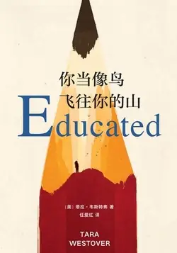

# 元数据

> [!abstract] 你当像鸟飞往你的山
> - 
> - 书名：你当像鸟飞往你的山
> - 作者：[美]塔拉·韦斯特弗
> - 译者：任爱红
> - 简介：奇迹！一部新人首作，上市第一周即登上《纽约时报》畅销榜，至今已累计80周，仍高居No.1，全美销量破百万册，作者被《时代周刊》评为“年度影响力人物”。17岁前从未上过学的女孩，如何成为剑桥大学博士？我们要背叛多少曾经，才能找到真正的自我！ 比尔·盖茨年度荐书 No.1
> - 出版时间：2019-11-01 00:00:00
> - ISBN：9787544276986
> - 分类：文学-散文杂著
> - 出版社：南海出版公司
> - 微信读书评分：87%
> - 阅读进度：0%
> - 阅读时长：6分钟
> - 最后阅读：2026-11-10
> - 微信读书：https://weread.qq.com/book-detail?type=1&v=8b832b5071979d0b8b86c0d

# 高亮划线

### 卖花女

> 📌 剑桥大学国王学院第一次映入眼帘时，我并没觉得自己是在做梦，但这只是因为我的想象从来不曾创造出如此宏伟壮观的东西
> ⏱ 2026-10-21 11:20:06

> 📌 我的目光落在一座石雕钟塔上。我被带到钟塔前，然后穿过它进入学院。一大片修剪完美的草坪环绕着湖泊，湖对面是一座象牙色的建筑，我隐约认出是希腊罗马式风格。但它是一座哥特式教堂，长三百英尺，高一百英尺，宛若一座石山，主导了全部的风景。
> ⏱ 2026-10-21 11:20:15

> 📌 “太不可思议了，”他微笑着说，“我好像走进了萧伯纳的《卖花女》[插图]。”
> ⏱ 2026-10-21 11:28:13

### 全能上帝之手

> 📌 一扇石门挡住了三一学院的入口，石门上还有一扇小木门
> ⏱ 2026-10-20 20:34:26

> 📌 。“消极自由，”他说，“是不受外部限制或阻碍的自由。此种意义下的自由指一个人的身体不受他人阻碍地行动。”
> ⏱ 2026-10-20 20:34:40

# 章节点评与书评

## 读书笔记

原生家庭塑造你的起点，但绝不决定你的终点；真正的救赎，从来不是别人的拯救，而是自我的教育与觉醒。

作者塔拉从小生活在闭塞偏执的大山家庭里。父亲拒绝现代医学、否定学校教育，固执地认为“大学是蠢笨之人的补习所”。在他扭曲的价值观里，世俗的知识、科学、求学之路，不过是不值一提的“一碗破汤”，而坚守愚昧的信仰，才是人与生俱来的高贵权利。一旦塔拉渴望求知、渴望走出大山，就会被定义成背叛家庭、出卖天赋的不孝者。

这种精神禁锢，是困住塔拉多年的无形牢笼。

书中最让我触动的，是那段关于车祸与命运的感悟。年少的灾难看似偶然，实则是无数选择堆叠的结果。沙粒不可计数，叠压成沉积物，然后成为岩石。原生家庭的每一句偏见、每一次否定、每一种偏执认知，都是一粒细沙，长年累月堆积，最终凝成坚硬厚重的命运枷锁。我们眼中突兀的人生困境，其实早已在无数个日常里埋下伏笔。

塔拉的伟大，在于她没有被既定的命运同化。在家人愚昧、暴力、否定的环境中，她靠着自学走出大山，走进剑桥殿堂。她的蜕变让我读懂：教育不是填充知识，而是重塑认知、重构人格、重启人生。它让我们拥有审视过往的能力，敢于推翻错误的原生思维，分清愚昧与真理、偏执与正义。

成长最痛也最珍贵的地方，是与过去割裂、与至亲解绑。塔拉最终与原生家庭渐行渐远，不是无情，而是自救。当旧的山川禁锢灵魂，人就必须像飞鸟一样挣脱桎梏，奔赴属于自己的山海。所谓“飞往你的山”，不是逃离故乡，而是在精神世界重建一座清醒、独立、自由、正直的属于自己的山。人生最大的幸运，是拥有自我救赎的勇气。

环境可以局限眼界，但不能禁锢思想。往后我愿以教育为羽翼，以清醒为底气，不被固有认知束缚，不被他人定义人生，勇敢奔赴属于自己的山河，活成独立、明亮、自由的自己。

> 记录于 2026-11-10 09:57:03
