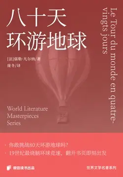

# 元数据

> [!abstract] 八十天环游地球
> - 
> - 书名：八十天环游地球
> - 作者：[法]儒勒·凡尔纳
> - 译者：庞冬
> - 简介：最疯狂的赌约遇上分秒必争的环球冒险！
>   19世纪伦敦绅士福格与牌友立下惊世赌约——80天环游地球。
>   这位精准如钟表的绅士带着新雇的法国仆人，揣着两万英镑赌金，踏上了蒸汽时代的疯狂旅程。
>   从苏伊士运河到印度平原，神秘警探如影随形，意外频发的时间赛跑中，冷静与混乱碰撞出令人屏息的化学效应。
>   这不是简单的旅行日记，而是一场颠覆认知的时空博弈，当秒针划过第115200分钟，赌局终章将揭开人类对速度与可能性的终极想象。
> - 出版时间：2025-05-23 00:00:00
> - 分类：文学-经典作品
> - 微信读书评分：88%
> - 阅读进度：0%
> - 阅读时长：6分钟
> - 最后阅读：2026-11-13
> - 微信读书：https://weread.qq.com/book-detail?type=1&v=8b5326d0813ab9f46g013472

# 高亮划线

## 第一章 菲利亚·福格雇用万事通

> 📌 光看他的脑袋，有人将他比作诗人拜伦[插图]，低头再瞧瞧则不禁哑然，福格可不像拜伦是个瘸子。
> ⏱ 2026-11-13 03:00:35
> 💭 拜伦（1788—1824），英国浪漫主义诗人，代表作品有《恰尔德·哈洛尔德游记》、《唐璜》等，并在他的诗歌里塑造了一批“拜伦式英雄”。他不仅是一位伟大的诗人，还是一个为理想战斗一生的勇士，积极而勇敢地投身革命——参加了希腊民族解放运动，并成为领导人之一。
>
> 文章开头描述福克先生的外貌时，说到有人说他像拜伦，只是脚长得不像而已。拜伦出生时右足畸形，落下残疾，终生跛足，而福克先生四肢健全，所以才有脚长得不像一说。另外，从1809－1811年，拜伦出国作东方的旅行，途经葡萄牙、西班牙、土耳其等国家，这与本书中福克先生后面的环球旅行也遥相呼应。
> 🕰 2026-11-13 03:01:32
> 💭 一想到拜伦也被母亲嘲讽，我倒是很坦然了⊙﹏⊙
> 🕰 2026-11-13 03:01:27

## 第十四章 福格穿过美丽的恒河山谷，却无心看风景

> 📌 香港位于中国南海边上，却是一座地道的英国化城市。
> ⏱ 2026-11-13 05:03:57

## 第十六章 菲克斯大智若愚

> 📌 菲克斯警探把全部的希望都寄托在了香港，因为轮船在新加坡停留的时间太短，无法开展行动，因此必须在香港抓到这个盗贼，否则他将永远地逃脱了
> ⏱ 2026-11-13 05:04:31

> 📌 香港是福格旅程中最后一块英国殖民地[插图]，出了香港，菲克斯将无计可施，中国、日本、美国都可能成为福格的良好避难所。如果逮捕证可以到达香港，菲克斯就可以理所应当地逮捕福格，并交到警官手中。这一切都将顺理成章
> ⏱ 2026-11-13 05:04:44
> 💭 1997年7月1日，香港回归中国。
> 🕰 2026-11-13 05:04:59

> 📌 一旦他们离开了香港，只有一张逮捕证是不行的，还需要办理引渡证明，这中间会耽误不少时间，会给他们的逃跑带来极大的便利。所以，如果不能在香港将他们绳之以法，之后将很难抓到他们了。
> ⏱ 2026-11-13 05:04:48

## 第十七章 从新加坡到香港的旅途见闻

> 📌 离开新加坡后，“仰光”号简直人满为患。在新加坡又有很多人上了船，他们里面有印度人、斯里兰卡人、中国人、马来西亚人以及葡萄牙人，不过大多数都在二等舱。
> ⏱ 2026-11-13 05:04:13

## 第二十五章 旧金山大会走马观花

> 📌 旧金山的街道像棋盘一样整齐，以至于每个拐角都是90°的直角。在一些街道中间，还设有芳草茵茵的街心花园，供人们流连游憩。前面还有一个唐人街，它就像是一个被从中国运来的原汁原味的中国街道
> ⏱ 2026-11-13 05:06:11

> 📌 如今，旧金山再也找不到头戴宽边大毡帽的西班牙人，也没有身穿红色衬衫的淘金者，那些头扎羽毛的美洲印第安人更是消失得无影无踪，唯有不计其数身穿深黑礼服、头顶丝织帽子的绅士们徜徉其间
> ⏱ 2026-11-13 05:06:14

> 📌 以蒙哥马利大街为例，街道两旁奢侈品商店林立，兜售着来自世界各地种类繁多的商品。这样的繁荣程度，几乎可以与伦敦的瑞金大街、巴黎的意大利人街和纽约的百老汇大街相媲美
> ⏱ 2026-11-13 05:06:22

> 📌 饭后，福格携阿妩达离开饭店，前往英国领事馆办理签证。临行前，万事通询问福格是否需要购买几把马枪或手枪，以备不时之需。福格纳闷万事通怎么有这个提议，万事通赶紧向他解释。原来传闻一些西乌人[插图]和波尼人[插图]经常在这段铁路线上抢劫火车，他们手法专业娴熟，就像普通的西班牙小偷一样。福格觉得购买枪支有些多此一举，不过他让万事通自己看着办。说完，福格就离开了。
> ⏱ 2026-11-13 05:07:02
> 💭 波尼人，北美印第安人，法国人称其为帕尼人，他们生性好斗，十分仇恨西班牙人。
> 🕰 2026-11-13 05:07:44
> 💭 西乌人，北美印第安人，包括7个部落，原居住在大湖区，自17世纪起，移居西部平原。
> 🕰 2026-11-13 05:07:13

## 第二十六章 乘坐太平洋铁路快车

> 📌 “一线通两洋”，这是美国人对这一条从太平洋到大西洋横贯美国东西的铁路大动脉的总称
> ⏱ 2026-11-13 05:08:17

> 📌 实际上，太平洋铁路是由两段不同的铁路线组成的：旧金山到奥格登这一段属于“太平洋中央铁路公司”，从奥格登到奥马哈这一段则属于“太平洋联合铁路公司”
> ⏱ 2026-11-13 05:08:21

> 📌 奥马哈到纽约有5条不同的线路，车次很多，而且交通便利
> ⏱ 2026-11-13 05:08:24

> 📌 所以，现在有一条3786英里长的完整铁路线，将纽约和旧金山联结起来了。从奥马哈到太平洋海岸这一段，铁路需要穿过一片至今还有印第安人和野兽经常出没的区域
> ⏱ 2026-11-13 05:08:38

> 📌 大约在1845年，摩门教徒[插图]被赶出伊利诺伊州以后，就开始在这里建立殖民地
> ⏱ 2026-11-13 05:08:54
> 💭 美国基督新教的一个教派，1830年由美国的约翰·史密斯(1805—1844)创立。1844年史密斯遭暗杀后，该教一度实行多妻制，后遭反对而废止。
> 🕰 2026-11-13 05:09:01

# 章节点评与书评

## 读书笔记

从昨天到今天早晨，我花了五个多小时，一口气读完了这本 13 万字的长篇小说《八十天环游地球》。

过瘾！ 非常过瘾！！超级过瘾！！！

法国作家的想象力从未让读者失望过。

赶在上班前的最后一分钟，我合上了书页。然而，因为沉浸在故事中，我误将洗衣机里的白 T 恤和其他颜色衣服进行高温混洗，串色了。可我竟觉得开心不已，仿佛花一件衣服的钱买到了两件，白 T 恤变成了粉色，还别有一番美感，好看！

早晨出门，我站在夏日的阳光下，舒展双臂，合上双眼，内心满是欢愉与满足，默默向生命中遇见的每一个人表示感谢与致敬。正因为有了你们，我的生命才如此丰富多彩，让我乐此不疲。

这已经是第二次产生这种强烈的满足感了，上一次是在读《基督山伯爵》的时候。不过，《八十天环游地球》里的很多情节让我觉得似曾相识。

小说的主人公福格，与牌友立下惊世赌约——80 天环游地球，踏上了一场分秒必争的环球冒险之旅。他一路“升级打怪”，路见不平拔刀相助，途中更是遇到了一生所爱阿妩达。福格身边有一位忠心耿耿的年轻仆人万事通，他如同《基督山伯爵》里的阿里一样，始终专心护主，对主人忠心不二。

此外，还有一个像雨果《悲惨世界》里沙威那样的警探，误将福格当成盗贼，从第一天到最后一天，一直追捕却从未得逞。

最终，故事以圆满的结局收场。主人公福格爱情、赌局双丰收，堪称人生赢家，既赢得了美人，又赢得了天下。

这并非一本简单的旅行日记，而是一场颠覆认知的时空博弈。当秒针划过第 115200 分钟，赌局终章将揭开人类对速度与可能性的终极想象。

翻开小说的路线图，孟买的庙宇、香港的码头、横滨的街巷依次展开，宛如一幅 19 世纪的环球风情画卷。凡尔纳让福格的皮鞋踏上不同文明的土地：

在印度，火葬仪式的肃穆与骑大象代步的奇遇相互交织，形成强烈张力。在美国，印第安人的突袭与太平洋铁路的现代性碰撞出绚烂火花。

这些细节并非地理教科书的枯燥复刻，而是以冒险家的视角，赋予每个国家以生命力，让它们成为有呼吸的、独一无二的存在。

然而，真正的环游远不止是空间的迁移。福格从“精确到秒的机器”逐渐蜕变为懂得为爱停留的凡人，仆人万事通从冒失的随从成长为能够化解危机的得力助手，甚至连固执的侦探菲克斯也在追逐过程中，读懂了“正义”的多重维度。

当他们推开伦敦俱乐部大门的那一刻，怀表指针正好停在约定时刻之前，时间不再是束缚人的枷锁，而是见证了灵魂成长的刻度。

我觉得这才是《八十天环游地球》最动人的隐喻：

【我们穿越世界，最终是为了穿越自己】

此刻我突然意识到，每一个认真生活的人，其实都在以自己的方式环游地球，用热爱丈量生命的半径，用勇气突破时区的界限。最终，我们会明白，所谓的“八十天赌约”，从来都是人类写给世界的一封动人情书～

🌼🌼🌼

最后的最后，关于这本书的延伸阅读，我推荐大家也去看看

📖雨果《悲惨世界》

📖大仲马《基督山伯爵》

📖凡尔纳《海底两万里》

📖凡尔纳《格兰特船长的儿女》

📖凡尔纳《神秘岛》

📖凡尔纳《气球上的五星期》

📖凡尔纳《地心游记》

📖村上春树《当我谈跑步时我谈些什么》

📖小鹏《背包十年》

📖张勇《伪装者》

📖海宴《琅琊榜》

> 记录于 2026-11-13 03:00:08
