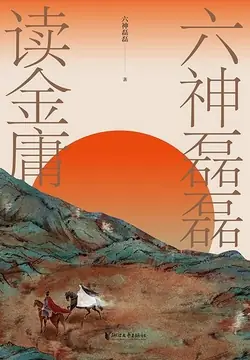

# 元数据

> [!abstract] 六神磊磊读金庸
> - 
> - 书名：六神磊磊读金庸
> - 作者：六神磊磊
> - 简介：我们读金庸，往往会沉浸在高深的武功和紧张刺激的情节中去。而有这样一个了不起的金庸粉丝，读懂了金庸先生烛照人性、洞察幽微的关怀，读出的是一代文豪对世人的“悲悯”，又用一副铁肩担起“惩恶扬善”的道义，用一支辛辣犀利的笔继承了先生”怜我世人”的事业。他，就是我们热爱的六神磊磊。金庸先生的作品总是映照时代，用精彩的故事去启发人们对现实的思考。六神磊磊将金庸先生的作品进行细致入微地解读和剖析，带我们去读金庸，引导着我们去思考：为什么东方不败不杀任盈盈？曼陀山庄的茶花怎么总是养不活？
> - 出版时间：2021-09-01 00:00:00
> - ISBN：9787533964825
> - 分类：文学-文学鉴赏
> - 出版社：浙江文艺出版社
> - 微信读书评分：80%
> - 阅读进度：3%
> - 阅读时长：26分钟
> - 最后阅读：2026-11-09
> - 微信读书：https://weread.qq.com/book-detail?type=1&v=e1c32cb07273aee3e1c6848

# 高亮划线

## 封面

> 📌 六神磊磊将金庸先生的作品进行细致入微地解读和剖析，带我们去读金庸，引导着我们去思考：为什么东方不败不杀任盈盈？曼陀山庄的茶花怎么总是养不活？
> ⏱ 2026-11-08 19:03:27

## 序言 不再心中一荡，谁来怜我世人

> 📌 金庸小说，有两句纲领性的、灵魂的话。第一句叫作：为国为民，侠之大者。
> ⏱ 2026-11-08 19:04:12
> 💭 昨晚，正在看脱口秀大会总决赛的时候，忽然收到微信读书的提醒，六神的新书上架了。一时有点小激动：六神还在全国飞来飞去做签售，一众大咖张佳玮等等还在发文公推，这边微信读书的电子版就上线了？
>
> 在金庸江湖，用微信读书，得六神秘籍，何其有幸！
> 🕰 2026-11-08 19:04:28

> 📌 金庸小说的第二句话，叫作：怜我世人，忧患实多。
> ⏱ 2026-11-08 19:04:33
> 💭 "生亦何欢，死亦何惧，喜乐忧愁，皆归尘土，怜我世人，忧患实多"
>
> 是从佛教教义中演化出来的,佛教对生死的看法，佛教以“乔迁之喜”来形容生死，房子旧了必须搬一个新居，衣服破了应该换一件新衣，身坏命终也会赋予另一个新的躯壳。因此，生，未尝可喜；死，也未尝可悲。
> 🕰 2026-11-08 19:04:55

> 📌 金庸的书，常常怜世人。而且越到后期越是这样，无人不冤，有情皆孽，人人可悯。笔下的一切人物，一切个体，都是怜的对象。
> ⏱ 2026-11-08 19:07:22

> 📌 乃知兵者是凶器，圣人不得已而用之。
> ⏱ 2026-11-08 19:07:50

> 📌 你可曾见过边关之上、宋辽相互仇杀的惨状？可曾见过宋人辽人妻离子散、家破人亡的情景？宋辽之间好容易罢兵数十年，倘若刀兵再起……你可知将有多少宋人惨遭横死？多少辽人死于非命？
> ⏱ 2026-11-08 19:08:11
> 💭 世界上有这么个国家，建国才200多年，几乎年年都在打仗，要么是内战风云，要么对外侵略，却被大殖子奉为灯塔。希特勒、东条、萨达姆、金日成、卡扎菲、本拉登等人：嫩说的可太中啦，灯塔国不该打俺们，俺们最爱和平啦
> 🕰 2026-11-08 19:08:44

> 📌 这些人对现实心灰意懒，看不到出路，想选择逃避，希冀能够金盆洗手、“笑傲江湖”。
> ⏱ 2026-11-08 19:09:06

> 📌 有被复仇扭曲了的，比如林平之。有被爱情扭曲了的，比如游坦之、阿紫、何红药。有被权力扭曲了的，比如任我行、东方不败、洪教主
> ⏱ 2026-11-08 19:09:27

> 📌 金庸拒绝让他们做天生妖魔，他笔下更多的是一个个有扭曲的原因、有反思的价值、有滑落的轨迹的个体。
> ⏱ 2026-11-08 19:09:29

> 📌 眼下金庸挥手走了，辞别了凡间的光明顶，去了天界的坐忘峰，收走了郭襄的眼泪，挥散了华山的烟云。真的想问问他：绿竹巷和蝴蝶谷在哪里？独孤九剑究竟怎么练成？风清扬真能生存得下去？笑傲江湖的事，到底有没有？
> ⏱ 2026-11-08 19:09:59

## 关于《射雕英雄传》《神雕侠侣》

> 📌 回看射雕处，千里暮云平
> ⏱ 2026-11-08 19:10:06
> 💭 风劲角弓鸣，将军猎渭城。
>
> 劲风吹过，绷紧的弓弦发出尖锐的颤声，只见将军正在渭城郊外狩猎。
>
> 草枯鹰眼疾，雪尽马蹄轻。
>
> 秋草枯黄，鹰眼更加锐利；冰雪消融，飞驰的马蹄格外轻快。
>
> 忽过新丰市，还归细柳营。
>
> 转眼已经路过新丰市，不久之后又骑着马回到那细柳营。
>
> 回看射雕处，千里暮云平。
>
> 回首观望方才纵横驰骋之处，傍晚的云层已与大地连成一片。
> 🕰 2026-11-08 19:10:35

## 从伟大武功到伟大公公

> 📌 不妨从时间最早的《天龙八部》的北宋说起，看看这段七百年的退化和缩阳史是如何发生的。
> ⏱ 2026-11-08 19:11:23

> 📌 第一个叫琅嬛玉洞，是逍遥派开设的；第二个叫还施水阁，是慕容家开设的；第三个叫藏经阁，是少林派开设的
> ⏱ 2026-11-08 19:11:46

> 📌 开办和经营这三个图书馆的，恰好一个是儒家——慕容氏，一个是道家——逍遥派，一个是佛家——少林派。
> ⏱ 2026-11-08 19:12:08

> 📌 先说开办了“还施水阁”的姑苏慕容家。
> ⏱ 2026-11-08 19:12:28

> 📌 那男子约莫四十岁上下，相貌俊雅，穿着书生衣巾。
> ⏱ 2026-11-08 19:12:44

> 📌 慕容博此人不但外表是个书生，在内心理念上也是个儒家积极用世理念的践行者，志在修齐治平。他家世代梦想兴复早已灭亡的故燕国，哪怕复国的成功率几乎是零，也仍然知其不可而为之。
> ⏱ 2026-11-08 19:14:44
> 💭 故燕，是五胡十六国时期鲜卑慕容氏建立的四个燕国：前燕、后燕、西燕、南燕。
>
> 其中，慕容皝建立前燕，慕容垂建立后燕，慕容泓建立西燕，慕容德建立南燕。
>
> 此外，当时还有一个北燕，由汉人冯跋实际控制
> 🕰 2026-11-08 19:13:51
> 💭 可怜了慕容复，原生家庭教育失败的产物，身负复国重压，最终疯魔。
> 🕰 2026-11-08 19:13:48

> 📌 在当时的江湖，作为儒生的他武学思想也最为桀骜，提倡夫子所谓的“以直报怨”，其核心武学精神是一句话——“以彼之道，还施彼身”，即“用你的办法来弄死你”。这可以说是当时江湖里最阳刚，甚至是最极端和偏激的武学思想。
> ⏱ 2026-11-08 19:15:00
> 💭 “以彼之道，还施彼身”，即“用你的办法来弄死你”
> 🕰 2026-11-08 19:15:12

> 📌 到了南宋，生于公元1170年前后的黄药师成为了金庸江湖里最后一个武功达到绝顶境界的书生。
> ⏱ 2026-11-08 19:15:56

> 📌 让我们记住黄药师的形象——“穿一件青色直裰，头戴方巾，是个文士模样”。这是武侠史上最后一个伟大的文士形象，是传统文士在江湖最高殿堂上的绝唱
> ⏱ 2026-11-08 19:16:12

> 📌 自黄药师之后的那些文士高手，无论杨逍、张翠山、陈家洛还是余鱼同，不管他们再如何风流机巧，终究都不是最顶尖的人物了。
> ⏱ 2026-11-08 19:16:07

> 📌 在儒家武士的一角塌陷沉沦的同时，大约公元1160年，随着一个叫黄裳的人以《万寿道藏》为基础，撰出了一本叫《九阴真经》的巨著，道家的武士迎来了辉煌的时代。
> ⏱ 2026-11-09 00:51:58

> 📌 ，他创立的全真教成为武林第一门派，他本人也成为无可置疑的天下第一高手，于华山论剑时独魁群雄，在“射雕三部曲”中留下一个高不可攀的背影。
> ⏱ 2026-11-09 00:52:15

> 📌 他创造的武学叫作“空明拳”，号称“天下至柔”，已经够萎靡的了。但这还远非极端，再下一任的道家领袖乃是张三丰，发明了比“空明拳”还要更痿的“太极拳”，把画圈圈、搅浑水、和稀泥的功夫推向另一高峰。
> ⏱ 2026-11-09 00:52:58
> 💭 转：这篇文章其实在说中国男性刚强性格的蜕化，六神磊磊的解读金庸系列文章，金庸小说只是壳子，里子还是解构中国社会现象，解读金庸小说前他原本预备解读新闻联播，新闻联播不允许解构，才去解读金庸小说。
> 🕰 2026-11-09 00:53:41

> 📌 张无忌……双手成圆形击出……随即左圈右圈，一个圆圈跟着一个圆圈，大圈、小圈、平圈、立圈、正圈、斜圈，一个个太极圆圈发出，登时便套得阿三跌跌撞撞……犹如中酒昏迷。
> ⏱ 2026-11-09 00:53:57

> 📌 有一次，张三丰的徒弟俞莲舟偶然创出了一门峻烈的武功，叫作“虎爪绝户手”，专门抓人的腰部。
> ⏱ 2026-11-09 00:54:32

> 📌 而百十年过去，如今连远为温柔的插人腰眼的“虎爪绝户手”都觉得太刺激了。
> ⏱ 2026-11-09 00:54:34
> 💭 废话，因为你恶狠狠弄别人，别人肯定要来弄你啊，张三丰看透了呗，咋能说一代不如一代呢
> 🕰 2026-11-09 00:55:06

> 📌 在“痿”的道路上，金庸的佛家武士比道家走得更远——你道家不是还遮遮掩掩地说什么“虚胜实”“不足胜有余”吗？我佛家武学干脆连遮羞布也不要了，干脆挨打不还手、唾面任风干，看你能痿过我？于是便有了《九阳真经》里著名的口诀：他强由他强，清风拂山冈。他横任他横，明月照大江。
> ⏱ 2026-11-09 00:55:25
> 💭 这叫委？他强由他强，清风拂山岗，我也有自己的自存之道，他恶任他恶，明月照大江，我仍然可以不畏不惧，静看月光铺满江面，他自狠来他自横，我自一口真气足，恶人又能奈我何？这不是逃避，不是委顿，而是自强不息，是自己的节奏，不被恶人狠人横人所欺所改。
> 🕰 2026-11-09 00:55:42

> 📌 这几句话因为太有名，甚至频频被人误栽在了历史名人的头上，拿来炖心灵鸡汤，却不知这其实是金庸小说里的武术口诀，就是要人内心平静地接受一切恶意，任由别人捶打。这几句话其实还不算是《九阳真经》里最萎靡的，更萎靡的是后面一句“他自狠来他自恶，我自一口真气足”，别人打我一拳，我只原地做深呼吸。
> ⏱ 2026-11-09 00:56:04
> 💭 我觉得不是越来越萎，是逐渐意识到，太刚的武功气数不会太长。天子以仁治取代了攻伐，后来的武功路数逐渐走的是仁的套路。若用残忍的手法弄死对手，对方的亲人兄弟必然会来寻仇，干戈不断，纠缠不休，但如果能不消灭人肉体，而从精神上赢得对方尊重，就能以武止戈。
> 🕰 2026-11-09 00:56:28

> 📌 每读到这句话，总想起在这之前百年的宋代，中原人民曾经自嘲：“金兵有狼牙棒，咱们有天灵盖。”这曾是一句无比辛酸的笑话，正所谓“遗民泪尽胡尘里，南望王师又一年”，听之让人泪下。没想到过了百十年，经过一番包装，一句辛酸的笑话居然摇身一变，成了正统的武学思想。
> ⏱ 2026-11-09 00:56:53
> 💭 神功逐渐退化为武功，武功慢慢演变为无功。从古代到现代，金先生的小说结合着历史，仿佛真实的世界一般。
> 🕰 2026-11-09 00:57:20
> 💭 金庸武侠世界，武功一代不如一代，人一代更比一代萎。这个点非熟读不知呀。原因呢
> 🕰 2026-11-09 00:57:17

> 📌 或许你觉得《九阳真经》的“挨打不还手、只做深呼吸”已经是武人退化的极致，已退无可退了。实则不然。
> ⏱ 2026-11-09 00:57:29

> 📌 在武学进化的加拉帕戈斯群岛上，经过伟大的自然选择，一种更神奇的武人终于出现了。他们踏过了狂躁的儒家武士、谦退的道家武士、自虐的佛家武士，登上了武学江湖的王座，他们的名字叫作阉人。金庸武侠史上从此出现了儒、释、道三教之外的第四个教派——阉教。一件本人的生殖工具，是加入这个教的投名状。
> ⏱ 2026-11-09 00:57:57
> 💭 投名状在古代边缘群体用于增强团体内聚力，表达对个人、组织的忠心，有强烈的人生依附性和反社会倾向，通常意思是以非法行为做保证（投名状）而加入非法团体。投名状是加入非法团体的表示忠心的保证书。
> 🕰 2026-11-09 00:58:09

> 📌 翻开腥臊味扑鼻的《笑傲江湖》，我们惊讶地看到，在《天龙八部》江湖的数百年后，一群没有男性特征的人成了武学的最高统治者。
> ⏱ 2026-11-09 00:58:42

> 📌 这种事情从无先例。回首过去历史上的那些武圣，从扫地僧到独孤求败，从黄裳到张三丰，不论他们如何修持禁欲，至少身体都是完整的。他们也是有爱欲的，王重阳可以和林朝英“二仙此相遇”，张三丰也可以惦记着明慧潇洒的郭襄，怀揣一份美好向往。
> ⏱ 2026-11-09 00:58:39

> 📌 可在明代的《笑傲江湖》里，阉人完全呈压倒性优势，健全人十分无力。你看那个江湖上儒家武士最高成就的代表岳不群，战斗力也就是七十分出头，备受欺辱和压制。为了攀登武学新高峰，岳老师一咬牙，背着老婆交了投名状，变身为超级赛亚阉人，顿时打遍五岳剑派无敌手。
> ⏱ 2026-11-09 00:59:01

> 📌 可不论左老师是佛是道，都是过时的明日黄花，一遇到加盟了阉教的岳不群，立刻被戳瞎了狗眼——此处用语绝非夸张，在小说中他是真的被戳瞎了眼。
> ⏱ 2026-11-09 00:59:22

> 📌 回望千年，真真恍然一梦。当年的阳刚和雄猛已经随风散去，那个江湖上已经没有了伟大的武功，只剩下一些伟大的公公。
> ⏱ 2026-11-09 00:59:57
> 💭 要是从创作逻辑来分析，金庸老爷子怕是没有这么多考虑，至高无上的神功之所以一部一个理念，纵横江湖的高手之所以一年一个代表，无他，新鲜感。
>
> 传统正面高手陈家洛、袁承志、郭靖写过了，就写桀骜不驯、放荡不羁的杨过、令狐冲，近乎完人的黄老邪写过了，就写有生理缺陷的东方不败、林平之。一如古龙小说里面最顶尖的高手往往都是不起眼的小人物一样，核心理由是相同的，即出其不意，去旧迎新，始终保持小说的新鲜感。
> 🕰 2026-11-09 01:00:23
> 💭 哈哈哈哈哈，确实。从乔峰，郭靖，杨过，令狐冲，到东方不败，岳不群，林平之……越来越娘了，跟现在的娱乐圈似的，原来偶像都是成龙，李连杰，施瓦辛格，杰森斯坦森，最不济也是阿汤哥，德普。现在都是练习2年半的练习生，粉底液将军，还有一群不知道名字的好汉，哎，江河日下，江河日下。
> 🕰 2026-11-09 01:00:18

## 华山论剑和家族政治

> 📌 华山论剑大概是二十五到三十年一期，它代表了南宋末年的武学巅峰，也是整个金庸小说历史上后无来者的盛事。后来江湖上再也没有组织起影响力这样大、品牌这样响亮的顶级峰会了。
> ⏱ 2026-11-09 01:00:47

> 📌 我们从第一次论剑说起。它的大背景是宋金两国相持，一个北伐未举，一个南侵无力。那时的江湖正在进行重组和新生，可谓是山头林立，派系众多。四方豪雄像野草般恣意生长，跑马圈地，重新划分势力范围，充满了一种“榛榛莽莽、天地初辟”的自由气息。
> ⏱ 2026-11-09 01:01:03

> 📌 甚至一些极弱的小股势力也能在夹缝中生存，比如“江南七怪”之流，没有什么重要战略资源（武功差），也没有依附什么大的势力，却也都能割据一城一寨，扬名立万。
> ⏱ 2026-11-09 01:01:39

> 📌 论剑的过程也基本上是自由公平的竞争，“五人口中谈论，手上比武，在大雪之中直比了七天七夜”，没有以多欺少的情况，而且大家只论武功，不论所谓的道德、是非问题，没有附会任何价值观上的东西。最后大家公推全真教教主王重阳为天下第一。
> ⏱ 2026-11-09 01:02:13

> 📌 中神通就是王重阳。在他和他的全真教强大的武力威慑下，各种矛盾暂时被压制住，纷争转为地下。用周伯通的话说，是“武林之中倒也真的安静了一阵子”。
> ⏱ 2026-11-09 01:02:57

> 📌 然而，仅仅数年之后，这个“东邪西毒、南帝北丐、中神通”的格局就崩塌了，其主要诱因就是王重阳的逝世。
> ⏱ 2026-11-09 01:03:52

> 📌 王重阳提前感觉到了自己寿数无多，开始着手谋划后事。过去他一直奉行的是大陆均势，几大山头谁也吃不掉谁，好让全真教一家独大。
> ⏱ 2026-11-09 01:04:04
> 💭 英国、法国、普鲁士、奥地利、俄罗斯，是近代欧洲五大强国
>
> 大英帝国奉行欧陆均势的国策，谁强便联手其它强国灭谁。
> 🕰 2026-11-09 01:04:30

> 📌 一、他选择了南帝作为盟友，实施“联南克西”，也就是联合南帝克制西毒。为此他不惜亲自率队出访大理，甚至和南帝大搞赤裸裸的军火交易——互相教对方先天功和一阳指。
> ⏱ 2026-11-09 01:06:45

> 📌 三、鉴于徒弟“全真七子”武功不高，他精心研发了大规模杀伤性武器“天罡北斗阵”，争分夺秒地在教中推广。这是一种七个打一个的群殴之法，王重阳希望通过武器和战法的先进来弥补徒弟单兵作战能力的不足，以便在自己死后使全真教继续保有超级地位。
> ⏱ 2026-11-09 01:05:39

> 📌 因为一起非常、非常偶然的桃色事件，这个联盟失败了，这就是他的师弟周伯通和南帝的妃子刘瑛姑私通。私通也就罢了，还生了孩子。
> ⏱ 2026-11-09 01:05:19

> 📌 各大山头之间的冲突开始升级，矛盾逐渐不可调和，巨头们连续爆发生死恶战。其中有：东邪重创并囚禁周伯通，西毒画“割肉饲鹰图”害南帝，西毒重创北丐，西毒打伤古墓派林朝英传人，东邪恶斗全真七子，西毒打死江南五怪嫁祸东邪……江湖上血雨腥风，恶斗连连。
> ⏱ 2026-11-09 01:07:14

> 📌 以两次“华山论剑”为标尺，这支力量最终一统武林，开启了对整个江湖的家族垄断时代。这就是郭靖、黄蓉的江湖大串联。
> ⏱ 2026-11-09 01:08:01
> 💭 郭靖黄蓉把几个码头全拜了，利益都交换完了。黄药师是黄蓉的爹，洪七公是郭靖的老师，这都是一荣俱荣的关系。一灯退出江湖纷争，欧阳锋被这几个人联手轮着揍。丐帮都快变成私人武装了，郭靖黄蓉可不就成老大了吗
> 🕰 2026-11-09 01:07:57

> 📌 二十多年前的第一次华山论剑是公平的一对一比武，根本不可能发生以多打少的群殴围殴。但在郭黄势力主导的这一场华山论剑上，欧阳锋遭到车轮战和围攻，被黄药师、洪七公、郭靖、黄蓉群殴，直到被搞发疯。在原著中说得明白：“这是合东邪、北丐二人之力，合拼西毒一人”，华山上已经不是争什么“武功天下第一”，而是一家子人存心搞死另一家子人。
> ⏱ 2026-11-09 01:08:32
> 💭 名门正派做了什么好人好事？都是站在自己所谓的道德制高点指责别人，小说读读就好，别太把自己带入进去
> 🕰 2026-11-09 01:09:27
> 💭 作者在这个大是大非的问题上明显有些糊涂，即使欧阳峰武功天下第一，难道就必须服从他占据武林领袖的地位？合伙消灭西毒，难道不是为江湖铲除邪恶势力？
> 🕰 2026-11-09 01:09:21
