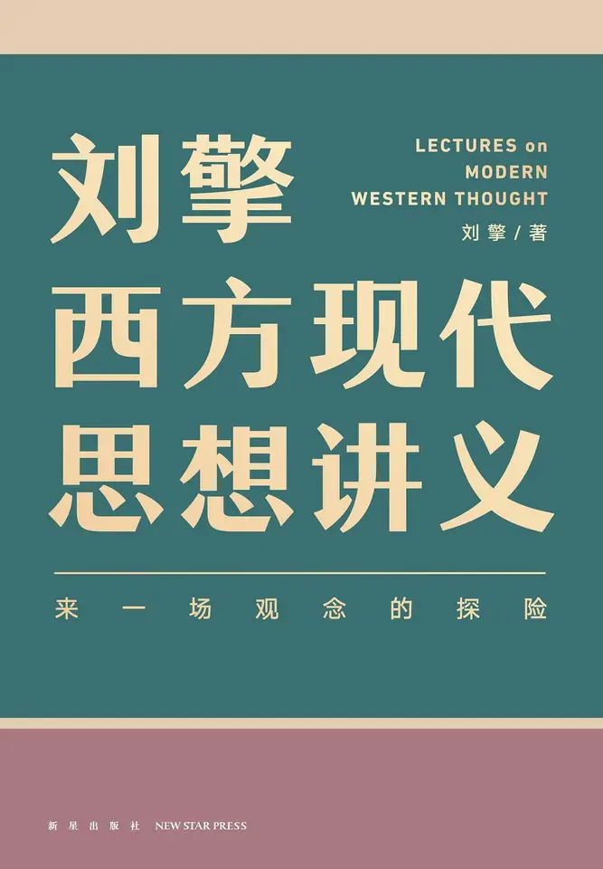

# 元数据

> [!abstract] 刘擎西方现代思想讲义
> - 
> - 书名：刘擎西方现代思想讲义
> - 作者：Administrator
> - 阅读进度：38%
> - 阅读时长：3小时15分钟
> - 最后阅读：2026-10-30
> - 微信读书：https://weread.qq.com/book-detail?type=1&v=4eb42c73643425f365779387255387632467137373744373541323774447546afa

# 高亮划线

## 前言：打开一本书，开始一次思想探索之旅

> 📌 人类区别于其他物种的独特性在于，既能“做事儿”，又会“想事儿”。古今中外都有一些特别擅长想事儿的人，他们的思考与言说，既是对社会现实的认识和理解，又会产生一种无形的力量，能够改变实践活动的逻辑和进程。这些人被称作“思想家”。
> ⏱ 2026-10-25 20:58:50

## 启程的意义

> 📌 从1850年以后，“alone”（独自一人）这个词出现的频率明显下降，但，“lonely”（孤独）这个词出现的频率却显著上升
> ⏱ 2026-10-26 18:44:07

## “现代化”的过程与“现代性”的结果

> 📌 简单地说，现代化的结果是西方形成了现代社会，出现了现代人。也许你会觉得，这么问答不就是把同一句话换了种方式说了一遍吗，没有真正回答问题啊
> ⏱ 2026-10-26 18:48:53

> 📌 我们可以在总体上说，现代化带来了现代世界，形成了不同于传统社会的一些突出特点：在经济上，是现代工业、商业和城市的崛起；在政治上，是民族国家的形成以及现代民主与宪政的发展；在社会层面上，是人口大规模的流动，包括地域的流动和阶层的流动；在思想文化方面，是理性主义获得主导地位，还有自由、平等和个人权利意识的兴盛
> ⏱ 2026-10-26 18:49:10

## 古今之变的思想动力

> 📌 启蒙的英语单词是“Enlightenment”，其中的词根“light”是光的意思“lighten”就是光照，“enlighten”就是赋予光明。启蒙字面上的意思就是赋予光明。把理性视为光明，是启蒙理性主义的特征。但这种思想不是突然来临的，它早在西方文明的源头，也就是古希腊哲学中就埋下了伏笔
> ⏱ 2026-10-26 18:50:45

## 古今之变后的两个观念转变

> 📌 古今之变带来了两个基本观念的转变：一个是“人类中心主义的转变”，它指的是人看待世界的观念发生了变化；另一个是“个人主义的转变”，它是指人看待自己的观念发生了变化，或者说人的“自我理解”的转变。这两种观念转变构成了现代思想的概念性框架。
> ⏱ 2026-10-30 12:23:08
> 💭 你不要去套用什么模板或技能生成AI纪要，也不要用什么文本处理的捷径工具，请你直接给我根据老师讲课讲讲稿中已有的讲授内容顺序、思路、逻辑（问题逻辑或理论逻辑），帮我整理出笔记。笔记务必详尽，不可敷衍，而且还要思路清晰有条理，要想保姆教学那样，方便我复习回顾复盘！笔记务必详尽，要尊重原文只是内容和结构的完整性！
>
> 还有一点，你不要搞一些花里胡哨的Markdown小标题或条目，那样看起来很不方便！你就想想“康奈尔笔记”是什么样的，“康奈尔笔记”是最适合复盘和思考的，但是要注意合理分行！你就想象一个人手写整理笔记，会是什么样的形式！
>
> 不要搞表格！也不要搞分割线！不要搞粗体加重！注意，是要“一个人手写整理笔记”，你不能太人机了！不要搞乱七八糟不一样的颜色！不要搞斜体，不要搞下划线！不要解释语音识别错误！如果有语音识别错误，你直接纠正就行了，不要过多解释！
>
> 一个人做笔记时，只准写出白纸黑字。特别是外语的拼写，你要记得自查，不要写错单词！还有，老师讲的例句或课文也要认真记下。注意，字体必须是Times New Roman，中文字体必须是宋体！要直接交付给我一个word！
> 🕰 2026-10-30 12:23:20

> 📌 在科学研究中，人类是考察者，是主体，是英文中的“subject”，而自然世界成为我们考察的对象，是客体，对象和客体的英文都是“object”
> ⏱ 2026-10-30 12:24:49

> 📌 人类身处自然之中，但在科学主导的思想观念中，人类从自然之中脱离出来，站在了自然世界的对面，形成了面对面的关系，而且人类处在积极主动的主体地位，自然处在消极被动的客体位置，人类与自然变成了主体与客体的关系
> ⏱ 2026-10-30 12:24:52

> 📌 在古代社会中，大部分人从出生到死亡，都生活在一个特定的社群之中。因此，你根本不能想象，离开这个社群你自己的生活会变成什么样，因为你的物质生活依赖这个群体的供给，你的精神生活也是亲朋好友邻居塑造的
> ⏱ 2026-10-30 12:27:00

> 📌 但在现代社会，随着工业化、城市化和商业化的发展，出现了大规模的人口流动，越来越多的人离开故乡，到陌生的地方工作和生活。个人依然离不开社群，但总是可以离开任何一个特定的社群
> ⏱ 2026-10-30 12:28:45

> 📌 你会发现，那种无法离开的所谓“血肉相连”的有机共同体是一个神话，只有你和你自己才是血肉相连的。个人的重要性和优先性就突显出来。人首先是一个独立的个体，可以脱离任何一个群体，进入别的群体。这就是“个人主义的转向”
> ⏱ 2026-10-30 12:28:56

> 📌 这种转向带来了传统社会难以想象的个人自由，生活变得多样而丰富，这是现代性的主要成就。但个人主义的自由也是有代价的，因为个人失去了与一个特定群体的久远、厚重和牢固的纽带关系，这带来了孤独感、漂泊感和乡愁。这也是现代性困境的一部分。
> ⏱ 2026-10-30 12:28:59
> 💭 这种自由应是像前文所说，是具有选择性的。我选择加入或者说远离这个群体，这个群体于我而言的情感与价值是否值得我融入？我是基于自我感知产生判断与选择进而影响我的行动。并非像古代一样迁就与盲从。
> 🕰 2026-10-30 12:29:20
> 💭 看弗洛姆的《逃避自由》学习过了
> 🕰 2026-10-30 12:29:16

## 04 | 路标 韦伯与现代思想的成年

> 📌 我们的思想之旅要探访的第一个人物是德国思想家马克斯•韦伯。为什么要以韦伯作为出发的起点？我可以说出一大堆理由，但最重要的理由是他在西方思想图景中的位置——韦伯是现代思想“走向成年的里程碑”。
> ⏱ 2026-10-30 12:30:33

## 韦伯的人生

> 📌 我自己第一次听说韦伯的名字，是在30多年前，哲学家李泽厚的一次演讲中。李先生说，我们中国人都知道伟大的卡尔•马克思，但德国还有一位“马克斯”也很了不起，就是马克斯•韦伯。他们都是现代社会学的奠基人（还有一位是法国学者涂尔干）。
> ⏱ 2026-10-30 12:30:51

> 📌 韦伯不是一个象牙塔中远离大众的学究，而是一位广泛介入公共生活、面向社会和现实的学者。他是百年前德国最大的“公共知识分子”。这是韦伯思想生涯的第一个特点。
> ⏱ 2026-10-30 12:32:29

> 📌 这样一位大学问家，学术生涯却颇为短暂。韦伯25岁获得法学博士学位，30岁就成为正教授，令同辈学人望尘莫及
> ⏱ 2026-10-30 12:34:00

> 📌 可惜4年之后，韦伯患上了严重的抑郁症，离开了大学。有几年的时间，韦伯完全停止了学术工作，病情缓和后才恢复学术研究
> ⏱ 2026-10-30 12:33:53

> 📌 又过了16年，到1918年，也就是一战结束的那一年，韦伯才正式重返大学。可回到大学才两年，韦伯就染上了当时肆虐欧洲的西班牙流感。1920年6月，刚满56岁的韦伯英年早逝。
> ⏱ 2026-10-30 12:33:48

> 📌 我想起韦伯的墓志铭，那是来自《浮士德》的一句话：“我们将再也见不到他的同类，尘世的一切莫不如此。”
> ⏱ 2026-10-30 12:34:10

## 看清理性化的世界

> 📌 韦伯到底洞察到了现代社会的什么奥秘？其实就是三个字：“理性化”。
> ⏱ 2026-10-30 12:37:05
> 💭 韦伯认为 "现代性"的问题即"理性化"的问题：
>
> 当代社会进步(工业革命、地理大发现等)的背后有一个统一的思想动力 - 理性主义。
>
> 所谓的"理性主义"即认为过去的不幸都是由于无知造成的(迷信、宗教等)，如果用理性清除掉这些无知 我们就会走向幸福。
> 🕰 2026-10-30 12:37:09

> 📌 在古代社会，大多数人的生活都贫困艰难，甚至王公贵族也过得不算很好。比如亚历山大大帝去世的时候只有32岁，后世学者根据记载，推断他是死于感染导致的持续高烧和衰竭。设想当时如果有抗生素，又会如何呢？
> ⏱ 2026-10-30 12:36:55

> 📌 还有13世纪的英格兰国王爱德华一世，他的王后一生中生育了16个孩子，前15个孩子中的男孩全部在10岁之前夭折了，直到第16个孩子顺利长大成人，王位的继承才有了着落。
> ⏱ 2026-10-30 12:36:42

> 📌 你看，无论是皇帝还是国王，在疾病面前也毫无办法。而启蒙时代之后，世界在短短两三百年间就发生了天翻地覆的变化
> ⏱ 2026-10-30 12:37:20

> 📌 说一个简单的数据就可以看出这一点：人类的平均寿命，两百年前还只有25岁，到了2016年，已经达到了72岁。
> ⏱ 2026-10-30 12:37:16

## 反思理性化的后果

> 📌 我从韦伯浩瀚的思想中提炼出三个核心命题，它们分别为“世界的祛魅”“诸神之争”“现代的铁笼”，以及一个重要概念“工具理性”。在本章接下来的章节中，我会分别来讲解韦伯的这几个命题与概念。
> ⏱ 2026-10-30 12:41:42

## 05 | 韦伯I 为什么说“祛魅”是人类的梦醒时分

> 📌 第一个命题，也是韦伯被人引用最多的一个术语，叫作“世界的祛魅”，也有人翻译成“除魅”（disenchantment）。
> ⏱ 2026-10-30 12:42:16

> 📌 这个词字面的意思就是“世界被祛除了魅惑性、神秘性”，人对自然世界的认识发生了改变。换句话说，以前人对自然的认识中有一种神秘性，后来被去除了。
> ⏱ 2026-10-30 12:42:20

## 魅惑的古代世界

> 📌 无论是在哪个文明中，古人都相信有各种神仙、鬼怪、精灵。不只是人有灵魂，动物也有灵性，石头草木也有灵，万物都有灵
> ⏱ 2026-10-30 12:43:15

> 📌 古希腊的那些神灵你肯定听说过。中国也有各种神仙，在道教里面，最高规格的普天大醮仪式中，会恭请3600位神仙。日本的神道教说有800万神灵。印度教中说有3300万神灵。其实这些也不是确切的数量，它所传达的是世界一切现象的背后都有神灵。
> ⏱ 2026-10-30 12:43:18

## 理性化与祛魅

> 📌 日食，就是一个天体现象，既不是什么皇帝失德，上天示警，也不是什么天狗食日；
> ⏱ 2026-10-30 12:46:40

> 📌 水，就是H2O这种分子，世界上没有什么神水圣水；
> ⏱ 2026-10-30 12:46:43

> 📌 你爱上一个人，不是什么前世因果，而是你体内荷尔蒙的变化。
> ⏱ 2026-10-30 12:46:48
> 💭 哈哈哈哈哈到这里笑出了声，我发誓我在此之前都是抱着十分严肃的学术态度阅读这本书的哈哈哈哈
> 🕰 2026-10-30 12:46:58

## 事实判断与价值判断

> 📌 所谓事实判断，就是你做的判断是在描述一个事实
> ⏱ 2026-10-30 12:53:23

> 📌 但生活中，我们还会做出另一种判断。要是我说，“清华大学应该搬到上海”，这就不是在说“实际”了，而是在说“应当”怎么样。这叫作“价值判断”
> ⏱ 2026-10-30 12:53:29

## 铁笼是禁锢也是庇护

> 📌 铁笼有两个最大的弊端。首先是造就了一种片面的社会文化。
> ⏱ 2026-10-30 13:18:18

> 📌 我们在上一节说到，理性化的发展偏科了，变成了工具理性的单方面发展，同样地，社会文化也跟着偏科了。现代的社会文化讲求事实、重视计算、追求效率。你看，这是最典型的工具理性逻辑，它本身没有错，问题是这种逻辑太强大了，在几乎所有的问题中占据了主导地位。但有些问题，在根本上是这种逻辑无法解决的。
> ⏱ 2026-10-30 13:18:21

> 📌 拿假冒伪劣现象举个例一这当然是一个与诚信道德有关的问题。但我们发现，要处理它，最有效的方式是罚款——当然，是广义上的罚款。总之就是要让假冒伪劣者付出巨大的代价，让假冒伪劣这件事在经济上变得不划算。这很实际，也很有效。
> ⏱ 2026-10-30 13:18:24

> 📌 但你有没有想过，这背后隐藏的逻辑是“用功利得失解决道德问题”。这当然立竿见影，但本质上，它把道德问题变成了利益计算。按照这个逻辑，只要能找到办法规避惩罚、提高收益，人还是会选择违背道德。用利益计算解决道德问题，永远是治标不治本，有时能解决问题，有时却会让问题更严重。
> ⏱ 2026-10-30 13:18:27

> 📌 铁笼的第二个弊端则是造就了片面的社会关系：人与人、人与组织之间，逐渐变成了一种商业的“供求关系”。
> ⏱ 2026-10-30 13:18:30

> 📌 比如说“人力资源”这个词。这个词已经成了日常用语，但你有没有想过，“人”怎么会是一种“资源”？我们现在常说要“自我发展”，但是我们是为了什么要追求“自我发展”呢？有人会说，是为了“提高自己的竞争力”。这句话听上去很平常，说得没错。但你有没有发现，其中潜藏着这样一层意思：人变成了某种商品，在“买家”面前互相竞争。“自我发展”被替换成了“提升自己作为商品的价值”，所以才会有“人才市场”这种说法。
> ⏱ 2026-10-30 13:18:33

> 📌 现代社会强调个性、强调自由，看上去有各种各样的选项供我们选择。但实际上，我们并没有那么多机会去提高真正的自主性，去发展自由而丰富的精神和人格，因为我们有一个摆在眼前的迫切任务：满足社会机器对一个零件的要求。我们要在激烈的竞争中成为一个合格、优质的零件，这就是“铁笼”的比喻中蕴含的深意。
> ⏱ 2026-10-30 13:18:36

> 📌 韦伯说：“专家没有灵魂。”意思就是，身处铁笼之中，即使有丰富的知识，成了“专家”，也只不过是一种高级零件罢了。我们人类作为“万物的灵长”，那些生命和灵性发展的需求被忽视和淹没了。
> ⏱ 2026-10-30 13:18:39

## 可怕的宣言：“上帝死了！”

> 📌 尼采做的事情就像是对一个从小被收养的孩子说出了他的身世真相。这个真相当然会对孩子造成沉重打击，但是这件事又太过重要，孩子应当知道真相。“上帝死了”这件事比身世问题更严重。
> ⏱ 2026-10-30 13:39:32

## 虚假的形而上学

> 📌 尼采认为，生命欲望是真实的，也是正当的。即使因为挫折而痛苦，我们也应当直面它们
> ⏱ 2026-10-30 13:43:25

> 📌 就像鲁迅说过的，“真的猛士，敢于直面惨淡的人生，敢于正视淋漓的鲜血”。按照尼采的观点，这就是诚实的英雄主义。但如果我们按照禁欲主义的说法，用否定生命欲望去逃避痛苦，就只会陷入自欺欺人的虚假人生。
> ⏱ 2026-10-30 13:43:28

## 奴隶道德与主人道德

> 📌 奴隶道德，就是放弃自己生命的激情，用虚假的思想来约束自己、安慰自己，把人生希望寄托在虚妄的观念之中。
> ⏱ 2026-10-30 13:53:40

> 📌 而主人道德，就是放弃一切幻觉，直面虚无和荒谬，像西西弗斯那样用生命的激情去自我创造，做一个勇敢、荒谬的英雄。
> ⏱ 2026-10-30 13:53:45

## 18 | 路标 20世纪的灾难为什么不可思议

> 📌 13世纪蒙古帝国的扩张，导致上亿人的死亡；17世纪的宗教战争，让欧洲损失了1/3人口，到处是血流成河、尸横遍野的人间惨剧……20世纪的灾难最不可思议之处，在于它完全出乎意料！
> ⏱ 2026-10-30 15:04:57

## 现代性与大屠杀

> 📌 鲍曼发现，官僚制不仅会损害个人自由，还会导致道德冷漠、逃避责任。现代官僚体系像一部庞大的机器，每个人都只是一个零件，在作为零件高效率运转的过程中，却丧失了对总体目标的责任感和道德感。
> ⏱ 2026-10-30 15:15:02

> 📌 大屠杀发生的场景，就像一个工业流水线。在集中营里，人人都只是照章办事、分工合作。有人负责给犹太人分类归档，有的人负责任务排期，有的人负责将犹太人分批送进毒气室，有的人负责后勤
> ⏱ 2026-10-30 15:15:19

> 📌 这里就像一个井井有条的工厂，只不过工厂的“原料”就是活生生的犹太人，生产出来的产品是死亡。整个过程中，没有哪一个人是杀人狂，每个人都只是承担自己手头的一份工作，完成流程中一个微小的步骤
> ⏱ 2026-10-30 15:15:25

> 📌 回头来看大屠杀这件事，会发现一个非常匪夷所思的地方：当时一共有600万犹太人被屠杀，600万人啊，为什么就没有出现组织化的反抗呢？在战争情况下，特别是在与苏联交战之后，纳粹军力非常有限，要镇压一场大规模的叛乱并不容易。实际上，当时不仅没有出现犹太人的大规模反抗，在大屠杀中甚至还有受害者的参与。
> ⏱ 2026-10-30 15:19:40

> 📌 鲍曼认为，这种合作是经由一种策略实现的，就是纳粹对受害者理性计算心理的利用。大屠杀不是一个公然宣布的清晰计划，否则肯定会立刻爆发大规模的抵抗。当时的犹太人并不知道这是一场种族灭绝，直到最后一刻，很多人都以为自己有可能活下来。纳粹利用了这种求生希望，消解了可能的反抗。
> ⏱ 2026-10-30 15:19:48

> 📌 比如，纳粹政府一开始说，特殊人才可以留下来，很多人就开始找各种渠道证明自己是特殊人才。你可以想象，有了可能的求生渠道，大规模反抗就很难组织起来。纳粹还设立“犹太人委员会”，招募犹太人警察，任命犹太人来管理犹太隔离区。
> ⏱ 2026-10-30 15:19:53

> 📌 只要考虑到人的理性计算心理，就可以在给受害者提供选项的时候，调整其中的收益，去引导受害者合作。因为在受害者看来，如果能够保存一部分生命，总比全体被屠杀更好。恰恰是这种得失计算的求生希望被纳粹所利用
> ⏱ 2026-10-30 15:20:09

> 📌 你是选择到隔离区继续生活，还是立刻被逮捕？你是选择通过官方渠道积累功绩，用稳妥的方法保护家人，还是铤而走险去反抗？借助这样的策略，最终，纳粹在军力有限的条件下，以相当少量的纳粹官兵，依靠许多犹太人的“合作”，实现了这场大屠杀。
> ⏱ 2026-10-30 15:20:02

## 20 | 阿伦特I 大屠杀真的是“平庸之恶”吗

> 📌 在20世纪，一位女性政治哲学家也针对这个主题做出了非常重要的研究。她就是1933年从德国流亡到美国的汉娜·阿伦特。她创造了一个概念叫“平庸之恶”，流传很广。但“平庸之恶”这个词，被谈论得很多，理解得却很浅，很多时候其实是被误解了。
> ⏱ 2026-10-30 15:21:59

## 理解不可理解的恶

> 📌 艾希曼是纳粹的一名高级军官，负责实施屠杀犹太人的所谓“终极解决方案”。二战之后艾希曼逃亡到阿根廷，1960年被以色列特工抓捕。1961年在耶路撒冷对他进行了刑事审判
> ⏱ 2026-10-30 15:28:46

> 📌 阿伦特当时作为《纽约客》的特约记者赶赴耶路撒冷，旁听和报道了这个审判的全过程，最后她的报道结集出版，书名是《艾希曼在耶路撒冷》，副标题是“一份关于平庸的恶的报告”
> ⏱ 2026-10-30 15:28:49

> 📌 在这个报告中，阿伦特提出了一个见解，她在艾希曼身上发现了一种“平庸性”
> ⏱ 2026-10-30 15:29:00

> 📌 在她看来，艾希曼并不是戏剧和小说中那种复杂而有魅力的反派角色，比如莎士比亚戏剧中的伊阿古、麦克白或者理查三世
> ⏱ 2026-10-30 15:29:11

> 📌 艾希曼并不残暴，也不是恶魔。但他有“一种超乎寻常的浅薄”，“不是愚蠢，而是匪夷所思地、非常真实地丧失了思考能力”。这就是艾希曼身上的“平庸性”，实质上是一种“无思状态”（thoughtlessness），就是不思考
> ⏱ 2026-10-30 15:29:18

> 📌 “极端之恶”和“平庸之恶”，其实是一体两面。纳粹大屠杀是一种极端的恶，但这种极端的恶，是经由一些“平庸”的罪犯犯下的。这些罪犯身上的这种“恶的平庸性”，其实质是不去思考，是丧失了思考能力。这从另一个角度解释了大屠杀研究中的难题：为什么寻常之人会犯下非同寻常的罪行。
> ⏱ 2026-10-30 15:30:47

## 思考的含义：独立判断

> 📌 艾希曼当时在法庭上侃侃而谈，甚至引用康德的名言为自己辩护。他说自己是履行职责、服从法律，因为在德意志第三帝国，“元首的命令是当前法律的绝对核心”，所以他不仅是服从法律，还是让自己的意志与“法律背后的原则”相统一。这样才符合康德的哲学。
> ⏱ 2026-10-30 15:34:26

> 📌 这种口才，恐怕会让很多不善辞令的人深感自愧不如。那么，阿伦特为什么会说艾希曼“浅薄”“丧失了思考能力”呢，这到底是什么意思呢？
> ⏱ 2026-10-30 15:34:30

> 📌 阿伦特的意思，并不是说艾希曼愚蠢，或者说他是在撒谎，而是说艾希曼满嘴都是套话，让自己陷落在陈词滥调之中。他又把这些陈词滥调当成自己的盾牌和武器，用它们来抵挡现实，拒绝真正的思考和对话
> ⏱ 2026-10-30 15:34:43

> 📌 艾希曼虽然能够引用康德，但在阿伦特看来，这种引用简直“令人发指而且不可理喻”，因为康德所讲的道德，恰恰与独立判断密不可分
> ⏱ 2026-10-30 15:34:47

> 📌 现在，人人都会宣称独立判断彳艮重要，这本身似乎也成为套话了。但你是否明白，独立判断的重要性究竟何在呢？阿伦特的回答是，因为在现代社会，只是月艮从主流规则，已经不再能够防止人们作恶。
> ⏱ 2026-10-30 15:34:57
