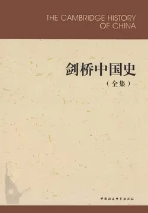

# 元数据

> [!abstract] 剑桥中国史（全集）
> - 
> - 书名：剑桥中国史（全集）
> - 作者：费正清 崔瑞德等
> - 译者：杨品泉 等
> - 简介：“剑桥中国史”丛书共16卷，各卷皆由国外知名学者主编，卷内各章节亦由研究有素的专家撰写，并注意吸收各国学者的研究成果，反映了国外中国史研究的水平和动向，已出版11卷。包括：《剑桥中国秦汉史（公元前221年至公元220年）》《剑桥中国隋唐史（589-906年）》《剑桥中国辽西夏金元史（907-1368年）》《剑桥中国明代史（1368-1644年）（上卷）》《剑桥中国明代史（1368-1644年）（下卷）》《剑桥中国晚清史（1800-1911年）（上下卷）》《剑桥中华民国史（1912-1949年）（上卷）》《剑桥中华民国史（1912-1949年）（下卷）》《剑桥中华人民共和国史：革命的中国的兴起（1949-1965年）（上卷）》《剑桥中华人民共和国史：中国革命内部的革命（1966-1982年）（下卷）》。
> - 出版时间：2017-06-01 00:00:00
> - ISBN：9787500409076
> - 分类：历史-中国古代
> - 出版社：中国社会科学出版社
> - 微信读书评分：86%
> - 阅读进度：0%
> - 阅读时长：46分钟
> - 最后阅读：2026-11-13
> - 微信读书：https://weread.qq.com/book-detail?type=1&v=6c5325d05d0b7f6c59b8055

# 高亮划线

### 第四章 蒙古帝国的兴起及其在中国北部的统治

> 📌 蒙古高原居民的基本职业是放牧畜群。蒙古人拥有的牲畜共有五大种类——马、绵羊、骆驼、牛和山羊，其中的每一种都有它特殊的用途，这五种牲畜的价值有着公认的高低顺序
> ⏱ 2026-11-13 02:14:02

> 📌 马，是草原游牧部落骄傲的财富，可用于军事活动、迁徙和管理畜群。没有它们，就不可能有干旷草原游牧部落的粗放性、流动性的经济
> ⏱ 2026-11-13 02:15:06

> 📌 居第二位而且数量最多的牲畜是绵羊，它们和最末种类的山羊一起，提供肉食和羊毛
> ⏱ 2026-11-13 02:15:26

> 📌 居第三位的是骆驼，主要用来在南面荒凉的戈壁地区运载货物
> ⏱ 2026-11-13 02:15:30

> 📌 居第四位的是长角的牛，也有丰富的数量，用来提供肉食、牛皮和运输
> ⏱ 2026-11-13 02:15:37

> 📌 运载部落首领帐篷的有名的大轮车（格尔·帖列格，ger tergen）即由一队牛群来拉。所有的牲畜都提供乳汁，乳类的副产品如阿剌亦黑（ayiragb，发酵的马奶，突厥语称忽迷思，kumis）、酸乳酪和各种干乳酪是蒙古人饮食中的主要食品。即便是牲畜的粪便也有用处，当它干燥后，是荒芜草原上燃料的主要来源
> ⏱ 2026-11-13 02:16:29

> 📌 在南西伯利亚的森林地区，部落经济中狩猎的相对重要性要大大增强，以至于古代蒙古人通常把“林木中百姓”（槐因·亦儿坚，hoi-yin irger）和那些生活在草原上的人区别开来
> ⏱ 2026-11-13 02:18:04

> 📌 虽然狩猎是他们的支柱，但西伯利亚的部落——斡亦剌、八剌忽、豁里秃麻和其他部落——也有马匹，按照游牧的（虽然不是草原的）生活方式，亦总是被看作基本的劳力来源，正在扩张的以草原为基础的部落联盟常从中抽取人力
> ⏱ 2026-11-13 02:18:18

> 📌 农业不是游牧家庭经济的一个独立的部门，但对蒙古地区的居民来说并不陌生：西伯利亚的部落，至少叶尼塞河地区的部落，在土地上种植，就像沿着长城的汪古部一样。实际上没有一个欧亚大草原的畜牧民族是纯粹的游牧经济而不与定居世界联系或接触。的确，纯粹的游牧经济是一种假设的概念，而不是一种社会现实
> ⏱ 2026-11-13 02:19:55

> 📌 我们最好把草原游牧生活看成一种统一体，它既包括近乎定居的迁徙生活，又包括几乎固定的理论上可能、但现实中却从未实现的“纯粹”游牧社会，这种社会从自己的畜群中获得每一件使用或消费的东西
> ⏱ 2026-11-13 02:20:06

> 📌 对所供给的冬季食物和牲畜饲料的需要，以及对茶和丝料之类奢侈物品的渴求，也曾在游牧部落中出现。由于他们自身的经济永远不能彻底满足对这些物质的需求，所以游牧部落必须被迫转向他们的定居邻居索取农业产品
> ⏱ 2026-11-13 02:20:28

> 📌 就蒙古地区的部落而言，这就意味着要承认和中国保持不断的经济联系。得到所需产品最好的方法是以皮、毛、马或其他东西向汉人“进贡”来换回诸如谷物、金属制品和奢侈品之类的“赠品”。如果自给自足的中国人拒绝交易的话，那些游牧部落就会以武力相威胁。简言之，草原居民用战争和战争威胁来强行索求向中原王朝交纳贡物的权力
> ⏱ 2026-11-13 02:21:10

> 📌 在成吉思汗的祖先中，海都似乎是史料最全的第一人。在老一辈世系中，他是孛端察儿的玄孙。根据拉施特保存的材料[插图]，海都在几个蒙古氏族之上实行了松散的宗主权力而且成功地使一个沿克鲁伦河从事游牧生活的部落——札剌亦儿处于他的控制之下。虽然没有提供确切的时间，但海都显然在辽王朝（907—1125年）的最后几十年中都很活跃。
> ⏱ 2026-11-13 02:22:27

> 📌 成吉思汗的父亲也速该是合不勒汗的次子巴儿坛把阿秃儿的第三子。也速该是孛儿只斤氏族的分支乞颜牙孙的一名成员，这个分支显然是由他的直系祖先建立的。也速该在有关蒙古人反对塔塔儿的战斗中首次被提到
> ⏱ 2026-11-13 02:23:53

> 📌 在12世纪50年代或60年代俺巴孩被俘获和被处死的时候，也速该把他后来的新娘，即弘吉剌部的诃额仑，从同她订婚的一个篾儿乞人那里绑架走。娶了这位心甘情愿的诃额仑后，也速该参加了针对塔塔儿人的袭击行动，这些行动也许就是由他的叔叔忽图剌发动的。
> ⏱ 2026-11-13 02:23:50

#### 蒙古

> 📌 蒙古始终是中国典型的边疆，因为蒙古的游牧民自古以来就几乎是对于中国农业文明的经常不断的军事威胁。但是到10世纪之末，蒙古的游牧生活方式已经完全衰退。昔日游牧民的强盛和独立已成过去。战争一度曾给游牧民带来荣誉和团结的基础，这也变成了过去，清朝把内蒙和外蒙的蒙古人——尽管他们的生活是流动的——同中国紧紧连在一起
> ⏱ 2026-11-13 02:26:12

> 📌 在1800年之际，清帝国全部操蒙古语者可能多达350万人（不包括旗人），其中多达70万是在外蒙（大量居住在北部中央地带），260万是在内蒙（集中于东部）。其余20万是在新疆和青海。如果这个估计正确，也许从18世纪前半期或更早以前，蒙古人口就已经在逐渐减少
> ⏱ 2026-11-13 02:26:38
> 💭 这个问题还需要作认真的历史研究。关于对20世纪人口的估计，可参阅迈斯基《革命前夕的蒙古》第2版，第28—30页；米勒：《内蒙古的寺院和文化变化》，第25—72页；《人民中国手册》，北京1957年版，第14—15页。
> 🕰 2026-11-13 02:26:50

> 📌 蒙古社会主要是由两个阶级组成：贵族和平民
> ⏱ 2026-11-13 02:27:17

> 📌 扎萨克（即旗的王公）由贵族产生，是清代为游牧民设置的基本政治单位——旗（和硕）的世袭统治者。旗下划分“苏木”（“箭”），六苏木设一扎兰（参领）
> ⏱ 2026-11-13 02:28:08

> 📌 蒙古诸旗的属民应与满、蒙、汉军旗人严加区别，因为后者是支撑清朝的基本力量。“旗人”一词仅用于称呼清朝的八旗军成员，蒙古诸旗的属民则称为“旗下属民”
> ⏱ 2026-11-13 02:28:05

> 📌 每一个蒙古贵族都接受清朝贵族爵位，分成从和硕亲王到四等台吉的十个等级。只有扎萨克即旗的王公才有世俗统治权
> ⏱ 2026-11-13 02:28:58

> 📌 。为了表示对清朝的臣服关系，扎萨克每年要按规定向皇帝进贡，主要是进献一定数量的牲畜和畜产。其中最有名的是外蒙古诸汗进献的“九白”之贡，即八匹白马和一匹白骆驼，不过到了1800年，“九白”实际上已改用其他物品，诸如毛皮、兽革和精选的家畜
> ⏱ 2026-11-13 02:29:09

> 📌 蒙古的进贡者则得到绸缎、布帛、瓷器和金银作为回赏。这些回赠之物至少与贡品价值相当，因此可以设想，清政府并不认为进贡是对进贡者的一种经济负担
> ⏱ 2026-11-13 02:29:12
> 💭 参看罗伯特·李的《满洲边疆》一书中关于打牲诸旗所负担的纳贡义务，第51、56—57页。
> 🕰 2026-11-13 02:29:25

> 📌 旗王公或盟长犯事，清政府则予以夺职削爵而不论其血统多么高贵。例如在1800年，清政府即曾革退车臣汗桑斋多尔济的盟长职务，尽管他是成吉思汗之后裔，并剥夺他本人及其子孙的汗称号
> ⏱ 2026-11-13 02:30:26

> 📌 成吉思汗家系的成员也通过结亲与清王朝联系在一起，满人总是小心翼翼地让这些王公感到他们在清帝国占有特殊地位：清廷曾将他们擢升为清朝贵族，并使他们意识到，他们作为最早的军事盟友，地位高于被征服的中国官僚。但是到了1800年，清王朝久已接受汉族的文化价值和标准，蒙古人显然不是盟友而是臣属了
> ⏱ 2026-11-13 02:30:34

#### 新疆

> 📌 天山山脉的山脊把天山两边隔成两个不同的地区。天山南部的东突厥斯坦是农业区，天山北部的准噶尔是草原世界
> ⏱ 2026-10-27 08:05:21

> 📌 在18世纪50年代，乾隆帝的军队征服了天山南北，占据了这块当时在亚洲腹地要算人种最复杂的领土。他们称准噶尔为天山北路，称东突厥斯坦为天山南路
> ⏱ 2026-10-27 08:05:12

> 📌 清军把这两个地区当作清帝国的属地予以管辖，统称之为新疆，意为甘肃的“新疆域”
> ⏱ 2026-10-27 08:05:11

> 📌 这里盛产玉、金、铜和棉花，富于耕地和牧草。政治动乱也发生频繁
> ⏱ 2026-10-27 08:05:09

> 📌 清政府的政策是尽量不插手当地民族的内部事务。在新疆的官员“既不尊重也不熟悉治下诸民族的语言和习惯”
> ⏱ 2026-10-27 08:05:06
> 💭 罗萨比：《1368年迄今的中国和亚洲腹地》，第171页。
> 🕰 2026-10-27 08:05:04

> 📌 从文化和历史方面来说，天山北路的牧区乃是蒙古地方的展延。统治游牧民的世袭扎萨克处于伊犁、库尔喀喇乌苏（乌苏）、塔尔巴哈台和焉耆的清军官员的严密监视之下
> ⏱ 2026-10-27 08:05:08

> 📌 在准噶尔和蒙古，政府当局限制稍宽。有时哈萨克商队以各种借口绕过政府限制，不时前往乌鲁木齐、科布多、乌里雅苏台、乌梁海地区和喀什噶尔。但是，清政府严禁向哈萨克、柯勒克孜和其他中亚商人出卖金属制品
> ⏱ 2026-10-27 08:05:15

> 📌 到1777年，天山北部约有10750户绿营兵和将近500户流犯和配军，他们耕种着总面积约22.73万亩的土地。在天山南部，主要是在哈密和吐鲁番，也有一些屯垦地，但其总面积不到上述数目的1/3。
> ⏱ 2026-10-27 08:05:02

> 📌 东突厥斯坦，即小布哈拉，位于天山之南，由东北区和西南区两部分组成。东北区旧称维吾尔斯坦，西南区即塔里木盆地，比东北区大得多，称为六城或喀什噶里亚；有时六城或喀什噶里亚之称也表示整个东突厥斯坦
> ⏱ 2026-10-26 20:38:55

> 📌 在塔里木盆地的西端，主要是在喀什噶尔、叶尔羌、和阗一带，有一大批外国商人，其中包括一些与外商有联系的工匠和越来越多的混血儿
> ⏱ 2026-10-27 08:05:05

> 📌 清政府曾于1795年禁止外国人娶当地妇女为妻，但这禁令难以贯彻，天长日久，外国穆斯林（主要是浩罕属民）与喀什噶尔妇女成婚者越来越多。他们的子女被称为察尔虎特，尽管其语言、住地和文化不同，但仍随他们父亲的国籍。这种混血儿所生子女同样被认为是察尔虎特，不算清朝属民
> ⏱ 2026-10-27 08:05:20

> 📌 旗人也有娶当地妇女为妻者，不过法律是禁止清朝官吏娶东突厥斯坦妇女的。这类婚生子女则被认为是当地人
> ⏱ 2026-10-27 08:05:17

> 📌 在喀什噶尔地区的塔什密里克居住着柯勒克孜的土拉吉尔钦察部，该部在19世纪50年代约有五百户。这是清政府唯一允许住在东突厥斯坦而与绿洲定居居民同等看待的柯勒克孜人
> ⏱ 2026-10-27 08:05:19

> 📌 在叶尔羌地区的有些村落中，还有一些从奇特拉尔和瓦罕释放出来的奴隶前来定居，他们就是所谓的什叶派（拉菲迪）。在许多山区则有塔吉克人、哈尔查斯人（山地塔吉克人）和瓦罕人，他们都讲伊朗语，在清国领土上过着半游牧生活。虽然他们现在是穆斯林，却还保留着伊斯兰时期以前的伊朗拜火教残余
> ⏱ 2026-10-27 08:05:07

> 📌 灌溉方法最初是从西部传入东突厥斯坦的，它广泛利用水沟、水管和地下水渠——坎儿井，以适应透水性强的黄土和沙砾地区，因为这里地面水会很快被吸干。某些作物收获量是很高的
> ⏱ 2026-10-27 08:04:57

> 📌 特别出名的是维吾尔斯坦的葡萄和瓜，最好的是吐鲁番葡萄和哈密瓜。吐鲁番出产的无核葡萄干誉满中亚，远销印度和中国本土
> ⏱ 2026-10-27 08:04:56

> 📌 农业技术和销售方法虽然实用，但比较原始，总的说来，粮食产量可能远较中国本土为低
> ⏱ 2026-10-27 08:05:18

> 📌 农民种植苜蓿以肥田，不采用轮耕法。储粮的普通方式是建仓库，但因气候干燥、冬天寒冷，粮食也可以储藏在地下，所以贫苦农民一般都采用地窖，特别在不太平年月居民普遍采用此法
> ⏱ 2026-10-27 08:05:13

> 📌 在清朝统治之下，东突厥斯坦社会仅有三个官方承认的阶级：土官（伯克）、宗教上层人士（阿訇）和普通属民（阿勒班克什，意即纳税人）
> ⏱ 2026-10-26 20:39:32

> 📌 在清朝征服以后，也许除了哈密和吐鲁番当地的统治者有权视需要任命毛拉担任政府职务外，东突厥斯坦的阿訇已经没有其他中亚地区的毛拉所享有的那种政治权力了
> ⏱ 2026-10-27 08:05:20

> 📌 在东突厥斯坦的两大地区中，维吾尔斯坦（主要是哈密和吐鲁番）与中国交往的历史较长，清朝对那里的控制也有很深的根基。像蒙古的旗王公一样，哈密王和吐鲁番王也属于清皇家贵族之列，是世袭统治者（扎萨克），而不单纯是清廷官员或代表。因此，哈密和吐鲁番的地位与蒙古诸旗相等，驻乌鲁木齐的都统仅对他们的事务实行单纯的监督作用
> ⏱ 2026-10-27 08:05:22

> 📌 清政府直接控制的只有将近2400名绿营兵和约200名汉民流犯（流犯都在哈密境内），他们耕种着总数约45200亩土地。[插图]受清政府直接控制的还有汉族移民和来自中国本土的汉商
> ⏱ 2026-10-27 08:05:16

> 📌 不过对于维吾尔斯坦当地定居民的治理，哈密和吐鲁番的扎萨克享有完全的自治权。他们自己向清廷进贡，但只有他们才有权向所辖属民征税。不全适合这条规矩的唯一例外就是：耕种清政府官地的当地人（主要是在辟展），每年得向清政府交纳土地使用税（其总数约为粮食3500担）
> ⏱ 2026-10-27 08:05:10

> 📌 最高级的伯克（清制三、四品）要着汉装和蓄辫。政府对于他们的任命遵循“回避法”，就东突厥斯坦的情况来说，这意味着土著不得担任当地的主要伯克
> ⏱ 2026-10-27 08:18:04

> 📌 在理论上，回避法旨在防止贪赃枉法，但是清政府在六城推行回避法的主要理由，还在于它在政治上驾驭哈密和吐鲁番的统治者家族以及库车和拜城的新贵族（因为他们的地位完全是受清朝之赐）比驾驭东突厥斯坦其他地方的上层贵族更有把握
> ⏱ 2026-10-27 08:18:26

> 📌 这类伯克的官职不是世袭的，但是除非渎职，都能继续留任，不像清朝驻军员司那样定期更换。换句话说，六城的最高级伯克们都是行政首脑和官员，而且一般都是贵族，但他们与哈密和吐鲁番的统治者不同之处是不能世袭
> ⏱ 2026-10-27 08:18:43

> 📌 他们最后要受理藩院管辖。最高层伯克享有每年进京朝贡皇帝的特权，从而使他们得到相当可观的回赏和许多好处；直到1859年，这种做法才被废除
> ⏱ 2026-10-27 08:18:52
