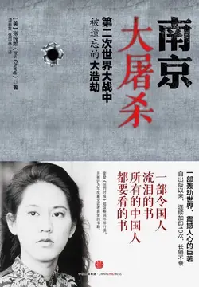

# 元数据

> [!abstract] 南京大屠杀
> - 
> - 书名：南京大屠杀
> - 作者：张纯如
> - 译者：谭春霞,焦国林
> - 简介：1937年12月，日军攻入中国古都南京。几周之内，30多万中国平民和士兵遭到有计划地强暴、折磨和屠杀——死亡人数超过广岛和长崎原子弹爆炸遇难人数的总和。 张纯如不仅在书中详述了日军疯狂暴行的细节，而且分析了在军国主义文化背景下成长起来的日本士兵对人类生命的漠视。张纯如对南京大屠杀的幸存者进行了大量采访，并首次发掘了许多重要文献。全书先是从日本士兵、军官为什么完全脱离了人类基本的行为规范，日本学校和教科书从心理层面向学生灌输对中国人民的仇恨和蔑视，以及高度军事化的教育体制等多个方面阐述了南京大屠杀发生的根源性原因。
> - 出版时间：2013-01-01 00:00:00
> - ISBN：9787508637242
> - 分类：历史-中国近现代
> - 出版社：中信出版集团
> - 微信读书评分：97%
> - 阅读进度：0%
> - 阅读时长：16分钟
> - 最后阅读：2026-11-13
> - 微信读书：https://weread.qq.com/book-detail?type=1&v=ed4325105af547ed45154e5

# 高亮划线

## 前言

> 📌 日本国内的恐怖气氛压制了对南京大屠杀进行自由开放的学术讨论，进一步阻碍了世人对真相的了解。在日本，如果公开表达对中日战争的真实看法（过去如此，现在依然如此）将会威胁到自己的职业生涯，甚至有丧命的危险
> ⏱ 2026-11-13 03:25:39

> 📌 1990年，长崎市市长本岛等曾因表示日本昭和天皇应为第二次世界大战负一定责任而招致枪击，被一名枪手射中胸部，险些丧命。
> ⏱ 2026-11-13 03:25:30

> 📌 日本社会弥漫的这种危险气氛使许多严肃的学者不敢去日本查阅相关档案文件，进行这一主题的研究；事实上，我在南京时曾听说中国出于人身安全方面的考虑，也不鼓励学者去日本进行相关研究
> ⏱ 2026-11-13 03:25:48

> 📌 日本之外的人就很难接触到日本国内关于南京大屠杀的一手档案资料。除此之外，大部分曾参与过南京大屠杀的日本老兵都不愿意就他们的经历接受采访，近年来，只有极少数老兵冒着被排斥甚至死亡的威胁，将他们的经历公之于世
> ⏱ 2026-11-13 03:25:56

> 📌 在写作本书的过程中，让我感到困惑和悲哀的是，日本人自始至终顽固地拒绝承认这段历史。与德国相比，日本付出的战争赔偿还不及德国对战争受害者赔偿总额的1%。“二战”之后，大多数纳粹分子即使没有因其罪行被囚禁，至少也被迫退出公众视野，而许多日本战犯则继续在产业和政府领域担任要职
> ⏱ 2026-11-13 03:26:49

> 📌 在德国人不断向大屠杀遇难者道歉的同时，日本人则将本国战犯供奉在靖国神社——有位太平洋战争中的美国受害者认为该行径的政治含义就好比“在柏林市中心修建一座供奉希特勒的教堂”
> ⏱ 2026-11-13 03:26:21
> 💭 作者对吉尔伯特·海尔（Gilbert Hair）的电话采访。
> 🕰 2026-11-13 03:26:27

### 第四章 恐怖的六星期

> 📌 强奸
> ⏱ 2026-09-17 20:52:43

> 📌 除了1971年巴基斯坦军人强暴孟加拉妇女的事件（一次起义失败之后，在巴基斯坦人长达9个月的恐怖统治期间，20万～40万孟加拉妇女遭到强暴）
> ⏱ 2026-09-17 20:52:31
> 💭 巴基斯坦军队在战争中对于孟加拉妇女施行惨无人道的有组织的强暴,基于消灭孟加拉民族的目的，巴军有意让被强暴的妇女怀孕并生下孩子。他们要制造一种混乱，在孟加拉人的下一代中，无法确定自己到底是孟加拉人还是巴基斯坦人。
>
> 国际上普遍认为，有20万-40万孟加拉妇女遭到强暴，巴基斯坦军队公开宣称，这些孟加拉妇女是战利品，她们中的许多人被留在军营中充当奴隶，一直到她们生下孩子为止。巴基斯坦军队的强暴行为，也被认为是一种种族灭绝式的强暴。
> 🕰 2026-09-17 20:52:35

> 📌 据我所知，以及根据一些中国历史学家和南京大屠杀遇难同胞纪念馆馆员的研究，至今没有一位中国妇女站出来承认自己的孩子是被日军强奸的结果。
> ⏱ 2026-09-17 20:53:01
> 💭 不用担心，这是我的大肥鱼发的。它每天都会跑脚本，把别人回复我的话，自己也拷贝一份发布，最后都同步到个人网站上，20260718.xyz，欢迎书友来玩🙃🙃🙃
> 🕰 2026-11-09 19:50:15
> 💭 没有人希望生下强奸犯的孩子，更何况是被毫无人性的日本人强奸之后生下孩子，她们首先是自己才是一个母亲，这不是主体性的问题
> 🕰 2026-11-09 16:48:34
> 💭 所以呢？就不是中国人的孩子了？就不是这些女性自己的孩子了？主体性这么弱么？究竟是女人能生孩子还是日本人亲自生的？
> 🕰 2026-09-17 20:53:38
> 💭 所以当遭遇不公的时候，我们自己不要感到屈辱，错的是伤害你的人，就像今天在职场校园遭遇强奸或者性骚扰，女性或男性都不要因为羞耻而隐瞒，我们要声讨加害者才能够让伤害本身不被忘记！
> 🕰 2026-09-17 20:53:25

> 📌 可以想象，许多中国妇女在面对抚养一个她们无法去爱的孩子和犯下杀婴罪行这样的两难选择时，内心所承受的罪恶、屈辱和自我厌恶之情。
> ⏱ 2026-09-17 20:53:53

> 📌 1937～1938年，“数不清”的中国妇女投江自杀。
> ⏱ 2026-09-17 20:53:51

> 📌 日军强奸各个阶层的南京妇女：农妇、学生、教师、白领和蓝领工人、基督教青年会职员的妻子、大学教授甚至尼姑，其中有些妇女被日军轮奸至死。
> ⏱ 2026-09-17 20:54:11

> 📌 事实上，一些日本士兵挨家挨户地搜查，索要钱财和“花姑娘”。
> ⏱ 2026-09-17 20:54:21

> 📌 如果待在家里，她们将处于当着家人的面被强奸的危险中。
> ⏱ 2026-09-17 20:54:29

> 📌 日军编造谎言说妇女可以去市场上用大米和面粉换取鸡鸭
> ⏱ 2026-09-17 20:54:51

> 📌 有些日本士兵雇用中国汉奸搜寻可供强暴的人选。
> ⏱ 2026-09-17 20:54:49

> 📌 曾经有17个日本士兵在神学院的操场上轮奸了1名中国妇女。
> ⏱ 2026-09-17 20:55:01

> 📌 《大公报》证实了南京的大规模强暴事件：“每天24小时，每时每刻都有无辜的妇女被日本士兵拖到某个地方去强奸。”
> ⏱ 2026-09-17 20:55:14
> 💭 引自《大公报》，转引自高兴祖、吴世民、胡允恭、查瑞珍：《日本帝国主义在南京的大屠杀》。
> 🕰 2026-09-17 20:55:18

> 📌 许多80多岁的妇女甚至被强奸至死，曾有这样年纪的中国妇女因拒绝日本士兵的性要求而遭枪杀。
> ⏱ 2026-09-17 20:55:32

> 📌 曾有中国目击者看到日本士兵在大街上强奸10岁以下的小女孩，然后用刺刀将她们劈成两半。[插图]在有些案例中，日本士兵甚至切开小女孩的阴道，以便强奸起来更容易。
> ⏱ 2026-09-17 20:55:48

> 📌 强奸妇女经常与屠杀受害者全家同时发生。
> ⏱ 2026-09-17 20:56:19

> 📌 当时留在南京的美国和欧洲传教士详细记录了一次最为臭名昭著的这类事件。[插图]1937年12月13日，30名日本士兵来到位于南京东南部新路口5号的一户中国人家中
> ⏱ 2026-11-13 03:28:12

> 📌 当房东出来开门时，日本士兵立即杀死了他，接着房客夏先生跪下来哀求他们不要再杀任何人时也被杀害。当房东太太质问日本士兵为什么要杀死她丈夫时，日本士兵开枪将她打死。
> ⏱ 2026-09-17 20:56:15

> 📌 当时夏太太正与她年仅1岁的孩子躲在客厅的一张桌子底下，日本士兵把她拖出来并扒光她的衣服强奸了她，然后将刺刀刺入她的胸膛，将她杀死
> ⏱ 2026-11-13 03:27:53

> 📌 这还不算，日本士兵又将一只花露水瓶子塞进她的阴道，并用刺刀将她的孩子刺死。
> ⏱ 2026-09-17 20:56:40

> 📌 接着他们来到隔壁房间，发现了夏太太的父母和两个十几岁的女孩。外祖母试图保护两个女孩免遭日本士兵强奸，结果被用左轮手枪打死
> ⏱ 2026-11-13 03:27:59

> 📌 悲痛欲绝的外祖父紧紧抱住妻子的尸体，也立刻被日本士兵杀害。
> ⏱ 2026-09-17 20:56:52

> 📌 接着，日本士兵扯掉两个女孩的衣服，轮奸了她们：16岁的女孩遭到两三个日本士兵强奸，14岁的女孩子遭到三个日本士兵强奸。事后日本士兵不仅将年龄稍大的女孩刺死，还将一根竹竿插入她的阴道
> ⏱ 2026-11-13 03:27:31

> 📌 另一个小女孩只是被刺死，“得以免除她母亲和姐姐所遭受的恐怖对待”，一位外国人后来描述这一场面时写道。
> ⏱ 2026-09-17 20:57:17
> 💭 死亡在这里反而变成了一种程度较轻的解脱……
> 🕰 2026-09-17 20:57:26

> 📌 日本士兵还刺伤了另一位8岁的小女孩，当时她和4岁的妹妹躲在床上的毯子底下。那个4岁的小女孩由于躲在毯子下的时间太长，差点儿窒息而死。由于长时间缺氧，造成她的大脑永久性损伤，余生一直为此而饱受折磨
> ⏱ 2026-11-13 03:27:44

> 📌 日本士兵在离开之前还杀死了房东的两个孩子，一个4岁，一个2岁。他们将4岁的孩子刺死，将2岁孩子的头劈成两半。
> ⏱ 2026-09-17 20:57:38
> 💭 总觉得日本这个民族充斥着自私、残暴的特性，对整个人类的伤害远大于贡献，远到二战，近到排核废水，无一不体现这一点。应该将这个民族从这个星球上抹掉。
> 🕰 2026-09-17 20:57:51

> 📌 几周以后，当一位安全区成员来到这里时，看到了那个在桌子上被强奸的小女孩尸体，他后来作证说：“我到达之后，桌子上的血还没有干透。”
> ⏱ 2026-09-17 20:58:01

> 📌 她的父母惨死在日军的刺刀之下，他们最后的遗言是告诉这个小女孩，不论日本人要她做什么，都要照办，以求活命。
> ⏱ 2026-09-17 20:58:22
> 💭 中国平民父母们只是对日本人的人性抱有一丝幻想，中华文明熏陶下的普通百姓始终认为，假如“听了无冤无仇的人的话”不至于没命。可哪里知道，日本文化是把自己生命都不当回事的非人文明，取人性命于他们，只是娱乐。
> 🕰 2026-09-17 20:58:26

> 📌 住在该建筑中的妇女分两类，一类是妓女，她们拥有人身自由，受到较好的待遇；另一类是被绑架来的良家女孩，被迫沦为性奴隶，她们中有人曾企图自杀。
> ⏱ 2026-09-17 20:58:44

> 📌 一天，有位好心的日本军官走到她面前，用中文问她为什么哭泣。听了她的遭遇后，这个军官用卡车把她送到南京，进入南门后给了她自由，并在一张纸上给她写下金陵女子文理学院的名字。
> ⏱ 2026-09-17 20:58:46
> 💭 校长是美国人魏特琳，她救了很多中国女学生。后来因为看到太多残酷经历，身体重病回国，病好后开煤气自杀。
> 🕰 2026-09-17 21:00:22

> 📌 曾有中国目击证人描述，一位11岁的小女孩连续两天遭到不间断的强奸而死的惨状：“那个女孩两腿之间满是血迹、肿胀和撕裂的伤痕，这景象真是令人作呕，不敢直视。”
> ⏱ 2026-09-17 20:59:28

> 📌 “2月3日，下午5点左右，3名日本士兵来到尚书巷（大中桥附近），强迫一名妇女丢掉怀中的婴儿后将她强奸，然后狂笑着扬长而去。”
> ⏱ 2026-09-17 21:00:36
> 💭 2月3日？也就是说从12.13开始算不止6周了，去问了一下AI，6周是国际公认的核心持续时间，而6周过后基本没有了集中成规模的屠杀事件，但零星暴行持续到38年夏，对于那些同胞们而言，仍然是十足的灾难。
> 🕰 2026-09-17 21:00:49

> 📌 当日本士兵将一名妇女从草棚中拖出来时，她的丈夫上前阻止，日本士兵“用铁丝刺穿他的鼻子，并将铁丝的另一头拴在树上，就像栓牛一样”，然后用刺刀在他身上反复乱刺
> ⏱ 2026-09-17 21:01:05

> 📌 在南京，日军的人性泯灭和性变态已经到了无以复加的地步。就像许多日本士兵为排遣反复屠杀的单调乏味而发明各种杀人比赛一样，有些日本士兵因纵欲过度而感到厌倦，于是发明了消遣性的强奸和凌虐游戏。
> ⏱ 2026-09-17 21:01:13

> 📌 一想到日本士兵还用其他异物对南京妇女实施难以忍受的摧残，不禁令人痛苦万分，心灵几乎失去知觉。
> ⏱ 2026-09-17 21:01:23

> 📌 1937年12月22日，日本士兵在通济门附近的街坊内强奸了一位理发师的妻子，并将爆竹塞进她的阴道，然后引爆爆竹将其炸死。
> ⏱ 2026-09-17 21:01:25

> 📌 一旦被抓的妇女奋起反抗，日本士兵就会对其施以凌虐，以儆效尤。那些不屈从日军淫威的妇女通常会遭受挖眼、削鼻、割耳或者切去乳房等酷刑折磨。[插图]因此，鲜有妇女敢与施暴者抗争，但还是有一些零星的反抗
> ⏱ 2026-11-13 03:22:11

> 📌 有位中学教师在被枪杀前奋勇击毙了5名日本士兵。[插图]最著名的是李秀英的事迹，她在与日本士兵的搏斗中身受37处刀伤，却坚强地活了下来，近60年后的今天依然精力充沛，且能生动地描述并演示自己的遭遇。
> ⏱ 2026-11-13 03:21:49
> 💭 胡华玲：《南京大屠杀中的中国妇女》，第68页。
> 🕰 2026-11-13 03:21:56

> 📌 其他日本士兵冲进来，显然他们也不敢相信眼前的情景。他们端起刺刀向李秀英刺去，但由于顾及自己的同伴，他们都刺不到她。李秀英的对手又矮又小，她完全可以把他举起来当作盾牌，以抵挡其他日本士兵的攻击
> ⏱ 2026-11-13 03:24:38

> 📌 但后来，日本士兵拿刺刀对准她的头部，在她脸上乱砍，将她的牙齿打掉了。她满嘴是血，朝日本士兵的眼睛唾去。“墙上，床上，地板上，到处都是血。”李秀英回忆说，“我满腔怒火，一点儿都不害怕。我唯一的念头就是与他们拼命，将他们杀掉。”最后，一个日本士兵用刺刀刺中她的腹部，她眼前一黑，昏死过去
> ⏱ 2026-11-13 03:24:43

> 📌 他们以为她死了，便扬长而去。当李秀英被抬到她父亲面前时，她父亲已经感觉不到她的呼吸，便做了最坏的打算。他请人把女儿抬到学校后面，挖了个坑，打算将她安葬。幸运的是，有人在下葬前发现李秀英还在呼吸，血泡从她嘴里冒出来。朋友们立即将她送到金陵大学医院，医生为她缝了37处刀伤。当天夜里，她在昏迷中流产了。
> ⏱ 2026-11-13 03:24:25

> 📌 李秀英与敌奋战的消息不知怎么传到她丈夫耳中，他立即向部队请了3个月的假，借钱回到南京。1938年8月，他回来后发现妻子脸颊肿胀，刀疤交错，被剃光的头上刚刚长出猪鬃般的新发。
> ⏱ 2026-11-13 03:24:21

# 章节点评与书评

## 读书笔记

这是我在微信读书读完的第一本书，两年前的夏天，在一个风雨交加的午后，我坐在房间里，用了一个下午时间，看完这本写满日本帝国主义在南京犯下的反人类罪行。书中的日本帝国主义犯下犯下反人类罪行，但我想这还只是日本帝国主义反人类罪行的一部分证据，不是全部。能保存到现在也是很不容易的。

日本帝国主义的战争犯在二战后没有得到审判，就现在日本右翼势力首相还一直参拜那祭拜战争犯的靖国神厕，甚至现在还叫嚣着台湾有事儿就是日本有事儿，简直太嚣张了。

南京，六朝古都，然而1937年12月，侵华日军制造了惨绝人寰的南京大屠杀，30万同胞惨遭杀戮，南京大屠杀是人类历史上极其黑暗的一页，日军在短短数周内犯下了包括大规模屠杀、性暴力、抢劫纵火在内的累累罪行。

大规模屠杀，包括集体屠杀（如汉中门外、鱼雷营、宝塔桥等屠杀案）和零散屠杀，手段包括集体枪杀、活埋、刀劈、火烧等。据战后军事法庭调查判定，集体屠杀有28案，屠杀约19万人；零散屠杀有858案，屠杀约15万人，总遇难人数超过30万。

性暴力与强奸，日军在占领南京后进行了大规模的强奸暴行，据史料记载，在日军进入南京市后的一个月内，发生约2万起强奸、轮奸事件，受害者甚至包括不到十岁的幼女和六七十岁的老妇，许多妇女在遭受凌辱后被杀。

摘自书中“日军所实施的性虐待中，最丧尽天良的案例莫过于对整个家庭的羞辱。为获取性虐狂般的快感，日军强迫中国男人犯下各种乱伦罪行：父亲强暴亲生女儿，兄弟强暴亲生姐妹，儿子强暴亲生母亲。”在写书评开始前有浏览一遍，看到这里压抑的心情实在是忍不住了。这就不是人能干出来的事情，却偏偏发生了。

抢劫与纵火破坏，日军对南京城进行了有组织、大规模的抢劫和焚烧。据记载，南京市三分之一的房屋被烧毁，几乎所有的商店被抢劫一空。一份1938年的调查显示，南京城里约73%的房屋遭到抢劫，城北区房屋被破坏率高达99.2%。

特别残忍案例，例如，日军第16师团的向井敏明和野田毅两名少尉军官，在从上海向南京进攻途中进行了骇人听闻的“百人斩”杀人竞赛，此事当时被日本媒体公开报道，战后两人在南京审判中被判处死刑。

种种暴行都不足以证明日本帝国主义的罪行，最可恨的是到如今还想企图美化他们的战争罪行，想要发动舆论机器，美化他们那丑恶的嘴脸，简直不容直视。

今天是2025年12月13日，国家公祭日（2014年2月27日，中国十二届全国人大常委会第七次会议通过决定，将每年的12月13日设立为南京大屠杀死难者国家公祭日。），今年也是抗日战争胜利80周年。回顾历史，不是抓住历史不放，是要吸取教训，落后就要挨打。我愿未来无战事，同胞不再造此浩劫。

在这特殊一天，写下这篇书评，也是我点评的第八十本书，也是刚好抗日战胜胜利八十周年。最后，提醒各位书友，读这本书要有一定的心理准备。

推荐阅读抗战的书还有以下这些：

1、《拉贝日记》

2、《南京大屠杀全史》

3、《金陵十三钗》

4、《南京保卫战老兵口述史》

5、《南京南京：不能忘记的伤痛》

6、《直面历史的深渊：南京大屠杀始末探析》

7、《罪与罚：关于南京大屠杀与日本侵华暴行的道德与法律思考》

8、《守望历史——四十年来南京大屠杀记忆传承口述》

9、《魏特琳日记》

10、《记忆的纹理：媒介、创伤与南京大屠杀》

> 记录于 2026-09-17 20:51:19
