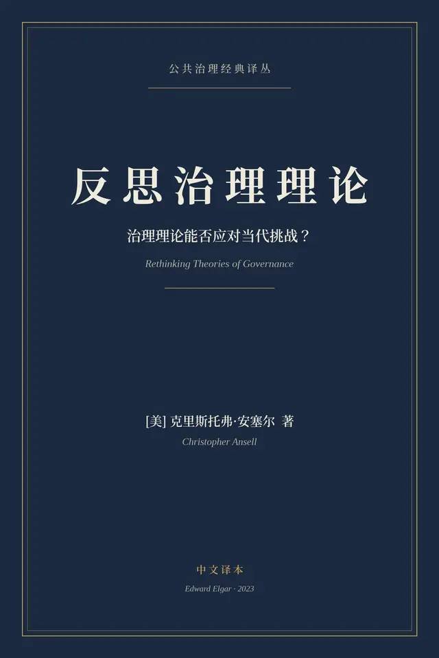

# 元数据

> [!abstract] 反思治理理论
> - 
> - 书名：反思治理理论
> - 阅读进度：0%
> - 阅读时长：2分钟
> - 最后阅读：2026-11-09
> - 微信读书：https://weread.qq.com/book-detail?type=1&v=35b42743643425f41373732426c323956465a66373748373541354c33326975a47

# 高亮划线

## 第一章 治理理论能否应对挑战？

> 📌 我们生活在一个充满挑战的时代。治理理论能否帮助我们应对这些挑战？它们是不是一种有用的资源？
> ⏱ 2026-10-26 18:51:21

> 📌 理论是否实用并不总是显而易见，究竟什么才算“好理论”也未必清楚。有人会说，理论的目的是理解，而不是实践行动；也有人会指出，我们面临的集体困境更多源于根深蒂固的政治约束，而非治理理论本身充足与否
> ⏱ 2026-10-26 18:51:31

> 📌 从“治理理论是否有用”这一视角出发，重新审视我们的治理理论
> ⏱ 2026-10-26 18:51:37

> 📌 当理论是“有根据的”（warranted）、具有诊断性（diagnostic）和对话性（dialogical）时，它才变得有用
> ⏱ 2026-10-26 18:51:44

> 📌 第一，治理一词常用于谈论具体事务如何被管理——如渔业治理、水资源治理等等。当人们关注具体社会问题的管理、谈论“在一线”的治理时，常常觉得治理这套语汇很有用。
> ⏱ 2026-11-09 23:37:47

> 📌 第二，治理一词通常用于谈论参与统治的众多群体和组织之间互动的结构与过程
> ⏱ 2026-11-09 23:37:57

> 📌 治理常被放在集体行动协调的意义上讨论；一些治理理论家把这种协调称为“掌舵”（steering）——这是一个系统论概念，源自德语 Steuerung，产生于关于政府如何指导、协调和控制相对自主的社会子系统的讨论（Mayntz, 1993）。例如，彼得斯和皮埃尔（Peters and Pierre, 2020）就把治理定义为引导经济与社会走向集体目标的掌舵
> ⏱ 2026-11-09 23:38:06

> 📌 第三，也许是最重要的，治理常常意味着把视野从“政府”拓宽，纳入公共行动者与私人行动者之间、或国家与市民社会之间的互动（Kooiman, 1993）
> ⏱ 2026-11-09 23:38:13

> 📌 不过，尽管这一概念可以容纳对纯粹私人治理的关注，却并不意味着政府已被自组织的私人行动者所取代
> ⏱ 2026-11-09 23:38:16
