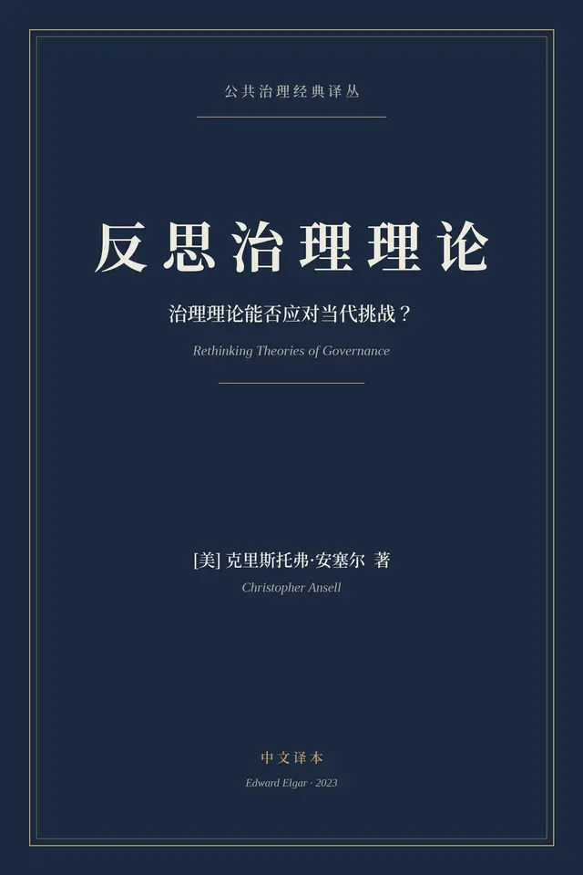

# 元数据

> [!abstract] 反思治理理论
> - 
> - 书名：反思治理理论
> - 阅读进度：0%
> - 阅读时长：2分钟
> - 最后阅读：2026-10-26
> - 微信读书：https://weread.qq.com/book-detail?type=1&v=35b42743643425f41373732426c323956465a66373748373541354c33326975a47

# 高亮划线

## 第一章 治理理论能否应对挑战？

> 📌 我们生活在一个充满挑战的时代。治理理论能否帮助我们应对这些挑战？它们是不是一种有用的资源？
> ⏱ 2026-10-26 18:51:21

> 📌 理论是否实用并不总是显而易见，究竟什么才算“好理论”也未必清楚。有人会说，理论的目的是理解，而不是实践行动；也有人会指出，我们面临的集体困境更多源于根深蒂固的政治约束，而非治理理论本身充足与否
> ⏱ 2026-10-26 18:51:31

> 📌 从“治理理论是否有用”这一视角出发，重新审视我们的治理理论
> ⏱ 2026-10-26 18:51:37

> 📌 当理论是“有根据的”（warranted）、具有诊断性（diagnostic）和对话性（dialogical）时，它才变得有用
> ⏱ 2026-10-26 18:51:44
