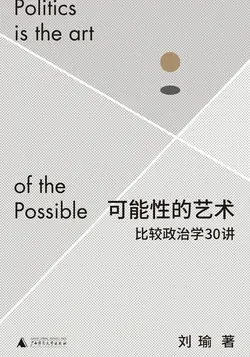

# 元数据

> [!abstract] 可能性的艺术：比较政治学30讲
> - 
> - 书名：可能性的艺术：比较政治学30讲
> - 作者：刘瑜
> - 简介：一个和平“爆发”的年代？
>   历史“终结论”的终结？
>   国家能力从何而来？
>   文明的冲突是一个过时的预言？
>   ……
>   面对林林总总的政治问题，作者带领我们以一种比较的视角，在民主问责和国家能力两个政治比较的核心维度下，建立起观察的参照系，将不同体制、不同经济发展水平的国家纳入比较的视野，去分析我们的时代背景和全球化进程，讨论不同国家的政治转型与国家能力，以及文化和经济对政治变迁的影响。
>   “政治是可能性的艺术。”当我们将面对的政治现实当作一万种可能性之一来对待时，就能从此时此地抽离，获得一种俯瞰的视角，进而再聚焦定位现实，在浩瀚的可能性中理解我们自身。
> - 出版时间：2022-04-01 00:00:00
> - ISBN：9787559848048
> - 分类：政治军事-政治
> - 出版社：广西师范大学出版社
> - 微信读书评分：90%
> - 阅读进度：0%
> - 阅读时长：2分钟
> - 最后阅读：2026-11-10
> - 微信读书：https://weread.qq.com/book-detail?type=1&v=9ea325a0813ab6d00g01640c

# 高亮划线

### 28. 新镀金时代？不平等的幽灵(1)

> 📌 根据谢宇教授的研究，中国的经济不平等在2010年左右到达顶峰，收入的基尼系数高达0.54，甚至超过同时期的美国。当然，最近10年左右，全球许多国家，包括中国，都出现了不平等又温和下降的趋势。
> ⏱ 2026-11-03 16:35:52
> 💭 基尼系数的本质是一个面积比：把所有人按收入从低到高排好队，画出“累计人口占比—累计收入占比”的曲线（洛伦兹曲线），它跟完全平均的对角线之间夹着的那块面积，除以对角线以下的整个三角形面积（恒为 0.5），就是基尼系数。所以它永远落在 0～1 之间。
> 🕰 2026-11-03 16:38:39
> 💭 基尼系数是20世纪初意大利经济学家基尼提出的指标，用来衡量收入分配差距：数值介于0与1之间，越接近0越平均，越接近1越不平均。通常把0.4视为“警戒线”，发达国家多在0.24~0.36，美国2013年约0.47，中国、巴西、南非等国则在0.5左右。
> 🕰 2026-11-03 16:36:47

> 📌 这也是为什么很多美国人，一旦失业或者生重病，就立刻陷入贫困，甚至因为付不出房贷房租而变得无家可归。
> ⏱ 2026-11-10 10:00:39
> 💭 最近斩杀线很热闹
> 🕰 2026-11-10 10:01:21
> 💭 我们怕是也差不多，一旦失业，大部分立马贫穷。差远了。无家可归和吃低保是两回事好嘛。
> 🕰 2026-11-10 10:01:14
