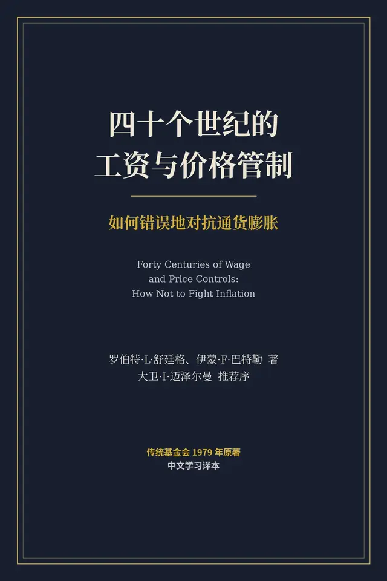

# 元数据

> [!abstract] 四十个世纪的工资与价格管制
> - 
> - 书名：四十个世纪的工资与价格管制
> - 作者：大卫·I·迈泽尔曼（David I. Meiselman）
> - 阅读进度：0%
> - 阅读时长：21分钟
> - 最后阅读：2026-10-20
> - 微信读书：https://weread.qq.com/book-detail?type=1&v=2d942a93643425f426c75447941447863465242373733373541326d5a47305ad96

# 高亮划线

## 前言

> 📌 两位作者于1974年开始撰写本书，其时美国总统尼克松（Richard Nixon）在美国实行的工资与价格管制刚刚终止
> ⏱ 2026-10-17 18:12:19

> 📌 自那时起，我们考察了公元前2000年至公元1978年间、分布于三十个不同国家的一百多个工资与价格管制案例
> ⏱ 2026-10-17 18:12:22

## 第1章 古代世界

> 📌 从有组织的政府刚刚出现之时起，统治者及其官员便以不等的成功程度，一直试图"控制"他们的经济。某种商品存在一个"公道的"或"公平的"价格、而且这个价格能够并且应当由政府强制执行——这种观念，显然与文明本身同样古老。
> ⏱ 2026-10-19 21:15:06

> 📌 政府总是把责任推给臣民的邪恶与不诚实，而不归咎于政策本身的无效。同样的倾向，今天依然存在
> ⏱ 2026-10-19 21:15:30

> 📌 人性如此，大约每隔十年，同一批老计划便被掸去灰尘：或许换个新名字，整个过程重新开始。
> ⏱ 2026-10-19 21:15:55

> 📌 在古代世界，对最重要的经济品——粮食——的支配权，本身就是至高的权力。"控制着必需品粮食供应的人，便掌握着最高权力
> ⏱ 2026-10-19 21:16:04

> 📌 早在埃及第五王朝（一般定年为公元前2830年或更早），君主亨库（Henku）便在自己的墓碑上刻下："我是本诺姆南方谷物的领主与监管人。"
> ⏱ 2026-10-19 21:16:32

> 📌 苏美尔的一位国王——拉伽什的乌鲁卡基那（Urakagina of Lagash），他约于公元前2350年开始执政。31从流传至今的零星记载看，乌鲁卡基那显然是路德维希·艾哈德（Ludwig Erhard）的先行者：他一上台，便着手解除政府加诸经济的过度管制，包括工资与价格管制。
> ⏱ 2026-10-19 21:18:36

> 📌 ，从乌鲁卡基那那里，"我们得到了人类历史上最珍贵、最具揭示意义的文献之一"——它记录着人为摆脱暴政与压迫而进行的、旷日持久而毫不松懈的斗争
> ⏱ 2026-10-19 21:20:22

> 📌 这份文献记载了对当时流行的一系列弊政的全面改革，其中多数弊政都可追溯到一个无处不在、令人生厌的官僚体系……正是在这份文献中，我们发现"自由"一词第一次出现在人类有记载的历史上；这个词是 amargi，字面意思是"回到母亲身边"……我们至今仍不清楚，这个比喻说法何以会被用来表示"自由"。
> ⏱ 2026-10-19 21:19:17

> 📌 若有人雇佣田间劳工，应付给他每年8古尔（gur）谷物。若有人雇佣牧人，应付给他每年6古尔谷物。若有人雇佣放牧牛羊的牧人，应付给他每年8古尔谷物。若有人租牛打谷，雇金为20夸（qa）谷物。若有人租驴打谷，雇金为10夸谷物。若有人租幼畜打谷，雇金为1夸谷物。若有人雇佣牛、车和车夫，应付给他每日180夸谷物。若有人单独租车，应付给每日40夸谷物。若有人雇佣工匠，则从年初到第五月，应付给每日6毫（银粒）银子；从第六月到年终，应付给每日5毫银子。若有人雇佣自由民之子：陶工的报酬为每日5毫银子；裁缝5毫银子；木匠4毫银子；绳匠4毫银子。若有人雇佣[字迹无法辨认者]，其报酬为每日3毫银子。若有人雇佣那克图（nakhirtu）女子，应付给每日2.5毫银子作为报酬。
> ⏱ 2026-10-19 21:31:57

> 📌 中国学者陈焕章（Huan-chang Chen）在其著作《孔子及其学派的经济原理》（The Economic Principles of Confucius and His School）中指出，孔子的经济学说主张："政府干预对于经济生活是必要的，竞争应被压缩到最低限度。"13
> ⏱ 2026-10-19 21:39:45

> 📌 每二十家店铺便设有一名"贾师"，职责是按成本核定每件商品的售价。"凡有天灾，"他写道，"商人不得涨价；例如饥荒之年，谷物必须按平价出售[即按政府所认定的'自然'价格出售]；大疫之年，棺材也须照同样办法出售。"
> ⏱ 2026-10-20 16:18:50

> 📌 纸与钱并用之处，纸币泛滥而钱总是不足；只用铜钱、别无其他钱币之处，钱通常充裕。由此可知，纸币只会伤害铜钱，而无补于铜钱之不足
> ⏱ 2026-10-20 16:19:40

> 📌 八百年前这两位中国经济学家，当时便已彻底懂得了一条经济学法则，而许多政治领袖直到今天还没有学会。
> ⏱ 2026-10-20 16:20:00

> 📌 在雅典，通晓谷物生意被视为政治家的必备素养之一。雅典是一个人口稠密而腹地狭小的城邦，谷物长期短缺，至少一半要靠海外进口
> ⏱ 2026-10-20 16:20:34

> 📌 首先监督谷物在市场上以公道价格出售；磨坊主按大麦价格的比例出售麸皮；面包师按小麦价格的比例出售面包；面包必须达到他们规定的重量。
> ⏱ 2026-10-20 16:20:57

> 📌 但吕西阿斯（Lysias）绝非第一个——他也很难说是最后一个——以"只要诸位把个别商人送上断头台，匮乏时期便能为百姓换来低价"来博取民心的政治家
> ⏱ 2026-10-20 16:21:42

> 📌 官僚是官员，对治下民众抱持惩罚取向……政府官僚机构是管制性的、汲取性的，而不是发展性的。它起源于书吏文化，总是倾向于由一批文学通才组成的士大夫阶层来主导。没有任何力量能够对它形成制衡。公司、立法机构、政党都还不存在。在多数情况下，一个社会那微不足道的精英，大多进了政府机构。这个政府侍奉的是一个言出即法的独裁者。因此，商人既得不到宪法保障，也无从防范那台机构……
> ⏱ 2026-10-20 16:22:45

## 第2章 罗马共和国与帝国

> 📌 共和国时期最著名的法令之一，是公元前449年的《十二铜表法》（Law of the Twelve Tables），它除其他事项外，把最高利率定为每里拉（libra）每月一盎司（uncia）（约合百分之八），不过这究竟是月息还是年息，已无从查考
> ⏱ 2026-10-20 16:23:21

> 📌 公元前367年的《李锡尼法》（Licinian law）宣布，已付利息可从所欠本金中扣除，实际上等于把利息的最高价格定为零。《格努西亚法》（lex Genucia，公元前342年）也有类似规定；我们被告知，违反这项"最高限额"的行为"在《马西亚法》（lex Marcia）之下受到严厉压制"。莱维总结说："除《十二铜表法》外，这些临时起意的、哗众取宠的措施很快便废止了。"
> ⏱ 2026-10-20 16:23:47

> 📌 公元前45年，尤利乌斯·恺撒（Julius Caesar）发现，差不多每三个公民中就有一个在领取政府免费发放的小麦。他设法把这个数字削减了约一半，但它很快又回升了；在帝国的漫长岁月里，罗马始终为这种人为压低的谷物价格所困扰，它造成了形形色色的经济失调
> ⏱ 2026-10-20 16:24:34

> 📌 公元284年戴克里先登基后不久，"各类商品的价格与劳工的工资便达到了前所未有的高度"。关于这场显著通货膨胀成因的历史记载十分有限。现存同时代史料中极少的一部——《迫害者之死》（De Mortibus Persecutorum）第七章——几乎把全部责任径直记在戴克里先账上
> ⏱ 2026-10-20 16:25:45

> 📌 由于已知该书作者是一位基督徒，而戴克里先又曾迫害基督徒，我们对这份报告必须打个折扣看待
> ⏱ 2026-10-20 16:25:48

> 📌 从长远看，膨胀同样是灾难。正是通货膨胀把帝国带到了全面崩溃的边缘。币制改革原本就是为了遏制这一灾祸，而它显然无法完成任务，这一点正变得越来越痛苦地明显
> ⏱ 2026-10-20 16:27:34

> 📌 于是他着手规定一切可售之物的价格。为了些微小事便大开杀戒；人们不再把食品运进市场，因为卖不出公道价钱；这使得饥荒越发严重，终于，在许多人因此丧命之后，这部法律本身被搁置一边。
> ⏱ 2026-10-20 16:28:02

> 📌 钱币学家证实，四世纪的铸币常常带有仓促粗制的痕迹；许多铸币未经修整、做得体面些就被抛进流通。造币厂这种草率的操纵，效果与我们现代印刷机无异——后者涌出滚滚不值钱、或几乎不值钱的纸币
> ⏱ 2026-10-20 16:29:07

## 第3章 从中世纪到近代早期

> 📌 在中世纪的英国，不仅全国政府，行会和市镇当局也都把固定价格当作一项常规活动。十三世纪时，英国的官员们"觉得自己有义务管制每一类经济交易，只要在这些交易中个人自利似乎会导向不公正"。
> ⏱ 2026-10-20 16:30:59

> 📌 都铎时代正是那场伟大的"都铎通货膨胀"的时代，而这场通货膨胀无疑是由亨利八世（Henry VIII）在位期间的货币贬值促成的。他穷奢极欲的生活方式意味着钱（以贵金属的形式）总得从某个地方来——它来自铸币的成色与重量。
> ⏱ 2026-10-20 16:34:06

> 📌 政府非但没有像1770年那样试图遏制投机，反而竭尽所能地鼓励投机。……在物价高昂的季节，政府若做任何遏制投机的事，其明智程度大概跟一艘沉船的船长下令全体船员减半口粮差不多。……在上一次饥荒中，人几乎一做粮食生意就犯法。到1866年，大批体面人物都做起了这行买卖；因为政府每周公布各地区粮价行情，使这种买卖既容易又安全。人人都知道哪里粮最便宜、哪里卖得最贵；于是粮食自然从最有余粮的地区被买走，运往最急需的地区。
> ⏱ 2026-10-20 16:58:59
