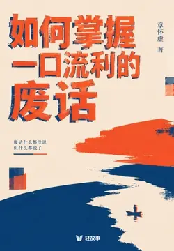

# 元数据

> [!abstract] 如何掌握一口流利的废话（轻科普）
> - 
> - 书名：如何掌握一口流利的废话（轻科普）
> - 作者：章怀虚
> - 简介：废话文学，一种用最少的语义密度维持最长时间对话的语言艺术。
>   它可以是维护人际关系的润滑剂，也可以是日常的调侃。妈妈那句“那也只能这样了”，似乎是一句废话，但人类交流并不总是寻求意义，有的时候只需要周围人情绪上的认同。
>   废话是给真实生活留的余地，能把一句话说成废话，反而是把一辈子活明白了
> - 出版时间：2026-06-05 00:00:00
> - 分类：个人成长-沟通表达
> - 微信读书评分：75%
> - 阅读进度：0%
> - 阅读时长：22分钟
> - 最后阅读：2026-11-07
> - 微信读书：https://weread.qq.com/book-detail?type=1&v=af132050813abb813g0169a7

# 高亮划线

## 文前

> 📌 我妈是个废话文学大师。
> ⏱ 2026-11-07 16:11:15

> 📌 她不上网，不刷B站，不看抖音。她62岁，在县城一个老小区住，每天早上去菜市场买菜，下午跟楼下王
> ⏱ 2026-11-07 16:11:18

> 📌 我那一刻突然就笑了。她什么都没说，又好像什么都说了。我跟她讲了二十分钟，她回了我大概不到三十个字，每一个字都像棉花一样，不接也不挡，但你抱怨的劲儿就这么散了
> ⏱ 2026-11-07 16:11:45
> 💭 这个方案行不行，主要看它到底行不行。
>
> 关于这个项目，我们简单说两句，至于具体怎么说，还得看情况。
>
> 工作嘛，做完了就是做完了，没做完就是没做完。
>
> 领导的意思大概就是：按领导的意思办。
>
> 这个任务难不难，取决于它到底有多难。
>
> 能解决就解决，解决不了那也解决不了。
> 🕰 2026-11-07 16:12:18
> 💭 好像说了，又好像没说，说话的最高境界；让我想到工作中的一些人，从不正面回答问题，解决问题，而是打太极，说了也好像没说，这真的是大智慧
> 🕰 2026-11-07 16:12:14

> 📌 后来我想明白——这就是废话文学的最高境界。我妈没读过什么书，但她活了六十多年，她明白一件事：很多时候，你不需要给对方一个答案，你只需要让对方知道，你听见了。
> ⏱ 2026-11-07 16:12:43

> 📌 学完这门课，你也能说出我妈这种水平的废话。你也能在饭局上，在会议上，在家庭群里，用一句不痛不痒的话把所有难题挡回去
> ⏱ 2026-11-07 16:12:58

## 第一课 先认识废话——一份不完整的样本集

> 📌 循环类： 三人行，必有三人。听君一席话，如听一席话。上次见你还是上次。我上次这么开心，还是我上次开心的时候。但凡你说得有用一句，你这话也不至于一句没用。
> ⏱ 2026-11-07 16:13:46

> 📌 同义反复类： 这个西瓜真大，给人一种很大的感觉。鲁迅说，我没说过这话。你这个人真是个人。但凡你跑得快一点，也不至于这么慢。我看你这个人吧，不能说不行，但也不能说行。
> ⏱ 2026-11-07 16:13:50

> 📌 条件零信息类： 只要你不睡，你就不会困。如果你能在三点之前完成，那么你就能在三点之前完成。如果不下雨的话，那应该就不下雨了。只要努力，就有收获。如果没有，那是你不够努力。你要是不饿就别吃。
> ⏱ 2026-11-07 16:14:03

> 📌 承上启下空话类： 据我所知，我也不知道。我觉得，如果可以的话，那就可以。这个事情吧，怎么说呢，反正就是那么回事。没有什么是一顿饭解决不了的。如果有，那就两顿。这话说得，听着像那么回事，又好像不像那么回事。
> ⏱ 2026-11-07 16:14:11

> 📌 反问加深类： 你说你这是图啥呢，要不你说你图啥？我不理解，但我大受震撼。你品，你细品。这怎么说呢，懂的都懂。
> ⏱ 2026-11-07 16:15:06

> 📌 如果你嘴角上扬了那么一下，恭喜，你已经入门了。
> ⏱ 2026-11-07 16:15:01
> 💭 如果我入门了，那我真是入门了。
> 🕰 2026-11-07 16:14:56

> 📌 废话文学不需要你思考。它需要你接受——接受语言可以什么都不传达，接受沟通可以什么都不解决，接受你说了一大堆，等于什么都没说。
> ⏱ 2026-11-07 16:15:16

## 第二课 废话的祖师爷们——东北人

> 📌 东北话本身就是一种半废话语言。东北人说话有一种独特的节奏感，他们不在意信息密度，他们在意的是说话的过程。一句话说出来，前三个字是铺垫，中间四个字是缓冲，最后两个字才是重点，但重点也不重要。
> ⏱ 2026-11-07 16:15:43

> 📌 “阿姨，你这盘菜里有头发，咱也不能说是你的，但咱也不能说不是你的。”
> ⏱ 2026-11-07 16:16:14
> 💭 阿姨：小伙子，说你年轻你也不年轻了，说你不年轻你确实年轻，
> 🕰 2026-11-07 16:16:22

> 📌 东北废话的祖师爷应该算是赵本山，他的小品里全是经典款：“要啥自行车？”——什么意思不重要，重要的是这个反问让对方无从回答。“脑袋大脖子粗，不是大款就是伙夫”——把一句无意义的描述包装成了民间智慧。“你跺你也麻”——没有任何实质内容，但完美收束了对话。
> ⏱ 2026-11-07 16:16:54

> 📌 赵本山的搭档范伟更是一绝。范伟在小品里那句“我蒙谁啊”，看起来是在反问，实际上是在自证清白，但谁也分不清他到底有没有蒙人。
> ⏱ 2026-11-07 16:17:04

> 📌 再往上追，得说马三立。马三立晚年那段相声《逗你玩》——通篇没什么实质内容，就是一个老头反复念叨“逗你玩”三个字，但全国人民都笑岔了气
> ⏱ 2026-11-07 16:17:17

> 📌 我有过一个不太严谨的猜想。东北是中国冬天最冷的地方，零下二三十度的时候，人不愿意张嘴。但东北人又是最爱社交的一群人，串门、唠嗑、酒局，缺一不可。两个矛盾撞在一起，就生出了一种用最少的信息维持最长时间的对话的语言艺术。
> ⏱ 2026-11-07 16:17:35

## 第三课 废话怎么火起来的——B站那年

> 📌 那一年B站上有一个UP主，发了一个视频。视频里他对着镜头一本正经地说：“听君一席话，如听一席话。”
> ⏱ 2026-11-07 16:18:27
> 💭 LPL十大经典废话文学（全网流传度最高，对标“听君一席话，如听一席话”）
>
> 1. 这场比赛两支队伍，最后一定有一支能赢下比赛
>
> 2. 寒冰现在这套装备，推塔快得一塌糊涂
>
> 3. 琴女给自己加速，相对来说等于对面减速，这就是峡谷相对论
>
> 4. Uzi还没倒下，Uzi还在输出！（此时Uzi早已撤离战场）
>
> 5. 下一条龙刷新出来，竟然还是水龙
>
> 6. 打赢大龙团的队伍，就是拿下这波团战的一方
>
> 7. 女警踩到夹子了，夹子刚好夹住女警
>
> 8. 领先一把无尽的时候，伤害特别高
>
> 9. 经济能翻过来，是经济落后队伍最想看见的局面
>
> 10. 现在这个时间节点，就是眼下这个时间节点
> 🕰 2026-11-07 16:18:31

> 📌 知乎上有问题问“废话文学算不算文学”，下面三千多个回答，没有一个能给出确定的答案——因为这个问题本身就是废话。
> ⏱ 2026-11-07 16:19:26

> 📌 那一年发生了不少事：互联网公司开始大规模降本增效，大学毕业生第一次面对就业难，房地产开始松动，疫情进入第二年，“内卷”“躺平”开始成为高频词。
> ⏱ 2026-11-07 16:19:37

> 📌 整个社会都很累
> ⏱ 2026-11-07 16:19:52

> 📌 累的人没力气讲道理，累的人不想再听别人讲道理。废话文学恰好在这个时候出现，给了所有人一个新的出口——我不反对你，我也不同意你，我只是用一句什么都没说的话，告诉你我听见了。
> ⏱ 2026-11-07 16:19:48

## 第四课 废话甚至传到了宝岛

> 📌 废话文学在大陆爆火不到半年，就跨过了海峡。2022年初，台湾的Dcard、PTT这些年轻人聚集的论坛上开始出现繁体版的废话文学。最早就是直接转载——“聽君一席話，如聽一席話”——一个字没改，竖排繁体。很快他们就开始本土化。台湾本土的废话样本：“你這個人是真的，真的就是這樣的人。”“看了這個新聞我才知道，原來這個新聞是這樣的。”“他這個人不能說很高，但也不能說不高，反正就是那個高度。”“這部電影看完之後我才發現，這部電影就是我看完的這部電影。”
> ⏱ 2026-11-07 16:20:48

> 📌 台湾本来就有一种说法叫“讲干话”，指的是说一些不痛不痒、没有营养的废话。讲干话是台湾政治和娱乐圈的传统艺能。废话文学传过去之后，跟干话文学迅速合流，又生出了一种新的混血形态。
> ⏱ 2026-11-07 16:20:58
> 💭 “讲干话”​，指的是说一些不痛不痒、没有营养的废话。
> 🕰 2026-11-07 16:21:09

> 📌 ETtoday、自由时报、TVBS新闻都报道过这个现象。报道里把它定性为“中国大陆青年文化向南输出”——这其实挺有意思的。过去十几年，是台湾文化向北输出居多，《康熙来了》《大学生了没》《通灵少女》一茬一茬。这次反过来，是大陆的网络流行语向南渗透
> ⏱ 2026-11-07 16:21:59

> 📌 废话文学是少数几个能跨越政治氛围，纯靠语言魅力实现两岸传播的网络文化现象。它没立场、没口号、没主张，它就是一种笑。
> ⏱ 2026-11-07 16:22:03

> 📌 笑是没有边界的。只要两岸的年轻人都累了，他们就都需要废话文学
> ⏱ 2026-11-07 16:22:37

## 第五课 废话的三种基本句法

> 📌 学到这一课，开始进入技术环节。废话文学看起来天马行空，其实有它的句法规律。摸清这三种句法，你自己就能现编。
> ⏱ 2026-11-07 16:22:44

> 📌 第一种：A=A型，同义反复。
> ⏱ 2026-11-07 16:22:47

> 📌 这是最基础的款。就是把一个东西用另一种说法重复一遍，让句子显得有信息量，但其实没有
> ⏱ 2026-11-07 16:22:56

> 📌 公式：X，是X那样的X。
> ⏱ 2026-11-07 16:23:04

> 📌 这个西瓜真大，给人一种很大的感觉。我家这条狗，怎么说呢，就是一条狗。这个事吧，从本质上来讲，确实就是这么个事
> ⏱ 2026-11-07 16:23:17

> 📌 练习：你现在试着用这个公式造一句。比如你看到一杯奶茶——“这杯奶茶喝起来，确实是一杯奶茶的味道。”合格。
> ⏱ 2026-11-07 16:23:21
> 💭 就我们领导讲的话吧，就有种领导讲话的感觉。
> 🕰 2026-11-07 16:23:55

> 📌 第二种：A→A型，循环论证
> ⏱ 2026-11-07 16:24:08

> 📌 把一个条件和它的结论用同一句话表达出来，表面在推理，实际啥也没推。公式：如果X，那么X。
> ⏱ 2026-11-07 16:24:12

> 📌 如果你能赶上车，那你就能赶上车。只要你不睡，你就不会困。你要是有钱，你肯定就有钱。一个人只要他活着，他就还没死。
> ⏱ 2026-11-07 16:24:23

> 📌 这种句式特别适合用来怼那些喜欢讲大道理的人，当对方说：“你只要努力就一定会成功”，你回他一句：“只要努力，就有收获。如果没有，那是你不够努力”，他立马哑火。
> ⏱ 2026-11-07 16:24:25

> 📌 第三种：A vs -A型，悖论平衡
> ⏱ 2026-11-07 16:32:06

> 📌 你这个人吧，不能说不行，但也不能说行。这事我同意，但也不算同意。我懂你的意思，但你的意思我也不太懂。我喜欢吃辣，但太辣的我又不吃。
> ⏱ 2026-11-07 16:32:21

> 📌 当老板问你某个方案怎么样，你说“这个方案确实有它的优点，但优点之外的部分还得看怎么理解”——老板会觉得你在认真思考，但你其实啥也没说
> ⏱ 2026-11-07 16:32:39

## 第六课 什么时候说废话最得体

> 📌 第一，对方期待你说点什么，但其实并不在意你说什么。
> ⏱ 2026-11-07 16:33:37

> 📌 最典型的就是长辈聚会，三姑六婆问你工资多少，对象有了没，什么时候要孩子。她们其实不在乎答案，她们只是在尽社交义务
> ⏱ 2026-11-07 16:32:52

> 📌 工资多少？——“够花，但也不算够花。”对象有了没？——“在看，也算没看。”什么时候要孩子？——“想要的时候就要，不想要的时候就不要。”
> ⏱ 2026-11-07 16:33:15

> 📌 第二，你说真话会引发冲突，但你又不想沉默。
> ⏱ 2026-11-07 16:33:40

> 📌 标准应答：“老板这个想法有它的独到之处，但具体落地的时候，我们可能还得再深入思考一下。”“我觉得这个方向是对的，但方向之外的细节，还需要进一步对齐。”
> ⏱ 2026-11-07 16:33:45
> 💭 职场老鸟都懂，这么说其实就是不同意的委婉说法。要真有人听不懂画外音，那趁早别干了。
> 🕰 2026-11-07 16:33:58

> 📌 第三，你需要给对方一个情绪反馈，但不需要给信息。
> ⏱ 2026-11-07 16:34:04

> 📌 “你说的我都懂。这个事情吧，时间会给你答案。”“感情这个东西，没经历过的人，是真的没办法理解。”“你现在这样，已经很不容易了。”
> ⏱ 2026-11-07 16:34:08
> 💭 每个评论和书本例子我都想抄下来🤣我的思维是解决问题型的，比如朋友吐槽亲戚烦 我说办法不搭理 对方突然来句但是亲戚给我钱啊 我都无语了，不知道啥脑回路，吐槽了提供解决方案又各种否定，后来才知道有些人说话不是为了解决问题，我太需要废话文学了🤣
> 🕰 2026-11-07 16:34:36
> 💭 你能这样，已经很厉害了
>
> 如果我是你的话，肯定早就受不了了
> 🕰 2026-11-07 16:34:17

> 📌 废话最不该说的场景也有：医生问诊、警察问话、考试答题、工作汇报里的关键数据。这些场景需要的是确定性，你说废话，对方会认为你在敷衍，甚至会被认为是在逃避。记住：废话是给情绪空间用的，不是给信息空间用的。
> ⏱ 2026-11-07 16:34:43
> 💭 废话作用于需要提供情绪空间，而不是信息空间
> 🕰 2026-11-07 16:34:57

## 第七课 废话和鸡汤的对决

> 📌 三十岁慌了，依然慌。命运的齿轮没转动，房贷的齿轮转得飞快。“你所站立的地方就是你的中国”——是的，但你的中国正在裁员。
> ⏱ 2026-11-07 16:35:50

> 📌 鸡汤，假装在告诉你真理。废话，不假装告诉你任何东西。鸡汤，用煽情的语言推销价值观。废话，用平淡的语言拆解价值观。鸡汤，让你相信努力会有回报。废话，告诉你努力不一定有回报。鸡汤，提供虚假的希望。废话，提供真实的认怂。鸡汤，越读越焦虑。废话，越读越放松。
> ⏱ 2026-11-07 16:36:04

> 📌 简单说，鸡汤是“骗你的”，废话是“陪你的”。
> ⏱ 2026-11-07 16:36:06

> 📌 废话回答：是的呀，压力这个东西，每个人都有，但每个人的压力又不太一样。你这样吧，先把今天过完，明天的事明天再说。
> ⏱ 2026-11-07 16:36:24

> 📌 因为废话不撒谎，废话不承诺什么，所以也不会让你失望。
> ⏱ 2026-11-07 16:36:26

## 第八课 废话的禁忌避难所

> 📌 很多话不能直接说，涉及政治的，涉及上下级的，涉及钱的，涉及性的，涉及家庭矛盾的，涉及朋友隐私的——这些话你说真心话会得罪人，说假话又违心，沉默又显得你冷漠。废话此时是唯一的出口。
> ⏱ 2026-11-07 16:36:33

> 📌 场景一：有人在饭桌上发表了一个明显你不认同的观点。
> ⏱ 2026-11-07 16:36:49

> 📌 直说：“我不同意你这个观点。”——气氛瞬间凝固。废话：“你这个想法挺有意思的，确实是一个看问题的角度。”——气氛保持。
> ⏱ 2026-11-07 16:36:53
> 💭 我就是这样的“每个人观点不同，小事情小事情”其实心里已经开始骂蠢货了【狗头】
> 🕰 2026-11-07 16:37:12

> 📌 场景二：朋友问你他新买的衣服好不好看。其实不好看。
> ⏱ 2026-11-07 16:37:16

> 📌 直说：“不好看。”——朋友破防。谎话：“好看。”——朋友以后还会穿出来。废话：“这件衣服挺特别的，能驾驭住的人不多。”——朋友自己琢磨去吧。
> ⏱ 2026-11-07 16:37:28

> 📌 场景三：领导让你评价同事的工作。同事是你的对头。
> ⏱ 2026-11-07 16:37:31

> 📌 直说：“他干得不行。”——你被记仇。谎话：“他干得不错。”——你违心。废话：“小李这个人吧，做事有他自己的方式。这个方式好不好，我觉得还得看具体场景。”——领导自己去评估。
> ⏱ 2026-11-07 16:37:45

> 📌 场景四：家庭群里，长辈转发了一篇你完全不同意的文章，问你看完什么感想。
> ⏱ 2026-11-07 16:37:53

> 📌 直说：“这文章是假的。”——长辈生气。废话：“这个说得有道理。我觉得这种事情吧，每个人有每个人的看法。”——皆大欢喜。废话不是懦弱，废话是一种社交润滑。
> ⏱ 2026-11-07 16:38:08

> 📌 它承认了一件事——很多场合，真相不重要，立场不重要，重要的是大家能继续坐下去。
> ⏱ 2026-11-07 16:38:09
> 💭 我就不会惯着某些老出生，我又不是他们的情绪斐济杯🧐🧐🧐
> 🕰 2026-11-07 16:39:54
> 💭 学到了。比如我以前鄙夷的饭局，就是一堆人（有的还不熟）在那讲废话。以前我会觉得，这不是浪费时间给别人也给自己添堵嘛？透过现象看本质，饭局废话并不是要传递什么真相和立场，重要的是承接住情绪。这个特定的场合给予情绪一个空间和出口，而人在无聊甚至低落的生活中往往最需要这个。
> 🕰 2026-11-07 16:38:23

## 第九课 我也曾经讨厌废话

> 📌 我也曾经讨厌废话
> ⏱ 2026-11-07 16:43:19

> 📌 我大学读的是理工科，毕业后进了互联网做产品。我那个圈子里的人，开口闭口都是“颗粒度”“链路”“赋能”“抓手”。
> ⏱ 2026-11-07 16:43:40

> 📌 旁边我表姐站起来，拍了拍我肩膀，对医生说：“医生，我们家的情况吧，您也看出来了。我们想让她舒服一点，但又不能太放弃。您看着办，我们都听您的。”
> ⏱ 2026-11-07 16:44:05

> 📌 废话不是无能，废话是一种语言上的让步——承认有些事情说不清楚，承认有些情绪传达不了，承认人和人之间，并不需要每一句话都信息密度最大化。废话是给真实生活留的余地。
> ⏱ 2026-11-07 16:44:09

## 第十课 装杯实战手册

> 📌 场景一：饭局上，长辈讲完人生感悟问你怎么看。
> ⏱ 2026-11-07 16:44:29

> 📌 标准应答：“您说的这个，我得回去好好琢磨琢磨。这个事吧，没有亲身经历过的人，确实很难说理解。”要点：先肯定对方说得有深度，再给自己留一个“没经历过所以不评论”的台阶，长辈听完会很满意。
> ⏱ 2026-11-07 16:44:32

# 章节点评与书评

## 读书笔记

260628《如何掌握一口流利的废话》章怀虚

​挺有意思的一本书，直到一多半我都觉得它也是一本废话，但它却是一种足够有用的废话。

​废话，既表明了你的态度，又承接了他人的情绪，给你一段自由和缓冲的时间，也给对方一段自由和缓冲的时间。

​但书里面有一段是我不认可的，作者认为对话废话通常没有立场，但是我认为有些废话当你说出口，你愿意承接的那一刻起，在某些时刻你就是拥有立场的。

> 记录于 2026-11-07 16:10:58
