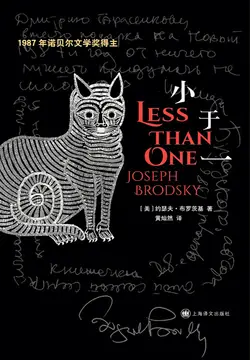

# 元数据

> [!abstract] 小于一（布罗茨基文集）
> - 
> - 书名：小于一（布罗茨基文集）
> - 作者：约瑟夫·布罗茨基
> - 译者：黄灿然
> - 简介：1987年诺贝尔文学奖得主约瑟夫·布罗茨基著，“一个诗人对一个帝国”。黄灿然经典译本全新修订版。《小于一》是约瑟夫·布罗茨基的首部散文集，以长文为主，夹以若干短文，仅十八篇文章，篇篇精彩，再加上其文体和“书体”的独特，遂形成一本完美之书。这是一个伟大诗人的精神自传，也是一部私人回忆录。布罗茨基以创造性的诠释与解读，完成了他对阿赫玛托娃、奥登等人的致敬，对个人价值的有力捍卫，还有对独裁者罪行的揭露和控诉。这样的控诉使用的不是公共语言和措辞，而是站在“一个诗人对一个帝国”的高度。而这个高度，又源自他的一个信念：语言高于一切，甚至是时间崇拜的对象，诗歌则是语言的至高形式。
> - 出版时间：2020-12-01 00:00:00
> - ISBN：9787532785179
> - 分类：文学-散文杂著
> - 出版社：上海译文出版社
> - 微信读书评分：87%
> - 阅读进度：0%
> - 阅读时长：4分钟
> - 最后阅读：2026-11-13
> - 微信读书：https://weread.qq.com/book-detail?type=1&v=ddd3286072288e70dddca7e

# 高亮划线

## 小于一

> 📌 我记得，在我十岁或十一岁的时候，想到马克思的名言“存在决定意识”，觉得只有在意识学习掌握疏离的艺术时，这个说法才是真的；
> ⏱ 2026-11-13 03:57:51

> 📌 之后，意识便独立自主，并可以决定和忽略存在。在那种年龄，这不啻是一个发现——却说不上值得记录，因为这肯定已被别人更好地阐述过了。“存在决定意识”是精神楔形文字的完美例子，至于谁首先破译它其实并不重要。
> ⏱ 2026-11-13 03:57:59

> 📌 老彼得摩擦人民的两肋。
> ⏱ 2026-11-13 03:58:05
> 💭 城市的改名在布罗茨基看来，也许意味着意识形态对城市传统记忆的篡改。在老人口上流传的歌谣中，彼得堡是一座象征君王剥削的城市，单单他的名字就成为一种恐惧的象征，而列宁格勒无疑代表一位伟大的领袖。一次对人民记录的历史的篡改。
> 🕰 2026-11-13 03:58:25
> 💭 这跟“嘉靖、嘉靖，家家干净”异曲同工。
> 🕰 2026-11-13 03:58:13

> 📌 从那条流向波罗的海的灰色、反光的河流和河流里偶尔一艘在急湍中挣扎的拖船，我学到的关于无限和禁欲的知识，要比从数学或芝诺那里学到的更多。
> ⏱ 2026-11-13 03:58:35

> 📌 那时斯大林还活力充沛，而列宁已经死了，仅仅是因为这点，他便是“好”的，因为他属于过去——即是说，得到历史和自然的赞助。
> ⏱ 2026-11-13 03:58:43
> 💭 经历过历史的人也将会变成历史本身。
> 🕰 2026-11-13 03:59:53
> 💭 死亡完成了对列宁的神化 而斯大林还活着，因此他是危险、赤裸的。人们对统治者的评价往往不取决于其实际罪行或功绩，而取决于时间距离带来的审美化幻觉。今天我们所赞美的某些过往也许只是因为我们如今不必再承受它的重量。
> 🕰 2026-11-13 03:59:33

> 📌 她半信半疑地笑着说，你可以回家向父母问个清楚。我没有再回去那个图书馆，尽管我后来成为很多别的图书馆的会员，它们也都要求填写相同的申请表。我不羞于自己是犹太人，也不害怕承认是犹太人。
> ⏱ 2026-11-13 04:00:21
> 💭 他并不怕承认自己是犹太人，但是又再也没有回去过，是不是因为那个图书馆太在意民族这个选项，不知道就不能进去！
> 🕰 2026-11-13 04:00:31

> 📌 在班级花名册上，我们的姓名、父母姓名、家庭地址和民族都有详尽记录，老师在课间休息时，总会时不时“忘记”教室书桌上那本花名册
> ⏱ 2026-11-13 04:01:01
> 💭 师德有亏。
> 🕰 2026-11-13 04:01:05

> 📌 我们会像秃鹰一样，扑向那本簿子；我们班上所有人都知道我是犹太人。但是七岁男童们都做不好反犹者
> ⏱ 2026-11-13 04:01:24

> 📌 按我的年龄计，我算是颇为强壮的，而那时最重要的还是拳头大小。我羞于“犹太人”这个词本身——在俄语里念作“耶夫雷”——不管它的内涵是什么
> ⏱ 2026-11-13 04:01:20

### 2

> 📌 也就是在那个时候，我学会不相信一切有关潜意识的噪音
> ⏱ 2026-11-13 04:02:04

> 📌 我想，我从未以象征符号做过梦——我总是看到真实事物：乳房、臀部、女人内衣。关于后者，当时对我们男孩来说，它有一种奇怪的深意
> ⏱ 2026-11-13 04:02:20

> 📌 我记得，在课堂上，有人会从一排桌子下一路爬到老师桌子前，带着唯一的目标——查看那天她衣服下穿着什么颜色的内裤。完成了他的考察后，他会用戏剧性的低语向其他同学宣布：“浅紫色。”
> ⏱ 2026-11-13 04:02:29

> 📌 　芝诺（约前335—约前263），古希腊哲学家，斯多葛学派的创始人，主张坚忍克己，恬淡寡欲。（以下译注如无特别说明，则均为译者所加，不再逐一标注。）
> ⏱ 2026-11-13 04:02:47

# 章节点评与书评

## 读书笔记

最喜欢《一首诗的脚注》，对茨维塔耶娃《新年贺信》的解读曾数次令我落泪。其次是《逃离拜占庭》和《一个半房间》。但总体来说，篇篇都是精品。

✦ 窄门

透过中文去理解用英语写就的俄国诗评实在是一种痛并快乐着的体验。

读布罗茨基、读诗、读外国文学甚至读广义上所有的作品，都是在企图进窄门——不止是在狭义的神学意义上，也是在广义的神学意义上，还是在宇宙学的意义上，同时，这窄门也不止一扇。

在狭义的神学意义上，“窄门”这个概念自不必多说：

「你们要努力进窄门。因为引到灭亡，那门是宽的，路是大的，进去的人也多。引到永生，那门是窄的，路是小的，找着的人也少。」

下面来解释一下宇宙学。

布罗茨基喜爱用“加速度”形容广义上的诗学，在评论曼德尔施塔姆和茨维塔耶娃时他都用到了这个词：

「俄罗斯走了她所走的道路，而对其诗学发展本身就非常快速的曼德尔施塔姆来说，那个方向只能带来一样东西——可怕的加速度。这种加速度首先影响他诗歌的性格。他诗歌那崇高性、沉思性、有音顿的流动变成了迅捷、猝然、啪嗒响的运动。

他的诗歌变成一种高速和暴露神经，有时候隐秘的诗歌，带着多少有点缩略的句法，以无数飞跃越过不言自明的东西。然而，以这种方式，它反而变得比以前任何时候更具歌唱性，不是吟游诗人似的歌唱，而是鸟儿似的歌唱，带着刺耳、难以预料的措辞和音高，有点像金翅雀的颤音。」

「把诗歌扩展至散文里，茨维塔耶娃并没有因此消除大众意识中诗与散文之间的界线，而是把这界线转换到一个迄今在句法结构上难以企及的语言领域——向上。

而原本在风格上走入死胡同的危险性就比诗歌高得多的散文，则只会从这种转换中获益：在她那稀薄化的句法空气中，茨维塔耶娃给它传递了一种加速度，并使惰性这个概念发生改变。」

这种心灵上的、乃至令语言诗化的加速度是迅捷的、向上的、朝向未知的、富含潜能的，因而也是宇宙学的：

「这种速度之磨，既是一幅自画像，也是对天体物理学的一种难以置信的洞见。」

而比起宇宙学，布罗茨基似乎不那么待见神学：

「一个诗人总的来说要比一个使徒更慷慨。诗学的“乐园”不局限于“永福”，因此不会受到某个教条乐园过度拥挤的威胁。与被说成是某种最后场面也即灵魂之结局的标准基督教乐园相反，诗学乐园更多是一个山峰，而诗人的灵魂与其说是达到完美了，不如说是处于持续运动中。

一般来说，诗学中的永生理念更多是受引力作用朝向宇宙学，而不是朝向神学；通常用来衡量灵魂的，也不是对达到与造物主相似或与造物主合而为一来说必不可少的完美程度，而是它在时间中漫游的具体的（抽象的）耐久性和遥远性。原则上，诗学中的存在概念会避免任何形式的有限性或停滞，包括神学上的神化。

不管怎么说，但丁的天堂要比教会版本的天堂有趣得多。」

但是在此处，我想说，广义的神学和宇宙学的分野或许可以不那么明晰：

「越是经常不断地进行思考，两个事物就越是以新的赞叹和敬畏充溢我的情感，这就是：我头顶上的星辰密布的天空和我心中的道德法则。」

这是康德。

「宗教实际上是人直观宇宙的方式，是人对自己最内在本性的呼声和追随。」

这是施莱尔马赫。

而更久远一些，在尚无基督教的世界里，还有哲学与文学的起源：对宇宙的叩问。本原、始基是水，是火，是阿派朗，是逻各斯，又或是奥林匹斯众神。

因此神学与宇宙学本就是一胞双胎。

当宇宙学成了新的神学，或者说，当二者重新如古时融合，或许我们就重获了一种双重性：在心灵的静中直观理念的动，在近处的、定形的文本里体验遥远的、有待澄清的未知，在有限性中同无限合一，在瞬间经历永恒。

这就是既是神学的又是宇宙学的、既新又旧的窄门——新是就狭义的神学而言，旧是对神之演变史的历时性来说。

而关于窄门的数量问题，或许可以先回到柏拉图，在这里，他的理式论现今还有一席之地，只不过是以变体的形式：“艺术与真理隔了三层”变成了“我们与诗人隔了三层”。

第一层是英译中，第二层是俄译英，第三层是诗心互译。

即，心灵中那看不见摸不着的体验被诗人自己翻译成用俄语写就的诗歌，而这俄语诗歌又被布罗茨基译成英文，接着，英文被黄灿然译成中文，如此，中文译文才是最终呈现给我们的模样，最后，还要经历一次将这中文译文翻译为我们自己的心灵的语言的过程。

同时，还存在一条诗歌评论的翻译进路，即布罗茨基将自己对俄国诗歌的感想译为他下意识使用的那种语言（我认为是他的母语俄语），再将这种语言译为英语写下来，黄灿然将英文译为中文，最后，我们再通过中文进行理解。

这每一次翻译，就是一扇窄门。

我们要努力进窄门，如此才更有可能接近诗人。

✦ 与天使的疏离

在翻译的过程中，似乎必然会失掉些什么：形式与内容、语音与语义的统一大概率会被破坏。所指抵达了，而原本的能指被抛下了，新的能指接过了载体的重任。这种悲剧式的断裂严重阻碍了不同语种的读者对诗歌的理解。

布罗茨基以茨维塔耶娃为例，让人近距离感受到了这种断裂：

「《新年贺信》以典型的茨维塔耶娃方式开始，从八度音最右端——也即最高——的高音C开始：

S Novym godom——svetom——kraem——krovom!

Happy New Year——World/ Light——Edge/ Realm——Haven!

新年快乐——世界/光——边缘/王国——避难所！

——用一个感叹号指向上面、外面。贯穿整首诗的这个调性，如同这首诗中的男高音，是不变的：唯一可能的修改，不是音域向下降（哪怕是插入语），而是向上升。在这个调性渗透下，这行诗中主格句的设置创造了一种狂喜效果，一种情感升腾的效果。这种感觉，得到那些外表上同义的列举的加强，如同上升的阶梯（阶段），每一级都高于前一级。

然而，这种列举，只是每个词的音节数目方面的同义，而茨维塔耶娃的平等（或不平等）的标记——破折号——把它们分开的程度，远甚于一个逗号所能达到的：它把每个后来的词都推向比前一个更远的高处。

更有甚者，在“新年快乐”（S Novym godom）中，只有一个词“年”（god）的使用，是原意上的使用；这行诗里的其他所有词都负载——超负载——着各种联想和比喻性的意义。“Svet”（世界，光）的使用有三重意义：首先是作为“世界”，例如“新世界”中的“世界”，它是通过与“新年”的类比而达成的——即是说，地理上的新。

但这地理是抽象地理；茨维塔耶娃心中更有可能想到“远处的背后”的某个东西，而不是大洋的另一边：某种界外范围。这种把“新世界”当作另一个范围的理解，引向有关“来世”的理念，而“来世”事实上才是真正要谈论的问题。

然而，“来世”首先是光；因为，由于这行诗的含意和“svetom”在音调上比“godom”优越（更有穿透力的声音），它的位置实际上是在头顶上面某处，在天空中，那里是光的来源。前后的破折号几乎使那个词摆脱了语义学上的职责，从而给“svet”装备了满仓库的正面指涉。不管怎样，在“来世”这个概念中，重点都同义反复地落在光方面，而不是像通常那样落在黑暗方面。

接着，这行诗在听觉上和地形学上都从抽象地理的“svet”向上飞，飞向那简短、呜咽般的“krai”（边缘，王国）：世界的边缘，一般的边缘，朝向天上，朝向天堂。“S novym...kraem”的意思，除了别的外，还指“新王国快乐，新边界快乐，越过边界快乐”。这行诗以结尾部“s novym krovom”（新避难所快乐）告终，既是语音的，又是语义的，因为“krovom”的语音实质与“godom”的语音实质几乎相同。

但这两个音节已被“svetom”和“kraem”提高了，比原本的声音提高了整个八度音——八个音节——根本不可能再回到那行诗的起点的调性或其原意。仿佛“krovom”正从更高处回望它在“godom”中的自己，元音和子音都不认识了。“Krovom”中的子音“kr”与其说是属于“krov”这个词本身，不如说是属于“krai”这个词，而正是部分地由于这个原因，“krov”的语义学意义似乎变得太稀薄了：这个词被放置在太高处了。

它作为世界边缘的一个避难所的意义和作为一个可以回去的家——一个庇护所——的意义，与“krov”交织在一起，而“krov”意思是天堂：地球的普世天堂和个人的天堂，灵魂的最后避难所。」

真的只有浸润俄语文学多年的人才能写出这样精妙的评论。

我一直认为，每一种语言，就是一种独特的思维方式，一种文化的显形。就像，同是“爱”，在古希腊语中，ἔρως是爱欲，偏向性的激情（love, mostly of the sexual passion），而ἀγάπη是神之爱，在《新约》语境中，指上帝对人的爱、人对上帝的爱、人与人之间的爱，φιλία则是指友爱（affectionate regard, friendship），若说，在中文里，ἔρως和φιλία还算有对应词语（爱欲和友爱），那么ἀγάπη似乎无法在中文里找到很准确的对应词。

而这种区别在中西哲学中的体现，大概就是希尔贝克、吉列尔所说的“中国文明更多的是实践的和实用的取向”了吧。

除了隐性的思维方式，还有更为明显的发音，这也是仅读英译或中译无法理解茨维塔耶娃妙处的原因之一。在《新年贺信》中，翻译令诗歌的韵律完全消失了。因此我无法捕捉到布罗茨基所说的那种向上的态势，进而也无法完全接住这每一个词语所承载的重量——情感的、宗教的、文化的……

故布罗茨基十分强调听觉：

「“用耳朵”分辨恰恰是创作的精神，它在一首诗中的载体或传送器是韵律，因为正是韵律预先决定了作品的调性。任何有点写诗经验的人都知道，诗歌韵律相当于某种心理状态，有时候不是一种而是多种状态。诗人通过韵律的手段来“分辨”他通往作品精神的路。

当然，在使用标准韵律时，潜伏着机械化说话的危险，每一个诗人都以自己的方式克服这危险，而克服过程的难度愈高，所描绘的特定心理状态的画面便愈精细——对诗人和读者来说都是如此。结果往往是诗人开始把韵律视为种种有活力的——在古老的意义上，是有灵感的——实体，如同某些圣器。」

他形容茨维塔耶娃是“耳朵评论内容”，她的“扬抑格回响着哀吟和咒语”。

但，翻译或许还是无法阻止另一些东西的：想象力。

在评论茨维塔耶娃《新年贺信》中的那句“最母语的是天使的”（the most native is Angelic）时，布罗茨基这样写：

「这是一个涉及“更母语”的高度的问题，也即不是俄语或德语可以获得的：一种超语言的高度，在普遍语调中——精神性的。终究，天使是用声音沟通的。

然而，“对我来说……最母语的是天使的”所包含的那种极容易辨认的好争论音调，却指向那“天使的”之完全非教会的特点，指向其与极乐的非直接关系；实际上，这只是茨维塔耶娃著名的说法“天上真理——对地上真理的声音”的另一个变体。两种说法所反映的世界观中的等级主义，是一种不受限制的等级主义——至少不受教会的地形学限制。

因此，她在这里只是在补助意义上使用“天使的”，旨在标示她本人——如她所言——向其尖叫的那个意义的高度。」

这令我想起里尔克的《杜伊诺哀歌》：

「如果我哀吟，天使们的队列中，有谁会听见我的声音？」

里尔克在给一名波兰译者的信中这样解释哀歌中的天使，它们的存在是这样一种生灵——“在这种生灵中，我们正在完成的从有形之物向无形之物的转化，已经显现在它的完成中……这样一种存在保证了对寓于无形中的更高现实的认识”。天使们构成了更高的存在秩序，人的能力正是以天使们为背景而受到考核和裁判的。

此外，茨维塔耶娃的另两行诗也令我想起里尔克。

茨维塔耶娃写：

「从此世望——如果不是望向那［来世］，从那［来世］

如果不是望向多苦难的此世。」

而里尔克写：

「此刻有谁在世上某处死，

无缘无故在世上死，

望着我。」

我想，不需要原文，不需要背景，单纯的意象就足够让人产生联想。

但如果了解一些背景，那么我觉得，最令人心碎的是，茨维塔耶娃的这首诗，是为里尔克而写的悼词。

而任何悼亡诗，都是一幅自画像——

「对茨维塔耶娃来说，德语是比俄语还母语的，即是说，德语与俄语都是她童年的语言，而她的童年刚好碰上19世纪的结束和20世纪的开始，连同19世纪德语文学对一个孩子产生影响的一切后果。」

同时，也「恰恰是茨维塔耶娃对德语的认识造就了她与里尔克的关系；因此，后者的逝世也是间接地打击——横越她的一生——她的童年。」

里尔克对言说的绝望似乎也以这样或者那样的方式蔓延到了茨维塔耶娃的笔下，缪斯哀泣，天使在上，同我疏离。

> 记录于 2026-11-13 03:57:32
