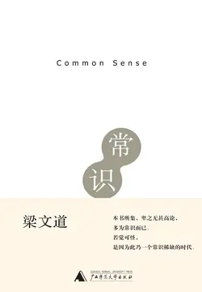

# 元数据

> [!abstract] 常识
> - 
> - 书名：常识
> - 作者：梁文道
> - 简介：一个知识分子眼中的大国民与小世界。本书为梁文道先生近两年来撰写的时评文字结集，谈及政治、民主、民族、教育、新闻自由、公民道德等社会诸多方面。文字风格犀利，文章主旨清晰、论述简洁有力，往往一针见血命中问题之要害，其文字在带给读者阅读快感之余，还催人省思，给人启示。本书名曰《常识》，正如梁氏自言：“本书所集，卑之无甚高论，多为常识而已。若觉可怪，是因为此乃一个常识稀缺的时代。”
> - 出版时间：2009-01-01 00:00:00
> - ISBN：9787563379637
> - 分类：文学-散文杂著
> - 出版社：广西师范大学出版社
> - 微信读书评分：71%
> - 阅读进度：0%
> - 阅读时长：4分钟
> - 最后阅读：2026-11-11
> - 微信读书：https://weread.qq.com/book-detail?type=1&v=aae328d0716c1fa5aaee48a

# 高亮划线

## 作者简介

> 📌 梁文道　1970年生于香港。1988年开始撰写艺评、文化及时事评论，并曾参与各种类型的文化及社会活动。现职凤凰卫视评论员，为《南方周末》及《南方都市报》等中国内地、香港及马来西亚十余份报刊杂志专栏作家。
> ⏱ 2026-10-15 18:08:23

## 自序

> 📌 我常常把自己看成一个人类学家，透过文档爬梳与现实生活等田野调查的方法，力图能用“本地人”的眼光去看周边景物，用“本地人”的思维去考虑眼前的问题
> ⏱ 2026-10-15 18:22:45

> 📌 在这个过程里面，我切实体会到一个香港评论人的最大原罪其实不是什么“洋奴心态”，而是相对优渥的空间
> ⏱ 2026-10-15 18:22:53

### 抗战 为什么它还没有结束

> 📌 抗战 为什么它还没有结束
> ⏱ 2026-11-09 23:39:38

> 📌 两种非常奇怪的现象：一是2005年全球纪念二次世界大战的结束，战时死亡人数最多的俄罗斯在纳粹德国投降的六十周年，于莫斯科红场举行了盛大的阅兵仪式。一队苏联红军接受俄罗斯人民的英雄式欢迎，光荣无比地经过克里姆林宫，一派战胜国的气势
> ⏱ 2026-11-11 14:43:06

> 📌 反观死伤数字比得上俄罗斯、战时国体残败犹有过之的中国，对之却表现得相当低调。而且全国上下的官方机构、各级传媒也是多谈当年的苦难国耻，少谈胜战的荣耀喜悦。明明是二次世界大战的胜方，中国却表达不出一种胜利的感觉
> ⏱ 2026-11-11 14:43:11

> 📌 二是近期各种国际媒体竞相吹嘘中国的强大崛起，《经济学人》甚至以“中国统治了世界经济”为题做了个专辑。而东南亚各地的传媒和民调也显示出对中国崛起的担忧日益增加，仿佛王朝时期的朝贡体系随时再临。但是中国人自己却不这么看，部分百姓则把美国日本当做凶险的国家。似乎八国联军围攻京师的日子还没过去，四处仍有强敌环伺，我们依然处在“最危险的时候”。
> ⏱ 2026-11-11 14:42:55
> 💭 难道不该是这样吗？看看这几年西方对我们的态度，我们也想和平，但奈何这些国家不做人！
>
> 但我也不能说作者乱讲一通，毕竟作者写这篇文章的时候是2005年。要是放在现在还这么认为就不对了。
> 🕰 2026-11-11 14:43:32

> 📌 当然“中国威胁论”有夸大不实的地方，也有很多国人对当前中国的地位深感骄傲。但是巡视一遍中国各大网站的网民言论，我们更容易感到的是一种浮躁不安的情绪
> ⏱ 2026-11-11 14:43:50

> 📌 听说韩国要求中国人以后改称“汉城”为“首尔”，有人立时上升到民族尊严的层次，说些“我们爱怎么叫就怎么叫，你韩国人凭什么？咱中国人不是好欺负的”之类的话。少数更极端的言论甚至要合并蒙古、越南，好“振我汉唐天威”
> ⏱ 2026-11-11 14:43:54
> 💭 首尔位于韩国西北部的汉江流域，朝鲜半岛的中部。最早为周朝的真番东夷小国的栖居地，1394年朝鲜国王李成桂迁都汉阳并改为汉城。
> 🕰 2026-11-11 14:44:10

> 📌 另一方面则是无日无之地讨论美国和日本的狼子野心，好像时时处在被威胁甚至灭国的危机之中。
> ⏱ 2026-11-11 14:43:36

> 📌 这两种表面矛盾的情绪其实是同一块硬币的两面，都是无法确切把握中国在国际上的位置、没有正常自信心的表现，而且是同一种民族主义的体现
> ⏱ 2026-11-11 14:44:14

> 📌 念兹在兹地唠叨“欺负”与“被欺负”，是因为现今中国社会的集体记忆里有着太多消散不去的创伤经验，犹如受伤的童年记忆阴影般地缠绕终身。总是被这样的梦魇折磨，怎么会有健康平和的心态呢？
> ⏱ 2026-11-09 23:40:16

> 📌 蒋介石也要为了争取美国的支持，不敢开出适当的赔偿条件，反而“以德报怨”，甚至请日本战犯当军事顾问好对付共产党。另一方面，为了争取日本成为盟友，中共也曾不断向对方伸出橄榄枝。
> ⏱ 2026-11-09 23:39:52
> 💭 老蒋请双手占满中国人鲜血的冈村宁次做军事顾问……
> 🕰 2026-11-09 23:40:50
> 💭 五十年代就是如此与七十年代也如此，改革开放后，中日一度关系蜜月期，可以说那段时间日本对我国的帮助是最大的，无论是投资办厂还是技术引进，当然后面也享受到了中国的发展红利
> 🕰 2026-11-09 23:40:39
