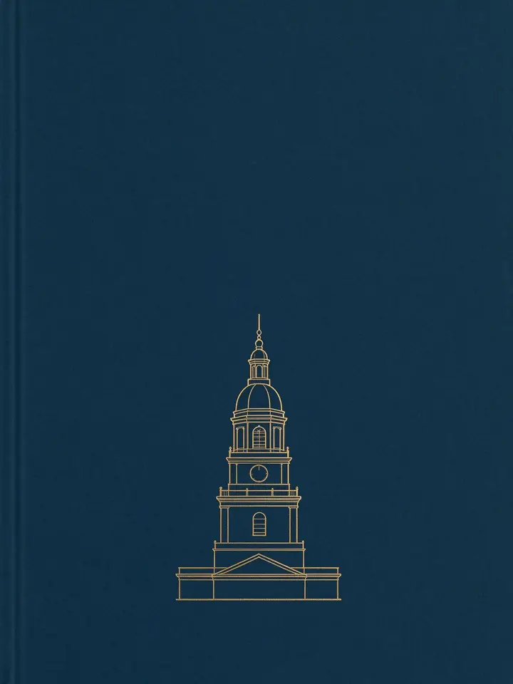

# 元数据

> [!abstract] 张千帆：美国立宪启示
> - 
> - 书名：张千帆：美国立宪启示
> - 作者：张千帆
> - 出版社：人民论坛网 · 学术前沿
> - 阅读进度：0%
> - 阅读时长：7分钟
> - 最后阅读：2026-10-25
> - 微信读书：https://weread.qq.com/book-detail?type=1&v=b2f42b73643425f46555547636747634f46687437374637354132396443354f4d9

# 高亮划线

## 张千帆：美国立宪启示

> 📌 美国立宪的最大“奇迹”在于，立宪者遇到“卡壳”的时候还能耐心地坐着“谈”，而不是动不动就“打”
> ⏱ 2026-10-25 20:45:32

> 📌 领导人的气质往往对一个国家的发展历程影响深远，美国也不例外。美国也经历过“八年抗战”（独立战争），总司令是华盛顿
> ⏱ 2026-10-25 20:46:05

> 📌 众望所归的他正是费城制宪委员会主席。他端坐在那儿不想打仗，这个仗就打不起来；他不想当皇帝，美国就注定是共和制；他当了两届总统就功成身退、卸甲归田，两届制在很长时间内就成了美国宪法惯例，直至修宪把这一条明确写进宪法
> ⏱ 2026-10-25 20:46:10

> 📌 除了主持程序之外，华盛顿对美国立宪并没有贡献什么思想，但美国有华盛顿，实在是它的幸运
> ⏱ 2026-10-25 20:46:15

> 📌 和英美不同的是，中国长期奉行权力至上文化。凡事都要先决出一个“老大”，其余即惟命是从，否则谁也不服谁
> ⏱ 2026-10-25 20:46:58

> 📌 我们把失败的后果设计得很可怕，所谓“胜王败寇”；政治斗争的败者轻则失去一切，沦为阶下囚，重则掉脑袋乃至诛九族。既然谁也承受不起失败的苦果，各方都只有选择无规则、无底线、不择手段的恶斗
> ⏱ 2026-10-25 20:47:28

> 📌 1908年出台的《钦定宪法大纲》就是错误自信的最好写照，自以为江山稳固、“万世一系、永永尊戴”，没想到三年后就爆发革命。此前还不知好歹地搞了一个“亲贵内阁”，激起全国公愤，成为武昌起义的导火索。“不见棺材不落泪”，只要大权尚未旁落，统治者是不会允许改革的
> ⏱ 2026-10-25 20:44:58
> 💭 《钦定宪法大纲》是清政府1908年8月颁布的伪立宪纲领，正文十四条“君上大权”把皇权写成万世一系、神圣不可侵犯，连议院也由皇帝随意召集或解散；附录“臣民权利义务”只列纳税、当兵等义务，几乎剥夺言论、集会等自由，连立宪派都失望。
> 🕰 2026-10-25 20:45:03

> 📌 既然权力至上是一种文化，它便不局限于官场，而是渗透到社会的每个角落，造成平民百姓也信奉权力，而不是讲道理、守规则。譬如办事托人就是一种“独特”的中国文化
> ⏱ 2026-10-25 20:48:10

> 📌 上访人“信访不信法”的现象也是一样。这固然是因为司法不独立、法律不可信等原因造成的，但是也体现了长期形成的社会习惯思维，总是指望权力部门出来一个“青天大老爷”为自己撑腰，而不是履行一个公民应尽的义务，通过民主和法治渠道解决自己的问题
> ⏱ 2026-10-25 20:48:37

> 📌 武昌起义后，清政府一下没了底气，急忙抛出架空皇权的《十九信条》，可以说是一夜之间从传统的实权君主制变为“虚君制”
> ⏱ 2026-10-25 20:49:08

> 📌 这本来是空前的历史进步，一个弱政府对于建立法治、保障人权无疑是有利的，但是中国人容不下弱者，不再会给满清机会；夹在强人袁世凯和拒绝妥协的革命军之间，年仅五岁的“末代皇帝”很快退位
> ⏱ 2026-10-25 20:49:26

> 📌 假如当时各派能有1215年英国贵族的气度，或1868年日本维新人士的智慧，保留皇权并迫使其实施《十九信条》，中国早已走上英国的虚君共和之路
> ⏱ 2026-10-25 20:49:54

> 📌 我们信奉的是实力；一旦没有实力，还凭什么在位？而实力是靠打出来的，不然怎么知道你有实力？等到用枪杆子证明实力的一方控制了政权，权力游戏又开始了新的轮回，而胜者通吃的格局还是和以前一模一样；执政集团垄断了所有的权力和资源，直至被下一个更强大的革命者武力推翻……
> ⏱ 2026-10-25 20:50:16

> 📌 当年独立战争是为了殖民地所有人的自由，凑齐了邦联军队。这一仗打了八年，好不容易打完了，还要再打，恐怕是没有谁会答应的——为了什么？为谁而战？不要忘记，虽然那个年代的各州政府算不上任何意义的民主标本，但也都没有专制政权的神通，想抓壮丁就抓壮丁，想派劳役就派劳役；他们想多征点税都要考虑能否保住自己的“乌纱帽”，独立战争就是为了抵制英国人的税才打起来的
> ⏱ 2026-10-25 20:58:06
