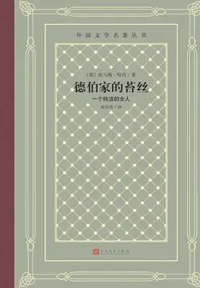

# 元数据

> [!abstract] 德伯家的苔丝：一个纯洁的女人（人文社外国文学名著经典·网格本）
> - 
> - 书名：德伯家的苔丝：一个纯洁的女人（人文社外国文学名著经典·网格本）
> - 作者：托马斯·哈代
> - 译者：张谷若
> - 简介：《德伯家的苔丝》是哈代的代表作，是“威塞克斯系列”中的一部。它描写了一位农村姑娘的悲惨命运。哈代在小说的副标题中称女主人公为“一个纯洁的女人”，公开地向维多利亚时代虚伪的社会道德挑战。张谷若以成功译介哈代的三部小说《还乡》、《德伯家的苔丝》、《无名的裘德》而著名，其中《德伯家的苔丝》译本最受广大读者欢迎。
> - 出版时间：2020-07-03 00:00:00
> - ISBN：9787020158355
> - 分类：文学-外国文学
> - 出版社：人民文学出版社
> - 微信读书评分：89%
> - 阅读进度：0%
> - 阅读时长：3分钟
> - 最后阅读：2026-11-13
> - 微信读书：https://weread.qq.com/book-detail?type=1&v=c0c3239072040ea7c0ca95c

# 高亮划线

## 文前辅文

> 📌 可怜你这受了伤害的名字！我的胸膛就是卧榻，要供你栖息。威廉·莎士比亚
> ⏱ 2026-11-13 03:18:36

> 📌 [1] 引自莎士比亚的《维洛那二绅士》第1幕第2场第114—115行。胸膛原文bosom，在原剧中意为从前“妇女内衣胸前之小囊，用以藏情书、爱情表记等”。译文改动原意。
> ⏱ 2026-11-13 03:18:40

## 42

> 📌 第二天靠近黄昏的时候，她走到一片高下起伏的白垩质台地或者高原了，只见它在她下生那个山谷和她恋爱那个山谷之间展开。无数形如乳房的半圆形古冢，点缀在高原上面，老远看来，好像奶头累累的随布利，在那儿长身仰卧一般。
> ⏱ 2026-11-13 03:18:09

## 44

> 📌 随布利，古代希腊罗马神话里的大地女神，她的像，平常总是一个妇人，大腹便便，象征大地孕育一切，胸部奶头甚多，象征大地滋养万物。这个比喻也见于哈代的诗《古冢旁》和《卡斯特桥市长》第22章。
> ⏱ 2026-11-13 03:19:01

## 59

> 📌 埃斯库罗斯（公元前525—公元前456），古希腊大悲剧家。众神的主宰一语，见于他的悲剧《被囚的普罗米修斯》第169行。众神的主宰指宙斯而言，他压迫众神，强奸了爱娥等。普罗米修斯在那一行的前后文里，大呼反对宙斯的残暴。这儿原书所引，为英国古典文学翻译者波克利（1825—1856）之译文，于一八四九年出版。
> ⏱ 2026-11-13 03:21:02
