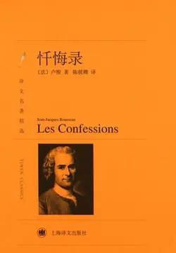

# 元数据

> [!abstract] 忏悔录（译文名著精选）
> - 
> - 书名：忏悔录（译文名著精选）
> - 作者：[法]卢梭
> - 译者：陈筱卿
> - 简介：卢梭的《忏悔录》堪称整个西方文学史甚或文化史上最著名的自传作品，是卢梭在文学方面的主要成就，与早期基督教神学家圣奥古斯丁的《忏悔录》具有同样经典的地位，对后世直至今天都有深远的影响。本书是作者晚年处于悲惨地时的悲愤自省、呕心沥血之作。整个自传是在颠沛流离、四面受敌的逃亡生活中断断续续完成的，主题是想通过自己历经坎坷的一生反映社会对人的残害和压迫。卢梭满怀感情地讲述自己的“本性善良”，古代历史人物又赋予他崇高的思想，但是社会环境的恶浊以及人与人之间关系的不平等，却使他受到了侵染和损害。卢梭历数他孩提时代寄人篱下所受到的粗暴待遇，入世后社会对他的虐待和他耳闻目睹的种种黑暗与不公……
> - 出版时间：2014-03-01 00:00:00
> - ISBN：9787532762835
> - 分类：文学-外国文学
> - 出版社：上海译文出版社
> - 微信读书评分：72%
> - 阅读进度：0%
> - 阅读时长：5分钟
> - 最后阅读：2026-11-17
> - 微信读书：https://weread.qq.com/book-detail?type=1&v=4a8323f05e391f4a8b0e3f1

# 高亮划线

### 第六章

> 📌 的确，这些病倒不是疼痛而是吓人，使得精神的痛苦大于它们似乎预示其崩溃的肉体上的痛苦
> ⏱ 2026-11-17 02:59:35
> 💭 到现在也不知道他得了什么病，还以为是研究下棋那一段过于殚精竭虑而元气大伤
> 🕰 2026-11-17 03:00:00

> 📌 我可以说，尽管学生们名声不佳，但我觉得这帮年轻人的道德和正直是成年人中很难看到的。他们喧闹而不浪荡，活泼而不放纵。如非强逼，我是很容易适应这种生活方式的，如果它能永远这么继续下去，我真求之不得
> ⏱ 2026-11-17 02:48:49

> 📌 这帮学生中，有好几个爱尔兰人，我试图跟他们学点英语，以备去圣昂代奥勒镇之所需，因为离我去那儿的时间不远了。拉尔纳热夫人每次来信都催我去，而且我也准备听从她的吩咐
> ⏱ 2026-11-17 02:49:07
