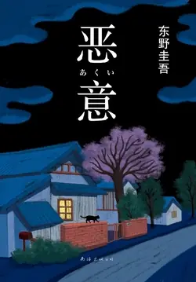

# 元数据

> [!abstract] 恶意
> - 
> - 书名：恶意
> - 作者：东野圭吾
> - 译者：崔健
> - 简介：★ 东野圭吾名作，2022版新译本！
>
>   ★ 与《白夜行》《嫌疑人X的献身》《解忧杂货店》并称东野圭吾四大杰作，从《恶意》开始真正认识东野圭吾
>
>   ★ 深刻揭示人性，处处是悬念，加贺恭一郎系列扛鼎之作
>
>   ★《纽约时报》《华尔街日报》《柯克斯书评》推荐
>
>   ★ ZUI大的恶意不是SHA了你，而是毁了你
>
>   ★ 赌上全部人生也要贯彻到底的恶意，究竟从何而来？
>
>   ★ 中文版发行量350万册 ，豆瓣评分8.7，跻身豆瓣推理小说百强榜！
> - 出版时间：2022-01-07 00:00:00
> - ISBN：9787544269452
> - 分类：精品小说-悬疑推理
> - 出版社：南海出版公司
> - 微信读书评分：91%
> - 阅读进度：16%
> - 阅读时长：54分钟
> - 最后阅读：2026-11-05
> - 微信读书：https://weread.qq.com/book-detail?type=1&v=f7932970813ab6e84g019b96

# 高亮划线

## 事件之章 野野口修的手记

> 📌 事件之章野野口修的手记
> ⏱ 2026-11-05 01:12:39
> 💭 《恶意》是所有推理小说里，我最不推荐看剧透的，因为这部小说带给读者的力量，必须是读者从前向后、亲自阅读得到的。这本也是我认为东野圭吾最高杰作。
> 🕰 2026-11-05 01:12:34

## 1

> 📌 这些路算不上窄，却都是单行道，大概安全性也是象征地位的要素之一吧。
> ⏱ 2026-11-05 01:19:41

> 📌 她看上去年龄在三十五岁到四十岁之间，长相普通，眼睛、鼻子和嘴巴都很小，气色不佳。
> ⏱ 2026-11-05 01:18:00
> 💭 长相普通就是五官小气，作者的审美取向
> 🕰 2026-11-05 01:18:17

> 📌 野野口先生，您一定要去那边找我们玩啊，我会给您当个好向导的
> ⏱ 2026-11-05 01:19:26

> 📌 日高端着咖啡杯，起身眺望窗外的庭院：“好在今年看到了樱花盛开的美景。”
> ⏱ 2026-11-05 01:19:14
> 💭 这样的家好爱啊，满园的樱花，写作的窗台，一开窗，一吹风，一抬头，一场樱花雨🌸🌸🌸
> 🕰 2026-11-05 01:19:18

> 📌 “没记错的话，那个女人姓新见，就住这附近。她看上去年轻，但实际应该超过四十岁了，有个初中生年纪的儿子，傻小子一个。她丈夫很少在家，理惠推测应该是在外地长期出差。”
> ⏱ 2026-11-05 01:20:36
> 💭 一个人过得好，要藏着哦。尤其是对身边的人藏着，要不然会招来滔天的恨意。东躲西藏，莫名的恨意会少一点。😃😄😁
> 🕰 2026-11-05 01:20:44

> 📌 “这件事和你有关系吗？”“她怀疑是我做了毒丸子，设计把猫给毒死的。”
> ⏱ 2026-11-05 01:26:33

> 📌 那是半页纸左右的一篇散文，名为《忍耐的极限》，题目旁边印有日高的头像。我浏览了一下，通篇都在讲作者如何被一只放养的猫折磨得心力交瘁。
> ⏱ 2026-11-05 01:18:29

> 📌 “死的那只猫是棕白相间的吗？”“正是这样。”
> ⏱ 2026-11-05 01:18:31

> 📌 虽然没有直说是我投的毒，但基本上就是那个意思。
> ⏱ 2026-11-05 01:21:36
> 💭 但是是不是应该想一下，猫把别人家弄成这样，自己没责任吗
> 🕰 2026-11-05 01:21:42

> 📌 我们下周就要搬去温哥华了，所以就算您家的猫再调皮，我们也只需要再忍耐几天就行了。
> ⏱ 2026-11-05 01:18:35

> 📌 “理惠说的话很有道理，你们根本就没有理由如此匆忙地杀死那只猫。”
> ⏱ 2026-11-05 01:22:38

> 📌 不知怎么，日高没有立刻对我的话表示赞同。他只是笑眯眯地眺望窗外，将手中的咖啡一饮而尽，然后小声地说：“是我干的。”
> ⏱ 2026-11-05 01:22:08
> 💭 是你干的，你还明晃晃的写出来，还发到杂志上，然后又和猫的主人狡辩，现在又在朋友的面前堂而皇之的承认了，你这人真是恶意满满
> 🕰 2026-11-05 01:22:24

> 📌 他把咖啡杯放到桌子上，拿起烟和打火机：“猫是我杀的。我在庭院里放了毒丸子，没有想到事情进展得那么顺利。”
> ⏱ 2026-11-05 01:22:46

> 📌 “很简单，只需要在猫粮里掺一些农药，任它们散落在庭院里就行了。那种主人不怎么管束的猫可是什么都会吃的。”
> ⏱ 2026-11-05 01:18:38

> 📌 “为什么要做那种事呢？”我问道，心里不是滋味。
> ⏱ 2026-11-05 01:22:52
> 💭 虽然不至于把猫毒害，可是主人不制止猫对他人造成的麻烦也是不对的。事事有因果，因为恶而产生的恶意又该如何被定义呢？
> 🕰 2026-11-05 01:23:12

> 📌 “房产中介还在继续寻找租客，不过前段时间提到了一件让我有点担心的事。”
> ⏱ 2026-11-05 01:18:44

> 📌 说是家门口摆着的塑料瓶让人印象不好，会让人觉得这家肯定深受猫捣乱的困扰。
> ⏱ 2026-11-05 01:23:32

> 📌 “那样做解决不了根本的问题啊。有意向租房的人来家里看时，对满院的猫屎会作何感想？我们人在的时候还可以打扫，但明天走了之后，这里就该臭气熏天了。”
> ⏱ 2026-11-05 01:18:42
> 💭 哎，这种不知算不算“压死骆驼的最后一根稻草”。急着走，但卖房这一步又不能按照计划完成。好似这一系列计划都因为“猫”而悬在半空中。
> 🕰 2026-11-05 01:24:28

> 📌 听到我的问题，他扬起一侧嘴角，摇了摇头：“怎么可能知道？女人啊，大多喜欢猫，要是把实话告诉她，我在她眼里就成恶魔了。”
> ⏱ 2026-11-05 01:18:47

> 📌 我马上就要开始写了……是啊，今天晚上一定会努力写出来的……好的，那我写完后给您发过去……
> ⏱ 2026-11-05 01:18:50

> 📌 “是聪明社的山边。我拖稿不是一天两天的事了，但这次他好像也不免感到担心，毕竟这一次如果拿不到原稿，我后天不在日本就不好办了。”
> ⏱ 2026-11-05 01:23:26

> 📌 就在这时，我听到了对讲门铃的声音。我以为是有人上门推销，但似乎并非如此。只听走廊里传来理惠的脚步声，接着就是一阵敲门声。
> ⏱ 2026-11-05 01:19:56

> 📌 是藤尾女士。”她压低声音。日高的脸就像暴风雨来袭前的天空，阴云密布：“藤尾……是藤尾美弥子？”
> ⏱ 2026-11-05 01:23:40
> 💭 新人物藤尾一出现，日高和妻子理惠的脸双双变得阴云密布，形势急转直下。
> 🕰 2026-11-05 01:24:00

> 📌 她身后站着一个长发女子，年龄应该在二十五岁到三十岁之间，身上穿着大学生去企业参观时常穿的那种西服。身为一个突然的访客，她还是在仪表上花了不少心思的。
> ⏱ 2026-11-05 01:27:07

> 📌 我的家和日高家有着天壤之别，只是一栋五层公寓中小小的一户，由一个六叠的房间和一个大约八叠的开间组成：前者是工作间兼卧室，后者则包含客厅、餐厅和厨房
> ⏱ 2026-11-05 01:28:10

> 📌 我也没有像理惠那样的伴侣，所以门铃响了只能自己去开门。
> ⏱ 2026-11-05 01:27:23

> 📌 他很清楚我是一个甜食爱好者。
> ⏱ 2026-11-05 01:28:31

> 📌 “没事，反正我也要回家，正好顺路。”
> ⏱ 2026-11-05 01:28:35

> 📌 我则打开报纸。自己写的东西被别人当面阅读，总让我觉得有些不舒服。
> ⏱ 2026-11-05 01:29:42

> 📌 “哦，怎么样了？”我这样问，是因为还惦记着藤尾美弥子的事。
> ⏱ 2026-11-05 01:29:05
> 💭 写作是内心世界的悄悄流淌~
>
> 被当众“直播”的滋味可不太好受😀
> 🕰 2026-11-05 01:29:57

> 📌 日高写有一部名为《禁猎地》的小说，讲述了某位版画家的一生。说是虚构作品，实际上主人公存在原型，即藤尾正哉。
> ⏱ 2026-11-05 01:27:28

> 📌 但是这部小说存在几个问题，即完全没有考虑到藤尾正哉的名誉，将现实照搬了进去，特别是他学生时代的古怪行为，都被日高悉数记载了下来。
> ⏱ 2026-11-05 01:28:44

> 📌 藤尾正哉被妓女刺死的部分，也跟现实别无二致。
> ⏱ 2026-11-05 01:31:52
> 💭 想起了冯小刚的《手机》，跟崔永元的事
> 🕰 2026-11-05 01:31:41
> 💭 结合之前的毒猫事件，日高的品行让人怀疑。
> 🕰 2026-11-05 01:31:30

> 📌 藤尾的父亲已经去世，抗议的是他的母亲和妹妹。
> ⏱ 2026-11-05 01:32:05
> 💭 这就让我想起之前张译主演的《他是谁》，以南大碎尸案为原型，尤其是对受害人刁爱青的刻画引起了很大的争议，刁爱青的家人喊话要说法。
> 🕰 2026-11-05 01:32:24

> 📌 我提到接下来要见的人是作家日高邦彦，大岛显得有些惊讶。
> ⏱ 2026-11-05 01:31:05

> 📌 嗯，我和他是小学、初中同学，父母家离得也不远，从这儿走一会儿就到。当然了，我们的老房子都被拆除了，后来新建了公寓楼。
> ⏱ 2026-11-05 01:30:44
> 💭 相似的生活经历，不一样的人生际遇。关系还能保持稳定良好，至少有一方在努力经营这段关系。
> 🕰 2026-11-05 01:30:59

> 📌 “一开始是你们主编想和日高约稿，但日高以自己不写儿童文学为由拒绝了，最后把我介绍了过来。所以他可以算作是我的贵人。”我用叉子把通心粉送进嘴里，这样说道。
> ⏱ 2026-11-05 01:28:56

> 📌 我走出电话亭，又决定去咖啡店之前再到日高家看看。灯依然没亮。另外，那辆萨博仍在车库里，这让我有些在意。
> ⏱ 2026-11-05 01:35:12

> 📌 房间中央是倒下的日高，他的双脚冲着我们
> ⏱ 2026-11-05 01:37:47
> 💭 剧透一下，凶手是个杀人犯
> 🕰 2026-11-05 01:37:51

> 📌 一瞬间我的大脑一片空白。理惠跑过去，但又突然停了下来，双手捂着嘴，浑身僵硬，整个过程没有说一个字。
> ⏱ 2026-11-05 01:37:59

> 📌 警视厅的侦查人员进行现场勘查取证时，我和理惠在会客室等着。
> ⏱ 2026-11-05 01:38:11

> 📌 敲门声响起，门随之而开。迫田警部[插图]进来了：他将近五十岁，是个沉稳的男人。让我们在这个房间先等一会儿的人就是他。看来，他应该是侦查负责人。
> ⏱ 2026-11-05 01:35:47
> 💭 日本警察的警衔由上向下分为警视总监、警视监、警视长、警视正、警视、警部、警部补、巡查部长、巡查。
> 🕰 2026-11-05 01:35:51

> 📌 “我自然也知道。除此以外，应该还有聪明社的人。”我解释说，日高原定今晚完成的原稿就是要交给聪明社的，“但也不能仅凭这一点就锁定凶手吧？”
> ⏱ 2026-11-05 01:40:27

> 📌 随着发现日高尸体时的冲击感一点点退去，疲劳感开始渐渐袭来。
> ⏱ 2026-11-05 01:40:38
> 💭 在遇到一件特别需要高度集中注意的事情以后，人们往往会忘却疲倦，而那股子劲一旦有所松懈，疲倦又卷土重来。
> 🕰 2026-11-05 01:39:30
> 💭 日本人对尸体的接受度也太高了，果然是比较抑郁的国家
> 🕰 2026-11-05 01:39:19

> 📌 工作间的门开着，但看不见里边的情况。想来，尸体应该被运走了。
> ⏱ 2026-11-05 01:40:53
> 💭 这里说“尸体被运走”，用的是“运”而不是“抬”唉，一般来讲没有生命没有感情的物体才会用“运”吧，足以看到野野口的冷漠。
> 🕰 2026-11-05 01:41:20

> 📌 我思绪游离，想到上次坐警车还是因为超速被抓到了。
> ⏱ 2026-11-05 01:41:48
> 💭 这一点是不是说明，这个野野口，也就是所谓的我，他并不是一个特别遵守原则，特别谨慎小心的人，我是一个偶尔会游走在规则边缘的，所谓的叛逆。会超速。
> 🕰 2026-11-05 01:41:48

> 📌 “嗯。”我向他提起《夜光藻》。这本书是我很久之前读的，内容已经记不清了，但肯定和杀人案有关。“您知道日高先生为什么要搬去加拿大吗？”
> ⏱ 2026-11-05 01:45:59
> 💭 加贺成为警察也算是自己的舒适区了，不着痕迹就问了话，看似闲谈，实则试探。
> 🕰 2026-11-05 01:46:05

> 📌 “不，前妻是交通意外去世的，已经是五年前的事了吧。”
> ⏱ 2026-11-05 01:46:57
> 💭 日高家暴
>
> 他前妻被他杀了
>
> 他和现在的妻子看起来没问题
>
> 从他杀猫 我推断他家暴现在的妻子
>
> 最后他被现在的妻子杀了
> 🕰 2026-11-05 01:47:02

> 📌 如果我能早早结束那无关紧要的工作讨论，早一些去见他，或许他就不会死了。我知道这么想无济于事，却仍懊悔不已。
> ⏱ 2026-11-05 01:46:18

> 📌 “怎么说好呢，之前他曾对我说，他一个小时大概能写出四页。”“所以就算再快，一个小时也只能写出六页左右？”
> ⏱ 2026-11-05 01:49:42

> 📌 理惠说藤尾美弥子是五点左右离开的，而日高打给我时是六点多，如果他这段时间里一直在写，那么应该写了五六页
> ⏱ 2026-11-05 01:49:34

> 📌 “你是说有人从背后打了他，趁他昏迷时将他勒死？”
> ⏱ 2026-11-05 01:50:05
> 💭 这怀疑的也太丝滑了吧？一般人会想到是这个人昏迷了之后才累死吗？一般如果是我的话，我只会猜测说。把这个人打得丧失一部分正常的行动能力，比如说晕晕乎乎的。或者说在地上挣扎，于是这就可以顺理成章地勒死，而不会一下子就想到打得特别严重，直接打昏这个人。
> 🕰 2026-11-05 01:51:18
> 💭 应该是挂断电话后，不小心摔到了后脑，于是恼羞成怒，用电话线自杀了。
> 🕰 2026-11-05 01:50:54

> 📌 我正要下车，“啊，稍等，”加贺叫住了我，“可以告诉我连载那部小说的杂志名吗？”
> ⏱ 2026-11-05 01:51:33

> 📌 我皱了皱眉，以掩饰害臊，有些生硬地说出了杂志名称。加贺将它写在了记事本上。
> ⏱ 2026-11-05 01:51:44
> 💭 每次“我”谈到或者透露自己的作品时的反应，总显得特别生动，了了几词就在告诉读者，“我”，也是书里的一个立体的角色而不止是纯粹的观众视角的旁白者
> 🕰 2026-11-05 01:51:58

> 📌 报道的内容与事实基本相符，只不过以下的表述或许会让读者误以为发现尸体的只有理惠一个人：“妻子理惠女士从认识的人那里得知家里没有开灯，于是返回住所，发现日高先生倒在一层的工作间里。”通篇都没有出现我的名字。
> ⏱ 2026-11-05 01:52:19
> 💭 对恶意的解读 解读一：没有我的名字，我没出名。解读二：还好没有我的名字。
> 🕰 2026-11-05 01:52:46

> 📌 我大吃一惊。报纸上完全没有提到我的名字，电视台的人却已经察觉到我就是尸体发现者了。“哦，”我思考着该如何回复，肯定不能轻率地应答，“什么事？”
> ⏱ 2026-11-05 01:52:59
> 💭 关于“我”的情绪描写好保守 前面只讲“通篇没有提到我的名字” 这样的心理想法 而不是直接的情绪描写来体现究竟是不满 疑惑还是庆幸 这样的保守让人总觉得是在给某种反转留空间一样
> 🕰 2026-11-05 01:53:38

> 📌 简而言之，当今的家长明明自己都根本不读书，却要求孩子必须读，而他们没有读书的习惯，不知道该让孩子读些什么，便要求政府进行推荐。
> ⏱ 2026-11-05 02:06:12
> 💭 最好的教育是言传身教，孩子最先看到的是父母，其次看到的才是其他人 ！———《杀死一只知更鸟》
> 🕰 2026-11-05 02:06:22

# 章节点评与书评

## 读书笔记

《恶意》读完，寒意入骨。

世上最极致的恨，无关恩怨，无关情仇。

只因你善良耀眼，只因你一生坦荡，

我便要毁了你，毁掉你的名誉，毁掉你的一生。

原来人心深处，藏着毫无来由、却足以吞噬一切的黑暗。

最可怕的恶意，从不是杀戮。

是明明你从未亏欠我分毫，

我却用尽所有心机，赌上全部人生，

只愿你身败名裂、光芒尽散。

嫉妒无声，恨意绵长，人性至暗，莫过于此。

> 记录于 2026-11-05 01:12:08
