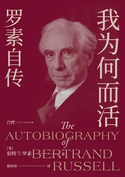

# 元数据

> [!abstract] 我为何而活：罗素自传（果麦经典）
> - 
> - 书名：我为何而活：罗素自传（果麦经典）
> - 作者：[英]伯特兰·罗素
> - 译者：靳婷婷
> - 简介：罗素是著名哲学家和数学家，被誉为“世纪先知”；在哲学以外的诸多领域都有建树，1950年荣获诺贝尔文学奖；是20世纪西方影响力蕞大的社会活动家之一，世界和平运动的倡导者和组织者；还曾来到中国讲学，对近代中国的文化启蒙与社会改革影响深远。
>   罗素以98岁高龄辞世，他在《我为何而活：罗素自传》中完整回顾了自己的百岁人生。“有三种感情，单纯而热烈，支配着我的一生：对爱情的渴望、对知识的追求，以及对人类苦难不可遏制的同情。”故事围绕着支撑他生命之舟的三种动力而徐徐展开。
>   罗素的一生是理性与激情的完美融合：取得显赫的地位，攀上智识的巅峰，拥有情感的至乐，也经历牢狱之灾，最终可谓度过了幸福的一生。
>   阅读《我为何而活：罗素自传》，我们得以走进这位伟大思想家的内心世界，感受他追求真理和正义的坚定信念，同时也思考自己的人生志向和抉择，懂得如何走出一条属于自己的幸福之路。
> - 出版时间：2025-02-01 00:00:00
> - ISBN：9787218182360
> - 分类：人物传记-学者
> - 出版社：广东人民出版社
> - 微信读书评分：86%
> - 阅读进度：0%
> - 阅读时长：12分钟
> - 最后阅读：2026-11-09
> - 微信读书：https://weread.qq.com/book-detail?type=1&v=d5232dc0813ab9bc8g015d07

# 高亮划线

## 致伊迪丝

> 📌 岁月漫漫，我求索安宁
> ⏱ 2026-11-09 19:58:13

> 📌 如今，垂垂老矣，风烛残年，我与你相识，
> ⏱ 2026-11-09 19:58:16

> 📌 而今，若我长眠不醒，我将心满意足，酣睡如梦。
> ⏱ 2026-11-09 19:58:20

## 第七章 中国之旅

> 📌 沉睡了几个世纪的中国，已经开始对现代世界有所觉知
> ⏱ 2026-11-09 20:24:52

> 📌 我和朵拉乘坐一艘名为“波尔托”的法国船从马赛前往中国[插图]，却在准备离开伦敦时得知，由于船上暴发瘟疫，起航时间要推迟三个星期。我们无心再与亲友道别一遍，于是便去了巴黎，在那里度过了三个星期
> ⏱ 2026-11-09 20:25:15
> 💭 1920年秋天，在新文化运动驱动者梁启超等人的促进下，讲学社邀请罗素到北京大学讲学，罗素在中国停留了近一年的时间，在北京、上海、杭州、南京等多地进行演讲。
> 🕰 2026-11-09 20:25:18

> 📌 在这段时间里，我写完了关于俄国的著作[插图]，犹豫许久之后决定出版。当然，任何反对布尔什维主义的言论都会正中反动派的下怀，我的大多数朋友都认为，除了对俄国积极正面的看法之外，对其他观点都应该缄口不言
> ⏱ 2026-11-09 20:26:48

> 📌 一个炎热的夏夜，在朵拉睡去之后，我起身坐在房间的阳台上凝视繁星。我试着不带党派的狂热情感来看待这个问题，想象自己在对仙后座倾诉衷肠
> ⏱ 2026-11-09 20:27:00
> 💭 仙后座是北天拱极星座，全年可见，秋季最亮。它由五颗星排成明显的“W”或“M”形，与北斗七星隔北极星相对，是北半球指极的重要标志。传说中，它代表因夸耀女儿美貌而受罚的埃塞俄比亚王后卡西俄珀亚。
> 🕰 2026-11-09 20:27:22
> 💭 那时光污染还不大，在巴黎也能看见星空，多么美好啊。仙后座很容易看见
> 🕰 2026-11-09 20:27:14

> 📌 朵拉因为我对俄国的消极看法而大为鄙夷，导致我的感情敏感波动。我表示当初根本不该一道出行，事到如今，还不如一起跳海一了百了的好。不过，这种主要由天气闷热而引起的情绪很快就平息下去。
> ⏱ 2026-11-09 20:27:38

> 📌 。鉴于这些人的身份地位，我专拣对苏联政府有利的话说，差点儿引起了一场骚乱。
> ⏱ 2026-11-09 20:49:40

> 📌 西贡有一头大象，大象的饲养员把香蕉卖给游客，让游客喂给大象吃。
> ⏱ 2026-11-09 20:50:27

> 📌 我们刚抵达上海的时候，发现没有人来接我们。我自打一开始便有一种不祥的预感，生怕这次邀请是个恶作剧，为了检验真实性，我便让中方在我出发前把旅费预支给我
> ⏱ 2026-11-09 20:25:42
> 💭 罗素的中国行是蔡元培，梁启超等人邀请的。
> 🕰 2026-11-09 20:25:53

> 📌 没过多久，他们便上船来，把我们带到一家中式旅馆，在那里，我们度过了我有生以来最为困惑的三天时间。
> ⏱ 2026-11-09 20:51:27

> 📌 我们在解释朵拉身份时遇到了一些困难。中方认为她是我的妻子，当我们表示我俩并非夫妻时，中方又担心我会因为之前的误解而不悦。我告诉中方，希望他们把朵拉当作我的妻子对待，于是他们便在中国的报纸上发表了一篇相关的声明
> ⏱ 2026-11-09 20:51:49
> 💭 哈哈，那时不强大的我国多少有点崇洋媚外，也可能罗素与朵拉的关系实在超出了中国文化的理解能力
> 🕰 2026-11-09 20:52:07

> 📌 在上海的时间，我们会见了不计其数的客人，有欧洲人、美国人、日本人、朝鲜人，还有中国人。一般来说，与我们会面的各国人之间彼此不相往来
> ⏱ 2026-11-09 20:28:05

> 📌 我们参加了一场盛大的宴会，宴会上，好几位中国人用最地道的英式风格在餐后发言，讲的尽是与这种场合相称的笑话。
> ⏱ 2026-11-09 20:52:46
> 💭 难道好好学地道的英文就是为了在土生土长的英国人面前秀一波，哈哈
> 🕰 2026-11-09 20:52:55

> 📌 直到那时我才意识到，有教养的中国人堪称世界上最有教养的人。
> ⏱ 2026-11-09 20:53:02
> 💭 罗素说“有教养的中国人堪称世界上最有教养的人。”这种教养因五千年的文化底蕴而厚实，谦谦之君子，谈笑有鸿儒。在罗素看来，尽管中国正处于动荡之中，但同欧洲相比，这似乎仍是一个达观恬静的国家。
> 🕰 2026-11-09 20:53:47

> 📌 孙中山曾经请我共进晚餐，但他提议的日期不巧在我离沪之后，因此我不得不拒绝，这也成了我终生的遗憾。此后不久，他赴广州发起后来席卷了整个国家的民族主义运动。由于我无法去广州，因此永远错失了与他见面的机会
> ⏱ 2026-11-09 20:53:20

> 📌 尽管湖南官员极尽劝诱挽留之能事，甚至安排了一辆直达武昌的专列。
> ⏱ 2026-11-09 20:48:31
> 💭 这么受欢迎！这么好的听众基础，就像今天迎接大明星！除了罗素的欧美名家光环，也有国人对新思想的渴望。看来彼时中国还是相当开放诶！爱因斯坦、泰戈尔、毛姆、卓别林等顶流都到过中国，而且都从底子上看好这个文明古国。只是这些与工农大众太遥远，不在惯常叙事里。
> 🕰 2026-11-09 20:48:43

> 📌 我在二十四小时内做了四次演讲，两次演讲安排在晚餐后，一次安排在午餐后。
> ⏱ 2026-11-09 20:54:47

> 📌 湖南督军[插图]为我们设了一场盛宴，席间，我们第一次见到杜威夫妇[插图]，他们待我们非常友善。我后来生病时，约翰·杜威对我和朵拉都照顾备至。
> ⏱ 2026-11-09 20:54:39
> 💭 督军，该省的军事长官。——原注
> 🕰 2026-11-09 20:55:15

> 📌 席间的美味珍馐，简直到了让人难以置信的程度。吃到一半，这位督军竟道歉说只给我们准备了些粗茶淡饭，说他猜想我们可能想要体验一下中国人的日常生活，而不是吃奢华的宴席。
> ⏱ 2026-11-09 20:55:31
> 💭 哈哈，粗茶淡饭——自谦文化已刻在了中国人的基因里。
>
> 这并非虚伪，而是通过贬低自己，来表示对客人的高度尊重。
> 🕰 2026-11-09 20:56:07

# 章节点评与书评

## 读书笔记

致伊迪丝

岁月漫漫，

我求索安宁，

我寻得了狂喜，寻得了苦闷，

寻得了疯狂，

寻得了孤寂，

寻得了咬噬心灵的，

孑然一身的苦楚，

却未曾寻得那份安宁。

如今，垂垂老矣，风烛残年，

我与你相识，

而与你的相识，

让我找到了狂喜和安宁，

历经多年孤独岁月，

我得以品尝休憩之味。

懂得了生活和爱情为何物。

而今，若我长眠不醒，

我将心满意足，酣睡如梦。

> 记录于 2026-11-09 19:58:40
