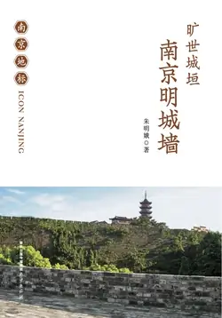

# 元数据

> [!abstract] 旷世城垣——南京明城墙
> - 
> - 书名：旷世城垣——南京明城墙
> - 作者：朱明娥著
> - 简介：城市建筑是活着的历史，要善于应用建筑去诉说城市独特的精气神。为了讲述“南京地标”、阐明“南京机遇”、表达“南京态度”，展现南京这座历史文化名城的魅力，树立崭新的城市形象，让全国读懂南京、喜爱南京，策划出版这套“南京地标”系列丛书。本丛书是一套通俗易懂、图文并茂的大众读物，以分篇叙述的形式，逐一介绍南京各个地标景点。从中山陵、总统府、南京长江大桥、夫子庙、玄武湖、明城墙等南京的地标入手，以时间顺序为主线，从地标的建设、形成开始，来讲诉地标从历史走到今天的一个个有趣的故事，内容涵盖跟地标关联的人物、事件、传说、地名、建筑、物品等方面。
>      《南京明城墙》是该套丛书中的一本，主要从墙体的结构、城砖的制作、瓮城的构建、防水排水系统的设计、护城河水源的利用、平面布局、皇宫选址、外郭建造、与城门有关的典故等方面，充分展示了我国古代劳动人民的聪明才智，创造了世界城墙建筑史上的一个奇迹，达到了我国古代城墙建筑史上的一个高峰。
> - 出版时间：2018-01-01 00:00:00
> - ISBN：9787553320199
> - 分类：社会文化-文化
> - 出版社：南京出版社
> - 阅读进度：0%
> - 阅读时长：4分钟
> - 最后阅读：2026-11-10
> - 微信读书：https://weread.qq.com/book-detail?type=1&v=28132fd0813ab77c7g011fca

# 高亮划线

## 缤纷多姿的书法艺术

> 📌 明朝书法完全处在元人书风的笼罩之中，大体上离不开康里巙巙、赵孟頫的影响。活动在元末明初的书家，或显于朝，或守于野，或死于明初文字狱，许多人如流星闪烁
> ⏱ 2026-11-10 17:15:08

> 📌 元末明初主要书家有“三宋”“二沈”。其中宋克(1327—1387)小楷为明代第一；宋广（生活在洪武年间）、宋璲(1344—1380)善草书；沈度(1357—1434)以楷书名世，草书亦不凡；沈粲(1379—1453)以草书名世
> ⏱ 2026-11-10 17:15:14

> 📌 明初提倡程朱理学，书法在复古主义思想指导下，宗法晋唐，但强调法度和实用，并不注重其艺术功能。同时，书法成为歌功颂德、粉饰太平的工具，真正的艺术创作精神被扼杀。
> ⏱ 2026-11-10 17:15:19

## 异军突起的简化字

> 📌 邹　繁体字作鄒。在南昌府新建县制造的城砖中，有一块砖文为“總甲李仁甫甲首黃克紹小甲邹用和窑匠黃五人夫遠近中”，分两列书写，其中的“邹”为简化字
> ⏱ 2026-11-10 09:53:50

> 📌 同一地区出产的另一块砖文为“總甲王友才甲首徐□□[插图]小甲晏龙升窑匠徐平二造磚人夫邹受用”的城砖中，“邹”也为简化字
> ⏱ 2026-11-10 09:53:55

> 📌 在武昌府通城县和太平府当涂县的城砖砖文中，司吏“邹均贤”和造砖人“邹荣”的“邹”用的也是简化字
> ⏱ 2026-11-10 09:54:00

> 📌 “太”字与“泰”字现在看来风马牛不相及，而在吉安府泰和县制造的城砖中，竟然将一个堂堂的县名“泰和”简化成“太和”
> ⏱ 2026-11-10 09:52:08

> 📌 这种现象早在六朝时期就已经出现。从出土六朝墓砖上我们可以发现六朝时的“泰”，常常被简化成“太”。如宋明帝“泰始元年”，写成“太始元年”
> ⏱ 2026-11-10 09:52:15

> 📌 这种简化字在民间一直使用了1000多年。
> ⏱ 2026-11-10 09:52:19

## 刘伯温与明皇宫

> 📌 内层的宫城平面呈正方形，东西宽0.75公里，南北长0.95公里，周长3.4公里，宫墙周围有御河环绕
> ⏱ 2026-11-09 23:43:00

> 📌 宫城内，中轴线上的“前朝”三大殿——奉天殿、华盖殿、谨身殿及“后寝”两宫——乾清宫、坤宁宫，以及东侧的文华殿、奉先殿和柔仪殿，西侧的武英殿、御花园和春和殿等都位于宫城之内
> ⏱ 2026-11-09 23:43:04
