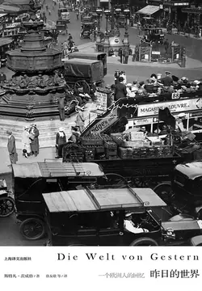

# 元数据

> [!abstract] 昨日的世界
> - 
> - 书名：昨日的世界
> - 作者：茨威格
> - 译者：徐友敬等
> - 简介：《昨日的世界》是奥地利作家斯特凡·茨威格创作的自传体文学作品,写于1939年至1941年间，是茨威格在临终前被迫流亡的日子里完成的。在茨威格离世以后，于1942年在斯德哥尔摩出版。在这部作品里，茨威格把个人命运与时代融为一体，通过自己所经历的人与事，展示了他生活过的城市和国家的文化生活风貌，记录了从第一次世界大战前夜到第二次世界大战时动荡的欧洲社会，描述了他与一些世界闻名的诗人、作家、雕塑家、音乐家交往的情景，批露了世界文化名人鲜为人知的生活轶事，同时穿插了作者各种细腻的心迹。茨威格从出生的城市维也纳和自己的犹太家庭写起，一直写到1939年9月已满60岁的时候，时值第二次世界大战爆发，他认为，这是“我们这些六十岁人的时代彻底结束”。
> - 出版时间：2018-06-01 00:00:00
> - ISBN：9787532777150
> - 分类：文学-外国文学
> - 出版社：上海译文出版社
> - 微信读书评分：90%
> - 阅读进度：0%
> - 阅读时长：0分钟
> - 最后阅读：2026-11-11
> - 微信读书：https://weread.qq.com/book-detail?type=1&v=80a324f0716b1a6480af682

# 高亮划线

## Digital Lab 简介

> 📌 Digital Lab是上海译文出版社数字业务的实验部门，成立于2014年3月。我们致力于将优质的资源送到读者手中。我们会不断努力，做体验更好、设计更好的电子书，加油！上海译文出版社｜Digital Lab
> ⏱ 2026-11-11 14:54:27
> 💭 感谢！加油！
> 🕰 2026-11-11 14:54:46

## 前言

> 📌 我让自己站在前面，仅仅是作为放幻灯片时的解说员；时代提供了图景，我无非是对这些图景加以解释而已
> ⏱ 2026-11-11 14:54:52

> 📌 因为这并非我个人的经历，而是我们整整一代人的经历——几乎没有任何一代人像我们这样，命运的负担如此沉重。
> ⏱ 2026-11-11 14:54:55
> 💭 有什么比出生于富贵之家，敏感且善于思考、历经两次世界级战争更沉重的命运负担？对于没有体验过光明的人来说，黑暗可能更容易接受
> 🕰 2026-11-11 14:55:05

> 📌 但是，我并不抱怨，恰恰是流离失所的人才能够获得一种新含义的自由，只有与一切失去联系的人才会无所顾忌。因此我希望，我至少能具备完成一部真正反映时代的作品所必需的首要条件：公正和无偏见。
> ⏱ 2026-11-11 14:54:49

# 章节点评与书评

## 读书笔记

这本书看的很慢，因为喜欢，所以舍不得看完。阅读过程中，仿佛跟随他的文字去到了那个时代的欧洲，陪着他成长，陪着他经历社会的繁华，又体验繁华后的凋敝。痛苦、快乐、遗憾与悲伤，每种情绪都通过他的文字，穿越时空传递给每位阅读这本书的人。

茨威格以其独特的视角，讲述了自己在欧洲各地的见闻和感受，以及与众多文化名人的交往。他以优雅而深情的笔触，讲述了那个曾经繁荣、自由、充满文化魅力的世界如何在战争的阴影下逐渐崩塌的故事。他见证了欧洲的辉煌与繁荣，也目睹了战争的残酷和人性的扭曲。

这本书是茨威格创作的自传体文学作品也是他的绝命书，在他的笔下为读者勾勒出了一幅横跨半个世纪的欧洲画卷。那是一个对我们而言虽未曾亲身体验却极易产生强烈共鸣的世界，仿若一首在历史长河上空悠悠回荡的深沉挽歌，会使每一位翻开此书的读者，不由自主地沉浸于那个已然消逝却永远镌刻在人们心中的世界。

从和平时期的文化繁荣到战争时期的残酷现实，为我们展现了时代的变迁对人们生活的深刻影响。在世界跌宕起伏的过程中，人性的光辉与黑暗也得以充分展现。有些人在困境中坚守善良和正义，而有些人则在利益面前迷失了自我。茨威格通过对各种人物的描写，让我们深刻感受到了人性的复杂性。

这本书是茨威格留给这个世界的遗作，也是留给我们的礼物。他把个人的命运与时代融为一体，通过自己所经历的人与事，记录了欧洲社会一代人的命运浮沉。从一战前夜到二战时动荡的半个多世纪，欧洲逐渐从精神的高地坠落到道德的深渊，和平与人性遭遇越来越严重的挑战，从前那个平和、包容、友善、自由的文明欧洲，消失殆尽。

昨日的世界，今日的镜像。“只有经历了光明与黑暗、战争与和平、飞升与没落的人才能说是真正生活过。”在结尾处茨威格写道。在这本即将告别这个世界之人最诚挚的自白中，我们看到了一个犹太知识分子的辉煌与苦难，一位作家对这个时代的记述与尽可能准确的还原，以及一个人道主义者对世界的热爱与失望。

杀死他的是战争，但他传递给我们的确是希望更多的人自由、勇敢、不报偏见地拥抱这个世界。我会重读这本书。

> 记录于 2026-11-11 14:54:18
