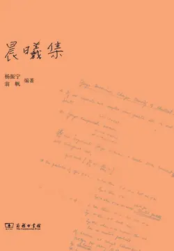

# 元数据

> [!abstract] 晨曦集
> - 
> - 书名：晨曦集
> - 作者：杨振宁 翁帆
> - 简介：《晨曦集》收录了杨振宁先生近期有代表性的文章，既有他放弃美国国籍的声明，也有关于加速器、高能物理等热点问题的专论，兼及研究生培养等多方面的社会议题，充分表露了一代科学大师的远见卓识与回报故园的拳拳之心。书中也收录了亲人、同事、友人、媒体人和学生所撰回忆文章，对杨振宁先生的生平和贡献进行了介绍和评述。书中收录了30多幅杨振宁先生生活与工作近照及一些历史珍贵照片，是了解杨先生不可多得的影像资料。
> - 出版时间：2018-03-01 00:00:00
> - ISBN：9787100156769
> - 分类：文学-散文杂著
> - 出版社：商务印书馆
> - 微信读书评分：91%
> - 阅读进度：4%
> - 阅读时长：19分钟
> - 最后阅读：2026-10-12
> - 微信读书：https://weread.qq.com/book-detail?type=1&v=57432d4072051c975748318

# 高亮划线

> 这本书目前没有个人划线。
