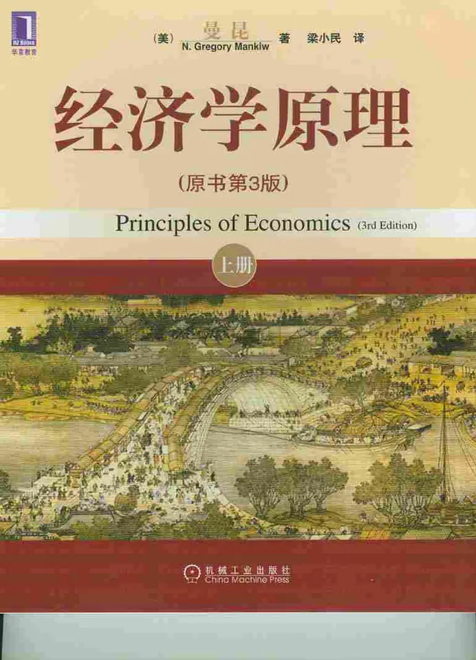

# 元数据

> [!abstract] 曼昆经济学原理 (N.格里高利·曼昆) (Z-Library)
> - 
> - 书名：曼昆经济学原理 (N.格里高利·曼昆) (Z-Library)
> - 作者：N.格里高利·曼昆
> - 阅读进度：1%
> - 阅读时长：9分钟
> - 最后阅读：2025-09-05
> - 微信读书：https://weread.qq.com/book-detail?type=1&v=5c142b73643425f394f36414265414252395a5236795036777739725a347855861

# 高亮划线

## 第一章 经济学十大原理

> 📌 经济这个词来源于希腊语，其意为“管理一个家庭的人”。
> ⏱ 2025-09-05 10:50:04

> 📌 经济只不过是一个在生活中相互交易的一群人而已。
> ⏱ 2025-09-05 10:51:37

> 📌 “天下没有白吃的午餐。”为了得到我们喜爱的一件东西，通常就不得下放弃另一件我们喜爱的东西。
> ⏱ 2025-09-05 10:52:08

> 📌 某种东西的成本是为了得到它而放弃的东西
> ⏱ 2025-09-05 10:55:46

> 📌 假设一架200个座位的飞机横越国内飞行一次，航空公司的成本是10万美元。在这种情况下，每个座位的平均成本是10万美元除以200，即500美元。有人会得出结论：航空公司的票价决不应该低于500美元。
> ⏱ 2025-09-05 10:57:40

> 📌 但航空公司可以通过考虑边际量而增加利润。假设一架飞机即将起飞时仍有10个空位。在登机口等退票的乘客愿意支付300美元买一张票。航空公司应该卖给他票吗？当然应该。如果飞机有空位，多增加一位乘客的成本是微乎其微的。虽然一位乘客飞行的平均成本是500美元，但边际成本仅仅是这位额外的乘客将消费的一包花生米和一罐汽水的成本而已。只要等退票的乘客所支付的钱大于边际成本，卖给他机票就是有利可图的。
> ⏱ 2025-09-05 10:58:12
