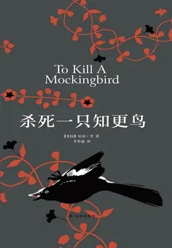

# 元数据

> [!abstract] 杀死一只知更鸟（同名电影原著）
> - 
> - 书名：杀死一只知更鸟（同名电影原著）
> - 作者：哈珀·李
> - 译者：李育超
> - 简介：《杀死一只知更鸟》的故事发生在大萧条时期美国南方一个静谧的小镇，几桩离奇的疑案彻底打破了几个孩子平静的生活：事件的真凶，怪人的谜底，传言背后的真相……在父亲的指引下，他们在迷雾中寻找真知，在磨难中历练风度，在不公平中积累正气，经历了暴风骤雨般的成长，也感受了人间的温暖与真情。
> - 出版时间：2017-02-01 00:00:00
> - ISBN：9787544766500
> - 分类：精品小说-治愈小说
> - 出版社：译林出版社
> - 微信读书评分：92%
> - 阅读进度：0%
> - 阅读时长：0分钟
> - 最后阅读：2026-11-11
> - 微信读书：https://weread.qq.com/book-detail?type=1&v=57e324b05d047c57ebe463e

# 高亮划线

## 第一章

> 📌 我哥哥杰姆快满十三岁的时候，胳膊肘遭受了一次严重的骨折。等到伤痛痊愈，他也不再担惊受怕，唯恐永远也玩不成橄榄球之后，就很少想到自己受伤的事儿了。
> ⏱ 2026-11-07 16:45:26
> 💭 翻译好拗口，还不如翻译软件直译。
>
> 直译：
>
> When it healed,
>
> 当它（骨折）痊愈后，
>
> and Jem’s fears of never being able to play football were assuaged,
>
> 杰姆关于再也不能踢足球了的担忧被减轻后，
>
> he was seldom self-conscious about his injury.
>
> 他很少再为自己的受伤感到局促不安。
> 🕰 2026-11-07 16:45:49

> 📌 等过了一些年，日子长到足够让当事人回首往事时，我们有时候会谈论导致他受伤的那些过往事件。
> ⏱ 2026-11-11 14:45:58
> 💭 时间从来不是解药，更像是麻药。我在读飘时候，一个书友说时间不是良药，自己才是良药
> 🕰 2026-11-11 14:46:13

> 📌 从迪尔来到我们这儿的那个夏天起——确切地说，是当迪尔怂恿我们把怪人拉德利引出来的时候，事情就开始了。
> ⏱ 2026-11-11 14:45:56

## 第三十一章

> 📌 他关上灯，回到了杰姆的房间里。他要在那里守护一整夜，等杰姆明天早晨醒来的时候，他还守在床边。
> ⏱ 2026-11-05 02:06:54
