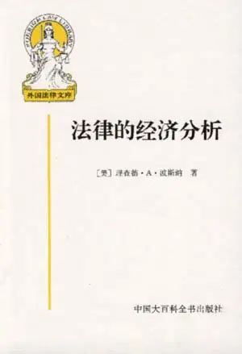

# 元数据

> [!abstract] 法律的经济分析
> - 
> - 书名：法律的经济分析
> - 作者：[美]理查德.A.波斯纳
> - 出版社：epub掌上书苑
> - 阅读进度：0%
> - 阅读时长：6分钟
> - 最后阅读：2026-11-13
> - 微信读书：https://weread.qq.com/book-detail?type=1&v=cf542f13643425f45784b42453642464643716b37376537354144686932466b491

# 高亮划线

## 中文版作者序言

> 📌 理查德·A·波斯纳
> ⏱ 2026-11-13 14:12:32
> 💭 法学家兼法官的理查德·波斯纳（1939—）是现代形式的经济快乐主义的主要倡导者，他主张很多普通法都可以解释为法官是在努力使经济福利最大化。换句话说，许多法律规则的建立都是着眼于在司法中努力实现最高效的结果。波斯纳认为，法官经常通过选择一个将会最大化社会财富的结果来裁决棘手的案件。
>
> 波斯纳用“财富最大化”这个词所指的是这样一种情势，在这种情势下，善和其他资源都在最重视它们的人的控制之下；也就是说，这些人为了拥有这些资源愿意也能够付出更多。
>
> 举个简单的例子，假定你以五美元的价格买到我这本书的复制本。你愿意支付的最高价格是十美元。这样你的财富就增加了五美元。同样地，波斯纳认为当社会上所有资源的分配能使每个人交易的总额都尽可能高时，社会财富就最大化了。波斯纳认为，这正是社会应当追求的。
>
> 波斯纳和他所属的芝加哥学派认为，经济因素解释了若干法律规则的发展。例如，在有关过失的法律中，责任的确定通常取决于哪种方式最经济高效。普通法的方法是在从事互动行为的人之间分配责任，从而最大化行为的共同价值，或者说，最小化行为的共同成本。
>
> 这一点的实现或通过重新定义财产权利，或通过设计一种新的归责准则，或通过对契约权利的认可。波斯纳照此方式分析了普通法的若干方面。
>
> 因此阅读波斯纳的长篇巨著要求对经济学理论有相当程度的了解。特别地，他使用了各种不同的效率概念，尤其是帕累托最优和卡尔多—希克斯检验。前者（根据意大利经济学家维尔弗雷多·帕累托命名）描述了一种状态，对这种状态的任何改变都会使至少一个人较改变前情况恶化。
>
> 当获益者所得价值的增长超过失利者的损失时，这种变化就被称为卡尔多—希克斯效益。二者都是根据付出代价的乐意程度来衡量的。波斯纳还应用了“边际效用递减”的概念，此概念指出这样一个事实：把一美元给一个穷困的乞丐会对他的财产产生重大影响，而对一个百万富翁来说，是否给他一美元几乎没有任何影响。
>
> 著名的科斯定理（根据经济学家罗纳德·科斯命名）假定了一种情形，这种情形下，有一种结果是最“有效率”的。
>
> 然而，现实生活也许比这个简单的例子所说的要复杂得多。在此过程中，不可避免地要产生某些成本。科斯定理最直接的形式也许可以表述如下：当交易成本为零时，有效率的结果就会出现，而不管法律规定如何。
> 🕰 2026-11-13 14:12:48

## 第七章 刑法

> 📌 现在，大量的执法资源投入到与偷运非法毒品（如可卡因、可卡因精、海洛因、大麻、麦角酸二乙基酰胺、安非他明等）的斗争中去，而且对毒品非法偷运的处罚越来越严厉——甚至是残酷的。
> ⏱ 2026-11-13 14:06:28

## 第八章 普通法、法律史和法哲学

> 📌 对大多数法学家而言，普通法只是一个没有联系的各领域的集合，每一领域都有其自己的历史、词汇及令人迷惑的大量规则和原则；确实，每一领域自身好像只是一个微弱相关的各种原则的集合体
> ⏱ 2026-11-13 14:10:28

> 📌 我们已经认识到，无论是财产权法、契约法、商法、赔偿法、不当得利法，还是刑法、亲属法、海事法，所有这些都能被铸入用以解释（主要地）这些法官制定法（judge－madelaw）领域中主要原则（包括实体的和救济程序的）的经济构架中
> ⏱ 2026-11-13 14:10:58
