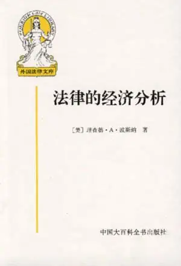

# 元数据

> [!abstract] 法律的经济分析
> - 
> - 书名：法律的经济分析
> - 作者：[美]理查德.A.波斯纳
> - 出版社：epub掌上书苑
> - 阅读进度：6%
> - 阅读时长：21分钟
> - 最后阅读：2026-11-14
> - 微信读书：https://weread.qq.com/book-detail?type=1&v=cf542f13643425f45784b42453642464643716b37376537354144686932466b491

# 高亮划线

## 中文版作者序言

> 📌 理查德·A·波斯纳
> ⏱ 2026-11-13 14:12:32
> 💭 法学家兼法官的理查德·波斯纳（1939—）是现代形式的经济快乐主义的主要倡导者，他主张很多普通法都可以解释为法官是在努力使经济福利最大化。换句话说，许多法律规则的建立都是着眼于在司法中努力实现最高效的结果。波斯纳认为，法官经常通过选择一个将会最大化社会财富的结果来裁决棘手的案件。
>
> 波斯纳用“财富最大化”这个词所指的是这样一种情势，在这种情势下，善和其他资源都在最重视它们的人的控制之下；也就是说，这些人为了拥有这些资源愿意也能够付出更多。
>
> 举个简单的例子，假定你以五美元的价格买到我这本书的复制本。你愿意支付的最高价格是十美元。这样你的财富就增加了五美元。同样地，波斯纳认为当社会上所有资源的分配能使每个人交易的总额都尽可能高时，社会财富就最大化了。波斯纳认为，这正是社会应当追求的。
>
> 波斯纳和他所属的芝加哥学派认为，经济因素解释了若干法律规则的发展。例如，在有关过失的法律中，责任的确定通常取决于哪种方式最经济高效。普通法的方法是在从事互动行为的人之间分配责任，从而最大化行为的共同价值，或者说，最小化行为的共同成本。
>
> 这一点的实现或通过重新定义财产权利，或通过设计一种新的归责准则，或通过对契约权利的认可。波斯纳照此方式分析了普通法的若干方面。
>
> 因此阅读波斯纳的长篇巨著要求对经济学理论有相当程度的了解。特别地，他使用了各种不同的效率概念，尤其是帕累托最优和卡尔多—希克斯检验。前者（根据意大利经济学家维尔弗雷多·帕累托命名）描述了一种状态，对这种状态的任何改变都会使至少一个人较改变前情况恶化。
>
> 当获益者所得价值的增长超过失利者的损失时，这种变化就被称为卡尔多—希克斯效益。二者都是根据付出代价的乐意程度来衡量的。波斯纳还应用了“边际效用递减”的概念，此概念指出这样一个事实：把一美元给一个穷困的乞丐会对他的财产产生重大影响，而对一个百万富翁来说，是否给他一美元几乎没有任何影响。
>
> 著名的科斯定理（根据经济学家罗纳德·科斯命名）假定了一种情形，这种情形下，有一种结果是最“有效率”的。
>
> 然而，现实生活也许比这个简单的例子所说的要复杂得多。在此过程中，不可避免地要产生某些成本。科斯定理最直接的形式也许可以表述如下：当交易成本为零时，有效率的结果就会出现，而不管法律规定如何。
> 🕰 2026-11-13 14:12:48

## 第一章 经济推理的本质

> 📌 一位学生修读价格理论的课程后便能知道谷物价格下降时，小麦的价格会发生什么变化，以及当牛肉价格上升时，牧草地的价格将发生什么变化。但是，他却无法理解这些事情与言论自由、意外事故、犯罪、禁止永久不得转让所有权的原则（the Rule AgainstPerpetuities）和公司契约有什么关系
> ⏱ 2026-11-14 03:43:15

> 📌 许多法律学者认为，经济学就是研究通货膨胀、失业、商业周期和其他神秘莫测的宏观经济现象的，它们与法律制度所关注的日常事务无关
> ⏱ 2026-11-14 03:42:52

> 📌 事实上，经济学领域比这要宽泛得多。正如本书所表明的，经济学是一门关于我们这个世界的理性选择的科学（the science of rationalchoice）
> ⏱ 2026-11-14 03:42:58

> 📌 在这个世界，资源相对于人类欲望是有限的。依此定义，经济学的任务就在于探究以下假设的含义：人在其生活目的、满足方面是一个理性最大化者（rationalmaximizer）——我们将称他为“自利的（self－interest）”
> ⏱ 2026-11-14 03:46:33

> 📌 “人是其自利的理性最大化者”这一概念暗示，人们会对激励（incentive）作出反应，即，如果一个人的环境发生变化，而他通过改变其行为就能增加他的满足，那他就会这样去做。我们可以从这一命题推出经济学的三项基本原理
> ⏱ 2026-11-14 03:47:26

> 📌 1．第一项是所支付的价格和所需求的数量呈反比例关系，即需求规律（the Law ofDemand）
> ⏱ 2026-11-14 03:47:21

> 📌 一些不受欢迎的老师有时通过提高他们所授课程学生的平均分数来增加课程注册人数，因为在其他情况相同时，严格判分者会比随便判分者拥有较少的课程注册人数
> ⏱ 2026-11-14 03:50:02

> 📌 一位在服刑的已决犯被看成是在“向社会还债”，经济学家会认为此项比喻是恰当的。至少从罪犯的角度看（为什么不从社会角度看？），刑罚是社会使罪犯对其过错所支付的代价
> ⏱ 2026-11-14 03:50:22

> 📌 经济学家由此预言，刑罚严厉性和其他类似负担的增加，会提高犯罪的价格，从而降低犯罪发生率，并促使罪犯代之以从事其他活动。经济学家将非金钱价格称作“影子价格（shadow prices）。
> ⏱ 2026-11-14 03:50:31

> 📌 2．在我们所举的牛肉例子中的消费者——以及这里讨论的罪犯——都被假定为试图使其效用（幸福、快乐、满足）最大化。可以推测，这一假定也适合于牛肉生产者，虽然就消费者而言，他通常被说成是为了利润最大化（Profitmaximization）而非效用最大化（utilitymaximization）
> ⏱ 2026-11-14 03:50:55

> 📌 销售者所追求的是使其成本和销售收入之差最大化，但此时我们所关心的只是一位理性的自利销售者所收取的最低价格是多少。最低价格是指销售者在制作（或销售）产品时所耗资源的价格将等于它们在其另一最佳使用时的价格——即替代价格（alternativePrice）
> ⏱ 2026-11-14 03:51:22

> 📌 与作为替代价格的成本慨念相关的一个推论是，只有当某些人被拒绝使用此资源时，成本才会发生
> ⏱ 2026-11-14 03:52:18

> 📌 由于我能呼吸到足够的空气而又不剥夺其他任何人对空气的任何需求，其他人无需因为我让与空气权给他而付钱给我，所以空气是不需要成本的。因此，一种物品只有一种使用（你能明白这是什么吗？）
> ⏱ 2026-11-14 03:52:40

> 📌 对经济学家而言，成本是“机会成本（opportunitycost）”——意谓由于将资源使用于某一方面而不能用于其他方面时所放弃的收益
> ⏱ 2026-11-14 03:52:35

> 📌 家务劳动是一种经济活动，尽管做家务的人是不接受金钱补偿的配偶一方或双方，但它仍然涉及成本——主要是做家务人的时间的机会成本
> ⏱ 2026-11-14 03:54:22

> 📌 寻找性伙伴（连同性行为本身）是需要时间从而相对于该时间的次佳使用的价值而言是会产生成本的。疾病和意外受孕的风险也是一种性的实在（虽不主要是金钱的）成本
> ⏱ 2026-11-14 03:54:47

> 📌 “沉淀”（已出现的）成本（“sunk”cost）并不影响对价格和数量的决定
> ⏱ 2026-11-14 03:55:59

> 📌 这一沉淀成本的讨论将有助于解释经济学家为什么将其研究重点置于事前研究而非事后研究。理性人将其决定基于对未来的预期而非对过去的懊悔。他们认为，过去的事就让它过去吧
> ⏱ 2026-11-14 03:56:39

> 📌 如果让懊悔破坏决定，那么人们塑造其命运的能力就会受到损害。如果允许一个自由达成契约的当事人在产生不良后果后修改契约条款，那就不可能达成任何契约。
> ⏱ 2026-11-14 03:56:49

## 第七章 刑法

> 📌 现在，大量的执法资源投入到与偷运非法毒品（如可卡因、可卡因精、海洛因、大麻、麦角酸二乙基酰胺、安非他明等）的斗争中去，而且对毒品非法偷运的处罚越来越严厉——甚至是残酷的。
> ⏱ 2026-11-13 14:06:28

## 第八章 普通法、法律史和法哲学

> 📌 对大多数法学家而言，普通法只是一个没有联系的各领域的集合，每一领域都有其自己的历史、词汇及令人迷惑的大量规则和原则；确实，每一领域自身好像只是一个微弱相关的各种原则的集合体
> ⏱ 2026-11-13 14:10:28

> 📌 我们已经认识到，无论是财产权法、契约法、商法、赔偿法、不当得利法，还是刑法、亲属法、海事法，所有这些都能被铸入用以解释（主要地）这些法官制定法（judge－madelaw）领域中主要原则（包括实体的和救济程序的）的经济构架中
> ⏱ 2026-11-13 14:10:58
