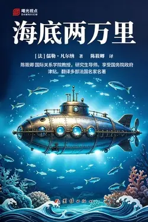

# 元数据

> [!abstract] 海底两万里（名家名人译）
> - 
> - 书名：海底两万里（名家名人译）
> - 作者：[法]儒勒·凡尔纳
> - 译者：陈筱卿
> - 简介：小说主要讲述了博物学家阿龙纳斯、其仆人康塞尔和鱼叉手尼德·兰一起随鹦鹉螺号潜艇船长尼摩周游海底的故事。
> - 出版时间：2017-01-01 00:00:00
> - ISBN：9787512647886
> - 分类：精品小说-科幻小说
> - 出版社：团结出版社
> - 微信读书评分：92%
> - 阅读进度：0%
> - 阅读时长：3分钟
> - 最后阅读：2026-11-13
> - 微信读书：https://weread.qq.com/book-detail?type=1&v=848324b0813abb1ceg0103bf

# 高亮划线

## 推荐序——“名著导读·名师中考试题训练与解析”丛书

> 📌 培根对读书的意义和作用有过十分精辟的论述：“读书足以怡情，足以傅彩，足以长才。其怡情也，最见于独处幽居之时；其傅彩也，最见于高谈阔论之中；其长才也，最见于处世判事之际。
> ⏱ 2026-11-13 02:58:34
> 💭 “傅彩”在原文中意为读书能增添谈吐的文采，使人在高谈阔论时言辞生动、有光彩。培根用“傅彩”与“怡情”“长才”并列，强调读书对言辞修饰与表达能力的提升，呼应后文“高谈阔论之中”的场景。
> 🕰 2026-11-13 02:58:42

## 五 阿拉伯隧道

> 📌 “瞧呀！”加拿大人又叫嚷道，“它翻转身子了，乳房露了出来！”“美人鱼！”康塞尔嚷道，“一条真正的美人鱼，先生觉得我说得对不对？”
> ⏱ 2026-11-13 03:30:04

> 📌 美人鱼的名字使我顿悟，我立刻想到，它是属于人鱼目的海洋生物。神话把人鱼目的海洋生物变成了美人鱼，是一种半人半鱼的动物。“错了，”我对康塞尔说，“那不是什么美人鱼，而是一种奇特的动物，目前只是在红海中有这么几只。这种东西被称为儒艮。”“人鱼目，鱼形群，单子宫亚纲，哺乳动物纲，脊椎动物门。”康塞尔补充道。
> ⏱ 2026-11-13 03:30:08
> 💭 儒艮是海牛目儒艮科的草食性海洋哺乳动物，因雌兽抱幼崽水面哺乳的姿势像人而被称作“美人鱼”。它分布于印度洋、西太平洋热带浅海，以海草为食，行动缓慢、性情温驯，但繁殖率低、寿命长，对水温敏感，已在中国功能灭绝，全球仅存约8万头，主要栖息在澳大利亚。
> 🕰 2026-11-13 03:30:13

## 十二 抹香鲸和长须鲸

> 📌 尼摩艇长让鹦鹉螺号靠近那具长须鲸尸体。两名艇员纵身跳到它的身上。我不无惊讶地看到，他俩把死鲸乳房里的乳汁在往外挤，挤得干干净净，足足挤了两三大桶。
> ⏱ 2026-11-13 03:30:30

> 📌 尼摩艇长递给我一杯还热乎乎的鲸鱼奶。我心中带着点对这种饮料的厌恶，向他表示了谢绝，但他却向我保证，说它同牛奶一样，营养丰富，质量上乘。
> ⏱ 2026-11-13 03:30:35

> 📌 我先尝了一口，觉得艇长没有撒谎。因此，鲸鱼奶便成了我们有益健康的储备，因为，把这种奶做成咸奶油或奶酪，可以大大地改善我们的日常饮食。
> ⏱ 2026-11-13 03:30:44

> 📌 我不无担忧地发现，自这一天起，尼德·兰对尼摩艇长的态度越来越不好了，我便决定多加小心，密切注视这位加拿大人的一举一动。
> ⏱ 2026-11-13 03:30:50

# 章节点评与书评

## 读书笔记

小时候的“神作”

如今再看《海底两万里》

我突然发现了这故事，

竟然有和《基督山伯爵》

与《呼啸山庄》的相似之处：仇恨

尼摩船长的宿命，

也神奇般的成为了唐戴斯和希思克利夫的“公约数”

即使他无法做到如基督山伯爵般顺利

即使他依然被“仇恨”所纠缠

但却用行动（向外走）来实现了

希思克利夫所无法实现的另一种救赎～

所以，回到现在

我发现这依然是“神作”！

> 记录于 2026-11-13 02:58:30
