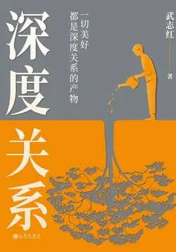

# 元数据

> [!abstract] 深度关系
> - 
> - 书名：深度关系
> - 作者：武志红
> - 简介：知名心理学者武志红继《为何家会伤人》之后，有关自我、自恋和关系的又一重磅作品。
>   独创自我认知工具“人性坐标体系”，帮读者用直观、可执行的方法衡量自己的心灵健康程度，或一份关系的健康程度。通过这一工具认识自我、找到问题症结。
>   深度剖析情绪内耗根源“全能自恋”，引导读者重新审视内心，识别和摆脱情绪操控；培养读者建立自己与人、事物和世界的深度关系的能力，从而拥有做成事的能力、爱的能力。
>   真正帮读者活得真实、松弛、实现最根本的疗愈。
> - 出版时间：2023-10-18 00:00:00
> - ISBN：9787522520223
> - 分类：心理-社会心理学
> - 出版社：九州出版社
> - 微信读书评分：86%
> - 阅读进度：0%
> - 阅读时长：1分钟
> - 最后阅读：2026-11-13
> - 微信读书：https://weread.qq.com/book-detail?type=1&v=bb432f60813ab8444g014d61

# 高亮划线

## 导言 欢迎来到真实世界

> 📌 自恋维度，也可以称为“力量维度”“权力维度”；关系维度，也可以称为“情感维度”“道德维度”。
> ⏱ 2026-11-09 19:45:50
> 💭 可以理解为自己和自己的关系，自己和他人的关系。本来看不懂的，豁然开朗
> 🕰 2026-11-09 19:45:56

### 第一章 全能幻梦

> 📌 2018年2月9日，广西桂林市的一座大桥上发生了惊心动魄的事情。一辆货车和另一辆车发生剐蹭，交涉时，货车司机用钢管殴打对方。从视频中可以看到，货车司机年轻帅气，殴打对方的时候很有气势，理直气壮。
> ⏱ 2026-11-13 04:50:20
> 💭 这句是站在施暴者视角写的吧，对外貌的正向描写和其所做的嚣张行为形成对比，更显荒谬了。看的时候想发笑，这就是黑色幽默吧。
> 🕰 2026-11-13 04:50:49

> 📌 有意思的一幕是，警方最终拦下货车并抓获该司机时，他看起来变得瘫软如泥。
> ⏱ 2026-11-13 04:50:32

# 章节点评与书评

## 读书笔记

武志红写的书真的跟他的头衔匹配不上，出于好奇找到了《巨婴国》的资源，网上传其说了太多真话，才被禁了的，前两天看了他的《巨婴国》，里边大篇幅的崇洋媚外，抨击其他文豪，书中的案例说明都是他从电视剧新闻里网上以及从旁人听来的故事，再进行分析猜测非常不严谨不专业，也就是不了解其中缘由与当事人的情况妄作判断，

基本所有问题都冠以“中国式”的问题，过于偏激，难怪是禁书了呢。

这是他42岁的作品，《巨婴国》展现了他眼界狭隘，抨击鲁迅李白屈原等文豪，他理解不到他人的境界而已，他自己原生家庭的给他的影响他自己都没疗愈到，反倒是写进书里抨击自己出生所在的中国文化。一位从业十几年的心理咨询师，却不能去疗愈自己原生家庭给他带来的影响。

出于好奇，心想今年50岁的他又出了新书，会不会庆幸当年《巨婴国》被禁，会不会新书《深度关系》有了新的转变和认识，刚看完，《深度关系》里的很多内容，是《巨婴国》里搬运过来的，书里用词过于偏激，举例子都是旁征博引来自新闻八卦电视剧电影旁人口中道听途说，擅长把问题夸大，给一个小事情贴上心理问题标签。

去b站看了他近期视频，才知道，他自己说从业20多年，个案才100+，基本都是长期案例，大多3.5年，还有11年，一个心理咨询师，个案咨询周期这么长，是值得骄傲的事吗？周期这么长不能疗愈他人，不如放过他人？？他的书，可以影射出他本人内心极度脆弱和敏感，眼界狭隘，挺没文化的（近期本人正在细看三国，他书里说刘备是流氓），无知又傲慢，爹味儿挺重的。

他本人才是他书里写的典型的巨婴。

《巨婴国》里，跟他不相似的经历，他很难接受和理解，比如他吐槽的各位文豪唐诗宋词以及经典，源于他的无知和眼界浅，岳飞跟他相似的经历，是因为都是被压制了欲望，做了很多不想做但不得不做的事，所以他很反感自己做一个“中国式的好人”，因为“中国式的好人”是有一个模板要求的，但实际他自己不想做不得不做，

于是在岳飞的经历里找到了认同感，所以，他能接受的，无非是找同类罢了。

他喜欢王小波，崇拜王小波，是因为王小波的自由与洒脱，他没有。在岳飞身上找认同，在王小波那里找渴望。

> 记录于 2026-11-09 19:45:32
