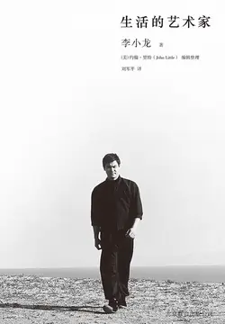

# 元数据

> [!abstract] 生活的艺术家
> - 
> - 书名：生活的艺术家
> - 作者：李小龙
> - 译者：刘军平
> - 简介：一直以来，李小龙都以一个功夫高手的形象闻名于世。但本书却告诉读者，李小龙绝不仅仅是一介武夫，他还是出色的哲学家、心理学家、作家、诗人、艺术家、演员、社会学家和灵魂的探求者。他有着明确的人生追求——就是在生活的每个层面都力求完美，成为一个生活的艺术家。在本书中，李小龙畅谈了他对功夫的独到看法和对人生的精妙洞见。这些鲜活的文字透过时空，将一代功夫之王丰富细腻的内心世界再现于读者面前。翻开这本书，聆听李小龙生命的交响曲，揭秘他传奇人生的智慧源泉。
> - 出版时间：2013-04-01 00:00:00
> - ISBN：9787550213500
> - 分类：人物传记-娱乐明星
> - 出版社：北京联合出版公司
> - 微信读书评分：80%
> - 阅读进度：12%
> - 阅读时长：14分钟
> - 最后阅读：2026-11-18
> - 微信读书：https://weread.qq.com/book-detail?type=1&v=7a2322c05df8b67a29d58f1

# 高亮划线

## 版权信息

> 📌 叶问与李小龙合影
> ⏱ 2026-11-17 05:45:07
> 💭 可能是先入为主吧，我更喜欢影视作品中叶问宗师的气度和李小龙酷酷的模样，现实中的他们略显平凡，感觉跟我们这大千世界来来往往的白丁一样的普通。不对，龙哥超自信的好不好 他的人格魅力真的异于常人
> 🕰 2026-11-17 05:46:23
> 💭 叶问这个样子啊，其实要让张家辉演，更像啊
> 🕰 2026-11-17 05:45:51

## 序言 艺术家之路

> 📌 小龙说过，“认识自己需要花一生的时间”，而他一刻也没有虚度光阴。
> ⏱ 2026-11-17 05:46:44
> 💭 活在当下，享受当下，用每个瞬间的体验来认识自己。其实，当下的每一刻都在无形中塑造着新的你，所以，专注当下，既能感受真实的自己，也能成为更好的自己。
> 🕰 2026-11-17 05:47:04
> 💭 李小龙说：他想要成为一个真正的人，一个充分自我实现，并不断拓展自己潜能的人。
> 🕰 2026-11-17 05:46:56

## 一个不朽灵魂的史诗

> 📌 在永恒的王国里，有许多新的灵魂，他们的离去，常常是为了活在人们中间。
> ⏱ 2026-11-17 05:47:20
> 💭 形体消寂了，灵魂和思想却永存于世，借助文字这个载体成为全人类共同的精神财富。
> 🕰 2026-11-17 05:47:27

## 前言 生活的艺术家

> 📌 在拍摄《龙争虎斗》（Enter the Dragon）和构思《死亡游戏》（The Game of Death）的几个星期中，尽管他十分忙碌，也还是挤出时间回到这些文章上。灵感一来的话，他就随手记下笔记——有些是在中国香港嘉禾电影公司的摄影棚里写的，有些是在他在故乡九龙塘学习时写的，也有些是他到餐馆吃午饭或晚饭时写的
> ⏱ 2026-11-17 05:48:16
> 💭 灵感稍纵即逝，应善于捕捉
> 🕰 2026-11-17 05:48:28

> 📌 李小龙所说的“生活的艺术家”，是指一个个体的成长过程，即一个人通过运用自己的独立判断，成为一个在身体上、心理上以及精神上完整的人。
> ⏱ 2026-11-17 05:47:41
> 💭 哇，这个“生活的艺术家”的称号，真是恰如其分。倘若一个人能活在当下，品味生活，不断在身心各方面追求进步，那么他所具备的，又何止是艺术家中的一部分精魄？这比我们世俗中扮演的任何一个角色——无论是父亲、丈夫，还是同事、领导——都要来得深刻而准确。我相信，一个生活的艺术家，定能在这些社会角色中游刃有余。
> 🕰 2026-11-17 05:47:52

> 📌 对于我来说，我的生活就是自我反省，一点点、一天天的自我剖析。
> ⏱ 2026-11-17 05:48:41
> 💭 我也是这样，通过对遇到的大大小小的事情的反应来不停的审视自己，想要更了解自己，理解自己，从而找到最适合自己的生活方式。似乎自己又是自己又是旁观者。
>
> 有时候会觉得很累，会觉得太复杂了，很难想清楚，但还是忍不住。
> 🕰 2026-11-17 05:48:59

> 📌 读者只需腾出一点空间，来接受李小龙还是一位诗人、哲学家、心理学家、作者、激励者、自助的倡导者、艺术家、演员、社会学家和灵魂的探求者。
> ⏱ 2026-11-17 05:49:46

> 📌 如果你带着李小龙所说的“静谧、无偏见的意识”来阅读本书，你会觉得自己不是在读一本书，而是在拜会一位老朋友。
> ⏱ 2026-11-17 05:49:29
> 💭 我现在可不是在读书，而是在拜访一位非常有智慧的老朋友——他也是个生活艺术家。我们正在交流探讨生活的艺术。
> 🕰 2026-11-17 05:49:36

> 📌 我无法教你什么，只能帮助你探求你自己。除此之外，别无他法。——李小龙
> ⏱ 2026-11-17 05:50:01
> 💭 因此，老子在《道德经》中言道：“知人者智，自知者明。”这提示我们，真正的成长始于对自我本心的探寻。这一过程充满了主观能动性，他人的经验终究是镜花水月，无法替代亲身的体悟与实践。
> 🕰 2026-11-17 05:50:25
> 💭 Such a humble person
> 🕰 2026-11-17 05:50:07

## 第一章 功夫之道

> 📌 事实上，李小龙曾经一度想在美国设立连锁的功夫协会。但是，随着他的学识与日俱增，哲学和武术的知识也日益精湛之后，他逐渐认识到，尽管传统美德备受推崇和尊敬，也并没有必要去极力颂扬它。
> ⏱ 2026-11-17 05:50:56
> 💭 貌似还是他自己的一派，有创新
> 🕰 2026-11-17 05:51:20

> 📌 他花了大量时间来寻找人类的共同根基，而不是寻找民族的根基，来证明他的信仰体系和行为。但有一点很有趣的是，从1972年开始，当他试图用电影反映哲理方面的内容时，他所展示的道理仍是来自东方的传统。
> ⏱ 2026-11-17 05:51:06

> 📌 道可道，非常道；名可名，非常名。无名，万物之始；有名，万物之母。故常无欲，以观其妙；常有欲，以观其徼。此两者，同出而异名，同谓之玄，玄之又玄，众妙之门。——老子《道德经》（一）
> ⏱ 2026-11-17 05:51:45

> 📌 《世界哲学名篇》（Masterpieces of World Philosophy）对“道”的解释是，“道是万事万物的无名之始，万物所遵循的规律，也是最高级、最终的形式，是万物生长的规律。
> ⏱ 2026-11-17 05:52:01
> 💭 老君曰： “ 知道易，信道难。信道易，行道难。行道易，得道难。得道易，守道难。守而不失，乃常存也。 ”。节选《太上老君内观经》
> 🕰 2026-11-17 05:52:24

> 📌 休斯顿·史密斯[插图]在《人的宗教》（The world's relingions）中谈到：“道是终极的现实——或者说是所有生命背后的方法和规律，或者说，人类的生命之道应该与宇宙的运行之道相和谐。”
> ⏱ 2026-11-17 05:52:06

> 📌 阴阳原理在武术中的运用体现为“和谐法则”，它旨在告诉我们：对于对手的力量不要顽抗，而要顺势而为
> ⏱ 2026-11-17 05:53:54

> 📌 凡事发乎自然，更重要的是顺其自然，不要刻意或勉强为之。当甲对乙施加“阳”的力量时，乙不必以蛮力来抗击它，也就是说乙不应该以“阳”克“阳”，而是应该以柔克刚，顺应甲的力量。当甲的力量发挥到极限的时候，“阳”即开始转为“阴”，乙则在其力道将竭之际，发动力量（阳）来反击对手
> ⏱ 2026-11-17 05:54:01

> 📌 这样，所有的动作过程纯系发乎自然，而非竭力为之。乙只需顺着对手的来势做出和谐、连贯的配合，不用负隅顽抗或竭力挣扎。
> ⏱ 2026-11-17 05:54:05

> 📌 应该忘掉自己，并将自己的力量融入对手发势、变势的动作中。不要先发制人，要随着对手的招式变化而做出相应地动作。
> ⏱ 2026-11-17 05:53:22
> 💭 这需要极高的定力，成为水，一切的变动皆以外在的变动而变动，你要攻，我便守，你要，我给，你对，我错，我不与你争，我只成为你系统的一部分，而后待你停下，不攻，不要，不对，我就自然而然成为了攻，要，对的那一方，你也就自然而然的进入守，给，错的那一方，这是道的规律，有定力则胜
> 🕰 2026-11-17 05:53:32

> 📌 人之生也柔弱，其死也坚强。草木之生也柔脆，其死也枯槁。故坚强者死之徒，柔弱者生之徒。是以兵强则灭，木强则折，强大处下，柔弱处上。——《道德经》
> ⏱ 2026-11-17 05:52:36
> 💭 这段话出自《道德经》第七十六章，核心思想是“柔弱胜刚强”，强调顺应自然、保持柔韧的生命力。人活着时身体柔软，死后僵硬；草木生长时柔脆，死后枯槁：这说明柔弱代表生机与活力，坚强则意味着僵化与死亡。“坚强者死之徒，柔弱者生之徒”：老子认为，过度逞强、刚硬的事物容易走向衰败，而柔弱、谦逊、灵活的状态更有利于生存和发展。
>
> “兵强则灭，木强则折”：以用兵和树木为例，说明过度强大、刚硬反而容易招致失败或毁灭。“强大处下，柔弱处上”：比喻真正有力量的事物往往谦逊低调，而表面强大者可能已走向衰落。老子并非提倡软弱无能，而是主张刚柔并济、以柔克刚，在生活和处事中保持灵活与谦逊，避免过度刚强导致的僵化与失败。
> 🕰 2026-11-17 05:53:05
> 💭 人活着的时候身体是柔软的，死了以后身体就变得僵硬。草木生长时是柔软脆弱的，死了以后就变得干硬枯槁了。所以坚强的东西属于死亡的一类，柔弱的东西属于生长的一类。
>
> 因此，用兵逞强就会遭到灭亡，树木强大了就会遭到砍伐摧折。凡是强大的，总是处于下位，凡是柔弱的，反而居于上位。
> 🕰 2026-11-17 05:52:55

> 📌 每一个冲突焦点，每一种外在的情感都既有破坏性，又分散精力。它打乱了人的自然节奏，降低人的整体效率，它比体力的损耗更让人筋疲力尽。摧毁人内部节奏的情绪有：仇恨、嫉妒、欲望、妒忌、自傲、虚妄、贪婪和恐惧。
> ⏱ 2026-11-17 05:55:23
> 💭 通过这一个焦点就剖析出人的内在情绪，也从这些情绪中可以看到这样确实特别容易消耗人的精力。
> 🕰 2026-11-17 05:55:35

> 📌 “无心”并不意味着大脑一片空白，而是指摒弃了所有的情感。
> ⏱ 2026-11-17 05:57:07
> 💭 让心不为所动。心未静念念于心，澄其心而神自清。
> 🕰 2026-11-17 05:57:32

> 📌 “宁静意味着无思无虑的平和，自省意味着生动清晰的意识。因此，宁静的自省就是清晰地意识到无思无虑的状态。”
> ⏱ 2026-11-17 06:54:55

> 📌 当他个人的自我意识和有意识的努力屈服于他者的力量时，他就达到了“无为”的最高境界。
> ⏱ 2026-11-18 10:03:59

> 📌 冰冻起来，它能结成巨大的冰山。它一会儿像尼亚加拉大瀑布（Nigara Falls）一样汹涌澎湃，一会儿像宁静的池塘一样平静无声。
> ⏱ 2026-11-18 10:23:05
> 💭 假设每个人都是“水”，你是尼亚加拉大瀑布你就找一个能让你成为那个瀑布的环境，如果你是池塘你就找一个能够成为池塘的环境，如此安好，在此环境你是你，你是优秀的、舒适的。假设你是瀑布却想成为池塘，就不是无为了，就会累，看自己却也可以“乐在其中”。
> 🕰 2026-11-18 10:23:15

# 章节点评与书评

## 读书笔记

一提到李小龙，所有人都知道他是武术家，武打明星，但这只是表象。读了这本《生活的艺术家》就知道，他还是个哲学家，艺术家，而武术和演员只是哲学和艺术的载体和表达。

这是一本他逝世前半年所著，是借武术讨论生命、自由与自我成长的哲学笔记。李小龙曾在美国华盛顿大学学习哲学，深受中国道家思想和西方哲学影响。他一生不满足于做一个武术家，而是试图将哲学、心理学、艺术和身体训练融为一体。

他所说的「生活的艺术家」，就是一个不被既定身份和外部规则定义的人，能够通过持续的自我观察、独立判断和实践，成为身心完整的自己。武术是他的语言，哲学是他的思考，而生活本身才是他真正的作品。

李小龙的生活哲学，核心是一个字：道。道家讲无为、自然、虚静，李小龙则把这些思想变成了截拳道的实践原则。他反对拘泥于门派、套路和固定招式，主张「以无法为有法，以无限为有限」。所谓无为，不是什么都不做，而是不让成见、恐惧和习惯妨碍自然反应；所谓忘我，也不是失去自我，而是放下自我中心的执念，让意识充分感知当下。

真正的高手，不是脑中装满招式的人，而是面对变化时，能够迅速觉察、自由选择、恰当行动的人。

这里让我联想到刚刚度过的费登奎斯「动中觉察」理论（见《身心智慧》）。两者虽然一个从武术出发，一个从身体教育出发，却有着非常有趣的呼应：李小龙追求的是在对抗中自由地行动，费登奎斯追求的是在行动中重新认识自己。费登奎斯强调，身体并不是一个等待大脑指挥的机械工具，人的动作、感觉、情绪和思维彼此交织。

只有放慢动作，提高觉察力，才能发现那些已经习以为常、却未必高效的身体模式。李小龙则通过截拳道打破固定的动作模式，让身体不再被套路控制，而是根据环境自然调整。前者通过觉察释放身体的可能性，后者通过实践验证觉察的自由。

两者似乎都在提醒我们：真正的进步不一定来自更用力，而可能来自更清醒地感知、更准确地行动。工作和生活处处皆可修炼，处处皆为「道场」。

工作中，我们也常常像练习传统套路一样，依赖过去的经验、流程和成功模式，却忘了环境和问题无时不刻不在变化。

管理者如果只会套用「高大上」的管理模型，就容易把团队变成僵化而只知道执行指令的机器；真正有智慧的领导者，应该像截拳道习武者一样，先观察局势、感知变化，再决定如何行动；也应该像费登奎斯的练习者一样，觉察自己的思维惯性、情绪反应和行为模式，发现那些看似熟练、实际上正在消耗自己的习惯。

截拳道教我们不要被外部套路束缚，动中觉察则教我们不要被内部惯性束缚。一个让我们更懂得应对世界，一个让我们更懂得认识自己。这种快速而深刻的觉察力需要大量的刻意或非刻意练习。

至于「面具」，成人的世界无法避免，每个人都在生活中扮演不同角色：管理者、父亲、丈夫、朋友，正如演员在不同场景中呈现不同的自己。但那又如何？为何不「戴着面具翩翩起舞」呢？😂所谓做自己，并不是摘掉所有面具，而是清楚自己为什么戴上它们，能够在不同角色之间自由切换，而不被任何一个角色绑架。

工作不只是完成任务，跑步不只是追求配速，阅读不只是积累知识，与人相处也不只是满足社会期待。我们可以在一次会议中练习倾听与判断，在一次冲突中觉察自己的情绪，在一次跑步中感受呼吸与身体，在一次独处中重新审视自己的念头。艺术不一定发生在舞台和画布上，它也可以发生在每一个普通的动作里。

关键不在于做了什么，而在于是否真正意识到自己正在做什么，以及能否从中发现新的可能。生活皆为艺术，就算是最稀松平常的事。

本书表达的核心生活哲学是：人生真正的自由，不是拥有无限的选择，而是不再被过去的自己所限制。李小龙以截拳道打破招式的边界，费登奎斯以动中觉察打破身体的惯性，两者最终都指向同一种生命智慧：不断观察、不断学习、不断调整，在行动中认识自己，在变化中创造自己。哲学不应该只是书本里的概念，艺术也不应该只是少数人的专业。

它们应该融入每个人的日常实践。也许所谓生活的艺术，就是既有能力像水一样顺应环境，又有勇气像李小龙一样打破旧我；既能全情投入每一个角色，又能在角色之外保持清醒。

最后，致敬李小龙🫡 争取把每一天都当成一次尚未完成的创作。破事烂事如果实在躲不开，就试试把它变成艺术的雕刻刀吧。😂

> 记录于 2026-11-17 05:44:52
