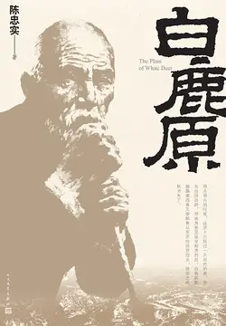

# 元数据

> [!abstract] 白鹿原
> - 
> - 书名：白鹿原
> - 作者：陈忠实
> - 简介：这是一部渭河平原五十年变迁的雄奇史诗，一轴中国农村斑斓多彩、惊心动魄的长幅画卷。一个家族两代子孙，为争夺白鹿原的统治权代代争斗不已：巧取风水地，恶施美人计，孝子为匪，亲翁杀媳，兄弟相煎，情人反目……大革命、日寇入侵、三年内战，白鹿原翻云覆雨，王旗变幻，家仇国恨交错缠结，冤冤相报代代不已……古老的土地在新生的阵痛中颤粟。
> - 出版时间：2025-09-11 00:00:00
> - 分类：精品小说-社会小说
> - 微信读书评分：92%
> - 阅读进度：38%
> - 阅读时长：1小时28分钟
> - 最后阅读：2026-11-13
> - 微信读书：https://weread.qq.com/book-detail?type=1&v=d8232a90721070e2d820e92

# 高亮划线

## 第一章

> 📌 第三个女人是北原上樊家寨的一户同样殷实人家的头生女儿，十六岁的身体发育得像二十岁的女人一样丰满成熟，丰腴的肩膀和浑圆的臀部，又有一对大奶子
> ⏱ 2026-11-13 05:16:37

> 📌 她要么是早熟，要么是婚前有过男女间的知识，一钻进被窝就把他紧紧搂住，双臂上显示着急迫与贪婪，把丰满鼓胀的奶子毫不羞怯地贴紧他的胸脯。这个像一团绒球的女人在他怀里缠磨过一年就瘦成了一根干枯的苞谷秆子，最后吐血而死了，死了也没搞清是什么病症
> ⏱ 2026-11-13 05:16:46

## 第三章

> 📌 白嘉轩猛地一颤，就呆若木鸡了。那棒槌肯定是用桃木旋下的了。桃木辟邪，鬼怕桃木橛儿。六个桃木棒槌对付六个从这个炕上抬出去的尚不甘心的鬼，可见仙草事先是做了充分准备的。他心头刚刚潮起的那种欲火又顿然熄灭了
> ⏱ 2026-11-13 05:18:28

> 📌 仙草却不理会他，带着叽里当啷摇晃着的小棒槌躺下了，用一条花格单子搭在身上。他也心灰意冷地躺下来。那温馨的气息像玫瑰花香一样沁人心脾，心里的灰冷渐渐被逐出，又潮起一种难以抑制的焦渴
> ⏱ 2026-11-13 05:18:33

> 📌 他鼓起勇气伸手把她揽进怀里，抚摸她的脖颈、丰腴的肩膀和最富诱惑的胸脯。她默默地接受了，没有惊慌也不反抗。她在他的怀里微微颤抖着身子，出气声变得急促起来
> ⏱ 2026-11-13 05:18:49

> 📌 他受到鼓舞，就把手往腹部伸去，却触到了一只倒霉的小棒槌，心里又泛起一缕阴冷之气。她抓住了他的手告诉他，出嫁前，母亲备下酒席请来一位驱鬼除邪的法官，法官把六个小桃木棒槌留下就走了。她说：“法官说，戴过百日再解裤带。
> ⏱ 2026-11-13 05:19:09

> 📌 白嘉轩一听就不由得火了：“又是个百日忌讳！”仙草却说：“百日又不是百年。你权当百日后才娶我。你就忍一忍，一百天很快就过去了。不为我也该为你想想，你难道真个还要娶八房十房女人呀……”他听着她友好的又是冷静的话，就抽出了被她抓着的手，把她紧紧搂住，心底却异常清醒
> ⏱ 2026-11-13 05:19:47

> 📌 他坐起来，重新穿上衣服。仙草问：“你干啥呀？”嘉轩说：“我跟鹿三哥睡马号去，免得睡在一起活受罪。”仙草说：“那也好。你睡这儿我也难受。只是……你明晚去马号。今日是……头一夜。”嘉轩断然说：“算了，我今黑就去。”
> ⏱ 2026-11-13 05:19:50

> 📌 嘉轩扯了一条被单夹在腋下，拉开门闩，走出门去。仙草迟疑一阵儿忽然跳下炕来：“等等。”她喊住他，又把他拽进门，反过身插上门闩，从他腋下扯走被单。嘉轩愣住了，怕她生气，反倒和颜悦色地说：“我听你的话，为我好也为你好……”仙草重新爬上炕，打断他的话：“算了！”说着，一把一个扯掉了腰带上的六个小棒槌，“哗”地一下脱去紧身背心，两只奶子像两只白鸽一样扑出窝来，又抹掉短裤，赤裸裸躺在炕上说：“哪怕我明早起来就死了也心甘！”
> ⏱ 2026-11-13 05:17:49

## 第四章

> 📌 结婚一年后，这个小厢房厦屋的土炕上传出一声婴儿尖锐的啼哭。仙草心安理得地享受了婆婆白赵氏无微不至的服侍。坐满了月子，跳下炕来的时候，她容光焕发，挺着两只饱满肥实的乳房，完全是一个动人的少妇了。
> ⏱ 2026-11-13 05:16:01

> 📌 白赵氏不仅不慌不急反而有些幸灾乐祸地说：“奶汁儿怕是给另一个暗里夺了吃光了。”仙草突然红了脸，又想起夜里丈夫和她做爱时吮咂乳房的情景。后来才悟出阿婆并没有取笑的意思，暗里夺了吃光了奶汁儿的是指自己肚里又有一个了。
> ⏱ 2026-11-13 05:12:22

## 第五章

> 📌 马驹叫白孝文，骡驹叫白孝武
> ⏱ 2025-09-12 16:32:34

## 第六章

> 📌 白嘉轩从街巷里走过去，瞥见白满仓之妻坐在街门外的捶布石上给娃子喂奶，扯襟袒脯，两只猪尿泡一样肥大的奶子裸露出来，当晚就在众人聚集的祠堂里当作违反礼仪的事例讲了。白满仓羞得赤红着脸，当晚回去就抽了丢人现眼的女人两个耳光。从此，女人给孩子喂奶全都自觉囚在屋里。
> ⏱ 2026-11-13 05:20:16

## 第七章

> 📌 鹿子霖在县府接受了为期半月的任职训练。受训结束的前一天，县长史维华再一次到场训示，发给每人一身青色制服，换上了一色一式制服的各仓总乡约和各保障所的乡约们一起同史县长合影留念，这无疑是滋水县历史上别开生面的一张历史性照片
> ⏱ 2026-10-26 12:56:19

> 📌 鹿子霖脱下长袍马褂，穿上新制服到大镜前一照，自己先吓了一跳，几乎认不出自己了。停了片刻，他还是相信这个穿一身青色洋布制服的鹿子霖，仍是那个穿长袍马褂的鹿子霖：长条脸，高额头，深陷的眼睛，长长的眼睫毛，统直的鼻子，俊俏的嘴角，这个鹿子霖比那个鹿子霖显得更精神了
> ⏱ 2026-10-26 12:56:32

## 第十章

> 📌 耕织传家久，经书济世长。
> ⏱ 2025-09-12 16:32:09

## 第十三章

> 📌 白嘉轩不失威严地挺坐在太师椅上，瞅见女儿窄巴的衣服绷紧的胸脯上隐伏着的两个乳房的轮廓，心里悸动了一下
> ⏱ 2026-11-13 05:12:53

## 第十五章

> 📌 她那会儿作为妇女代表风风光光坐在戏楼上观看对田福贤的审判，看见田福贤被绳索拘勒成紫茄子色的脖颈和脸膛，两只翻凸出来的眼球布满血丝，那眼睛里流泻出垂死的仇恨、垂死的傲气和少许的一缕胆怯。
> ⏱ 2025-09-12 16:37:13

> 📌 她那会儿作为妇女代表
> ⏱ 2025-09-12 16:36:56
> 💭 田小娥不能被定为“出轨”，她相当于是被她父亲卖给财主当小妾。和黑娃在一起是勇于抗争，争取妇女权利的表现。
> 🕰 2025-09-12 16:36:56

> 📌 “好大哩，现时还说那些事做啥！黑娃年轻张狂了一阵子，我也张狂了几回，现在后悔得提不起了。”
> ⏱ 2025-09-12 16:38:44
> 💭 可怜的女人，总是想着委曲求全，这下正着了这帮政客的道了。
> 🕰 2025-09-12 16:38:38

> 📌 他又一次感到自己心慈面软的天性，比不得白嘉轩那样心硬牙硬脸冷，甚至比不得鹿三。
> ⏱ 2025-09-12 16:40:44

> 📌 鹿子霖看见小娥撅了撅浑圆的尻蛋儿站立起来
> ⏱ 2025-09-12 16:41:37

> 📌 被泪水洗濯过的脸蛋儿温润如玉光洁照人，间或一声委屈的抽噎牵动得眉梢眼角更加楚楚动人，使人突生怜悯。
> ⏱ 2025-09-12 16:41:26

> 📌 鹿子霖叮嘱着，看见小娥有点张皇失措地撩起衣襟去擦眼泪，露出了一片耀眼的肚皮和那个脐窝，衣襟下露出的两个乳头像卧在窝里探出头来的一对白鸽。他只扫瞄了一眼，小娥捋下衣襟说：“大！那我就托付你了，我走了。”
> ⏱ 2025-09-12 16:44:10
> 💭 看到目前为止，发现这部小说中，很少写女性角色的心理和内心思考，对她们的描写大部分都是婚姻、性和繁衍。（噢！除了白灵，确实白鹿之灵了，她是自由恣意的。）可能因为这些女性角色都是传统女性角色，写她们对传统的顺从（白赵氏）、压抑（冷家大女儿）和反叛（田小娥）。
>
> 这一段小娥撩衣服擦眼泪的情节，我们都是从鹿子霖的视角来看小娥的动作，我们无从知道她是有意为之还是无意，不知道她此刻在想什么，无从探究她的心理。
>
> 个人来看，田小娥确实是一个主动性很强的人物。在地主家，她看上黑娃年轻力壮的身体，主动勾引黑娃，享受肉体的欢愉。
>
> 当黑娃逃走抛弃她，当她被吊上杆头时，我们不知道此时她是否就开始为自己打算，我倾向于她是有的，她此时急需攀上一个地位较高的人来保全自己，她的年轻的肉体是唯一的资本，或许她对黑娃是有爱的，但也是复杂的，她想过的是平凡简单的生活，哪怕忍受贫苦，她也甘之如饴，但黑娃的逃跑和抛弃，打破她平凡的愿望，
>
> 夜晚独自抽的大烟（她和黑娃在一起的时候就没有写过她抽大烟），又有多少无奈惶恐和凄苦，或许她对鹿子霖倾诉的住在村外野窑里被狗狼声音吓哭的话语不只是示弱也含着许多真情。被吊上桅杆时的尖声惨叫，点开横线的评论，却有人在意的是电视剧版的小娥是没有穿衣服被赤裸裸吊上去的，更有人猎奇地评价刺激。
>
> 田小娥的内心需要我们一点点去推敲思考，就像立在流沙上的房屋没有有力的支撑，一切都是推测，没有确切的描写。就像观看玻璃墙面后的动物似的，人们带着猎奇、疑惑、哀怜、批判种种不同的眼光。
>
> 或许更深一层的，我们需要从中看到自己。
> 🕰 2025-09-12 16:43:52

> 📌 鹿子霖在黑暗如漆的窑洞里站着，对面的小娥近在咫尺鼻息可感，他没有伸出双臂把她挟裹到炕上去，而是等待小娥的举动。小娥没有叫喊，没有朝大大脸上吐唾沫，只是站着不动也不吭声。听见一声呢喃似的叹息，站在他对面的影柱儿朝炕那边移动，传来脱衣服的窸窸窣窣的响声
> ⏱ 2026-11-13 05:23:03

> 📌 鹿子霖的心底已经涌潮，手臂和双腿控制不住地颤栗；他丢剥了夹褂儿又褪下了夹裤，摸到炕边时抖掉了布鞋就跷上炕去；当他的屁股落到炕上时感到了一阵刺疼，破烂的炕席上的篾片儿扎刺进皮肉去了；他顾不得疼痛，揭开薄薄的被子钻进去
> ⏱ 2026-11-13 05:23:14

> 📌 小娥羞怯地叫：“大——”鹿子霖嘻嘻地嗔怨：“甭叫大甭叫大，再叫大大就羞得弄不成了！”他已经把那个温热的身子紧紧裹进怀里，手忙脚乱嘴巴乱拱，这样的年纪居然像初婚一样慌乱无序，竟然在刚刚进入的一瞬便轰然一声塌倒
> ⏱ 2026-11-13 05:23:22

> 📌 他躺着凝然不动，听着潮涌到心间的血液汩汩退回到身体各部位去，接着他一身轻松无比清醒地滚翻下来，搂住那个柔软的身体，凑到她的耳根说：“黑娃万万不能回来！”小娥呼地一下豁开被子坐起来：“你哄我？你把事没办妥，你哄着我睡觉……
> ⏱ 2026-11-13 05:23:44

> 📌 鹿子霖欠起身说：“我说你们女人家沉不住气，你还说你赌咒哩！听我把话说完——”他把她搂住按进被窝，“我给田福贤把你的话说了，田福贤也答应了，昨日专门到县里去寻岳书记，岳书记也答应只要黑娃回来认个错，就啥话不提了。说黑娃万万不能回来是我的主意。你听了我的话好，你要信田福贤的话就去叫黑娃回来……
> ⏱ 2026-11-13 05:23:54

> 📌 小娥忙问：“大，你咋说万万不敢回来？咋哩？”鹿子霖说：“你们女人家只看脚下一步，只摸布料光的一面儿，布的背面是涩的，桌子板凳墙壁背面都是涩粗麻麻的。田福贤万一是设下笼套套黑娃咋办？”
> ⏱ 2025-09-12 18:28:32

> 📌 小娥突然缩回手：“不要不要不要！我成了啥人了嘛？”鹿子霖嗔怒地说：“你成了啥人了？你成了大的亲蛋蛋了！不是大的亲蛋蛋儿，大今黑还能给你说这一河滩体己话？”他穿上衣裤，下了炕站住斩劲地说：“谁欺侮你你给大说，大叫他狗日水漏完了还寻不见锅哪儿破了。关门来。大逢五或者逢十来，把炕上铺得软和些儿。”
> ⏱ 2025-09-12 18:28:17

> 📌 谁欺侮你你给大说，大叫他狗日水漏完了还寻不见锅哪儿破了。关门来。大逢五或者逢十来，把炕上铺得软和些儿。”
> ⏱ 2025-09-12 16:54:07
> 💭 话里话外都骗人说时为了黑娃好，其实都是为了在小娥身上发泄兽欲，如果黑娃来了被抓起来了，小娥肯定也难得幸免，最好也是沦为更高一级人的玩物。他哪里还能尝到鲜？
> 🕰 2025-09-12 16:54:07

> 📌 他现在不需要像头一次那样繁冗的铺陈，一进门就把光裸着身子的小娥揽进怀里，腾出一只手在背后摸到木闩插死了门板，然后就把小娥托抱起来走向炕边，小娥两条绵软的胳膊箍住了他的脖子。鹿子霖得到呼应就受到鼓舞受到激发，心境中滞留的最后一缕隐忧顿然消散
> ⏱ 2026-11-13 05:24:38

> 📌 他把她轻轻放到炕上，然后舒缓地脱衣解裤，提醒自己不能再像头一回那样惊慌那样急迫，致使未能完全尽兴就一泄如注。他侧着身子躺进被窝，一股浓郁的奇异的气息使他沉迷。小娥迎接他的到来，钻进他的怀里。他再次清醒地提示自己不能急迫慌乱，用他的左手轻轻地抚摩她的后颈和脊背，他感到她的手臂一阵紧过一阵地箍住他的后背，把她美好无比的奶子偎贴到他的胸脯上
> ⏱ 2026-11-13 05:25:32

> 📌 她的温热的脸腮和有点凉的鼻尖偎着他的脸颊，发出使他怜悯的轻微的喘息，他控制着自己不把嘴巴贴过去，那样就可能使他完全失控。他的手掌在她细腻滑润的背脊上抚摩良久就扩展到她的尻蛋儿上，她在他怀里颤栗了一下。他抽回手从她柔软的头顶抚摩下去，贴着脖颈通过腰际掠过臀部下滑到大腿小腿，一直到她穿着睡鞋的小脚，便得到了一个统一的感觉，他又从她的脸膛搭手掠过脖颈，在那对颤颤的奶子上左右旋摩之后，滑过软绵的腹部，又停留在他最终的目标之上，小娥开始呢呢喃喃扭动着腰身
> ⏱ 2026-11-13 05:25:52

> 📌 他已经从头到脚一点不漏地抚遍她全身的每一寸肌肤，开始失控，于是便完全撒缰。小娥急促地扭动着腰身，渴望似的呢喃着叫了一声：“大呀……”鹿子霖一扬手掀去了被子，发疯似的摇拽扇摆起来：“大的个亲蛋蛋儿呀，娥儿娃呀，大爱你都爱死了……
> ⏱ 2026-11-13 05:26:19

> 📌 鹿子霖享受了那终极的欢乐之后躺下来吸烟，卷烟头上的火光亮出小娥沉醉的眯眼和散乱的乌发，小娥又伸出胳臂箍住他的腰，在他耳根说：“大呀，我而今只有你一个亲人一个靠守了……”鹿子霖慷慨地说：“放心亲蛋蛋，你放心。你不看大咋着心疼你哩！你有啥难处就给大说。谁敢哈你一口大气大就叫他挨挫。”鹿子霖弹了烟灰坐起来穿衣服
> ⏱ 2026-11-13 05:26:28

> 📌 小娥拢住他的胳膊说：“大，你甭走，你走了我害怕。”鹿子霖问：“害怕啥哩？”小娥说：“有人时不时地在窑垴学狼嗥，学狐子哭吓我哩！”鹿子霖呵呵一笑：“你既然知道那是人不是狼，你怕啥？你关门睡你的觉甭理他。我收拾他。”他心里非常清楚，小娥虽好，窑洞毕竟不是久留之地。随后就断然走出了窑洞。
> ⏱ 2026-11-13 05:26:37

> 📌 鹿子霖这一夜正搂着小娥亲昵的当儿听到了狗蛋的创造。狗蛋在窑窗外一字一板朗诵，还用手掌击打着节拍：“小娥的头发黑油油。小娥的脸蛋赛白绸。小娥的舌头腊汁肉。小娥的脸，我想舔。小娥的奶，我想揣。我把小娥瞅一眼，三天不吃不喝不端碗；宁吃小娥屙下的，不吃地里打下的；宁喝小娥尿下的，不喝壶里倒下的……”鹿子霖贴着小娥的耳朵说：“你说他唱得好，明晚再来唱。”小娥就对着窗口说：“狗蛋哥，你唱得真好听。我今黑听够了想瞌睡了。你明黑再来唱多唱一阵儿。”
> ⏱ 2026-11-13 05:27:03

## 第十六章

> 📌 白孝文已经被确立为白鹿两姓族长的继任人，
> ⏱ 2025-09-12 18:57:43

> 📌 村姑对刘秀死乞白赖打诨骂俏动手动脚的骚情举动明着恼暗着喜噘嘴拒斜眼让半推半就实际上好的那个调调儿，麻子红把个村姑演得又稚又骚。
> ⏱ 2025-09-12 19:00:45

> 📌 觉得这样的酸戏未免有碍观瞻伤风败俗教唆学坏，到白鹿村过会时绝对不能点演这出《走南阳》。他心里这样想着，却止不住下身那东西被挑逗被撩拨得疯胀起来
> ⏱ 2025-09-12 19:01:09

> 📌 那只攥着他下身的手暗暗示意他离开戏场。
> ⏱ 2025-09-12 19:03:35

> 📌 那只手牵着他离开戏场走过村边的一片树林，斜插过一畦尚未翻耕的麦茬地，便进入一个破旧废弃的砖瓦窑里。
> ⏱ 2025-09-12 19:04:34

> 📌 那一刻里，白孝文听到胸腔里的肋条如铁笼的铁条折断的脆响，听见了被囚禁着的狼冲出铁笼时的一声酣畅淋漓的吼叫，双手揽住了田小娥的后腰，几乎晕昏了。
> ⏱ 2025-09-12 19:06:15

> 📌 相比之下，自己那个婆娘简直就是一堆粗糙无味的豆腐渣了。
> ⏱ 2025-09-12 19:08:33

> 📌 老子老命都不要了还要老二？割了拿回去敬你祖宗去
> ⏱ 2025-09-12 19:09:57

> 📌 土匪们把鹿泰恒背缚着用皮绳绕过大梁吊到空中，却对兆鹏媳妇十分客气地说：“嫂子，你睡你的觉，甭害怕没有你的事。”
> ⏱ 2025-09-12 19:10:45

> 📌 遭劫后的第二天早晨，鹿家和白家的街门上都发现了土匪留下的手迹：“白狼到此”。
> ⏱ 2025-09-12 19:11:31

> 📌 白嘉轩不能翻身转腰，死死地仰躺在炕上接待前来看望他的亲戚友好和乡邻族人，他没有愤恨没有伤感甚至连剧烈的痛楚也不呻唤出来，平静淡漠地接受热切意诚的问候和安慰。
> ⏱ 2025-09-12 19:11:57

> 📌 那个土匪说：“你的腰挺得太硬太直了！”
> ⏱ 2025-09-12 19:12:30

> 📌 三哥，你记得不记得有这回事？黑娃逃学，我给他买了笔墨纸砚叫他念书，他给你说了一句‘我嫌嘉轩叔的腰挺得太硬太直’
> ⏱ 2025-09-12 19:12:53

> 📌 同志们，中国现在就是这个样子。我们就是那个要被黑心的哥哥掐死的小兄弟，他的手已经掐到我们的脖子了。我们能像曹植那样唱一首诗乖乖儿地送死吗？”
> ⏱ 2025-09-17 17:00:32

## 第二十八章

> 📌 尤其是晚上，她躺在床上就能感到阿公那双揉捏胸脯乳房的大手，能感觉到那急拱她脸颊的毛茸茸的嘴巴，可以嗅见阿公身上那种像骡马汗息一样的气味……她想到那些揉捏，那些醉话，那种骡马的气息，由不得害羞，又忍不住渴盼
> ⏱ 2026-11-13 05:15:41

> 📌 她现在得到了具体的新鲜的被揉捏奶子时的酥麻，被毛茸茸嘴巴拱着脸颊时的奇痒难支，以及那骡马汗息一样的男人气味的浸润和刺激，如此具体，如此逼真，如此勾魂荡魄。她无力阻隔那些诱惑而又十分清楚这些全部都是罪恶。她有时瞅着阿婆松弛发黄的脸颊愣愣地想，阿公大概夜夜都用毛茸茸的嘴巴在那脸颊上拱呀蹭呀，肯定用手揉捏阿婆那两只吊垂着的奶子
> ⏱ 2026-11-13 05:15:21

> 📌 阿婆突然斜着眼问：“你死盯住我看是认不得我了？”她猛一哆嗦，从迷幻的境地灵醒过来垂头不语。阿婆半是训斥半是无意地说：“我看你像是没睡灵醒迷里迷瞪的？”
> ⏱ 2026-11-13 05:15:25

## 附录　《白鹿原》创作手记（摘录）

> 📌 在查阅县志和写作的间隙里，我和近门的一位爷爷交谈时，他说他见过我的曾祖父，个子很高，腰杆儿总是挺得又端又直，从村子里走过去，那些在街巷里在门楼下袒胸露怀给孩子喂奶的女人，全都吓得跑回自家或就近躲进村人的院门里头去了
> ⏱ 2026-11-13 05:21:40

> 📌 我听到这个他描述的形象和细节，是一种无以名状的激动和难以抑制的兴奋。此前我已经开始酝酿构想着的一位族长的尚属模糊平面的影像，顿时就注入了活力也呈现出质感，一下子就在我构想的白鹿村的村巷、祠堂和白家门楼里踏出声响来；这个人的禀赋、气性，几乎在这一刻达到鼻息可感的生动和具体了
> ⏱ 2026-11-13 05:21:53

> 📌 也就在这一刻，我从县志上抄录的“乡约”，很自然地就融进这个人的血液，不再是干死的条文，而呈现出生动与鲜活
> ⏱ 2026-11-13 05:22:04

> 📌 这部由吕氏兄弟创作的《乡约》，是中国第一部用来教化和规范民众做人修养的系统完整的著作，曾推广到中国南北的乡村
> ⏱ 2026-11-13 05:22:11

> 📌 我对族长这个人物写作的信心就在这一刻确立了，至于他的人生际遇和故事，由此开始孕育。白嘉轩这个族长的形象就浮现出来，连同他周围的那些他喜欢的敬重的或讨厌的不屑的人，逐渐清晰起来丰满起来，故事也由单线条到网络似的复杂起来，竟有两年多时间，一个怀得过久的胎儿
> ⏱ 2026-11-13 05:22:16

# 章节点评与书评

## 读书笔记

陈忠实临近五十岁，生出强烈的危机感：人生创作的黄金期快要结束，过往的作品都撑不起自己一辈子的文学理想。他和友人喝酒时坦言，要写一部死了入殓、放在棺材里当枕头都足够分量的书，垫棺作枕！这辈子的文学追求也彻底圆满了 。

他以白鹿原一方土地的50年，把晚清覆灭、民国乱世、抗战、解放的国家大历史，缩放到宗族、家庭、个人的命运里。原汁原味的乡土语言，撑起了白鹿原独有的厚重黄土气息！我读了12天，最意难平的2个人，黑娃和白灵！是白鹿原上拒绝被命运规训的年轻人。最终都没能被自己奔赴的新世界接纳！

黑娃落草为寇、后投身革命，他一生都在寻找一个能容纳自己的身份。前半生作恶漂泊，后半生收心读书、拜师朱先生，洗心革面想要做个好人，他放下了所有戾气，却在解放后被枪毙了！

白灵和家庭决裂，忍受艰险的地下工作。可无端的猜忌、人性的阴暗，容不下这份纯粹。她没有死在敌人的枪口下，反而牺牲于自己人手中。在延安被活埋了！纯粹的理想主义者，往往是乱世里最先凋零的人。反倒精于算计、懂得妥协变通的人苟活下来。实在令人扼腕。

> 记录于 2026-11-13 05:37:33
