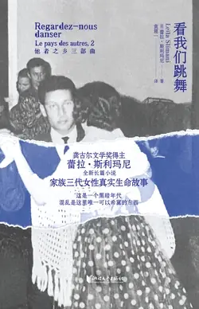

# 元数据

> [!abstract] 看我们跳舞
> - 
> - 书名：看我们跳舞
> - 作者：[法]蕾拉·斯利玛尼
> - 译者：袁筱一
> - 简介：她明白，所有的家都是陷阱。婚姻生活二十年，消耗掉成吨的食物，生长出的却是一个令人窒息的家族。在这个家里，每个人都是异乡人。他们的误解、仇恨与隐秘的罪恶，回响着时代的喧哗与骚动。一个家庭的沉浮，注定和一个国族的命运纠缠共舞……《看我们跳舞》是龚古尔文学奖得主蕾拉·斯利玛尼的全新长篇小说，是其书写三代女性的家族史诗“他者之乡三部曲”中的第二部。在这部基于真实经历的家族传奇中，个人境遇与国家命运相交织，理想、欲望与现实、历史激烈碰撞，生动展现了后殖民时代摩洛哥社会的生存境况、权力关系以及复杂现实。
> - 出版时间：2025-11-01 00:00:00
> - ISBN：9787533980740
> - 分类：精品小说-社会小说
> - 出版社：浙江文艺出版社
> - 微信读书评分：82%
> - 阅读进度：63%
> - 阅读时长：9分钟
> - 最后阅读：2026-11-13
> - 微信读书：https://weread.qq.com/book-detail?type=1&v=ca032ca0813abb26fg01311e

# 高亮划线

## 封面

> 📌 她明白，所有的家都是陷阱。婚姻生活二十年，消耗掉成吨的食物，生长出的却是一个令人窒息的家族。在这个家里，每个人都是异乡人。他们的误解、仇恨与隐秘的罪恶，回响着时代的喧哗与骚动。一个家庭的沉浮，注定和一个国族的命运纠缠共舞……
> ⏱ 2026-11-11 11:32:40

> 📌 《看我们跳舞》是龚古尔文学奖得主蕾拉·斯利玛尼的全新长篇小说，是其书写三代女性的家族史诗“他者之乡三部曲”中的第二部。在这部基于真实经历的家族传奇中，个人境遇与国家命运相交织，理想、欲望与现实、历史激烈碰撞，生动展现了后殖民时代摩洛哥社会的生存境况、权力关系以及复杂现实。
> ⏱ 2026-11-11 11:32:58

## 第一部

> 📌 玛蒂尔德老了，也许这就是他的错，丈夫的错，她看起来要比自己的真实年龄还要老。她脸上的皮肤因为风吹日晒变得粗糙了。她的额头和嘴角布满了皱纹，甚至她眼睛的绿色也失去了光彩，就像是穿了太多次的裙子
> ⏱ 2026-11-13 04:54:23

> 📌 她发福了。为了刺激丈夫，有一天，她抓起一条花园里用来灌溉的水管，在保姆和雇工的眼皮底下把自己浇了个浑身透湿。她的衣服贴在身上，透出发硬的乳头和阴毛
> ⏱ 2026-11-13 04:54:33

> 📌 玛蒂尔德一直不知道阿米纳在这个女人的怀里沉醉了多少时间。她也不知道他们之间是爱情还是别的什么，他们之间有没有过绵绵情话，或者正相反——也许这样更糟糕——他们只是沉默着投入肉体之爱。
> ⏱ 2026-11-11 11:33:35
> 💭 现实必然是残酷和不堪的背叛和不忠，但这种持续的猜想，收集和拼凑各种可能性进行无线的排列组合的行为会建造一座将玛蒂尔德囚禁的地牢。
> 🕰 2026-11-11 11:33:46

> 📌 阿米纳被金钱和骄傲冲昏了头脑。他专门定制了西装，学会了跳华尔兹和曼波舞。他和城里一半的女人睡过觉。在穆依拉拉去世后的几个月里，他就在贝里玛城区母亲的老房子里和情人约会，在几乎发了霉的长凳上做爱
> ⏱ 2026-11-13 04:55:38

> 📌 有时，阿米纳还会把车停在向日葵地里，吮吸着某个无所事事的已婚妇女的乳房；他以为自己是一个人，没人看见他。甚至有一回，他醉醺醺地从晚会上回来，将车头冲进了一棵橄榄树的树干里。他还说：“我没有醉，只是有些疲惫。我打了个哈欠，闭上了眼睛。”穆拉德知道这一切。他知道，在这里，人们从来都不会是真正的一个人。他想要提醒阿米纳：“总有人会知道你做了什么。”
> ⏱ 2026-11-13 04:55:57

> 📌 后来他总是不断地去回想这个下午发生的事情，直到将它们消磨殆尽，直到再也记不得发生了什么
> ⏱ 2026-11-13 04:56:26

> 📌 他将她拉了过来，又也许是她站起身来，将他的脸与她的脸贴在一起。她将唇凑上来，他的嘴巴里感觉到了她的舌头，清凉、潮湿。他觉得自己要昏过去了，能够把舌头整个儿地吞下去
> ⏱ 2026-11-13 04:56:44

> 📌 他没有害怕。他投入她的怀抱，就像他投入水中一般，他有一种清晰而轻盈的感觉。他将手伸进她绿色的晨衣里，抓住她小巧的乳房。乳头变硬了。他抚摸着塞尔玛腹部温热、甜美的肌肤。他看着她那双疯狂的、雾蒙蒙的眼睛，那双眼睛在诉说着等待被洞穿的欲望，他想，她从来不曾像此刻这样美
> ⏱ 2026-11-13 04:56:57

> 📌 她没有松开他的手，把他拽到了走廊上，接着又拽进了卧室，关上房门。她有没有想过穆拉德有可能会回来，或者她应该到校门口去接萨芭放学了？她似乎并不在意。她躺了下来，解掉了晨衣的腰带。她的皮肤是雇工们在指间捏碎的那种大麻的颜色。她什么也没有说，只是看着塞利姆脱掉衣服。他的动作很平静，几乎有点孩子气，就好像是他第一次自己脱衣服。她能够看见小伙子的短裤下性器勃起的形状。外面，唤拜的宣礼声响了起来
> ⏱ 2026-11-13 04:57:24

> 📌 整整一个星期，塞尔玛都在等他，坐在厨房的桌前，她总是不停地想起他，他拉开她裙子的拉链，把她推到床上，分开她的双腿，和他将舌头深入她身体的方式。她一边抽烟，一边想，他吻她的方式发生了变化，不再那么笨拙，不再像开始时那么匆忙。她想要和他说些非常非常粗鄙的话，向他承认，她希望他抓住她，将她推到墙上，进入她，直到她隐去、消失为止
> ⏱ 2026-11-13 04:57:56

> 📌 他学会了挑逗她，激怒她。他咬她的唇，抽打她的背。她坐在他身上的时候，他把手放在她的乳房上，说“等等”。当他进入她的时候，她体验到的不仅仅是快感，同时还有一种如释重负的感觉，甜蜜而舒畅。塞利姆的性器没有给她造成撕裂的疼痛。她的情人让她得到了延伸，补充了她，填满了她的空虚，平复了她的饥渴
> ⏱ 2026-11-13 04:58:15

> 📌 有时她会感到害怕，他们花了太多的时间在享乐上。她担心他会厌倦她，抛弃她，但是她学会了不再去想这一切，听凭自己被快感吞没，不慌不忙。而当她真的享受这一切时，她便会笑出声来
> ⏱ 2026-11-13 04:58:19

## 第二部

> 📌 塞尔玛梦想着能有一本护照和一张机票。她祈祷有一天，她的某一位情人能够领她去巴黎或者马德里。但是目前，还是理智一些好，不能要求太多，甚至不要说得太多，要表现得谨慎，同时有趣，虽然有些轻浮，但不能粗俗，不要否认自己是妓女，要让上流社会的女性成为焦点。要装作什么都不知道，扮演无辜者的角色，装作惊慌失措的处女
> ⏱ 2026-11-13 05:00:52

> 📌 一开始，当她做爱的时候，她不闭上眼睛，有些男人对此颇为不满。他们不喜欢这样，他们觉得她不太正派。于是她侧身躺着，将男人的手放在她的乳房上，当他们进入她的身体时，她就盯着窗户或者墙
> ⏱ 2026-11-13 05:01:12

> 📌 他们也不喜欢她说话，不喜欢听她说出自己喜欢什么。有些人甚至发火说：“不需要你来教我怎么做。”她装出顺从的样子，像一条狗那样仰面躺着，伸出舌头，要求爱抚。她不仅仅是装出顺从的样子，而且还装出听话的样子
> ⏱ 2026-11-13 05:01:24

> 📌 她不假装渴望，不，他们不喜欢这个，她因而装出一副吃惊的样子，发出轻微的呻吟。然而，她很清楚怎么做能让自己受益，以什么样的方式，什么样的姿势。她能够让自己的身体获得一种难以言表的轻盈，从脚趾到发根，她就像一阵微风，一团泡沫，一种慢慢流入喉咙深处，让自己暖起来的液体。她独自享受着欢愉
> ⏱ 2026-11-13 05:01:37

> 📌 麦迪不再想着起身。他在嘴里摇动着舌头，吞了吞口水。他把手放在阿伊莎的乳房上。透过她睡衣单薄的布料，他能够感受到那里的圆润与娇小。他将脸埋入他身边的这个女人的发间。她散发着海滩上风的咸味
> ⏱ 2026-11-13 04:58:49

> 📌 她有点冷，睡的时候蜷起了双腿。她的双手合在一起，仿佛在祈祷。她怎么能睡着呢？难道她没有像他一样，因为贴着她而如此激动？他的下体血脉偾张，并不痛苦，但是一直纠缠着他，就好像一种愤怒，一种恐慌，床单的摩擦声使之更加难以忍受，一种想要迸发的尖叫，一种被活埋的窒息感
> ⏱ 2026-11-13 04:58:55

> 📌 在拉巴特的街上，叛乱分子被带上了卡车。十八九岁或者二十岁的少年，剃着光头，头皮几乎是青色的，他们的脸上尽是疲惫，像要晕倒的样子。他们的手腕和脚踝用皮带系在一起。国王没有死，明天他会说：“我比昨天更像一个国王。”
> ⏱ 2026-11-13 04:59:08
