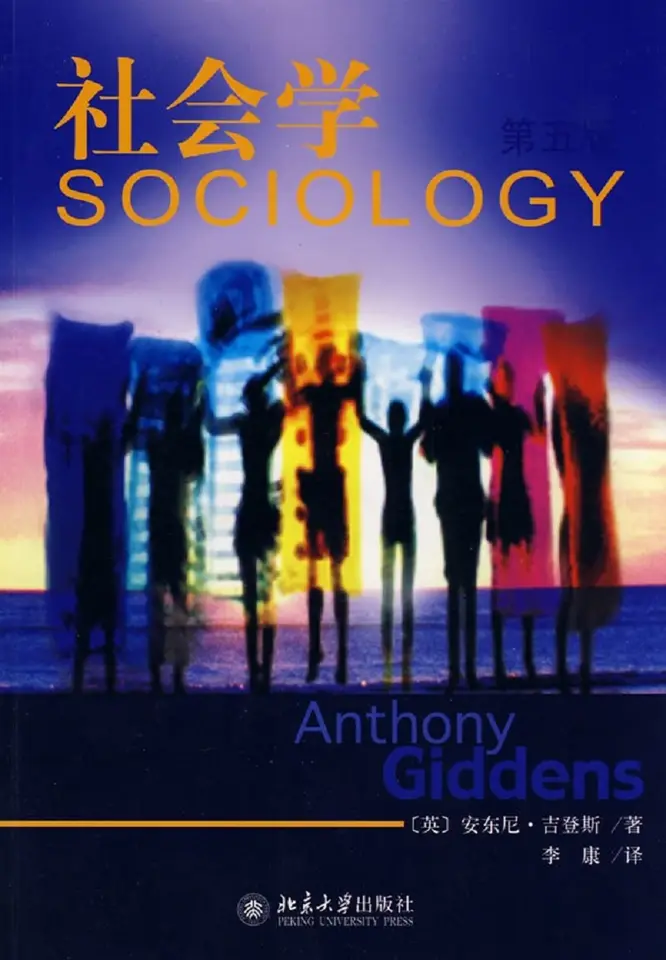

# 元数据

> [!abstract] 社会学（第5版）.安东尼.吉登斯
> - 
> - 书名：社会学（第5版）.安东尼.吉登斯
> - 阅读进度：0%
> - 阅读时长：0分钟
> - 最后阅读：2025-09-05
> - 微信读书：https://weread.qq.com/book-detail?type=1&v=94042e43643425f35503538726e387632394e34367951367777423347454c5944c

# 高亮划线

> 这本书目前没有个人划线。
