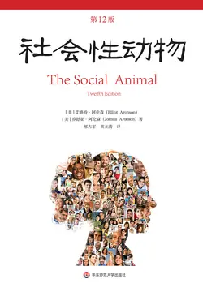

# 元数据

> [!abstract] 社会性动物（第12版）
> - 
> - 书名：社会性动物（第12版）
> - 作者：艾略特·阿伦森 乔舒亚·阿伦森
> - 译者：邢占军,黄立清
> - 简介：社会影响无处不在。我们是如何受到影响的？为什么我们要接受信息，或者换句话说，信息对我们有什么好处？什么样的社会动机使我们容易受到他人的想法、言论和行为的影响？哪些因素会增加或减少社会信息的有效性？哪些因素增加或减少了社会影响力的持久性？一个人是怎样喜欢上另外一个人的？是否通过同样的心理过程，我们选择了普通麦片而不是即食麦片？一个人如何对某个民族、某种宗教或种族群体产生偏见？偏见与喜欢类似？还是恰恰相反，涉及一套完全不同的心理过程？许多人会对诸如此类的问题感兴趣。因为我们都花费了大量的时间与其他人交流——受他人的影响；影响他人；高兴、开心、悲伤、厌恶、沮丧，或者被激怒——我们的天性就是对人们为什么做他们所做的事情提出假设。从这个意义上说，我们每个人都是业余的社会心理学家。尽管大多数业余社会心理学家在与他人互动时会对这些假设进行检验，并达到他们自己的满意程度，但这些偶然的“检验”缺乏细致的科学研究所具有的严谨性和公正性。
> - 出版时间：2020-05-01 00:00:00
> - ISBN：9787567599703
> - 分类：心理-心理学研究
> - 出版社：华东师范大学出版社
> - 微信读书评分：83%
> - 阅读进度：39%
> - 阅读时长：29分钟
> - 最后阅读：2026-11-21
> - 微信读书：https://weread.qq.com/book-detail?type=1&v=fcb322c071f3f438fcb5e8c

# 高亮划线

## 作者简介

> 📌 是我们这个时代一位杰出的、多オ多艺的心理学家。他是美国心理学会125年历史中唯一一位获得三个重要奖项的心理学家
> ⏱ 2026-09-11 17:09:54

> 📌 乔舒亚·阿伦森(Joshua Aronson
> ⏱ 2026-09-11 17:09:57

## 推荐语

> 📌 每一门科学都需要一部能够滋发想象力的著作，让读者充分感受到从事这门科学的兴奋之情。
> ⏱ 2026-09-11 17:12:50

## 本书的故事

> 📌 1970年，身为一名德克萨斯大学较为年轻的教授，我得到了一个难以回绝的机会： 受邀到一个美丽的地方呆上一年，享受着全职薪酬而几乎不需要做些什么——这是件不错的事情！
> ⏱ 2026-09-11 17:13:06

> 📌 。高等研究中心不仅给我提供了一年的薪酬，而且还为我安排了一间办公室，以及我所需要的文秘辅助。我可以使用那里不错的图书馆，可以享用免费午餐，只要愿意，随时有机会和那些杰出的学者们讨论问题
> ⏱ 2026-09-11 17:13:18
> 💭 本书作者创造出了杰作，应该跟他的大量阅读有很重要的关系，而要写出杰作，需要一个图书馆。
>
> 而在我们这个时代，微信读书就是我们的图书馆。在以前需要图书馆才能创作出杰作，成为大师的年代，现在已经一去不复返，所有的有志之士，在世界各地只要用用手机，把它当做图书馆，就能够成为他自己的大师，世界各地的大师英雄志士们正在崛起。
> 🕰 2026-09-11 17:13:37

> 📌 整整一年时间我都可以随心所欲地做自己想做的事情，那么我做了点什么呢？
> ⏱ 2026-09-11 17:13:45

> 📌 我们社会心理学家喜欢讲社会心理学是一门年轻的学科，与大多数自然科学（例如，生理学、天文学）相比，这无疑是一种准确的说法。
> ⏱ 2026-09-11 17:13:11

> 📌 然而，从深层次看，对我而言声称社会心理学是一门年轻的学科，则又会陷入因极力逃避而带来的自责之中——这无疑是在恳求我的学生们不要对我们抱太大的期望。
> ⏱ 2026-09-11 17:13:57
> 💭 是的，就像是预防别人的攻击一样，有时候自己提前说了“虽然我在这个领域但是不擅长”，当结果真的不如人意时候，别人责怪或怀疑你的时候，也可以拿出“我提前说清楚了”当挡箭牌，也算是保护自己吧
> 🕰 2026-09-11 17:14:27
> 💭 突然意识到自己平日也会对别人说中医很难学，虽然是一个事实，但是否在说出口时也在逃避？话外之意防佛是我学得还不够好，你不要对我抱太大希望。
> 🕰 2026-09-11 17:14:13

> 📌 从这层意义上讲，声称社会心理学是一门年轻的学科，无异于坦陈我们还不能够讲出任何重要的、有用的或者与我学生们的生活有关的事情。
> ⏱ 2026-09-11 17:14:45

> 📌 上世纪70年代如此，至今我依然持同样的观点。
> ⏱ 2026-09-11 17:14:38

> 📌 我所持的第二个偏见是，要确定通过实验所发现的因果关系是有效的，唯一途径便是将这些发现从实验室拿到现实世界中去加以验证。
> ⏱ 2026-09-11 17:14:41

> 📌 我们可以在实验室“纯净”的条件下对这些假设进行最充分的检验；与此同时，为了尽可能防止我们的想法变得“纯净”，我们要尝试着将实验室里的发现通过这扇窗户带回到现实世界，以检验这些发现能否站得住脚。
> ⏱ 2026-09-11 17:15:22

> 📌 由此而使我决定必须用第一人称单数的方式写出来，用一种置身其间的方式来描述我所发现的，以及我所理解的这门科学的状况。（与当时的任何一种教科书不同，在《社会性动物》中，“我”这个词反复出现。）
> ⏱ 2026-09-11 17:15:35

> 📌 他们特别喜欢这种个性化的写作方式，以及这本书的内容与他们个人生活的关联。
> ⏱ 2026-09-11 17:15:42

> 📌 1970年当我第一次开始撰写本书时，才38岁左右，还是一个踌躇满志的年轻人。
> ⏱ 2026-09-11 17:15:47

> 📌 他的名字叫乔舒亚·阿伦森(Joshua Aronson)——一位杰出的、经验丰富的社会心理学家。
> ⏱ 2026-09-11 17:16:12

> 📌 我和乔舒亚重新梳理了每一章，删除了一些几年前所谓的热点研究和理论，它们没有经受住时间和重复研究的考验。
> ⏱ 2026-09-11 17:16:15

> 📌 最近的研究为我们理解当下发生的事件提供了信息——例如，互联网是如何导致我们的决策过程变得更好或更糟，信息泡沫的出现以及自我确认的媒体来源如何塑造这个国家两极化的信仰和行为，
> ⏱ 2026-09-11 17:16:31

## 致谢

> 📌 我曾经动情地致谢我的朋友和导师利昂·费斯汀格(Leon Festinger
> ⏱ 2026-09-11 17:16:46

> 📌 如果说有什么不同的话，那就是这些感觉在以往的几年里变得更加强烈了。
> ⏱ 2026-09-11 17:16:44

> 📌 随着本书的岁月已久以及我本人年龄的增长，我也越来越意识到自己从学生们身上获益匪浅
> ⏱ 2026-09-11 17:16:52
> 💭 我很好奇读这本社会心理学著作，能为我带来什么不一样的信息和看待世界的视角，带着好奇读下去!
> 🕰 2026-09-11 17:17:04

> 📌 从他们身上我学到了很多东西，我由衷地感谢他们的帮助。我也很愿意与一些极具天赋的同事们交流并吸取他们的思想。
> ⏱ 2026-09-11 17:17:21

> 📌 其中需要特别提到的两位是安东尼·普莱特肯尼斯(Anthony Pratkanis)和卡罗尔·塔夫里斯，他们为本书的不断完善作出了相当大的贡献
> ⏱ 2026-09-11 17:18:05
> 💭 卡罗尔·塔夫里斯是一位知名的社会心理学家、演说家和作家，以其对性别角色和社会认知的深入研究而闻名。她曾为《洛杉矶时报》、《纽约时报》、《科学美国人》等出版物撰写心理学专栏文章，探讨过许多有关社会认知和性别平等的话题。
>
> 塔夫里斯在1992年出版的《对女性的误测》中，对传统的性别角色和性别测量提出了挑战，认为“男性的身体就是解剖学本身”。她以批判性的视角审视了社会对女性的误解和偏见，强调了性别平等的重要性。
>
> 她与合著者埃利奥特·阿伦森共同撰写的《不是我的错》（Mistakes Were Made, But Not by Me）一书，也广受关注。这本书探讨了人们如何为自己的错误和失败进行辩护，以及社会对错误归责的影响。
>
> 塔夫里斯的研究和写作不仅限于学术领域，她还通过演说和公众写作，将复杂的心理学概念普及给大众，帮助人们更好地理解自身和他人的行为。
> 🕰 2026-09-11 17:18:09

> 📌 在此我对他们的无私支持表示衷心的感谢。
> ⏱ 2026-09-11 17:18:11

## 社会性动物

> 📌 那些不能过公共生活，或者可以自给自足不需要过公共生活，因而不参与社会的，要么是兽类，要么是上帝。
> ⏱ 2026-09-11 17:18:23

## 1 什么是社会心理学

> 📌 什么是社会心理学
> ⏱ 2026-09-11 17:18:32

> 📌 研究人类这样一种令人困惑、富有创造性而又容易被激怒物种的社会心理学，又有哪些独特之处？
> ⏱ 2026-09-11 17:18:30

> 📌 那时我还是个犹太男孩，我想知道为什么一些信奉天主教的孩子会用反犹太口号嘲弄我，偶尔还会粗暴地对待我。
> ⏱ 2026-09-11 17:18:53

> 📌 他想知道为什么有些孩子在课堂上能够很好成长，而另一些孩子则被竞争压力和教育体制所窒息。
> ⏱ 2026-09-11 17:18:57

> 📌 这个研究领域提供了对人类社会生活的科学理解，更为重要的是，提供了改进人类社会的方法。
> ⏱ 2026-09-11 17:20:29

> 📌 最终，他对他的朋友们低声说道，“我想，他似乎不如我所期望的那样真诚”。
> ⏱ 2026-09-11 17:20:08

> 📌 原因是奥运游泳冠军迈克尔·菲尔普斯(Michael Phelps)印在产品包装盒上
> ⏱ 2026-09-11 17:19:43
> 💭 我第一次认识迈克尔·菲儿普斯是在2008年的北京奥运会上，那年的他大放异彩，我国队员孙杨虽然也很厉害，但是总会被他压一头，太可惜了。。看到菲尔普斯出场，冠军基本都是他的☺️
> 🕰 2026-09-11 17:19:58

> 📌 一位店主在蒙大拿州的一个小镇上生活了一辈子，他从来没有和任何一位穆斯林实际接触过，然而他仍然“知道”穆斯林不是美国人，不忠诚，而且很可能是恐怖分子。
> ⏱ 2026-09-11 17:19:17

> 📌 他恰好和同班的两位女生坐同一张餐桌。其中的一位热情、迷人、漂亮、活泼
> ⏱ 2026-09-11 17:20:14
> 💭 性吸引力的基础，“主动，大方得体”
> 🕰 2026-09-11 17:20:25

> 📌 韦尔奇后来说，他对自己的所作所为感到后悔，但他仍然相信那个假新闻。
> ⏱ 2026-09-11 17:23:05

> 📌 一年之内，卡娅从一个对数学感到兴奋、有信心的学生变成了一个惧怕数学的学生。
> ⏱ 2026-09-11 17:23:08
> 💭 深有体会，我在高考之前都喜欢数学，因此大学选了数学专业，结果写吐了。越过喜欢后就发觉不喜欢的也是数学。
> 🕰 2026-09-11 17:23:24

> 📌 在哥伦拜恩中学大屠杀发生后的近二十年里，数百名美国青春期男孩在校园里实施了同样可怕的大规模枪击。曾经不可思议的事情已经司空见惯。
> ⏱ 2026-09-11 17:27:15
> 💭 很容易理解啊，代入动物比如公狮子会因为领地配偶互相撕咬斗争，雌狮子则是等待斗争之后的结果依附胜利者，这种雌雄之间的生存压力区别导致了不同的斗争意愿强度。
>
> 用在对的方向的斗争精神就变成了有勇气有魄力，而错的方向就变成了冲动粗鲁犯罪，虽然人类是动物上更进一步的生物但是底层逻辑是不会因为刚出现没多久的文明社会改变的。
> 🕰 2026-09-11 17:28:09
> 💭 事实就是男性的犯罪率更高，不明白为什么每当有人指出这一点的时候，就有一些人应激？是因为代入自己了吗？
> 🕰 2026-09-11 17:28:01
> 💭 所以说当学校发生了有孩子跳楼的事情一般不允许透露，原因就是这会造成其他孩子寻找社会认同，从而纷纷效仿。主要是因为学校在争取其它资源的时候也有绩效考核吧
> 🕰 2026-09-11 17:27:39

> 📌 然而，每当有两三个朋友和他一起在车上时，史蒂夫的行为就会变得危险起来：当看到半个街区外的灯开始变黄时，他经常会猛踩油门，希望能够在交通灯变红之前冲过十字路口。
> ⏱ 2026-09-11 17:28:29
> 💭 所以，判断自己的行为动作是由于社会性别人的观察还是自己真的想做，就可以想象如果没有人知道，没有人关注，没有人看着你，那么这件事你会不会做？
> 🕰 2026-09-11 17:28:57
> 💭 这个挺常见的
>
> 记得有一次我开得比较慢，后座的朋友突然来一句你开车真慢，突然我无意识开始加速了，过一阵才想起：我干嘛要听你的。然后就放慢了，他说归说，我还是慢慢开。
> 🕰 2026-09-11 17:28:41

> 📌 1939年，贪婪的德国商人奥斯卡·辛德勒(Oskar Schindler)加入了纳粹党，并开始从野蛮的希特勒第三帝国统治时期犹太人的灾难中获利
> ⏱ 2026-09-11 17:26:57

> 📌 长篇小说和奥斯卡获奖影片《辛德勒的名单》里讲述了这样一个故事：辛德勒冒着生命危险，把所有的财富都用于拯救他人。
> ⏱ 2026-09-11 17:29:25
> 💭 网络上流传的“犹太人资助日本侵华”说法并不符合历史事实，而是将不同时期的历史事件拼凑、曲解后的传言。历史上确实存在犹太银行家在特定战争中向日本提供贷款，以及日本在二战期间企图拉拢犹太资本的计划，但两者均与“犹太群体有组织地资助日本侵华”有本质区别。
>
> 以下是相关历史事件的真实脉络：
>
> 1. 1904年日俄战争期间的个人金融贷款
>
> 这是该传言最主要的“事实来源”，但发生的时间与对象均不是侵华战争。
>
> • 事件背景。 1904年至1905年日俄战争期间，美国犹太裔银行家雅各布·希夫（Jacob Schiff）通过其掌管的库恩-洛布公司，为日本政府承销了约2亿美元的战争公债。
>
> • 真实动机。 希夫此举并非为了侵略中国，而是为了报复沙皇俄国政府在当地制造的“基什尼奥夫大屠杀”等残酷迫害犹太人的暴行，希望借日本之手削弱沙俄政权。
>
> • 历史性质。 战争虽然发生在中国东北领土上，但希夫的贷款行为属于针对沙俄的个人政治报复与商业融资，不能等同于全体犹太人资助日本侵略中国。
>
> 2. 二战期间日本的“河豚鱼计划”以失败告终
>
> 20世纪30年代，日本军部确实曾单方面幻想过获取犹太人的资金来支持其侵华战争，但并未得逞。
>
> • 日方的算盘。 受《锡安长老会纪要》等反犹书籍影响，日本军方误以为犹太人掌控着全球金融和美国舆论。1938年，日本政府制定了河豚计划，企图通过在中国东北安置欧洲犹太难民，换取美国犹太财团的投资以及美国对日侵华的默许。
>
> • 犹太社团的拒绝。 该计划遭到了世界犹太人大会主席斯蒂芬·怀斯（Stephen Samuel Wise）等国际犹太领袖的严厉斥责和坚决抵制。美国犹太组织不仅拒绝向日本提供资金，还积极在舆论上揭露和反对日本的侵略行径。
>
> • 结果。 最终来到中国上海和东北的犹太人绝大多数是逃离纳粹大屠杀的身无分文的难民，根本没有为日本经济或侵华战争提供资金支持。1940年日本与纳粹德国结盟后，该计划彻底破产。
>
> 3. 犹太难民与中国抗战的真实关系
>
> 在二战最艰难的时期，中国人民与犹太难民之间更多是患难与共的关系，而非敌对或阴谋勾结。
>
> • 中国对犹太人的救助。 1938年至1941年间，面对西方各国紧闭大门，中国上海接纳了超过2万名逃离纳粹迫害的欧洲犹太难民。时任中国驻维也纳总领事何凤山也向数千名犹太人发放了“生命签证”。
>
> • 日军对在华犹太人的压迫。 珍珠港事件后，日军将...
> 🕰 2026-11-18 10:45:19
> 💭 但是老了之后的辛德勒差点饿死，这就搞笑了。就跟二战犹太人资助日本侵华，把东北划给他们一样，犹太人恶贯满盈，不懂得感恩
> 🕰 2026-09-11 17:31:54

> 📌 此时，他却把手伸进口袋，掏出所有的零钱，连数都不数地给了那个乞丐。
> ⏱ 2026-09-11 17:29:57
> 💭 想到了《福格行为模型》里的说法，行为的发生有三个条件：动机，能力和提示。在这里，乔舒亚也是满足这三个条件的。
>
> 动机：受到电影的感染，也想通过帮助他人获得满足感，从而能想到自己也成为了电影中的主角。
>
> 能力：口袋里有钱。
>
> 提示：恰好碰到乞丐向他乞讨。
>
> 这三要素都具备了，于是行为发生了。
> 🕰 2026-09-11 17:30:54
> 💭 情境影响也非常大，有时候看一本打鸡血的书，看完也立马激情澎湃，可是，往往不持久。除非这种情境经常围绕在你身边
> 🕰 2026-09-11 17:30:34
> 💭 受突然刺激下的非常规激情行为，未必具有可持续性。
> 🕰 2026-09-11 17:30:10

> 📌 数以千计的来自西方国家的普通青年男女离开了自己的家园，成为伊斯兰圣战分子，在叙利亚和伊拉克战斗乃至战死。
> ⏱ 2026-09-11 17:33:54
> 💭 这个问题很容易被讲乱、讲成“宗教打架”，但真正的根子并不在宗教本身。
>
> 我用通俗、按故事顺序的方式给你讲清楚👇
>
> ⸻
>
> 一句话先给你结论
>
> 👉 **所谓“伊斯兰圣战 + 叙利亚 + 伊拉克”的混乱，本质是：
>
> 殖民划界 + 政权崩塌 + 权力真空 + 极端组织借用宗教语言。**
>
> 宗教是“外衣”，
>
> 政治、权力和混乱才是“内核”。
>
> ⸻
>
> 一、先把最容易误解的词说清楚：什么是“伊斯兰圣战”？
>
> ⚠️ 重点：“圣战”≠恐怖主义
>
> Jihad（吉哈德）在伊斯兰里的原意是：
>
> “奋斗、努力、克制自我”
>
> 分两种：
>
> 1.	大圣战：和自己的欲望、贪婪、懒惰斗争（内在修行）
>
> 2.	小圣战：在遭受侵略时的自卫
>
> 👉 极端组织把“小圣战”歪曲成：
>
> “无限制暴力 + 神授权杀戮”
>
> 这是偷换概念，
>
> 就像拿宗教词汇当政治动员口号。
>
> ⸻
>
> 二、叙利亚和伊拉克本来怎么来的？（关键历史背景）
>
> 🔥 重点来了：
>
> 叙利亚和伊拉克是“被硬画出来的国家”
>
> 100多年前：
>
> •	中东属于奥斯曼帝国
>
> •	一战后帝国崩溃
>
> •	英国、法国直接在地图上划线
>
> 👉 不管民族、不管宗教、不管部落
>
> 于是：
>
> •	同一民族被分到不同国家
>
> •	敌对宗派被塞进同一个国家
>
> 这是后面所有冲突的“地雷”。
>
> ⸻
>
> 三、伊拉克为什么先乱？
>
> 2003 年，美国推翻萨达姆政权
>
> 发生了三件灾难性的事：
>
> 1️⃣ 旧政权被连根拔起
>
> 2️⃣ 军队和警察被解散
>
> 3️⃣ 没有建立有效新秩序
>
> 结果：
>
> •	国家直接“塌了”
>
> •	武器满天飞
>
> •	失业军人遍地
>
> 👉 权力真空 = 极端组织的温床
>
> ⸻
>
> 四、ISIS 是怎么出现的？（这一步最关键）
>
> ISIS 不是突然出现的
>
> 它是：
>
> •	伊拉克混乱
>
> •	宗派仇恨
>
> •	战争创伤
>
> •	权力真空
>
> 混合出来的怪物
>
> 他们做了三件事：
>
> 1.	利用社会绝望
>
> 2.	利用身份认同（“你是逊尼派/什叶派”）
>
> 3.	利用“圣战”语言包装暴力
>
> 👉 宗教成了动员工具，不是根本原因
>
> ⸻
>
> 五、那叙利亚又是怎么被卷进来的？
>
> 2011 年，叙利亚内战爆发
>
> •	政府 vs 反对派
>
> •	国家控制力下降
>
> •	边境几乎失控
>
> ISIS 一看：
>
> “机会来了”
>
> 于是：
>
> •	从伊拉克跑到叙利亚
>
> •	在两国之间自由流动
>
> •	宣布建立“伊斯兰国”
>
> ⚠️ 他们刻意“无视国界”
>
> 因为他们的口号是：
>
> “现代国家是假的，宗教才是真的”
>
> ⸻
>
> 六、为什么他们同时出现在叙利亚和伊拉克？
>
> 因为：
>
> •	这两个国家：
>
> •	边界人为
>
> •	政权脆弱
>
> •	战争连年
>
> •	对极端组织来说：
>
> •	是一整块“无人区”
>
> 👉 他们不是代表伊斯兰，而是寄生在失败国家上。
>
> ⸻
>
> 七、那为什么大家会把这三者混在一起？
>
> 因为：
>
> •	媒体简化叙事
>
> •	把复杂问题缩成一句话
>
> •	“伊斯兰 + 暴力”更容易传播恐惧
>
> 但现实是：
>
> ❗
>
> •	绝大多数穆斯林反对 ISIS
>
> •	叙利亚和伊拉克的普通民众是最大受害者
>
> •	极端组织杀的穆斯林远多于西方人
>
> ⸻
>
> 🌍 用一个非常通俗的比喻总结
>
> 叙利亚和伊拉克就像两栋年久失修、
>
> 被人为改造过结构的大楼。
>
> 当地震（战争、政权崩溃）发生时，
>
> 不是房子里的人突然变坏了，
>
> 而是废墟里最容易长出怪物。
>
> ⸻
>
> 最后一句很重要的话
>
> 不要用“宗教”去解释战争，
>
> 战争几乎永远是权力、资源、失败治理的结果。
>
> 宗教，只是被利用的语言。
>
> 如果你愿意，我也可以继续给你讲：
>
> •	逊尼派和什叶派到底在吵什么
>
> •	为什么中东冲突总是“剪不断理还乱”
>
> •	为什么西方总是很难真正解决这些问题
> 🕰 2026-09-11 17:35:13

> 📌 想象一下乔治和他的白人朋友一起观看这类种族主义影片时的感受吧。然而，他却从没告诉过我他的感受。
> ⏱ 2026-09-11 17:35:37

> 📌 大多数非洲裔美国人都知道“黑人购物”经历，这意味着销售人员会对他们的信誉提出质疑，怀疑他们会偷东西，甚至拒绝为他们提供服务。
> ⏱ 2026-09-11 17:36:09
> 💭 是啊想一想，也许有黑人做好事不被报道，或者有白人也加入了零元购却没有被发出来……这完全有可能。
> 🕰 2026-09-11 17:36:36
> 💭 黑人内部可能也很反感：“你们零元购，害得我正常购物都要被店员提防着”。
> 🕰 2026-09-11 17:36:25

> 📌 上述事例展示的都是社会心理情境。尽管它们看起来各不相同，但其中都包含着一个共同的因素：社会影响。
> ⏱ 2026-09-11 17:36:55

> 📌 卡娅从数学爱好者转变为数学惧怕者并不罕见，特别是在美国，数学在传统上被认为是天赋异禀和“男孩的事情”。
> ⏱ 2026-09-11 17:38:15

> 📌 被拒绝是人类最痛苦的经历之一，会导致各种各样的自我挫败和破坏行为，从暴饮暴食到暴力
> ⏱ 2026-09-11 17:38:08

> 📌 来自种族主义以及其他形式的偏见导致了像ISIS这样的恐怖组织成功招募到年轻人，而许多年轻人与伊斯兰教没有任何精神上或家庭方面的联系。是什么力量说服他们离开自己的家园和家庭，成为“自杀式炸弹”？
> ⏱ 2026-09-11 17:38:02

> 📌 我们将社会心理学定义为：他人真实的、想象的或暗示的存在，对我们的思想、情感、信仰和行为的影响，以及我们如何影响他人的科学研究。
> ⏱ 2026-09-11 17:38:40

> 📌 偏见与喜欢类似？还是恰恰相反，涉及另一种完全不同的心理过程？
> ⏱ 2026-09-11 17:39:45
> 💭 此处英文版为：is prejudice akin to liking but in reverse，or does it involve an entirely different set of psychology process？
>
> 那么更好的翻译应该是：是「偏见」与「喜欢」有着同样的心理过程，但方向相悖，或是「偏见」有着完全不同于「喜欢」的心理过程？
> 🕰 2026-09-11 17:40:00

> 📌 所谓事后聪明偏见指的是，一旦我们知道某一事件的结果，我们往往高估自己的预测能力。
> ⏱ 2026-09-11 17:38:49
> 💭 我第一次对“事后聪明偏见”有意识是小学数学课，当时有一道考试附加题，全班只有我答上来了，但老师让我讲完思路之后，很多同学突然顿悟了这道题思路其实不复杂，只是有点绕，带着点羡慕嫉妒恨的心情挤兑我“也没什么了不起”，我倒是没难过，因为我做对那道题也不是因为我更聪明，只是恰好之前在某本书里见过原题记住了而已，
>
> 而我第一次自己做的时候，确实也没答上来，我只是在想，如果我没有看那本书，考试就答不上来，反应会不会跟那些同学一样觉得“很简单，只是没想到”呢，但如果我没看过，也确实很可能答不上来啊。我能拿后来的经验去验证事前的状态吗？
> 🕰 2026-09-11 17:39:32
> 💭 事后诸葛亮
> 🕰 2026-09-11 17:39:02

> 📌 那些做了被禁止的、非法的、弄巧成拙的事情而受到惩罚威胁的人，最终可能会停止他们的行为；而且惩罚越严厉，他们服从的可能性越大。
> ⏱ 2026-11-18 10:49:00
> 💭 如果强奸罪和谋杀罪都是死刑的话，那强奸犯会更倾向于毁尸灭迹。
>
> 所以目前法律给强奸犯留下的惩罚间隙也是给受害者留下一线生机。
> 🕰 2026-11-18 10:49:04

> 📌 当面对着轻微惩罚的威胁时，人们会讨厌被禁止的行为；而那些受到严重威胁的人，更可能受到被禁止的活动的吸引。
> ⏱ 2026-11-18 10:50:12
> 💭 这种心理现象可用心理学中的“禁果效应”或“罗密欧与朱丽叶效应”阐释。禁果效应是指，当某行为或物品遭禁或难获时，它常更吸引人，激起人们好奇与渴望。罗密欧与朱丽叶效应特指恋爱关系里，当外界压力或禁令加剧，恋人间感情或更强烈。
>
> 面对轻微惩罚威胁，人们或对被禁行为生厌，因虽惩罚轻微，却仍足引人们不适，从而避行该行为。然当威胁趋严，人们或因逆反心理，或因对禁行的好奇与挑战性，而更受该行为吸引。此心理机制或源于人们对自由选择的重视及对限制的本能反抗。
>
> 此现象揭示了人在面对不同程度威胁时复杂的心理反应。当遇轻微惩罚威胁，人们往往对被禁行为反感，因轻微惩罚虽不至造成大伤害，却足以使人意识到某行为不被接纳，从而激起对该行为的抵触情绪。此抵触情绪通常源于对规则的尊重与对社会秩序的维护。
>
> 然当威胁严重，人的反应或大相径庭。受严重威胁者更易受被禁活动吸引，或因极端压力下，人易生叛逆心理，觉既然惩罚严苛，那违反规定的行为似更具挑战性，甚至带“禁忌之果”般的吸引力。且面临巨大压力时，人或寻逃避或反抗之法，而被禁活动恰好提供了释放压力的出口。
>
> 此现象于心理学上可借“逆反心理”与“压力释放机制”解释。逆反心理指个体面对限制或禁令时产生的反抗与抵触情绪，压力释放机制指个体面对压力时寻某种方式缓解与释放此压力。
>
> 为应对此况，可虑以下几点：首先，制定规则与惩罚措施时，应充分考虑人的心理反应，避过严或过松；其次，对受严重威胁者，应供更多心理支持与引导，助其正确面对压力与挑战；最后，借教育与宣传等方式，提人对规则与秩序的认识与尊重，减逆反心理产生。
>
> 总之，人在面对不同程度威胁时，对被禁行为的态度有异。了解此心理现象助我们更好理解与应对人的行为反应，从而制定更有效规则与措施。
>
> 此现象可经由心理反应理论解读，即人对限制或禁止行为的反应。当面对轻微惩罚威胁，人或因对该威胁的反感而对被禁行为生厌。他们或觉此行为不值得冒险，遂选避之。
>
> 然当威胁趋重，人或对被禁行为产生更强烈好奇与吸引力。此因严重威胁或激人反叛心理，使人欲挑战权威或规则。此外，严重威胁亦或使人感压力与焦虑，从而寻被禁行为作逃避或释放之径。
>
> 此现象于诸多情境皆有观察，如青少年对父母限制、员工对公司政策的反应等。了解此现象助我们更好理解人的行为动机，及如何制定有效规则与政策以引导人的行为。
> 🕰 2026-11-18 10:51:01

> 📌 在理解社会性动物方面，专业社会心理学家比大多数业余社会心理学家具有更多的有利条件。
> ⏱ 2026-11-21 02:12:50

> 📌 我们可以让事情发生；我们可以进行实验，在实验中让许多人面对特定的事件（例如，严重的威胁或者轻微的威胁；无意中听到好话或者无意中既听到好话又听到令人不愉快的话）。
> ⏱ 2026-11-21 02:12:48

> 📌 是什么导致那些人相信这则“疯狂”的假消息？尽管有确凿的证据表明事实并非如此，为什么他们仍然会坚持这种看法？
> ⏱ 2026-11-21 02:13:03

## 5 大众传播、宣传与说服

> 📌 每天都有数百人试图向你推销产品、旅行或想法；说服你承认他们是对的；说服你按他们的方式去投票；让你对一些不公正感到愤怒；让你对一些外部危险感到恐惧；引诱或者诱导你去做他们想做的事情。
> ⏱ 2026-11-21 02:13:19
> 💭 是啊，有时候甚至不知道是你自己的想法和观念，还是各类大v，媒体在诱导你这样去想。甚至不知道你看到的哪一些是事实，哪一些是真相，因为你根本无从验证。
> 🕰 2026-11-21 02:13:36

> 📌 广告打断了你在网上的阅读；会出现在网站的空白处；每次购买都会面对广告；在大多数电视节目之前都会插播广告；在每个加油站、自动取款机和公共汽车长凳上都张贴着广告。
> ⏱ 2026-11-21 02:13:42
> 💭 另一方面来说，如果没有广告，我们还能享受很多免费的互联网吗？这本质是一种交换，我们用我们的注意力去交换一种服务。
> 🕰 2026-11-21 02:14:04
> 💭 现在的微博真的没有净土。
>
> 基本上是每刷四五条微博就弹出一条广告，游戏的，脱发的，租房的，以及罗永浩…
>
> 真的炒鸡影响体验，不胜其烦。
> 🕰 2026-11-21 02:13:53

> 📌 说服一个人有多容易？答案在一定程度上取决于我们所要面对的是人们的看法还是态度。
> ⏱ 2026-11-21 02:22:27
> 💭 深以为然，这就是我和我对象经常出现的情况，我称之为理性和情感，我们经常有一些争执，我能够很容易从理性层面说服她，却难以在情感层面让她认同。认识到这一点非常重要，它界定了我们探讨的层次和争执的边界，很多时候我们理智上能达成一致就行了，情感上的一致需要慢慢来，急于求成只会让冲突升级。
> 🕰 2026-11-21 02:22:58

> 📌 看法指的是一个人认为是真的：我的看法是吃蔬菜对我有好处，系安全带可以减少交通事故，每天服用维生素很重要
> ⏱ 2026-11-21 02:22:35

> 📌 这些看法主要是认知的；也就是说，它们发生在头脑中而不是情感深处。它们是短暂的；它们可以通过很好的证据来加以改变。
> ⏱ 2026-11-21 02:22:37

> 📌 我们的手机可以用来做任何事情：获取不断更新的新闻；写作；查阅我们的日历；获取方位；做研究；预订餐厅、航空旅行和酒店房间；购物；或者迅速在Spotify[插图]、Netflix[插图]或YouTube[插图]上选择无限多的娱乐选项。这种多功能性只是部分解释了为什么大多数拥有智能手机的人在醒着的时候会有超过25%的时间眼睛盯着屏幕
> ⏱ 2026-11-21 02:23:21
> 💭 YouTube，目前世界上最大的视频网站，注册于2005年，早期公司位于加利福尼亚州的圣布鲁诺。——译者注
> 🕰 2026-11-21 02:24:23
> 💭 Netflix，成立于1997年，是一家在线影片租赁提供商，总部位于美国加利福尼亚。——译者注
> 🕰 2026-11-21 02:24:05
> 💭 Spotify，目前全球最大的正版流媒体音乐服务平台之一，2008年在瑞典首都斯德哥尔摩正式上线。——译者注
> 🕰 2026-11-21 02:23:36

> 📌 即使我们不沉湎于我们的手机，我们对手机的依赖也意味着它们的存在经常会影响我们的注意力
> ⏱ 2026-11-21 02:25:33

> 📌 在一种情况下，实验者把手机放在他们旁边的桌子上；在另一种情况下，实验者把笔记本放在同一个地方
> ⏱ 2026-11-21 02:25:39

> 📌 其他类似的研究发现，在社交互动过程中使用手机会减少眼神交流、参与度、对同伴的同理心关怀以及谈话的乐趣。
> ⏱ 2026-11-21 02:25:30

> 📌 除了剥夺我们发展社交技能的机会外，深入社交网站还可以促使人们变得更加自我中心和自恋，并相信名声、财富、人气比友谊、慷慨、社区更重要。
> ⏱ 2026-11-21 02:25:55

> 📌 苏格拉底哀叹书籍的发明，他说这将促使人们“健忘”。
> ⏱ 2026-11-21 02:25:53

> 📌 技术将继续迅猛发展，并改变我们的生活方式，最好的反应不是哀叹这一事实，而是学会明智和适度地利用我们的技术设备。
> ⏱ 2026-11-21 02:25:58

> 📌 因此，新闻广播往往侧重于恐怖分子、杀人犯、抗议者、罢工者、警察或失控名人的暴力或破坏性行为，因为与描绘人们以和平、有序的方式行事相比，这类行为更能吸引人们观看。
> ⏱ 2026-11-21 02:26:03

> 📌 人们总是被教导要听从领袖们的命令……你必须做的只是告诉人们，他们正面临着攻击，而去指责那些主张和解的人缺乏爱国心并可能会将国家置于危险之中。在任何一个国家这一招都会奏效。
> ⏱ 2026-11-21 02:26:16
> 💭 第一反应是 红色教育。不是吧，红色教育从来不是让人去仇恨，从来不是让人去开启战争。我所接受的教育是，铭记历史，缅怀先烈，珍惜和平。是记住落后就要挨打，是记住革命先烈的付出，是感恩和平的来之不易，所以我们当代青年要奋斗，为了以后不再受苦，所谓“居安思危”，所谓“生于忧患死于安乐”，不外如是。
> 🕰 2026-11-21 02:27:00
> 💭 好处是转移内部矛盾，可以增加凝聚力，坏处是使用不当，会堕入深渊。
> 🕰 2026-11-21 02:26:41

> 📌 这些故事被戏剧性地称为“模仿中毒”，反过来这些故事引起了媒体的广泛关注，创造了更多故事。
> ⏱ 2026-11-21 02:27:39
> 💭 不管新闻怎么报导，因为负面的新闻总不能不报导（如天灾人祸），一样的新闻报导有人被情绪感染，作出被情绪控制的反应，有人尽量保持自身的判断力，尽量少让情绪控制决策，也就是所谓的刺激与行动之间总还是有理性思考的空间，这才是后天阅读与教育对人的重要性。
> 🕰 2026-11-21 02:27:57

> 📌 许多人惊慌失措，寻求烧伤和中毒的医疗援助，而实际上他们所患上的只是普通皮疹、喉咙痛、胃痛。误报人数是实际受到物品毒害人数的7倍。[插图]由于这些事件发生在万圣节之前[插图]，数十个社区的官员们担心许多人可能通过污染儿童糖果来模仿谋杀
> ⏱ 2026-11-21 02:28:31

> 📌 最初发生在芝加哥的投毒事件几乎可以肯定是出自一人之手，只不过他从未被发现或抓获。但有人认为，在某家新闻机构的言论中，[插图]投毒的风潮形成了“一场无法治愈的传染病”。
> ⏱ 2026-11-21 02:29:01

> 📌 许多报纸发现自身处于一种颇具讽刺性的境地：从最初耸人听闻地报道投毒事件，到后来极力渲染专家们对这类宣传所导致的灾难性后果而提出的批评。
> ⏱ 2026-11-21 02:29:03
> 💭 所以解决方法呢，怎么提高群众信息分辨能力，还有该不该对媒体监管呢。教育吧，还有提高从业人员的素质和健全媒体行业的规范，大概道阻且长。
> 🕰 2026-11-21 02:30:20
> 💭 好家伙，现在不也是这样吗，跟打地鼠似的，今天你报道我批评，明天咱俩换换位置，中间还有专家作证，事发事后坚持跟风的
> 🕰 2026-11-21 02:29:23

> 📌 这就是为什么自杀预防研究人员发现，当媒体报道避免强调或美化自杀、并且不使它看起来像是一个简单或不可避免的解决方案时，对有自杀风险的人来说，传染效应会降低。
> ⏱ 2026-11-21 02:30:44

> 📌 媒体的选择性强调不仅使媒体能够报道事件，而且能够决定随后发生的事件。媒体对某件事情关注得越多，它就越具有“传染性”，其他人也就越有可能被激励去效仿。
> ⏱ 2026-11-21 02:30:54

> 📌 今天，当一个重大事件发生时，新闻播音员不仅要报道它，而且要报道所有分析和评论事件的人，然后再做跟踪报道。评论往往具有新闻价值。
> ⏱ 2026-11-21 02:31:01

> 📌 食盐包装盒上有一张小女孩举着一盒食盐的照片，照片上面有一张小女孩举着一盒盐的照片，那张照片上面有一张小女孩举着一盒盐的照片，依此类推。
> ⏱ 2026-11-21 02:31:06

# 章节点评与书评

## 读书笔记

《社会学让人沉思》

阖上本书的时候陷入沉思，脑海里不自觉地涌流出来约翰·多恩那篇著名的布道词：没有人是一座孤岛/可以自全/每个人都是大陆的一片/整体的一部分……因为我是的人类的一员（because I am involved in mankind）。

同时，想起了各种书籍中对于人的定义：或能制造工具、或能语言交流、或能协作组织……如此种种。如果从本书的视角来看，社会性动物——恰是从心理学视角对于人所下的一种定义。

本书共分为九个章节，从第一章介绍何为社会心理学开始，紧接的两个章节介绍了个体对于社会的认知及反馈模式（社会认知与自我辩护），接下来的两个章节着重剖析了社会整体与构成社会的个体之间的相互作用（个体如何服从群体，以及群体如何对个体施加影响），

此后的三个章节刻画了社会心理将导致的个体行为（按照疏离程度依次为——攻击、偏见与爱）。最后一个章节短小但重要，作者强调了社会心理学的科学属性，这在某种意义上是为全书定下标尺，更是为贯穿其间的心理学实验与结论正名，因此此章不可或缺。

但社会心理学横跨社会学与心理学两大领域，百年来此消彼长间又不断融合，其边界不断漫漶甚至消散，其中社会科学和人文科学各自的占比有多大？这一直是多年来学者们争论不休的问题，或者这也正是探索社会心理学的一个新起点。

在这书评里，我想谈谈对于社会心理如何而来的个人理解。

首先是先天遗传。

作为元心理学之一的进化心理学这样说：人类的进化速度非常慢，现代人和远古祖先在生理特征上没什么特别大的不同，人的性格与思维模式还停留在史前水平，从而导致现代人依然保有刻入DNA的心理机制。

从书中我们可看到大量进化心理实例，如：对于陌生人的警惕性——这是典型的偏见，更是原始部落间敌对心理的遗传；对于外貌的偏好——这是基因得以经过选择性遗传的结果……

先天遗传使我们在意识中牢固建立起了可统括为“趋利避害”的心理机制，这使人无法摆脱其动物属性所赋予的心理模式。当然从遗传选择的角度来看，这些心理机制与模式某种意义上也是适应环境的产物，在环境飞速变化的今天，这些心理必须要经过自身的甄别与审视，从而让自己决定是否需要传承或克服。

可以这样说，先天遗传决定着“我们从哪里来？”

其次是后天习得。

人作为一种比较特殊的社会性动物（特殊性在于亲代对于子代有较长的抚养时间），从一出生开始，就必然归属于一个最小的社会单元：家庭。对于个体来说，社会认知是由三个基本单元组成，分别是：谱系距离、社会等级和群体归类，所以基于谱系距离最近的原生家庭就是建立人后天习得心理机制的第一个场域。

孩子在原生家庭中接受抚养，从牙牙学语到长大成人的这十多年间，在家庭与学校（常规模式）的作用下，后天习得了诸多的心理机制。从建立朦胧的社会认知开始，学会了自我辩护，知道了“少数服从多数”，懂得了“收礼只收脑白金”……家庭是社会接受个体的第一站，引领着人导向社会，并在社会等级与群体归类中找到属于自己的位置。

后天习得是在先天遗传的基石上再加上了厚重的一层，在某种意义上将决定着“我们向何处去？”

第三是社会形塑。

说到社会心理学，社会既是一种分类，也是一种隐然的决定性力量。如果建立个社会心理的剖面图，则先天遗传在最内里，后天习得在中间，而社会形塑在最外沿。这意味着当我们离开家庭之后，社会会承担教育与塑造的责任，试图让每一个个体都建立起其符合其规范与价值的社会心理，如果个体不遵从，等待他的往往是“规训与惩罚”。

此书在第一章就引用了亚里士多德的名言：社会从本质上看是先于个体而存在的。不论这句话从逻辑上看是否存在问题，其带给我震撼在于——社会的力量之大可能不只是影响个体的肉体，还包括灵魂。我们以为是在自由意志制驱使下的行动以及那些心理作用，恰恰都是社会所形塑的。

从原生家庭与学校出来，我们就走入了社会这个学校（这个说法非常熟悉且不是比喻），在这个学校里的一切行动，都被导引到社会所希望的秩序里，并最终通过社会性变迁来推动新的行动（显的外在行动与隐的心理活动）……如此周而复始，不断循环……所以，社会形塑的力量对于个体的心理影响最为强大，是人格化的他让我们保有或消弭攻击性、

让我们持存或摒弃偏见、让我们爱或恨……

简而言之，社会形塑决定着“我们是谁？”

总的来看，人类作为社会性动物普遍存在的心理模式并没有绝对的好坏之分，所谓的偏见、攻击性……等在语言学上属于贬义的词都只是心理学或社会学上的中性词而己，关键是在这些心理机制作用下产生的行动，这也正是中国文化中的“听其言、观其行”，最终还是要落实到行动上。

了解社会心理学是打开一扇理解并掌握人生的新大门，在门外是我们作为群体所熟悉的生活场域，但也有属于个体的星河灿烂、杂花生树、风雨交加、晦暗不明……选择哪种，那最终的决定性力量只能是社会心理统御罅隙间的、真正属于自我的个体心理。

> 记录于 2026-09-11 17:09:45
