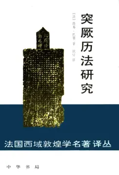

# 元数据

> [!abstract] 突厥历法研究 (路易·巴赞) (Z-Library)
> - 
> - 书名：突厥历法研究 (路易·巴赞) (Z-Library)
> - 作者：（法）路易·巴赞
> - 阅读进度：0%
> - 阅读时长：3分钟
> - 最后阅读：2026-08-27
> - 微信读书：https://weread.qq.com/book-detail?type=1&v=5ef428e3643425f414253306a3830684c47414f367961367777383138464455962

# 高亮划线

## 第九章 库蛮人的历法

> 📌 在伊斯兰和突厥文史料中,他们的部落联盟叫做“钦察”
> ⏱ 2026-08-27 02:05:24
