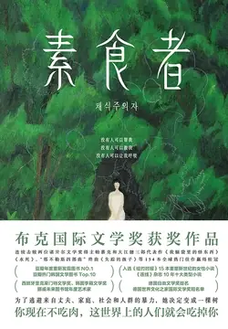

# 元数据

> [!abstract] 素食者【2024诺贝尔文学奖得主】
> - 
> - 书名：素食者【2024诺贝尔文学奖得主】
> - 作者：[韩]韩江
> - 译者：胡椒筒
> - 简介：为了逃避来自丈夫、家庭、社会和人群的暴力，她决定变成一棵树。在英惠的丈夫郑先生的眼中，“病”前的英惠，是个再普通不过的女子：不高不矮的个头、不长不短的头发，相貌平平，着装一般，温顺、平淡、文静。正如他所希望的那样，英惠完美地扮演了平凡妻子的角色——料理家务，伺候丈夫，就像千千万万的传统妇女一样。
> - 出版时间：2021-09-01 00:00:00
> - ISBN：9787541160868
> - 分类：精品小说-社会小说
> - 出版社：四川文艺出版社
> - 微信读书评分：80%
> - 阅读进度：0%
> - 阅读时长：22分钟
> - 最后阅读：2026-11-11
> - 微信读书：https://weread.qq.com/book-detail?type=1&v=2ff32410726da6902ff40f0

# 高亮划线

## 封面

> 📌 为了逃避来自丈夫、家庭、社会和人群的暴力，她决定变成一棵树。在英惠的丈夫郑先生的眼中，“病”前的英惠，是个再普通不过的女子：不高不矮的个头、不长不短的头发，相貌平平，着装一般，温顺、平淡、文静。正如他所希望的那样，英惠完美地扮演了平凡妻子的角色——料理家务，伺候丈夫，就像千千万万的传统妇女一样。
> ⏱ 2026-11-11 11:15:27
> 💭 一个很毛骨悚然的发现：为什么大家习以为常得认为，妻子就必须是这样的形象？
> 🕰 2026-11-11 11:15:30

## 素食者

> 📌 妻子吃素以前，我没有觉得她是一个特别的人。
> ⏱ 2026-11-11 11:18:56

> 📌 我之所以会跟这样的女人结婚，是因为她没有什么特别的魅力，同时也找不出什么特别的缺点。在她平凡的性格里，根本看不到令人眼前一亮、善于察言观色和成熟稳重的一面。正因为这样，我才觉得舒坦。
> ⏱ 2026-11-11 11:16:00

> 📌 如此一来，我就没有必要为了博取她的芳心而假装博学多才，也无须为约会迟到而手忙脚乱，更不用自讨没趣地拿自己跟时尚杂志里的男人做比较了
> ⏱ 2026-11-11 11:16:41

> 📌 我那二十五岁之后隆起的小腹，和再怎么努力也长不出肌肉的纤瘦四肢，以及总是令我感到自卑的短小阴茎，这些对她来讲都是无关紧要的事。
> ⏱ 2026-11-11 11:16:15
> 💭 突然想到网络上的段子和普通人的分享，打扮了一两个小时，化了精致的妆，穿了漂亮衣裳，却没有一个男的主动过来加微信。而有一天头也没梳，脸也没洗，穿了个睡衣就下楼扔垃圾，竟然被男的要微信了。太真实了。
> 🕰 2026-11-11 11:18:46
> 💭 卑劣总是振振有辞。自己平庸所以对美好感到自卑惶恐。不过读了几页纸书非要倒转乾坤。可怜可悲可憎。
> 🕰 2026-11-11 11:18:32
> 💭 所以我特别讨厌在社交平台上看到类似于 女生觉得自己打扮的好看，是给自己对象长脸 的言论。可能女生身上既有美貌又有才华，而男生外貌不太出众（可能有其他出众的方面） 大多数人会觉得 这个男生真有钱 而女生除了外貌之外一无所有，本该属于女生自己的优点总会成为男生的奖章。这个社会总是对男性很宽容。
> 🕰 2026-11-11 11:17:49
> 💭 犀利的文字如同医生的手术刀，割开了糜烂的皮肤，透过炎症红肿的血肉，看到了骨头上游离着的烂疮。
> 🕰 2026-11-11 11:17:29
> 💭 低级阿，找个这样温顺的妻子，竟然只是为了从里到外的贬低她，好让自己的大部分缺点和懒惰合理化存在。
> 🕰 2026-11-11 11:17:10

> 📌 小时候，年长的我会带领比我小两三岁的家伙们玩耍；长大后，我考进了能领取丰厚奖学金的大学；毕业后，我进了一家珍视我微不足道能力的小公司，并为能够定期领取微薄的薪水而感到心满意足。
> ⏱ 2026-11-11 11:19:39

> 📌 从一开始，那些用漂亮、聪明、娇艳和富家千金来形容的女子，只会让我感到不自在。
> ⏱ 2026-11-11 11:19:46

> 📌 她每天早上六点起床，为我准备一桌有汤、有饭、有鱼的早餐，而且她从婚前一直做的副业也或多或少地贴补了家用。
> ⏱ 2026-11-11 11:20:04

> 📌 说到兴趣爱好，她似乎只有看书而已，而且看的都是那些我连碰都不想碰的、枯燥无味的书。
> ⏱ 2026-11-11 11:20:29
> 💭 对，如果不说阅读，我可能会觉得这个女孩可能还处于精神空洞的世界，但是，如果是阅读，那她也绝对不可能是无知的，其次，男生对女孩是一无所知，从那些措辞“而已，好像之类”他根本不懂那个女孩，而女孩也可以侧面看出，在物质世界没有得到任何温暖，转而投身在了书籍里寻求慰藉
> 🕰 2026-11-11 11:20:58
> 💭 我不相信一个热爱阅读的人拥有的是空洞的灵魂，她的精神世界是丈夫看不到的。
> 🕰 2026-11-11 11:20:52

> 📌 妻子只有一点跟其他人不同，那就是她不喜欢穿胸罩。
> ⏱ 2026-11-11 11:21:08
> 💭 我不觉得哪个女人会喜欢穿胸罩，只不过是因为被这个社会驯服，随着所谓的体面、礼貌、得体而不得不对自己进行的束缚。试问，闷热的夏天，脱掉胸罩的那一刻，哪个女性没有得到解放的感觉？说是自己对自己的束缚，其实是社会对女性的束缚。
> 🕰 2026-11-11 11:22:21
> 💭 现代胸罩诞生（最知名故事）
>
> 玛丽·菲尔普斯·雅各布（19岁纽约名媛）
>
> 1913年：准备参加舞会，硬质鲸骨紧身胸衣会从轻薄晚礼服下凸出来，破坏礼服效果。她叫女仆，拿两块丝绸手帕+粉色丝带临时缝制一件轻便胸衣：无硬骨、露背、分开承托双乳，轻便柔软。舞会后很多朋友找她定做。
> 🕰 2026-11-11 11:22:08
> 💭 说明妻子的意识很超前 更在乎自己的舒适 最搞笑的是男人只联想到性暗示
> 🕰 2026-11-11 11:21:54

> 📌 与其这样，还不如在胸罩里加一张厚实点的胸垫。这样一来，跟朋友见面时，我也好显得有点面子。
> ⏱ 2026-11-11 11:22:48
> 💭 拿老婆的乳房在兄弟面前装面子，这是什么脑回路？！长相好的女人，长相是优势，身材窈窕的女人，身条是优势。如果两者都没有，那只有胸脯四两优势了。相比男人而言，这是女人唯一的长处。
> 🕰 2026-11-11 11:23:39
> 💭 好真实、、有一种人是会把你看作战利品，带出去很有面子，持有你就能证明他是强者。敏感一点就很容易感觉到他并不是真正的喜欢，一旦他遇到更漂亮的（并且在他自认为能掌控的范围之内），就会果断放弃你。
> 🕰 2026-11-11 11:23:17

> 📌 我没有穿过胸罩，自然无从得知那有多难以忍受。但看到其他女人都没有像她这样讨厌穿胸罩，所以我才会对她的这种过激反应感到很诧异。
> ⏱ 2026-11-11 11:24:12

> 📌 直到二月的某天凌晨，我发现妻子穿着睡衣站在厨房前，我从未想过这样的生活会出现任何改变。
> ⏱ 2026-11-11 11:24:55
> 💭 你当然没想过了，你那空空如也的脑袋瓜子里只有性和剥削女性劳动力，你还能想什么东西？你觉得你所当然的一切都是剥削女性得来的，你当然什么都想不到咯。
> 🕰 2026-11-11 11:25:08
> 💭 “我早已习惯她的顺从乖巧 可从未想过她渐渐开始失控”
> 🕰 2026-11-11 11:25:03

> 📌 妻子一动不动地看着冰箱。黑暗中，虽然看不清她的表情，我却感受到了一股莫名的恐惧。她披着一头蓬松且从未染过色的黑发，穿着一条垂到脚踝的白色睡裙，裙边还稍稍打着卷。
> ⏱ 2026-11-11 11:25:19

> 📌 但不知她从何时光着脚，穿着春秋款的单薄睡衣，跟听不见我讲话似的愣愣地站在那里。仿佛冰箱那里站着一个我看不见的人，又或者是鬼。
> ⏱ 2026-11-11 11:25:27
> 💭 这样的观察力，不太像一个丈夫拥有的。男的只会起来撒尿喝水去睡觉，根本不会注意妻子在床上还是在地上，更别说这么细致观摩
> 🕰 2026-11-11 11:26:00

> 📌 她不是没有意识，她知道我走出卧室，向她发问，并且靠近她。她只是无视我的存在罢了。
> ⏱ 2026-11-11 11:27:00
> 💭 “最高的轻蔑是无言，而且连眼珠也不转过去。”（鲁迅，《华盖集》）
> 🕰 2026-11-11 11:27:07

> 📌 我从浴缸上方黑色的换气口、地面和墙壁上的白瓷砖，感受到了一种残酷季节的寂寞感。
> ⏱ 2026-11-11 11:27:47
> 💭 之所以会有残酷的寂寞感，因为灵魂得不到共鸣，与其说结婚，不如说是凑活。
> 🕰 2026-11-11 11:28:07

> 📌 只要我伸手就能触碰到妻子带有温度的身体，但不知道为什么，我不想碰她。甚至连一句话也不想跟她讲。
> ⏱ 2026-11-11 11:28:16
> 💭 真是！一直都是男性“碰”女性，没有女性“碰”男性这一说法。“碰”这个动作的发起者永远是男性，诸如此类的动作还有我“看”电视、我“买”东西、我“骑”车...这些动作的发起者是人而承受者都是物，这不是物化女性是什么！！！
> 🕰 2026-11-11 11:30:03
> 💭 所以，经常看到有评论说，什么谷爱凌滑雪会不孕，没人会娶这样的一个女人，简直就是再说好像女人只有被男人肯定了才有活着的意义，如果没有的话，那么她的存在就没有意义
> 🕰 2026-11-11 11:29:56
> 💭 “不想碰她”变成某种男性对女性感到不满或厌恶的表示，仿佛是在某种“我随时可以碰她”的大前提之下，她作为“性价值”的提供者，不被“我”所需要便意味着否定。
> 🕰 2026-11-11 11:28:35

## 1

> 📌 吃火锅用的牛肉、五花猪肉、两块硕大的牛腱、装在保鲜袋里的鱿鱼、住在乡下的岳母前阵子寄来的处理好的鳗鱼、用黄绳捆成串的黄花鱼、未拆封的冷冻水饺和一堆根本不知道装着什么的袋子。
> ⏱ 2026-11-11 11:30:22
> 💭 这一天，玛蒂尔德看着平底锅，她问自己：“这是第几次看着水开了？我花了多少时间为他们去买菜？”她抬起眼睛，盯着冰箱，好像冰箱成了她最凶猛的敌人。这只白色的、冰冷的野兽吞噬着食物，就像希腊神话中无底的木桶——永远都要重新开始，永远都要重复相同的动作，什么都没有剩下。
>
> 她感到很羞耻，如此羞耻——她想起流逝的岁月，她围绕着家人的生活，他们消耗掉的成吨的食物。她想象着一间堆满肉排、圆形大面包和煮熟的蔬菜的房间，食物从地上一直堆到天花板。她对他们和自己感到恶心。
>
> ——《看我们跳舞》
> 🕰 2026-11-11 11:30:55

> 📌 我扒开塑料袋一把抓住妻子的手腕。她的腕力大得出乎我的意料，我使出浑身力气才逼她放下了袋子。
> ⏱ 2026-11-11 11:31:54
> 💭 也不奇怪，毕竟是“练不出肌肉的纤细手臂“
> 🕰 2026-11-11 11:32:04

> 📌 “我做了一个梦。”
> ⏱ 2026-11-11 11:35:41
> 💭 恭喜诺贝尔文学奖获得者！来晚了，早知道这么精彩，应该更早开始看的
>
> 。现在看也不晚呀，新年好啊！
> 🕰 2026-11-11 11:36:42
> 💭 为什么不问问她梦到了什么，为什么不关心关心她？因为他一点都不在乎妻子的内心世界，他在意的只是老婆的外表，胸大不大，朋友面前能不能给自己长面子……
> 🕰 2026-11-11 11:36:03

> 📌 “对不起，家里出了点急事……真是对不起。我会尽快赶到的。不，我马上就能赶到。只要一会儿……不，您别这样，请再给我一点时间。真是对不起。是，我无话可说……”
> ⏱ 2026-11-11 11:35:17

> 📌 “有没有熨好的衬衫？”妻子没有回答。我一边破口大骂，一边在浴室门口盛放脏衣服的桶里翻出了昨天穿过的衬衫。
> ⏱ 2026-11-11 11:37:37

> 📌 这是结婚五年来，我第一次在没有妻子的照料和送别下出门上班。
> ⏱ 2026-11-11 11:36:55
> 💭 明明没有任何一部法律上写着女性应该料理丈夫的一切，那么是谁默认了这条隐藏的规则呢？婚姻是维护男性剥削女性的制度，规定是由父权制定的。女性不被底层男性剥削的唯一办法就是不进入这个制度
> 🕰 2026-11-11 11:37:19

> 📌 因此，我根本无暇去思考妻子异常的举动。我心想，无论如何今天都要早点回家，自从换了部门之后，我已经好几个月没有在十二点前下过班了。
> ⏱ 2026-11-11 11:38:11
> 💭 工作对人施以剩余价值剥削，丈夫在家中则对妻子索取生活照料和情绪价值、性价值。
>
> 丈夫对妻子的颐指气使和对领导的唯唯诺诺形成了强烈的对照。这两种态度之间的落差由妻子负责吸收，工作与生活接轨时的的过渡与摩擦也由妻子负责缓冲润滑。可在相当长的时间里，妻子在家庭生活中所提供的劳动却不被给予任何认可，要么被在外工作的丈夫视为必须，要么被其他另一部分独立的女性群体轻视讽刺。
>
> 上野女士在《无薪主妇》中用“再生产”一次描述主妇在社会发展中所产生的无形劳动。例如家务、育儿、护理等，它们被称为“看不见的劳动”或“Shadow Work”（影子劳动）。
>
> 在男主外女主内的家庭结构中，男性在市场、职场中创造价值，而女性自然而然承担起服务男性、料理家事以确保工作以外的生活正常维持。
>
> 乍一看外围职场自成体系，创造价值者是工作的男性，而那些由于职场歧视、道德压力或是自主意志选择成为家庭主妇的女性则被认为是“需要养”的负累。
>
> 上野女性用无薪描述这种劳动，她写道：“市场内部发生的是物品（资本、服务）的生产与流通，其交换过程需要支付相应的代价，这就叫有薪劳动。市场外围发生的是生命的生产与再生产。简单来说，就是孕育生命、送走生命的劳动。只要这种劳动发生在家庭内部，就是不伴随支付的无薪劳动。”
> 🕰 2026-11-11 11:38:40

> 📌 我走上前，扒开草帘走进去，只见数百块硕大的、红彤彤的肉块吊在长长的竹竿上。有的肉块还在滴着鲜红的血。我扒开眼前数不尽的肉块向前走去，却怎么也找不到对面的出口。身上的白衣服早已被鲜血浸湿了。
> ⏱ 2026-11-11 11:38:53

> 📌 我眼前出现了难以形容的灿烂光景，流淌着溪水的岸边，很多出来野餐的家庭围坐在地上，有的人吃着紫菜卷饭，有的人在一旁烤着肉。歌声和欢笑声不绝于耳。
> ⏱ 2026-11-11 11:39:33
> 💭 因为话还是说回之前，丈夫的干净体面靠的是她日复一日的辛苦，当然她可以选择建立更好的家庭，夫妻分工工作；丈夫性能力不行，她可以选择用爱包容，而不是自己也不在意，如此麻木；温柔美丽的独立女性她也可以去做，但现实是她只能从事着一份画画兼职。
>
> 现实和理想的差距，让她嚼不动那块肉，那块软绵绵的肉是她过往过不去又被强行压抑下的痛苦，只要她不把这个痛苦当回事，不接受自己处于弱势，去争取，去认同人是有选择的，在弱肉强食的世界里选择成为强者，而不是选择质疑这种生存方式，她就能吃肉，她就香甜的吃肉。
>
> 但她没法把软绵绵的口感变成畅快的大口吃肉大口喝酒，所以嚼不烂，不敢咬。
>
> 她已经开始有点精神出问题了，所以肯定会日渐介意吃肉，不知道该怎么吃，慢慢的退化为没有牙，类似这个过程？我也不清楚。
>
> 这本书我就看了一点点，后面没有再看，可能其他的解读更正确吧，毕竟我才看了一点点，不一定能直接理解作者想表达的意思。
>
> 我不太喜欢这本书，太压抑了，感觉偏向女性更多一点，对男性角色的理解非常刻薄，没有深挖原因。好像都是天生坏种，自然而然选择的成为恶的走狗。我更容易接受鲁迅在《祝福》里祥林嫂的塑造。每个人都有推波助澜，但大家最开始也真情实感的可怜过她，这一切更多的是社会和时代的悲剧。
>
> 这俩也不是一个国家的，风土人情也不一样，她可能是真实的，但我看起来会有种是韩国的事，不能特别顺滑的过度到国内的情况，还是有点不一样的感觉吧
> 🕰 2026-11-11 11:40:46
> 💭 这里他们吃的应该都是母亲和女性的肉吧，因为是以家庭为单位出现的，孩子，家庭，野餐等等都和妻子在其中起到的角色密不可分，什么情况下，人们看到烦人的孩子会觉得小孩可爱，在孩子有人照顾的时候，我们可以放心的觥筹交错，不用体会疲惫，愤怒，不被人用异样的眼光看着。好像这家人情绪一点也不稳定。
>
> 这种美好建立在妻子的付出身上，他们吸食的是鲜艳肉块，多么让人害怕，一场光明正大的食人狂欢，女主自己还吃了一块，但她吃出来的不是美味烤肉，是软趴趴的自己的肉，她无法接受这一切，也无法自己杀死自己，真正放弃或者承认自己的痛苦
> 🕰 2026-11-11 11:40:41

> 📌 我的双手和嘴巴里都是血，因为刚刚在仓库的时候，我吃了一块掉在地上的肉。我咀嚼着那块软乎乎的肉，咽下肉汁与血水。
> ⏱ 2026-11-11 11:40:56
> 💭 我想素食，是妻子的一种反抗，一种被迫长期保持沉默中生发出的反抗。肉食，象征的是压迫，掠夺，血腥，更是丈夫长期的精神暴力。
> 🕰 2026-11-11 11:41:16

> 📌 我无法忘记用牙齿咀嚼生肉时的口感，还有我那张脸和眼神。
> ⏱ 2026-11-11 11:41:38

> 📌 我无法解释这种似曾相识又倍感陌生的感觉……也无法讲明那种既清晰又怪异和恐怖的感觉。
> ⏱ 2026-11-11 11:41:40
> 💭 有点狂人日记般惊悚的感觉：我又何尝不在无意识中吃了一口他人的肉。一大块的肉是被剥削的女性，而自己也吃肉，是有意无意地参与了这种异化的过程，在这过程中，女性变得逐渐无法认清自己，现实比之梦境更恐怖恶心
> 🕰 2026-11-11 11:42:06

## 2

> 📌 搞什么？因为做了一个奇怪的梦就把肉都扔了？你知道那些肉值多少钱吗？”
> ⏱ 2026-11-11 11:49:06

> 📌 “至少给我煎个鸡蛋吧。我今天累坏了，连午饭都没好好吃。”
> ⏱ 2026-11-11 11:49:12
> 💭 我无法忍受被人使唤的感觉，我也不喜欢使唤别人，为什么在两性关系里，一个人要服务另一个人，一个心甘情愿，一个理所当然
> 🕰 2026-11-11 11:49:38

> 📌 一切出乎我的意料，她竟会有如此自私、任性的一面。我怎么也没有想到她会是一个这么不理智的女人。
> ⏱ 2026-11-11 11:49:45

> 📌 “反正你只在家吃早餐，中午和晚上都能吃到肉……一顿不吃肉死不了人的。”
> ⏱ 2026-11-11 11:49:49
> 💭 是的，本质是不能压制妻子，
> 🕰 2026-11-11 11:50:13
> 💭 丈夫的愤怒核心不是没有肉吃而是失控感。从前的妻子是可控，服从规则，服务于他生活的附属品，现在的妻子有了自己的原则和底线，自己的精神世界，不再为他妥协，不再为世俗妥协。
>
> 他无法理解妻子的痛苦，只能用“自私任性”定义她的觉醒。
>
> 施暴者永远无法共情被压迫者的反叛。
> 🕰 2026-11-11 11:50:08

> 📌 只不过是做了一个奇怪的梦，就要改变饮食习惯？而且她还彻底无视我的劝阻，固执得让人不可理喻！
> ⏱ 2026-11-11 11:50:19

> 📌 妻子烤肉的技术非常娴熟，她一手拿着钳子，一手拿着大剪子，剪排骨肉的架势相当稳重。
> ⏱ 2026-11-11 11:50:37
> 💭 妻子过去显然非常熟练地处理肉食，但“会做肉”不能证明“喜欢吃肉”，丈夫把妻子长期承担的生活劳动，当成了妻子自身喜好的证据。这段回忆里，他记得的是妻子怎样做出自己喜欢的菜，只字没提妻子喜欢吃什么。
> 🕰 2026-11-11 11:50:43

# 章节点评与书评

## 读书笔记

这是读前感，可能写得很糟糕。

套用《素食者》这本书的开头：韩江得到诺贝尔文学奖以前，我没有觉得她是一个特别的作家。

看到她获得诺奖的新闻, 想起我还从来没有读过新鲜出炉的获奖者的作品。于是赶紧跟风，搜作家和代表作。这才发现：这本书，放在我的书架里，已经很久了。

再查了一下最近十年的诺贝尔文学奖获奖名单。发现居然只读过其中一位的作品，就是阿列克谢耶维奇的《二手时间》。当时好奇地读，更多是因为我去过那个小而美的白俄罗斯。从没想到过，那里居然也能出诺奖获得者。你问我对《二手时间》的评价如何？ 哎，我只读了个开头，而且没印象了。是的，我承认，很多时候，我就是这么浅薄。

又看了一眼这个十年名单，发现：其中，居然有五位获奖者是女性作家！分别是：

2015年。白俄罗斯。阿列克谢耶维奇。代表作品：《二手时间》，《战争中没有女性》，《锌皮娃娃兵》，《最后的见证者》，《切尔诺贝利的祭祷》。

2018年。波兰。奥尔加·托卡尔丘克。代表作品：《太古和其他的时间》，《白天的房子，夜晚的房子》，《云游》，《怪诞故事集》，《最后的故事》，《衣柜》，《世界上最丑的女人》。

2020年。USA。露易丝·格丽克。代表作品：《月光的合金》，《直到世界反映了灵魂最深层的需要》，《沉默的经典-忠贞之夜》。

2022年。法国。安妮·埃尔诺。代表作品：《悠悠岁月》《一个女人的故事》，《一个男人的位置》，《一个女孩的记忆》。

2024年。韩国。韩江。代表作品：《素食者》，《植物妻子》，《不做告别》，《白》，《失语者》。

尤其是最近五年，有三年的获奖者是女性！再加上呼声极高的残雪，真的要打破刻板印象了：文学创作的主角，不只是男作家。

如果接下来，残雪女士也获奖，衷心希望她不会被称为残雪“先生”。够了，女士已经代表了世上最优秀的群体，不再需要“先生”的尊称来加持。

又想，凭什么这奖不颁给呼声很高的残雪，而是要给默默无闻的韩国韩江呢？转念又一想，这搞不好，又是我的傲慢与偏见吧？我怎么能断定韩江就默默无闻？她的书，不是早就躺在我的书架里了吗？我不会真的以为我的信息茧房就是整个真实世界吧？

韩国电影，优秀作品层出不穷；韩国电视，欧巴风靡拉美中东；韩国音乐，鸟叔的《江南style 》横扫全球；韩国时尚，修身西服与九分裤改变了亚洲男性的审美风格；那韩国文学作品，韩国女作家，凭什么不能拿到诺贝尔文学奖？

我们往往以为自己什么都知道，自己的观点都对。其实，我只了解井上的那一圈天空。就比如韩江的《素食者》这本书，我昨天跟风寻她千百度，蓦然回首，那书却在书架最深处。

骂了自己一句。抱着尊重与好奇，开始拜读。

> 记录于 2026-11-11 11:14:16

## 读书笔记

🎾灵魂跑的太快了，肉体都跟不上了！

今年是读的最少的一年，才 125 本，也就不准备再读了这几天，就准备给自己做个总结。想从为什么读这本书？我从中得到的启示？我现在还记得这本书的大概内容吗？这三方面来给自己总结一下！停下快速阅读的脚步，回味一下自己读的书，哪些还能值得自己在以后的人生中，可以读第二遍，第三遍…。

哪些书就不应该读，浪费时间，或者说是同样的时间读其他的书会更好一些？我短暂的顶多一百年的人生，能读几本书，书海无涯，慎重选择的时间多花点。可能比埋头去读书好很多吧。

🪂好书太多，时间太少！书永远读不完，书读的越多，我越是功利化了。有些书可能很好，很经典，可是我是真的没有那么多时间去读了。已经读的也在思考我是享受其中，给我一种意境和代入进去，有种穿越感，能够重生一回？还是读完了都没任何印象了，就像一夜情一样，都不知道名字，也不知道身材好不好了，甚至样子都没记住。

🍎现在时间是 2025.1.1 日 12.23 分，就在外面还有爆竹声中，把今年的读书写在这个书里面吧！因为关于这本书的解读满大街的，网上太多了，不缺我一个，就当日记写吧！让自己以后读书更经典一些！

废话不多说了，我这个碎碎念，赶紧一本书一本书的回味一下这 125 本一夜情吧！

* 《宋词三百首（彩图精装）》，不规定自己啥时候读完了，想读的时候就读一下

* 《关系千万重（精装版）》读了一部分，未读完，明年继续

* 读了一部分，未读完，明年继续《反经（国学大书院）》

*125《毕淑敏文化地理散文：世界如锦心如梭（名家视觉地理阅读）》

🎾当喝饮料一样，喝完了。喜欢这种感觉

*124《知识大迁移》

🎾你以为的不一定是对的

*123《太古和其他的时间（2018诺贝尔文学奖得主作品）》

🎾诺贝尔文学奖作品，但我没读懂

* 122《素食者》（2024诺贝尔文学奖得主韩江作品）

🎾读完了挺抑郁的

* 121《树上的男爵》

🎾早就想读这本书，卡尔维诺的书籍，一种另类的感受

* 120《涅朵奇卡：一个女人的一生》

🎾女人都不容易

* 119《芙蓉镇》

🎾茅盾文学奖获奖作品，电影也很经典

* 118《我们为什么要睡觉？》

🎾睡觉太重要了，这本书对我有用，我以前的状态不好跟我晚上熬夜有关系

* 117《小镇喧嚣：一个乡镇政治运作的演绎与阐释》

🎾让你以一个看客的身份了解乡政府和乡政工作人员

* 《116 现代中国的历程（增订本）》

🎾因为黄仁宇读了这本书，侧面了解了蒋介石这个人

*115《身体和灵魂都在路上》

🎾因为梁永安这个人读了这本书，《梁永安：阅读、游历和爱情》你试着读一读

*106《领导的气场：8堂课讲透中国式领导智慧（白金版）》

*104、105、107、108、109、110、111、112、113.114《百科知识 2024》

🎾有点像百度百科，没有专门的只能读这个，你捡自己感兴趣的去读。

*103《中国人的性格》

🎾一个外国人眼中的旧时候中国人

*102《论中国》

🎾基辛格写的，让外国人了解中国历史和现状，以及外交态度

*101《读书与领导力：新时代干部必读的100本书》

🎾相当于给你介绍了大多数名著国学的大概内容

*100《金瓶梅》

🎾必读啊

*99《世界秩序》

🎾基辛格写的，可以读读

98*《小城与不确定性的墙（村上春树时隔6年最新长篇）》

🎾村上春树的

*97《边缘地带的治理》

🎾社会学方面的书籍，感兴趣的试试

*96《我的工作是扼杀婚外情（小众职业故事集）》

🎾挺有意思的一本书，好多没听过的行业

*95《草民》

🎾好像是书友推荐的，蔡崇达的，都忘记了具体内容

*94《新时代基层社会治理工作实务》

🎾虽然还是迷糊状态，但也了解不少知识

*93《部级领导干部历史文化讲座（套装共6册）》

🎾享受了一回部级待遇，值得一读

*92《半小时漫画中国航天.探索宇宙篇》

🎾挺好的，了解了不少知识

*91《蒋勋说红楼梦（修订版）（套装共8册）》

🎾文字优美到让人窒息，读完红楼梦你再读这个来，强烈推荐

*90《煤老板自述三十年（煤老板眼中的世道与人生）》

🎾作为陕西人，对这个行业都或多或少了解一些，更好奇一些

*89《怎么看都很可爱》

🎾漫画的

*88《觉醒胖东来》

🎾受短视频影响就想了解这个企业

*87《中国社会各阶层分析》

🎾梁晓声写的，值得一读

*86《成长手信少年版》

🎾一个书友写的。很不错

*85《你不知道的旧社会（老天津的那些事儿）》

🎾我就对这种野闻佚事感兴趣

*84《世界前沿技术发展报告2024》

🎾虽然咱不是专业的，但是知其然不知其所以然也挺好

*83《治大国若烹小鲜：基层治理与世道人心》

🎾一个个热点事件带你解读这个社会

82*《女人的胜利（余华现实主义代表作）》

🎾全书是几个故事的合集，可我就记住了同名的《女人的胜利》这个小故事

*81《精英的傲慢：好的社会该如何定义成功？》

🎾值得一读，可是我忘了具体内容，当时估计是享受其中了

*80《海奥华预言》

🎾没有认真读，很失败，忘记具体内容了，不够专注啊

79*《一如既往： 不变的人性与致富心态》

🎾忘记具体内容了，也算是失败的

*78《论犯罪与刑罚（中意英三语版）》

🎾钟书峰译著，值得一读

*77《事实（比尔·盖茨推荐）》

🎾用数据思考，避免情绪化决策

*76《在峡江的转弯处：陈行甲人生笔记》

🎾强烈推荐

*75《重新发现社会（修订版）》

🎾我觉得你可以一读，了解这个社会，通过各个热点事件，重新解读

*74《芯片战争：世界最关键技术的争夺战（财之道丛书）》

🎾短视频上看到漂亮国一直对我们芯片技术掐脖子，华为加油，其他企业也加油

*73《独裁者手册》

🎾普通人要的出推崇的政治模式不一定是对的！可能会是国家灾难

*72《结构性改革》

🎾一个当过重庆市长的学者写的，你就会明白，人家是有真本事的

*71《大国政治的悲剧（修订版）》

🎾打开世界政治军事格局的一本书

*70《西游记（全集）（果麦经典）》

🎾四大名著总得读一次吧

*69《课长，这不是恋爱，这就是性骚扰！（上野千鹤子力荐）》

🎾我们生活中，已经见过太多了，能感受到。

*68《德国人写的中国文学史》

🎾也是看到是读客熊猫君出版社出版的，就去读了，一种不一样的角度吧

*67《飞鸟集（中英对照版）》

🎾一个字一个字的读完，钟书峰先生的译注不是盖的

*66《生气的时候就看看：365日育儿减压指南》

🎾看了还是会因为孩子生气。任何时候都要有爱，任何时候都要情绪稳定

*65《生意的三个本质：人性、产品和模式》

🎾想做生意的可以读一下

*64《丰乳肥臀【中国诺奖得主代表作】》

🎾争议比较大，包括我写的书评里面书友的评论，可能这本书很经典，但我不喜欢这个角度

63*《观念的水位》

🎾谁读谁知道，你会有不一样的思维和认识。真心。刘瑜的书闭眼收藏

*62《乡土中国》

🎾费孝通的书啊，避不开的社会学书籍

*61《一秒就读懂的孙子兵法》

🎾跟小时候路边那种一斤十几块钱的书累死但是举的例子都挺行，挺好

*60《纳瓦尔宝典》

🎾值得一读

*59《我胆小如鼠》

🎾可能我就是人如其名，胆小如鼠吧

*58《以利为利：财政关系与地方政府行为》

🎾你会明白财政税收历来的发展，地方政府和中央政府关于财税的比例变化

*57《寂静的春天》

🎾《三体》对叶文洁影响最大的一本书，就赶紧读了，真的很可怕，除草剂等等化学品太可怕了，现在吃个苹果都不敢吃皮了

*56《我在北京送快递》

🎾推荐读一读，我们同龄人写的东西，很真实，让你明白你遇到的每个行业的人都不容易，要互相体谅

*55《我的失败，不算太坏》

🎾书友推荐的，就读了给写了书评，写的非常好，作者也在我们的读书群里

*54《文学回忆录：1989-1994》

🎾也是短视频刷到的，陈丹青一个劲的推荐，就找到读了

*53《寻欢作乐》

🎾从不同人的角度你会感受不一样，毛姆是洞察人性的

*52《在中国大地上：搭火车旅行记》

🎾一个外国人在中国搭火车旅行的记录，值得一读，我喜欢这种散漫的风格

*51《庄子说什么》

🎾强烈推荐，这本书讲的太好了，谁读谁知道。

*50《硅谷钢铁侠：埃隆马斯克的冒险人生》

🎾跟下一本书都是关于马斯克的，但是写的不一样

*49《埃隆马斯克传》

🎾目前人类也就这么一个人吧，了解一下总是好的

*48《告别百年激进》

🎾短视频上看到的温铁军，就找了他的书读一读

*47《你不可不知的人性》

🎾中国人写的这种类型的书籍，基本上都是给你讲做人做事的道理

*46《结构思考力》

🎾一种思考方法论，可惜我没有任何印象了。也算是失败的

*45《当下的力量实践手册》

🎾因为《当下的力量》读的这本书

*44《无所谓》

🎾可能还是因为冯唐这个人的原因才读了这本书，几个单独的故事合成的

*43《格言联璧》

🎾不要问为什么。想读你就认真的一个字一个字的读，字字珠玑，滴水藏海，几千年文化的力量不是盖的。

*42《当下的力量》

🎾活在当下，值得一读。

*41《胜天半子》

🎾受《人民的名义》祁同伟影响对这四个字很敏感了，但是我似乎都忘记了这本书讲了啥了，算是自己的阅读失败了。似乎是讲做人做事的，跟祁同伟无关。

*40《通透》

🎾一开始以为是网络名人写的，不值得读读完了才知道人名到名人是原因的，值得一读。

*39《记一忘二三》

🎾李娟的书都很好

* 38《浪漫主义的根源》

🎾起初可能是哪本书里面推荐的，就读了

* 37《好骨头》

🎾可惜的是具体内容都没有印象了，读的比较失败，但不可否认是好书

* 36《作家榜名著：一间自己的房间》

🎾“独立而自由的灵魂，才是幸福之源。做自己，比任何事情都重要。”我一定给我女儿准备一个自己的房间

* 35《沧浪之水》

🎾作为体制内的人，你最好读一下《沧浪之水》这本书，但是你不要跟任何人透漏你读过这本书。——来自于我这个中年人的忠告！

* 34《人生总会有答案》

🎾强烈推荐的一本书，人生不应该只读一遍。我自己读完后给自己写了十几条建议

* 32 和 33《天幕红尘套装》《天幕红尘》《背叛》

🎾读了《遥远的救世主》的人大概率都会想读这两本书，因为是“豆豆三部曲”

* 31《五万年中国简史》

🎾具体为啥读这本书，忘记了，总之读客熊猫君出版社的很多书真的好啊

* 30《悉达多（果麦经典）》

🎾你有你的路要走，你有你的道要修！不管任何时候，我都觉得你值得拥有这本书

*29《信念 : 人生每一步都算数（珍藏版）》

🎾也许我做不到雷殿生这样的生活，但我的灵魂随着他的脚步👣走了一遍。

* 28《大明王朝1566（全集）》

🎾看过电视剧你再读这本书，你会更有画面感，更会觉得编剧刘和平太牛了，电视剧演的太好了

* 27《静静的顿河（全集）》

🎾我一直喜欢这种类型的书籍，还有《额尔古纳河右岸》

* 26《野性的呼唤》

🎾陪孩子共读

* 24《王阳明大传：知行合一的心学智慧（全集）》

🎾一个书友推荐的，真心值得读，虽然关于王阳明的书籍看过好多，但是这本最好，虽然是小日子写的。

* 23《红楼梦》（二刷）

🎾在往后余生之中，一年读一遍都不过分，千古第一

* 22《看见孩子》

🎾教育孩子是我的心事，可是读完了自己还是教不好，不能说这类书籍没用，只能说是孩子都是独一无二的。

* 22《相信》

🎾短视频刷到的丁磊

*21《汤姆叔叔的小屋》

🎾家里有纸质书，陪孩子共读的

*20《暗网》

🎾起初是孩子跟我说什么是暗网之类的，我查了一下，然后读的这本书，挺不错的，见识多了！

* 19《此生未完成》

🎾于娟🌹，愿你在天堂安息，可以见到李清照！

* 18《培根随笔全集（经典译林）》

🎾第一次听是领导的新年贺词后面的书架，但是确实经典，加入N 遍书单了

* 17《格兰特船长的儿女（凡尔纳作品精选）》

🎾跟《海底两万里》一样的原因，陪孩子共读

* 16《可能性的艺术：比较政治学30讲》

🎾政治是一门可能性的艺术，刘瑜的书你去读就行，不会失望

* 15《地心游记（经典译林）》

* 14《神秘岛（经典译林）》

🎾跟《海底两万里》《地心游记》都是一样的原因，跟孩子共读

* 13《瓦尔登湖》

🎾第二次读了，以后在人生中还要再读几遍，加入需要阅读N 遍的书单了

* 12《海底两万里（经典译林）》

为了陪孩子读，自己先读了一遍，也算弥补了自己小时候没有读的遗憾。

*10《 佛说八大人觉经》

🎾原因是因为莫言的《生死疲劳》这四个字出自这里，就又读了这本书，虽然读的似懂非懂，但是值得一读！

*9《窄门》

🎾“你们要努力进窄门，因为宽门和阔路引向沉沦，进去的人很多；然而窄门和狭道却通向永生，只有少数人能找到。”

*8《生死疲劳》

🎾莫言的代表作，确实很好，写了这个书评还为我获得了二十本纸质书，😄

*7 她身之欲：珠三角流动人口社群特殊职业研究（中山大学社会学文库）

🎾让我对小姐这个群体有了更多的认识

*6《雪国》

🎾我很喜欢这种冰天雪地静谧的环境，白色衣服的女人，白色的世界，一切是那么的纯净！

* 5 和 11《黎东方讲史系列》（细说元朝、细说宋朝）

🎾因为《资治通鉴》只到了北宋时期，后面的一段历史还是需要填充一下！这两本书很好，值得我推荐一下

* 4《九大思考：重新审视我们的世界》

🎾导新年贺词后面书架上的书，就找来读了，对人类面临的问题的九大思考，读完了会让我们的视野更开阔一些，不出茅庐，已知大的问题。

* 3《伟大的海：地中海人类史（全2册）》

🎾导新年贺词后面书架上的书，就找来读了，对着世界地图观察，你会发现俄乌战争，以色列侵略巴勒斯坦，中东石油，非洲都在地中海这块，我们值得研究。

* 2《深度学习》

🎾领导新年贺词后面书架上的书，就找来读了可以了解人工智能方面的知识，很不错，值得一读，。

* 1《明朝那些事儿（全集）》（跨年书）

🤸‍♀️回味：大学读了一部分，剩下的去年和今年读完了，我觉得值得一读，但是我估计也不用读第二遍了。这块历史已经大概了解了。

> 记录于 2026-11-11 11:14:23
