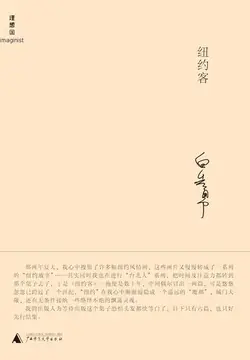

# 元数据

> [!abstract] 纽约客
> - 
> - 书名：纽约客
> - 作者：白先勇
> - 简介：六五年的一个春天，作者在爱荷华河畔公园里一张桌子上，开始撰写《谪仙记》，其时春意乍暖，爱荷华河中的冰块消融，凘凘而下，枝头芽叶初露新绿，万物欣欣复苏之际，而作者写的却是一则女主角飘流到威尼斯投水自尽的悲怆故事。当时作者把这篇小说定为“纽约客”系列的首篇，并引了陈子昂《登幽州台歌》作为题跋，大概作者觉得李彤最后的孤绝之感，有“天地之悠悠”那样深远吧……可是悠悠忽忽已跨过了一个世纪，“纽约”在作者心中渐渐退隐成一个遥远的“魔都”，城门大敞，还在无条件接纳一些络绎不绝的飘荡灵魂。
> - 出版时间：2010-10-01 00:00:00
> - ISBN：9787563397631
> - 分类：精品小说-社会小说
> - 出版社：广西师范大学出版社
> - 微信读书评分：81%
> - 阅读进度：0%
> - 阅读时长：3分钟
> - 最后阅读：2026-11-10
> - 微信读书：https://weread.qq.com/book-detail?type=1&v=1cd32b305ccc7d1cd22feef

# 高亮划线

## 牡丹因缘

> 📌 登幽州台歌陈子昂前不见古人后不见来者念天地之悠悠独怆然而涕下
> ⏱ 2026-11-10 17:16:02

### 1

> 📌 慧芬说一九四六年她们一同出国的那天，不约而同地都穿上了一袭红旗袍，四个人站在一块儿，宛如一片红霞，把上海的龙华机场都照亮了，她们互相看看，忍不住都笑弯了腰。
> ⏱ 2026-11-10 17:16:25

> 📌 李彤自称是“中国”，她说她的旗袍红得最艳。没有人愿意当“俄国”，俄国女人又粗又大，而且那时上海还有许多白俄女人是操贱业的。
> ⏱ 2026-11-10 17:16:30
> 💭 哈哈，法国的酒，俄国的妞！
> 🕰 2026-11-10 17:17:59
> 💭 特地问了deepseek，原来20世纪20-40年代，白俄“难民”很多，主要集中在哈尔滨天津上海等地。因为俄国十月革命5年内战，白俄主要是内战战败方，其中大部分都逃亡欧洲地区，负责东线的军队逃亡路线被阻截只能逃亡东亚。
> 🕰 2026-11-10 17:17:48
> 💭 任何时期都有这样的吧，在异地他乡为了生存，女子进入性服务行业。白先生这句话应该意有所指，十月革命以后许多俄国贵族很多都流落到了上海，男的酗酒不务正业，女的多半流落风尘。
> 🕰 2026-11-10 17:17:16
> 💭 二战后，上海接纳的白俄难民多达2.5万人，其中不乏白俄贵族。他们多数生活窘迫，昔日辉煌不复存在，白俄女子在酒色场所谋生，从事文中的“贱业”。
> 🕰 2026-11-10 17:16:54

### 2

> 📌 就是这个顶合我的胃口。”李彤说道，几下便把一杯Manhattan喝尽了，然后用手将杯子里那枚红樱桃撮了起来塞到嘴里去。有一个侍者走过来，李彤用夹在手指上那截香烟指指空杯说道：
> ⏱ 2026-11-10 20:52:42

# 章节点评与书评

## 读书笔记

《纽约客》收录了白先勇跨度数十年的六篇短篇小说，包括《谪仙记》《谪仙怨》《夜曲》《骨灰》等。这些故事都以纽约为舞台，却不断回望上海、台北，以及更远处的故乡，串起半个多世纪里华人与世界大都会之间纠缠复杂的关系。

《谪仙记》写于六十年代，讲的是上海旧家千金李彤，流落到纽约，在繁华都市里一点一点沉沦，最后投河自尽。从云端跌落尘埃，天上人间的差距，令人唏嘘。《谪仙怨》里另一位上海小姐黄凤仪，也同样在纽约迷失，文化错位和性别困境在其中清晰可见。

进入七十到八十年代，《夜曲》把目光转向留学生。吴振铎、吕芳这群人，因政治与时局而各奔东西，有的在美国深造，有的经历文革审查，二十五年后重逢纽约，当年的理想和爱情早已面目全非。

《骨灰》也是同一时期的作品，两位老人因政见不同而分道扬镳，一位是国民党旧部，一位是民主斗士，在齐生父亲的骨灰安葬仪式上再度聚首，回望一生，政党争斗的荒诞与流亡者的苍凉，不言自明。

在这些故事里，人物不断跨越地理和文化的边界，从上海到台北再到纽约，却始终逃不开"中国人"与"世界人"之间的双重身份焦虑。《夜曲》和《骨灰》直面国共内战、文革等宏大背景，个体的命运被时代洪流裹挟得身不由己；而《谪仙记》《谪仙怨》则暗藏着殖民与文化不平等的隐痛。

早期作品里的悲悯大多局限在中国人内部，后期两篇则逐渐跨越种族和性别，走向更广阔的爱，也映照出作者从国族立场向世界主义视角的转移。

这六篇小说，如同六幅并置的都市浮世绘。从前殖民时期的焦虑，到冷战时代的流亡，再到全球化背景下族群与爱的碰撞，纽约既是梦想之都，也是漂泊者的容器。白先勇借中国人客居异域的漫长旅程，追问文化归属、历史伤痕和人性救赎，写下了一部兼具时代史诗与人类关怀的短篇佳作。

> 记录于 2026-11-08 16:11:11
