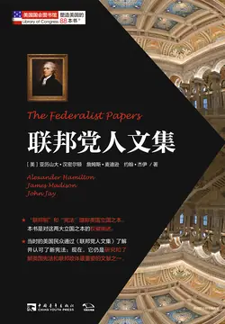

# 元数据

> [!abstract] 联邦党人文集
> - 
> - 书名：联邦党人文集
> - 作者：亚历山大·汉密尔顿 詹姆斯·麦迪逊 约翰·杰伊
> - 译者：杨颖玥,张尧然
> - 简介：《联邦党人文集》包括论文85篇，是三位作者共同以“普布利乌斯”为笔名在纽约报刊上发表的。《联邦党人文集》对后来一些国家的宪法的制定有着深远的影响，也是今人研究美国宪法和政体的重要资料。后来的美国法官常引用本书解释宪法。1787年，美国历史上著名的制宪会议举行，该会议制定并通过了一部新宪法。新宪法要由13个州的代表会议分别批准，一旦征得9个州同意，宪法即生效。但是在讨论过程中，各种拥护和反对之声不绝于耳，于是便发生了一场激烈的论战。《联邦党人文集》就是这次论战的产物，是全面为新宪法辩护的一部著作。它一方面反驳了反对派对新宪法的抨 击，另一方面阐述了美国宪法的基本原则和美国联邦政体的运作模式。
> - 出版时间：2014-01-06 00:00:00
> - ISBN：9787515319599
> - 分类：社会文化-法律
> - 出版社：中国青年出版社
> - 微信读书评分：86%
> - 阅读进度：5%
> - 阅读时长：1小时4分钟
> - 最后阅读：2026-11-17
> - 微信读书：https://weread.qq.com/book-detail?type=1&v=2c432fb071f8f0d52c44f19

# 高亮划线

## 编者的话

> 📌 1910年，年仅19岁的胡适考取“庚子赔款”第二期官费生赴美留学，就读于康奈尔大学。
> ⏱ 2026-11-15 06:10:51

> 📌 我保证善用我的思辨才能；我保证发展我独立的思想；我保证接受教育，从而使自己能够独立判断。
> ⏱ 2026-11-15 06:11:14
> 💭 相比发挥天性，挖掘天性，儒家更擅长压制甚至改变天性。最后挖掘出一堆巨婴毒虫哈哈哈，真讽刺
> 🕰 2026-11-15 06:12:16

> 📌 力争客观、原生态地呈现美国的人文社会、政治制度以及美国历史发展和民主进程，在一个个美国故事中，讲述真实的美国和美国人，宏观展示美国的诞生、成长和强大，美国人自我意识的觉醒和认同。
> ⏱ 2026-11-15 06:12:27
> 💭 如果你要了解一个国家，最好的办法就是了解他们的历史，文化和人的生活状态，并亲身踏上那片土地，了解一下当地的风土人情，文化，政治制度，而不要仅仅根据媒体上的只言片语去拼凑
> 🕰 2026-11-15 06:12:39

> 📌 我们怀着真挚的感情，把这段话献给“塑造美国的88本书”丛书的读者，希望广大读者关心她、批评她、帮助她。让她成为我们共同的事业。
> ⏱ 2026-11-15 06:12:52
> 💭 如果评选塑造中国的88本书，我会选择：论语，史记，三国演义，唐诗三百首，资治通鉴，西游记，红楼梦，水浒传，资本论，毛选，鲁迅杂文，诗经，孟子，本草纲目，黄帝内经，齐民要术，礼记，四书章句集注，孙子兵法，道德经，周易，商君书，盐铁论，开工天物，九章算术
> 🕰 2026-11-15 06:13:11

## 第一篇 概况

> 📌 第一篇　概况
> ⏱ 2026-11-15 06:14:06
> 💭 精彩。
>
> 记录一：
>
> 现实种种，使我们感到现行邦联的不足，我们需要为合众国建立一部新宪法，虽然人们都怀疑人类是否具备足够的理性来建立一个优良的政府，那么现在我们面临的危机正是我们的机会。
>
> 如果我们的选择是基于正确且清晰公正的分析，当然是一种庆幸，但这只是理想，现实是宪法涉及广泛，种种利益牵涉其中，无可避免伴随着一些阻碍我们的观念，情感和偏见。
>
> 现在就有一个明显的阻碍：来自利益受损阶层的反对。把所有反对者都认定为既得利益者过于草率不客观，事实上，他们也可能是出于合理的意图真诚的缘由，这可能是先入为主的偏见造成的错误判断。造成偏见的因素很强大，连有些聪明善良的人也无法逃脱。
>
> 再一个是，我们并不能一直确信，那些主张真理的人在道义上比他们的反对者更加高尚。危险的野心，更容易隐藏在热心保护人民权利的面具之后，而不是一心建立稳定高效政府的冷峻外表之下。历史告诉我们，前者比后者更容易走向专制之路；大多数颠覆共和自由的人们，在最开始都极力谄媚讨好人民，靠煽动人心起家，以专制统治收场。
>
> 请大家警惕没有事实依据的舆论影响，无论它出自何方。我真诚建议大家接纳新宪法，因为新宪法是你们的切身利益所在。我深信，为了保护你们的自由、尊严和幸福，这是一条最安全的道路。下面我将把理由及依据放到你们面前，我的论述都将以不辱事实为基准，以不损真理为精神。
> 🕰 2026-11-15 06:14:10

> 📌 人类社会是否真正有能力通过深思熟虑和成熟抉择来建立一个优良的政府，还是命中注定只能永远依赖由武力和偶然建立的政治法则生存。
> ⏱ 2026-11-15 06:26:12
> 💭 6月23日下午，美国国会参议院通过一项法案，要求美国总统特朗普停止对伊朗的军事行动，将美军从与伊朗的敌对行动中撤出。表决结果为50票赞成、48票反对，2名共和党议员缺席投票。这是自美国1973年《战争权力法》颁布以来，首次由参众两院双双通过决议。不过，该投票大概率仅具象征意义。
>
> 此前从未有战争权力决议在参众两院双双通过；而1983年美国最高法院裁决称此类措施须提交总统签署或否决方能产生法律效力。白宫方面则坚持《战争权力法》违宪，故对其无约束力。总统即便不签署，也大大降低了中期选举的舆论优势。
> 🕰 2026-11-15 06:27:11
> 💭 人们自己创造自己的历史，但他们不是随心所欲的创造，并不是在他们自己选定的条件下创造，而是在直接碰到的、既定的、从过去继承下来的条件下创造。——马克思《路易·波拿巴的雾月十八日》。
>
> 两位伟人都摆脱了宿命论的枷锁，高扬人类自由理性的光芒，也都对主观能动性与客观制约性之间的张力予以承认，揭示了人类社会发展的复杂性。
> 🕰 2026-11-15 06:27:06

> 📌 在这样的前提下，如果事实最终说明我们选错了，那必然可以将其认为是整个人类的不幸。
> ⏱ 2026-11-15 06:27:21

> 📌 我们必须承认，这些人也可能是出于合理的意图；于情于理，现在的反对者，以及今后也会有的反对者，他们大多数都有自己的缘由。就算这些缘由不能令众人信服，也不用去多加指责！
> ⏱ 2026-11-15 23:30:58

> 📌 因为在政治上和在宗教上一样，想用火和剑强行改变别人的信仰，是无比荒谬的。政治和宗教上的异见，是不能用迫害来消除的。
> ⏱ 2026-11-15 23:30:56

> 📌 危险的野心，更容易隐藏在热心保护人民权利的面具之后，而不是一心建立稳定高效政府的冷峻外表之下。
> ⏱ 2026-11-15 23:44:37

> 📌 我对自己不认同的东西不会假装留有余地。一旦做出决定，我便不会装出商议的姿态来讨好大家。
> ⏱ 2026-11-15 23:46:24

> 📌 我撰写文章的动机长存我心，但我对自己观点的论述会对所有人完全开放，任由评议
> ⏱ 2026-11-15 23:46:22

> 📌 在相关论述的过程中，对可能出现并引起大家任何注意的所有反对意见，我都将尽力做出满意答复
> ⏱ 2026-11-15 23:46:27

> 📌 但是，事实上我们已经风闻新宪法反对者在私下的议论了。他们认为，十三个成员国组成的合众国辐员过于辽阔，没有任何通行的体制适合于所有成员国。因而，我们有必要动手把合众国各个部分加以拆分。
> ⏱ 2026-11-15 23:46:32

## 第二篇 论外国势力的危险（一）

> 📌 美国人民也必将会意识到，他们现在所面临的问题，所要做出的决定，是最值得他们关注、也是最重要的事情之一。
> ⏱ 2026-11-15 23:46:48
> 💭 新的宪法，新的国家最值得关注
> 🕰 2026-11-15 23:47:13

> 📌 政府的存在，必不可少！这一点再明确不过。同样不容回避的是，人民必须让出一部分天赋权利，把这些权利转交给政府，让政府拥有必要的权力。
> ⏱ 2026-11-15 23:47:16
> 💭 区别在于让出那些，让出多少。是政府一纸条例直接夺走的，还是人民经过考虑同意的。
> 🕰 2026-11-15 23:47:34

> 📌 是为了集体的共同目标，大家团结在一个联邦政府之下，成为一个国家呢，还是分散为多个独立的联盟，把本该交给联邦政府的权力返还给各联盟首脑机构呢？
> ⏱ 2026-11-15 23:47:46

> 📌 不管是什么样的动机和理由使这些人转变了思想和观点，如果没有令人完全信服的事实依据和政策基础，大家就都去接受这个新说法，那肯定是不明智的。
> ⏱ 2026-11-17 00:50:41

> 📌 我发现，常常令我感到愉悦的是，独立自主的美利坚不是由分散隔离、相距甚远的地区组成的，她的疆域接连成片，她的国土肥沃丰美，这块广阔无垠的国土，养育着自由的西方儿女。
> ⏱ 2026-11-17 00:50:37
> 💭 西方儿女:此处取“欧洲中产阶级白人男性”之义
> 🕰 2026-11-17 00:50:38

> 📌 上帝特别赐予她大片的沃土和丰饶的物产，创造无数的河流为之灌溉，让这里的居民能够安居乐业。河道接连相通，似链条般蜿蜒缠绕于她的边疆，把这个国家抱为一体。世上最著名的这几条河流之间，距离恰到好处，上下奔流不息，为居民之间友好互助、货物运输和商品贸易提供了天然的便利通道。
> ⏱ 2026-11-16 00:09:41

> 📌 这些人民同源同宗，讲述同一种语言，信仰同一种宗教，奉行相同的政府原则，依循相似的礼仪习俗。
> ⏱ 2026-11-15 23:52:51

> 📌 这片土地和这群人民似乎因彼此而存在，骨血相依不容分割。似乎是上帝的精心营造，使这片土地如此适宜生存，如此适合人民共同传承，大家紧密团结，永远都不应当分裂为彼此隔绝、相互猜忌的不同国家。
> ⏱ 2026-11-15 23:52:54
> 💭 秦始皇也太老了，之后分分合合也好多次了，现在的大一统是元明清的基础，台湾则是更晚近的事情了
> 🕰 2026-11-15 23:53:39
> 💭 美国的建立同样离不开武力，只不过是失败者几乎被灭光了而已，哪个国家的建立不是充满了暴力
> 🕰 2026-11-15 23:53:27
> 💭 我想，这个和台湾不一样。这里是美联邦打算聚合在一起，中国曾经是依靠秦始皇的武力聚合在一起的。这是不一样的。因此，台湾问题和这里并不类似。
> 🕰 2026-11-15 23:53:23

> 📌 虽然他们知道，对于建立一个完善且各方利益平衡的政府，冷静而成熟的思考是最重要的基础。在这种种不利的时刻成立的邦联政府，在实践中存在着与既定目标不符的不完善之处，实在不足为怪。
> ⏱ 2026-11-17 00:50:31

> 📌 他们明白，只有建立一个比之前更加完善的中央政府，个人自由和政治联合才能得到保护。所以，在共识达成后，他们召开了最近的费城制宪会议，探讨这个重要议题。
> ⏱ 2026-11-16 00:11:27
> 💭 1787 年的5月25日，美国制宪会议在费城举行，一直持续至 9 月 17 日 。会议旨在解决新生美利坚合众国运作困难的问题，制定了人类历史上第一部成文宪法。日后许多国家的成文宪法都从中借鉴，使这场会议成为美国乃至世界史的重要事件之一。
>
> 在这部宪法制订前，经历了美国独立战争的 13 个殖民地以《邦联条例》组成了松散联合，各州之间常僵持不下、国会表决多次因人数不足被迫休会。作为一个新生国家，美国在组织、管理等各个方面存在严重的问题，因此邦联国会通过了举办条例修改讨论大会的方案，唯罗德岛州因担心利益受损而抵制。
>
> 由于交通不便，1787 年原定 5 月 14 日召开的会议，直到 25 日才有 7 个州的代表人数达到法定人数。大会方向由仍弱化中央政府的修例，最终走向要制定强化中央政府的新宪法。在民众直选、不同人口数量的各州之间平衡的参、众两院制度也由妥协而生。
>
> 这部宪法并未给奴隶提供选举权，但拥有更多奴隶的南方要求将奴隶计入计算众议院代表数目的人口，经北方反对，得出了“五分之三”的折衷计算方法。
>
> 1787 年 9 月 17 日，39 名代表签署了宪法，确立了五项基本原则：人民主权、共和政府、有限政府、三权分立与联邦体系。宪法序言如是说：
>
> “我们合众国人民，为建立更完善的联邦，树立正义，保障国内安宁，提供共同防务，促进公共福利，并使我们自己和后代得享自由的幸福，特为美利坚合众国制定本宪法。”
>
> 美国宪法明确了由选举产生的政府具有唯一的合法性。经由 1870、1920、1964年的宪法修正案，美国选举权才分别扩充至非白人人种、女性与穷人。
> 🕰 2026-11-16 00:13:17

> 📌 和平时期，他们摈除杂念，清醒冷静，持之以恒地连续数月专注于磋商。没有受任何感情的影响，没有向任何势力弯腰，唯有对自己家园的挚爱，最后终于完成了他们全体参与并一致认可的方案，并把这个方案推荐给大家
> ⏱ 2026-11-16 00:13:43
> 💭 老爷们关着门把方案定了。跟泥腿子有什么关系？最后方案定了发个文章让泥腿子支持他们。200年后大洋彼岸的泥腿子们在微信读书评论区给美国老爷们唱赞歌。味儿太冲。
> 🕰 2026-11-16 00:14:28
> 💭 写这些文章的人可都是律师出身，都是辩论高手，巧言令色，煽动民意都是他们最擅长的事情，如果不加审视确实很容易就被他们感动了
> 🕰 2026-11-16 00:14:20

> 📌 这个方案只是推荐，并不是要强加给大家。然而大家也要记得，我们既不能盲目接受，也不能盲目拒绝。
> ⏱ 2026-11-16 00:14:44
> 💭 一般这种表述方式，后半句才是真实意图。就是强加的且不能拒绝的。
> 🕰 2026-11-16 00:14:58

> 📌 大家应该都还记得，1774年大陆会议的召开是因为人们意识到了迫在眉睫的危险。
> ⏱ 2026-11-16 00:15:06

> 📌 大陆会议为人们制定了一系列具体措施，独立战争的成功证明了这些措施的智慧。然而好景不长，很快出现了各种反对这些措施的报纸、宣传册和周刊，群起围攻这些措施，后来的局面至今令人记忆犹新。
> ⏱ 2026-11-16 00:15:52

> 📌 事实上，确实有许多人被鼓动、被蛊惑了。但是也有绝大部分人，做出了明智的思考和决断。今天回头再去细细回顾这件事，他们必定会为自己的选择感到欣慰。
> ⏱ 2026-11-16 00:16:09
> 💭 以独立战争的胜利印证大陆会议的正确，以类比当下的新宪法的正确性。这里暗示人民支持就是正确的，反对就是被蛊惑了。
> 🕰 2026-11-16 00:16:27

> 📌 这个群体来自于全国各地，带来了有关各地的丰富信息，促进了相互交流，加深了相互了解。
> ⏱ 2026-11-16 00:16:45

> 📌 如果说，人们知道大陆会议中很多成员并非有经验的名人，都依然能客观地给予他们充分信任，那么，人们现在有更充分的理由去尊重这次制宪会议的判断和建议。
> ⏱ 2026-11-16 00:15:17

> 📌 现在，他们经历了更多考验，并把累积的知识和经验带到了这次会议上。同时不妨公正地说一句，他们的爱国精神和实干能力已经有目共睹，更不用说他们还有异于常人的政治敏锐度。
> ⏱ 2026-11-16 00:16:32
> 💭 立国初期真的是白月光一样的存在。
> 🕰 2026-11-16 00:16:38

> 📌 合众国解体之时，就是美利坚道出这句诗之时：“再见吧！永别吧！我的一切伟大。”
> ⏱ 2026-11-16 00:17:01
> 💭 这个时候的美国正建立着属于他们的“周礼”，但现在看来，礼崩乐坏的趋势自然也是有的。
> 🕰 2026-11-16 00:17:19

## 第三篇 论外国势力的危险（二）

> 📌 无论哪个成员国的人，但凡有一点智慧和眼界的人，在涉及自己利益的时候，都很少会迷途不知返，他们不会接受危及自己利益的错误意见，更不会坚持错误观点，这已不是什么新的心得。
> ⏱ 2026-11-16 00:18:03

> 📌 意识到联合的重要性后，始终坚定地团结在一个联邦政府之下。同时赋予这个政府足够的权力，以实现所有的全国性目标和集体目标。
> ⏱ 2026-11-16 00:18:19

> 📌 一个有智慧的自由民族，在诸多需要关注的问题中，会把安全问题放在首要位置。
> ⏱ 2026-11-16 00:18:23

> 📌 我打算只就维护和平与保持安定这一角度来界定安全问题。考虑的重点是，既要对抗国外势力的威胁，也要杜绝国内原因导致的类似威胁。
> ⏱ 2026-11-16 00:18:27

> 📌 民众认为，在一个高效国家政府的带领下，一个和谐紧密的联邦能够为他们提供尽可能好的安全保障。因为这个政府可以集全国之力，针对外来的威胁采取安全防护措施。
> ⏱ 2026-11-16 00:18:32

> 📌 如果最终得出的是联合的美利坚有最少的战争可能性，那么我们就可以认定，在安全问题上，联邦能更好地维系各成员国人民与其他国家的和平。
> ⏱ 2026-11-16 00:18:40

> 📌 战争的正当起因，多数情况下是由于某方违犯两国条约，或是直接开展侵略。合众国已经和至少六个国家签订了条约。这些国家，除了普鲁士之外，都是海洋国家。因此，它们有可能会来骚扰我们，伤害我们
> ⏱ 2026-11-16 00:19:17
> 💭 可怜的普鲁士
> 🕰 2026-11-16 00:19:27

> 📌 美利坚还跟葡萄牙、西班牙以及英国有广泛的商业交流。值得留意的是，后两个国家在北美大陆的殖民地还与我们的国土接壤。
> ⏱ 2026-11-16 00:19:31

> 📌 在与这些强国的相处中，遵守相关国际法，对于合众国的和平至关重要。而且，我觉得这里有一个显而易见的事实：与十三个分散的成员国或者三四个独立的联盟相比，一个全国性的政府，能够更加完善而忠实地履行这一点。
> ⏱ 2026-11-16 00:19:43

> 📌 更何况，作为全国性的机构，其覆盖范围更广，在人才招揽方面候选人自然会更多。所以，永远都不会出现某些成员国常见的人才稀缺问题
> ⏱ 2026-11-16 00:20:34

> 📌 如果成立全国政府，那么国际法和条约及其条款会由全国政府统一阐述，统一贯彻执行。
> ⏱ 2026-11-16 00:21:02

> 📌 制宪会议在这方面的智慧非常值得赞赏，它把处理这类问题的司法权授予联邦法院，由联邦法院来统一审理和裁决。这个联邦法院的法官由全国政府来任命，同时也只对全国政府负责。
> ⏱ 2026-11-16 00:21:32
> 💭 各州也有立法权，但联邦的法律、最高法院具有最高权威性。这点与联邦和各州行政权的关系有很大不同
> 🕰 2026-11-16 00:21:51

> 📌 至于说到其他的战争理由，比如以战争为目的主动侵犯，这种情况是很容易察觉的，面对这种情况，一个优秀的全国政府能为人民提供更多的保护，有效阻止危险，这远比任何地方政府要来得可靠。
> ⏱ 2026-11-16 00:24:54

> 📌 这些暴力冲突，通常不是因整个民族的冲动或利益引发的，而是一部分人为了利益而冲动开战，是一两个成员国的行为，而非整个联邦的行为。迄今为止，与印第安人的战争，没有一场是由邦联政府侵犯挑起的，邦联政府现在实在处于弱势
> ⏱ 2026-11-16 00:25:56

> 📌 而印第安人的几次反击战，也是因为某些成员国的不当行为所触发的。这些成员国一来没能力，二来也不愿意制止那些侵犯印第安人的行为，最后也不加以惩罚约束。结果导致许多无辜的居民被屠杀。
> ⏱ 2026-11-16 00:25:33
> 💭 有识之士其实从来坦诚，热血不斥理性，真当是理性爱国的典范了。然而，我觉得利益使然，在决策上，白人还是会无数次选择牺牲印第安人的利益。这是现代工业文明和古典游牧文明的根本冲突，但是清醒的人不会说自己是对的。
> 🕰 2026-11-16 00:26:23

> 📌 如此情况，只有全国政府能有效地排除这种战争风险。有直接利害关系的那部分人，理智可能会被冲动所取代；但全国政府能够跳出这个窠臼，以慎重的态度理智地处理国际事务。
> ⏱ 2026-11-16 00:24:50

> 📌 在这类事情上，全国政府就不会受到这些想法的影响。它会慎重而公平地考虑，谨慎而公正地决策，找出最适合的方法和手段，以使人民摆脱各种威胁。
> ⏱ 2026-11-16 00:27:31
> 💭 如今总统的权力越来越大，难以有效制约，其所做出的决定并不是审慎公平的考虑。
> 🕰 2026-11-16 00:27:40

> 📌 众所周知，一个强大的统一国家做出的道歉、解释和赔偿，往往更能被接受和认可。但如果换作是一个无足轻重又狭隘的成员国或联盟，那就难以令人信服和满意，更谈不上会被接受。
> ⏱ 2026-11-16 00:28:00

> 📌 在1685年,热那亚得罪了路易十四, 事后曾努力去安抚他的愤怒。路易十四要求他们派遣总督或首席执政官，由四名参议员陪同，到法国向他请罪。除了请求他的宽恕，还得接受他的条件。为了和平，热那亚不得不屈从这种要求
> ⏱ 2026-11-16 00:29:31
> 💭 rè nà yà
>
> （Genova）　意大利最大的港市。位于热那亚湾北岸。人口59.47万（2015年）。公元前3世纪为罗马自治城市。15世纪为欧洲最强大的城市共和国之一。1815年为撒丁王国一部分。1861年归属意大利王国。经济以港口为基础，客货运量皆为全国之首。意大利北部与中欧至地中海的出海口。金融保险业繁荣。工业发达，全国最大船舶制造中心。石化、机械、钢铁、纺织工业亦重要。铁路、公路枢纽。
>
> 有输油管道联结意大利北部与瑞士、德国。多教堂、宫殿等中世纪古迹。旅游业兴盛。
> 🕰 2026-11-16 00:29:35

> 📌 试想，路易十四敢如此嚣张，向西班牙、英国或者其他任何强国提出这种要求吗？或者反过来，哪个强国敢向路易十四提出这样的屈辱要求呢？
> ⏱ 2026-11-16 00:29:19

## 第四篇 论外国势力的危险（三）

> 📌 一个全国性的政府，不仅会给敌人更少发动战争的借口，而且即使行动稍有差池，也更容易求得和解。
> ⏱ 2026-11-16 00:30:42
> 💭 后来1812年的英美战争算是一个鲜活的例子。美国向英属加拿大开战，结果被打的落花流水，首都陷落，白宫被焚，但是因美国当时已经比较大的国土纵深，英军没法彻底将其消灭，最后回到了谈判桌。
> 🕰 2026-11-16 00:31:34

> 📌 一般来说，只要觉得战争有利可图，就总有一些国家要挑起战争。无论这种行为多么可耻，多么让人性蒙羞，但它确实存在于现实当中。
> ⏱ 2026-11-16 00:31:52

> 📌 当专制君主在自己的国家无利可图时，也往往会发动战争。原因不过是为了私人的目的和打算，比如对军事荣耀的渴望、报复私仇、野心或者私人契约
> ⏱ 2026-11-16 00:32:40

> 📌 对于最后一项，也不过是出于支持或扩大自己家庭和党朋的实力。这些动机和其他只有统治者才会受到影响的动机，常常使其发动一些不符合人民意愿、不符合人民利益的不义战争
> ⏱ 2026-11-16 00:32:44
> 💭 各个小国的统治者由于个人利益或喜好难免会做出一些带有极强个人主义色彩的决策，而这些决策通常是违背民众意愿的。
> 🕰 2026-11-16 00:32:56

> 📌 法国和英国，是我们的渔业对手。尽管他们使用各种方法与我们竞争，阻挠我们抢占市场，譬如设法奖励本国渔业，同时对外国渔产征税，但是我们还是能以低于他们的价格，将渔产送入他们的市场
> ⏱ 2026-11-16 00:33:21
> 💭 美国渔业的很大支柱，来自于在独立战争后期，和富兰克林、杰伊一起代表美国，来自新英格兰地区马萨诸塞州的约翰亚当斯出于当地支柱产业捕鱼业利益，为争取美国在英属加拿大纽芬兰海域的捕鱼自由，和英国谈判代表据理力争，列入《英美巴黎和约》的条款的捕鱼权。
> 🕰 2026-11-16 00:33:46

> 📌 我们有自己的船只，我们的商业版图在扩大。任何一个美洲这片大陆上的国家，或是领土靠近这片大陆的国家，都不会为我们的商业成就感到高兴。他们不愿意看见这样的结果，因为我们在这片区域分享了他们越来越多的利益。
> ⏱ 2026-11-16 00:36:19
> 💭 现在把“美洲”换成亚太甚至地球，“我们”换成中国，“他们”换成美国也一样
> 🕰 2026-11-16 00:36:35

> 📌 一方面，西班牙觉得通过封锁密西西比河来对付我们轻而易举；另一方面，英国把我们驱出圣劳伦斯河。两国都切断自己与另两方的通路，不允许彼此之间有互相贸易往来的水路。
> ⏱ 2026-11-16 00:35:01
> 💭 二百多年前美国人就在考虑所谓自由贸易，是需要舰炮作为坚实的后盾的，当然还有一条真正的、切实的红线，为了维护自身的利益，不惜战争，不是哄骗自已的人民。而是给全世界的可能的敌人展现自已坚强的意志。否则只能被人拿捏。
>
> 今天能从中国这里拿到好处的国家，明天就是对中国下手最凶残的敌人。不要将自己估计太高，也不要将任何人都当作善良天使。国家从来就是机会主义者，想想自己的伪善也就知道人家也不可能多么纯洁。
> 🕰 2026-11-16 00:36:00
> 💭 看到这突然意识到美国的崛起之路也是受到层层阻扰的。（现在总是下意识觉得美国的发达是与生俱来的）
> 🕰 2026-11-16 00:35:18

> 📌 我们不能期望其他国家真正祝福我们的发展。面对我们的联合，面对我们在海洋上的影响力和势力，面对我们在大陆上的力量和地位，他们做不到视若无睹，处之泰然。
> ⏱ 2026-11-16 00:39:04

> 📌 引爆这些导火线的时机若来临，也自然能找到它的借口，去粉饰或辩解开战的理由。所以，你们必然也会有英明的见解。那就是，美利坚必须联合起来，建立一个全国性的政府。
> ⏱ 2026-11-16 00:39:41
> 💭 一个国家只有团结统一，才能更加安全强大
> 🕰 2026-11-16 00:39:47

> 📌 在这里，我们切入一个与这个问题相关的讨论：一个优秀的政府，是否比多个政府更能有效地保护自己的人民？
> ⏱ 2026-11-16 00:39:54
> 💭 前面分析了建立一个全国性政府的必要性，后面与多个政府相比较，分析全国性政府的有效性。
> 🕰 2026-11-16 00:40:01

> 📌 一个政府能够扩大每个成员的利益，谋虑深远，行事谨慎。在制订法律时，一个政府能够照顾到全局利益，也能考虑到局部的差异。因为在同一个政府的统辖下，共同利益与个体利益是统一的。
> ⏱ 2026-11-16 00:40:19

> 📌 这样的军队更有效率，远胜于分为十三个或三四个各自独立的军队。
> ⏱ 2026-11-16 00:40:31

> 📌 英国海军的事迹，我们素有耳闻。如果我们足够聪明，明白其间的因由，则美利坚海军威名远播的那天终将到来。一个全国性政府，举全国之财力，聚全国之物力组建海军。英国航海事业若非由一个全国政府管理，则无法打造一个培养优秀海员的基地，也绝对不会有今日景象。闻名遐迩的英国海军，又何来现在的声势，又何来人人称赞的威名
> ⏱ 2026-11-16 00:41:57

> 📌 英格兰、苏格兰、威尔士、爱尔兰都各自拥有独立的海运和舰队。如果大英帝国这四个地区皆由四个独立政府统辖的话，那么不难想象，他们的分量会迅速降低，威名会迅速跌落，直到式微。英国的每个地区也就无足轻重了。
> ⏱ 2026-11-16 00:40:46

> 📌 本身就非常爱好和平或渴望和平，即使看在邻居的份上，也不愿拿自己的安宁去冒险；更不用说，还有妒忌邻居的可能，或是乐于邻人的重要地位被削弱，因而拒绝为邻人提供防御。
> ⏱ 2026-11-16 00:42:13
> 💭 任何集体、民族、国家如果想要长久的和平，则必须为战争做好准备。
> 🕰 2026-11-16 00:42:21

> 📌 那么援助的人力如何组织，何时组织，按什么方式组织？援助的款项怎么提供，何时提供，按什么比例提供？
> ⏱ 2026-11-16 00:42:28

> 📌 我们的国家政府行事高效，组织良好；我们的商业监管审慎，谋划深远；我们的军队组织得宜，训练有素；我们的资源和财政管理谨细认真；我们的信用得以重建；我们的人民自由、团结、生活美满。那么，他们将会非常乐于维护与我们的友谊，避免冒犯我们，造成不快。
> ⏱ 2026-11-16 00:44:39
> 💭 这个确实是硬道理了
> 🕰 2026-11-16 00:44:47

> 📌 一个民族或家庭内部分裂、兄弟阋墙，则内祸外乱必起。
> ⏱ 2026-11-16 00:43:48
> 💭 想到红楼梦中探春说的“可知这样大族人家，若从外头杀来，一时是杀不死的，这是古人曾说的‘百足之虫，死而不僵’，必须先从家里自杀自灭起来，才能一败涂地！”
> 🕰 2026-11-16 00:44:14

## 第五篇 论外国势力的危险（四）

> 📌 一个完整而完美的联盟，是永久和平的基础。它将会保卫你们的宗教、自由和财产；消除你们内部的敌意，消除我们之间的猜忌与分歧
> ⏱ 2026-11-16 00:45:43
> 💭 换句话说，不完美的联盟就会破坏你们的宗教、自由和财产；增强你们内部的敌意，加大我们之间的猜忌与分歧。
> 🕰 2026-11-16 00:45:51

> 📌 这样一个岛上的人民自然应该结为一个国家，但是我们却发现，他们长期分裂为三个国家，而且这三个国家之间，还几乎总是在彼此争吵，甚至进行战争
> ⏱ 2026-11-16 00:45:58

> 📌 在很多年里，他们都是在相互添乱、相互干扰，而不是相互支持、相互帮助。
> ⏱ 2026-11-16 00:46:21

> 📌 不信任又会滋生不信任，再没有什么比猜疑嫉妒、含沙射影更容易改变良好的愿望和善行了，不论这是明显的还是暗示的表现。
> ⏱ 2026-11-17 00:51:15

> 📌 如果分裂为多个联盟的话，美利坚更有可能和欧洲一样，邻国之间充斥着对立的利益和不友好的情绪，这会左右各国的行为，令各国常常持不同立场。
> ⏱ 2026-11-17 00:51:50

> 📌 罗马帝国和其他一些国家，曾经多次以同盟军的角色征服其他国家，他们扮演这样的角色，又给他们假装要保护的政府带来了多少革新呢？
> ⏱ 2026-11-17 00:51:22

## 第六篇 论各成员国不和的危险（一）

> 📌 假如各个成员国完全分裂，或者只是结为几个地区性的联邦，那么，他们组成的不同部分之间，必将会经常发生激烈的冲突。
> ⏱ 2026-11-17 00:53:32

> 📌 人的本性就是有野心、有报复心、有贪婪心的。希望几个相邻的独立国家，不经联合，却可以长期和平共处，那就是对人类普遍规律的忽视，就是对千百年来积累经验的挑战。
> ⏱ 2026-11-17 00:53:27

> 📌 为了巩固这位有魄力有权势的皇帝对自己的宠信，他违反最基本的政策规定，将英国卷入了一场对法国的战争，并以整个欧洲和他所管辖的这个王国的独立和安全作为赌注。
> ⏱ 2026-11-17 00:54:22
> 💭 这点作者搞错了，我不知道是不是故意的，沃尔西是亲法派，反对与法国的战争，当然他是个优秀的战争后勤部长。顺着对自身有利的讲
> 🕰 2026-11-17 00:55:07
> 💭 在英国都铎王朝的历史中，亨利八世的著名首相——红衣主教托马斯·沃尔西（Cardinal Thomas Wolsey）确实在很大程度上将英国卷入了对法国的长期战。
>
> 沃尔西是一系列对外穷兵黩武政策的具体操盘手、策划者和推行者。他在迎合亨利八世好大喜功的军事冲动的同时，也把英国当作自己争夺国际话语权和个人晋升的筹码。虽然展现了极高的外交才华，但最终因劳民伤财和战略误判，导致国家和个人双双陷入危机。
> 🕰 2026-11-17 00:54:44

> 📌 一个女人偏执顽固6，一个女人性急易怒7，还有一个女人结党图谋8，这三个女人对当代欧洲大部分地区的政策、动乱和安宁所产生的影响，成为人们经常讨论的话题，已是众所周知了。
> ⏱ 2026-11-17 00:53:53

> 📌 斯巴达、雅典、罗马和迦太基都是共和国；其中，雅典和迦太基都是商业性质的国家。然而，这两个国家参与的战争次数，不论是主动进攻还是被动防御，都不比他们的君主制邻国少
> ⏱ 2026-11-17 00:55:38
> 💭 迦太基是一个古代腓尼基人建立的国家，位于今突尼斯境内，是古代地中海地区的重要强国之一。
>
> 起源与历史
>
> - 建立: 迦太基建立于公元前8世纪，由腓尼基城市推罗的移民在北非建立。
>
> - 发展与扩张: 迦太基在公元前6世纪已经成为一个庞大的奴隶制帝国，疆域包括北非、西班牙南部、西西里岛等。
>
> - 与罗马的关系: 迦太基与罗马为了争夺地中海霸权，进行了三次布匿战争，最终在第二次布匿战争后元气大伤，并在第三次布匿战争中被罗马彻底击败。
>
> 文化与经济
>
> - 地理位置: 迦太基位于地中海商路汇合点，长期垄断西部地中海贸易。
>
> - 经济基础: 依靠贸易和农业，迦太基积累了巨大财富，其农业和手工业十分发达。
>
> 灭亡与遗产
>
> - 灭亡: 迦太基在公元前146年被罗马夷为平地。
>
> - 文化遗产: 迦太基遗址成为重要的考古地点，1978年被联合国教科文组织列入世界遗产名录。
> 🕰 2026-11-17 00:56:10

> 📌 斯巴达几乎就是一个管理良好的军营，而罗马对于屠杀与征服也从来没有满足过
> ⏱ 2026-11-17 00:56:22

> 📌 迦太基尽管是一个商业共和国，然而在那场导致其最终毁灭的战争中，扮演的却是侵略者的角色。
> ⏱ 2026-11-17 00:56:29
> 💭 争夺地中海的霸权而已，无所谓侵不侵略的，况且第三次布匿战争还是罗马主动发起的
> 🕰 2026-11-17 00:56:39

> 📌 汉尼拔（公元前247～前182年，北非古国迦太基名将，军事家。——译者注）曾经带领他的军队攻入意大利的腹地，兵临罗马城下，直至最后才被西庇阿（公元前235～前183年，古罗马统帅和政治家。——译者注）在迦太基彻底打败，迦太基共和国也从此被征服。
> ⏱ 2026-11-17 00:58:37

> 📌 后来，威尼斯不止一次在野心勃勃的对外战争中得胜，成为意大利其他小国的集体反对目标。直到教皇朱利斯二世设法结成强大的联盟9，才给这个实力强大而又傲慢的共和国致命一击。
> ⏱ 2026-11-17 00:57:14
> 💭 指康布雷同盟，包括罗马教皇、法国国王、阿拉贡国王，以及绝大部分意大利诸侯和国君。
> 🕰 2026-11-17 02:06:11

> 📌 荷兰的各省在他们不堪承受各种债务和税负之前，在欧洲的战争中扮演了明显的主角。他们和英国争夺海上霸权，展开了激烈的较量。他们还是路易十四最顽强、最势不两立的敌人。
> ⏱ 2026-11-17 00:58:26

> 📌 在英国政府中，人民的代表构成了国家议会的下议院。商业已经成为该国的主流行业很多年。然而，很少有国家比英国参加的战争更多；而且在英国参加的战争中，有很多都是由其人民引起的。
> ⏱ 2026-11-17 00:57:54
> 💭 让我想起了《鸦片战争》中，英国投票要不要发动战争的一幕。战争派的得票其实只高了一点点，还有很大程度是受了摔碎瓷瓶的震撼才投的[叹气]
> 🕰 2026-11-17 00:58:22

> 📌 以上各国的形势与我们有类似之处，对他们的历史进行总结之后，我们有什么理由可以抱有幻想，希望在合众国解体，各成员国分裂独立之后，各成员国还能够真诚地和睦相处呢？
> ⏱ 2026-11-17 02:02:19
> 💭 這才是真正的以史為鑒
> 🕰 2026-11-17 02:02:13

> 📌 那些空洞的理论，极尽夸张之词的谬论，许诺我们说可以消除社会各方面不完美、缺点和罪恶现象，试图换取我们的信任，我们难道见得还不够多吗？难道现在还不是时候，从这种黄金时代的迷梦中觉醒吗？
> ⏱ 2026-11-17 02:02:28

> 📌 我们应该认识到，我们和地球上的其他居民一样，距离完美智慧和道德的幸福国度还很遥远，难道我们不应该把这作为政治行为的一条实践准则吗？
> ⏱ 2026-11-17 02:02:32
> 💭 完美，没有完美的绝对的。正如中国一直追求的“天下大同”，也只是一种动态平衡的理想状态，而非绝对的终点。
>
> 其实现依赖于人类对贪婪、偏见的持续克服，以及对合作、包容的长期实践。
>
> 正如费孝通所言：“各美其美，美人之美，美美与共，天下大同”——唯有在差异中寻求和谐，在竞争中守护共生，方能逐步趋近这一文明远景。
> 🕰 2026-11-17 02:02:42

> 📌 邻国是彼此的天然敌人，除非他们的共同弱点迫使他们结为联邦共和国，通过共同宪法制止它们之间的分歧，消弭那种潜藏的相互嫉妒，以免他们牺牲邻国来成就本国。
> ⏱ 2026-11-17 02:04:33
> 💭 欧洲建立欧盟，是维护地区长期和平的伟大创举。
> 🕰 2026-11-17 02:04:42
> 💭 欧盟似乎更像一个松散的邦联。
> 🕰 2026-11-17 02:04:37

> 📌 普布利乌斯
> ⏱ 2026-11-17 02:04:19
> 💭 《联邦党人合集》的真正作者是汉密尔顿、麦迪逊和杰伊，笔名普布利乌斯（Publius，源自古罗马执政官Publius Valerius Publicola）却为三人共同使用。
>
> “……汉密尔顿、麦迪逊和杰伊撰写了这些文章——这在当时是一个公开的秘密，但三个人都不想站出来承认写过哪些特定文章。”
>
> 1804年，在汉密尔顿决定与伯尔决斗前，在给友人的信件中公开了这八十五篇文章所对应的作者。但麦迪逊在十三年后重新列出他的作品清单，其中有十二篇与汉密尔顿所列清单有所出入。后来在两位统计学家对常用词频率的计算和统计数学方法协助下，确定那十二篇作品归属麦迪逊。
> 🕰 2026-11-17 02:04:17

## 第七篇 论各成员国不和的危险（二）

> 📌 有时候，会有人很骄傲地问道，如果各成员国不联合，有什么动机会使他们之间爆发战争呢？对这个问题完全可以这样回答：在历史的不同时期，导致世界各国血流成河的那些原因，便是他们的动机。然而不幸的是，这个问题对我们有更为特殊的答案
> ⏱ 2026-11-17 02:09:05

> 📌 在我们所能直接想到的范围内，有很多不同的理由可以导致分歧，即使在联邦体制的约束下，我们也可以凭借足够的经验，做出合理判断，想象如果去掉这个约束，将会产生怎样的趋势
> ⏱ 2026-11-17 02:07:15
> 💭 突然想到人口社会学的作业，我吐
> 🕰 2026-11-17 02:07:19

> 📌 领土争端永远都是孕育国家之间敌对的最肥沃土壤。
> ⏱ 2026-11-17 02:06:21

> 📌 在合众国境内，有大片的土地尚未确定归属。对于这些国土，某些成员国至今还存在不一致的领土要求，合众国的瓦解，将会提供一个契机，使所有成员国都提出类似的领土要求。
> ⏱ 2026-11-17 02:08:52

> 📌 众所周知，这些土地在独立战争时期没有加以分配，通常都称之为公有土地，各成员国也曾对其归属进行过认真而激烈的讨论。某些成员国沿袭之前殖民地政府的说法，宣称这些土地是属于他们的，而其他成员国则认为，这些土地的主权应该移交给邦联政府
> ⏱ 2026-11-17 02:09:38

> 📌 特别是全部西部领土，不论是从实际占有角度来看，还是从原来印第安领主的屈服对象来看，都应该是英国国王的属地，直至最后，英国通过和平条约，将它们转让给我们。
> ⏱ 2026-11-17 02:09:42
> 💭 英国银的强盗逻辑是在北美的广阔土地上生活的原住民处于自然状态，木有形成有效的政府来管理，所以介片土地奏属于欧洲的殖民者们。
> 🕰 2026-11-17 02:10:29
> 💭 屈服对象这个词用的好。
>
> 一方面以和平为借口，要求组成强大合众国。另一方面，依靠强大武装来获取他人领土。双标啊。
> 🕰 2026-11-17 02:10:15

> 📌 如果合众国不复存在，那些当年对邦联政府做出妥协，转让这些土地的成员国，就很容易会认为继续转让这些土地的理由已经没有了，并重新对这些土地提出领土要求。
> ⏱ 2026-11-17 02:10:51
> 💭 苏联解体时也就出现了这样的状况，其后果就是当前的乌克兰危机
> 🕰 2026-11-17 02:11:17

> 📌 为此，不同的成员国可能会制定出不同的原则；由于这种分配涉及到各成员国之间的利益冲突，因此很难通过和平协商的方式来完成。
> ⏱ 2026-11-17 02:11:30

> 📌 以古鉴今，我们有理由相信，他们最终有可能会诉诸武力来解决问题。康涅狄格和宾夕法尼亚之间，关于怀俄明土地的纠纷，告诫我们不要对这种分歧的解决过于乐观。
> ⏱ 2026-11-17 02:11:48
> 💭 康涅狄格与宾夕法尼亚的怀俄明土地纠纷（18世纪末）是美国建国初期州际矛盾的典型案例。
>
> 两州对土地所有权的主张均基于殖民时期特许状（康涅狄格依据1662年宪章，宾夕法尼亚基于1681年威廉·佩恩特许状），叠加移民定居、经济利益冲突，导致矛盾持续数十年，甚至引发武装冲突（如1778年怀俄明大屠杀）。
>
> 纠纷最终通过1782年联邦最高法院（当时为邦联议会）裁决宾夕法尼亚胜诉解决，但过程暴露了邦联时期中央权威薄弱的问题。
>
> 康涅狄格虽败诉，但其西部土地主张（俄亥俄河谷）后来通过《1786年土地让渡法案》转为联邦公有土地，为西部开发奠定基础。
>
> 领土与权益纠纷往往兼具法律、历史、现实利益多重维度，过度乐观的“速决思维”可能忽视深层矛盾。理性路径应是：以制度化为基础，以利益平衡为手段，在尊重历史的前提下寻求各方可接受的“非零和解”，同时为长期磨合预留空间。
> 🕰 2026-11-17 02:13:18
> 💭 特许即Charter. 大英帝国的monarch 都是抠B， 给臣民一纸特许状，你自费经营，但我要提成。
> 🕰 2026-11-17 02:13:13

> 📌 法庭的判决有利于宾夕法尼亚，但是康涅狄格对判决结果表现出了强烈的不满，也没有表示要完全服从判决结果，直到通过谈判斡旋，获得了与他们损失相当的满意补偿为止
> ⏱ 2026-11-17 02:13:25

> 📌 商业竞争是滋生争端的另一片沃土。那些处境较差的成员国，会渴望摆脱不利的地理环境，并分享那些幸运邻国的优势。每个独立的成员国或者联盟，都会建立一套适合自身的商业政策
> ⏱ 2026-11-17 02:13:34
> 💭 相对组成邦联，拆散的各州贸易壁垒一定更多，人才、物资、信息肯定无法像邦联一样自由流通，这对各州发展肯定不利，这也是为什么欧洲国家要建立欧盟的原因。是的，信息的流通非常重要
> 🕰 2026-11-17 02:13:54

> 📌 如果美利坚完全不联合，或者只是结为一个松散的攻守同盟的话，我们就会因为上述的种种原因，逐渐陷入类似欧洲的政治纠纷或战争的致命迷宫之中；
> ⏱ 2026-11-17 02:14:35
> 💭 其实，无论东西，道理都是一样的。
>
> 如果一个国家不团结，就会被外部势力“分而治之”，而分而治之的手段也可以是一种团结的手段，通过权力碎片化与利益分化维持中央集权。
>
> 中国古代就有分而治之，进而维持稳定，维持民族团结进步的具体方法：比如地理分割，通过划小行政单元（如推恩令）、设置缓冲区域；通过制度分权：行政、军事、监察权分离；通过文化渗透：以中原文明为核心，结合边疆习俗分层次治理；通过利益制衡：扶持不同势力相互监督（如宦官与士族、土司与流官）等。
> 🕰 2026-11-17 02:14:42

# 章节点评与书评

## 读书笔记

许多人攻击美国，却鲜有文章批判美国宪法，相反美国宪法--世界上第一部真正意义上的共和国宪法--成了许多国家的典范和首选的政体。美国独立战争后宪法的诞生和通过无疑在很大程度上要归功于35万字近2000屏的《联邦党人文集》。《文集 》85篇，每篇相当于一篇论文（附录独立宣言、邦联条款、美利坚合众国宪法和宪法修正案）。

文集的作者是亚历山大·汉密尔顿、约翰·杰伊和詹姆斯·麦迪逊，三人以“普布利乌斯Publius”（古罗马共和时期的政治家，词根是“共和”）为笔名1788年发表在纽约报纸上。

这些美利坚合众国的国父们founding fathers高瞻远瞩博览群书、历时（纵向）共时（横向）地研究世界：要建立一个前所未有的灯塔国（新瓶装旧酒，1611年清教徒牧师约翰·温斯罗普在横渡大西洋去美洲时就有了建立‘山巅之城’的使命，遑论五月花号船宣言），将权力关进制度的笼子里。

他们集思广益：考虑了各合众国、群体的立场和利益以及他们背后的考量，化解了美国人民和各州对联邦权力过大和潜在的寡廉鲜耻官员的担忧。他们鞭辟入里：分析了世界上主要政体的利弊，特别是古希腊的共和政体和母国英国的君主立宪制立法司法行政的历史演化和实践，为各州通过宪法扫清了拦路虎和大小绊脚石。

《文集》是一场全民普法，涉及的内容方方面面：从法理、伦理、人性、哲学、历史、国土面积和安全到政体、税收、联邦的权力、三权分立和制约、众议院参议院的权限、组成和期限，总统的产生、权力、连任、罢免、弹劾，陪审团等。

每种设想或论证都考虑到大小腐败的可能性和腐败的程度，比如报酬和任期：在合众国财政可以承受的情况下既能发挥官员的经验和主观能动性，又要防止报酬太低任期太短官员急功近利以权谋私。

如果先驱们百密一疏留下了权力的漏洞和腐败的后门，读者可以回忆一下制宪大会通过宪法的过程（凯瑟琳.德林克.鲍恩的《民主的奇迹：美国宪法制定的127天》和易中天的《帝国三部曲》等许多著作都有详尽的叙述）。制宪会议从1787年5月25日开始，至同年9月17日结束。

116天（普遍接受的计算法）确保了大小州的代表们畅所欲言，即使通过的条款也可以从容地在炎热酷暑中被重新讨论表决。看看代表们的构成：美国制宪会议55名代表精英荟萃。

21人有美国著名大学的法学或政治哲学的教育经历，8人曾在《独立宣言》上签字，7人曾任总督或州长，46人曾任议员，42人是大陆会议的代表，14人当过法官，讷言敏行众望所归的华盛顿将军坐镇。有怎样的代表就有怎样的宪法和政府！

费城会议充分发扬民主，逐条逐款的569次无记名表决和明智的妥协确保了宪法的诞生（篇、章、节、条、款、项，美国的宪法只有条和款）。如有瑕疵，大会的组成和议事规则也能防范于未然，宪法的修正案更是提供了纠错机制并为法律的与时俱进敞开了大门。200多年前的《文集》有其局限性，为取得最大共识蓄奴派和反蓄奴派只能妥协，接受奴隶3/5的选举权。

毫无疑问，美国宪法站在前人的肩膀上是迄今为止人类史上一部伟大的宪法，而《联邦党人文集》居功厥伟功不可没！

> 记录于 2026-11-15 06:10:17
