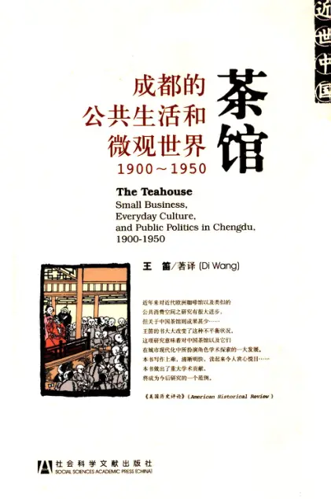

# 元数据

> [!abstract] 茶馆：成都的公共空间与微观世界
> - 
> - 书名：茶馆：成都的公共空间与微观世界
> - 阅读进度：0%
> - 阅读时长：0分钟
> - 最后阅读：2026-09-06
> - 微信读书：https://weread.qq.com/book-detail?type=1&v=f8842143643425f366a4c315848315959476c6836796a367777353349415369472

# 高亮划线

> 这本书目前没有个人划线。
