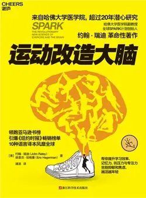

# 元数据

> [!abstract] 运动改造大脑：动起来能解决你99%的内耗
> - 
> - 书名：运动改造大脑：动起来能解决你99%的内耗
> - 作者：[美]约翰·瑞迪
埃里克·哈格曼
> - 译者：浦溶
> - 简介：运动不只是瘦身手段，更是重塑大脑的科学路径。哈佛大学教授约翰・瑞迪以 20 年研究证实，运动可激活 BDNF（脑源性神经营养因子），修复神经连接，提升专注力与情绪调控力。​
>   沙溢的蜕变是鲜活例证：从体脂 25% 的 “中年油腻” 到 15% 的健硕体态，他用 HIIT 训练、马拉松接力践行书中理念，坦言 “运动让大脑更清醒，戏路都宽了”。其 “碎片化健身”（通勤骑车、片场间隙训练），完美诠释书中 “运动融入日常” 的智慧。​
> - 出版时间：2023-05-30 00:00:00
> - ISBN：9787573906106
> - 分类：生活百科-体育
> - 出版社：浙江科学技术出版社
> - 微信读书评分：82%
> - 阅读进度：0%
> - 阅读时长：30分钟
> - 最后阅读：2026-11-17
> - 微信读书：https://weread.qq.com/book-detail?type=1&v=1f4326e0813ab7e0fg0167ca

# 高亮划线

## 中文版序 运动改变世界

> 📌 我给超过12万人做过160多场有关运动益处的演讲，听众中包括颇有影响力的教育家、政府官员、健康专业人士、保险公司人员、首席执行官(CEO)、企业员工以及健身团体的成员。
> ⏱ 2026-11-17 05:01:59
> 💭 我看外国人的书好多次看到这种介绍了，什么早起、微习惯、原则啥的，说得好像都很有用😂😂
> 🕰 2026-11-17 05:02:25
> 💭 有点害怕了，感觉很像成功学讲师的开场白
> 🕰 2026-11-17 05:02:21

> 📌 与此同时，《运动改造大脑》还进一步证明，在治疗轻度和中度抑郁与无助感方面，运动的效果和抗抑郁药一样好。
> ⏱ 2026-11-17 05:02:38

> 📌 玩耍和运动有助于儿童的情绪发展，有助于改善孩子的成绩和考试分数，能让他们的认知获得最优的发展
> ⏱ 2026-11-17 05:02:56
> 💭 在中国认为玩就是剥脱了学习的时间，只有拼命学才能提高成绩，看大部分孩子上小学以后就开始两眼无神，眼神里全是空洞的感觉
> 🕰 2026-11-17 05:03:12

### 从美国走向全球

> 📌 在韩国，教育部将学生每天的在校时间增加了1小时，其中50%以上的时间被用于身体锻炼和体育运动，同时还设立了38个BOKS项目。
> ⏱ 2026-11-17 05:03:46
> 💭 在中国，任何课业跟不上，第一个被砍掉的就是体育课，学校食堂也难吃，觉也不让睡，然而这三件事对于青少年来说确实最要紧的事，有些学校不仅在妨碍学生智力发育，还在妨碍学生身体发育。
> 🕰 2026-11-17 05:04:13

> 📌 《运动改造大脑》提出的理念在日本同样很受欢迎。在两次访问日本期间，我拜会了日本的教育部副部长，并在各大中小学巡回演讲。
> ⏱ 2026-11-17 05:04:28
> 💭 在日本应该称为省吧
> 🕰 2026-11-17 05:04:55
> 💭 对的，应该是“文部省”
> 🕰 2026-11-17 05:04:48

> 📌 锐步公司还改变了它的营销策略，不再展示耀眼的体育明星，而鼓励普通人把身体变得更强壮。
> ⏱ 2026-11-17 05:05:38

> 📌 撒撒野，将你的身体与心灵从文明的束缚中解放出来。
> ⏱ 2026-11-17 05:05:23
> 💭 不必时刻局限在文明之中，想到了前段时间很流行的“鳄鱼爬”，让身体放松舒展不在意其他人的眼光，心灵也会随之而来得到解放。
> 🕰 2026-11-17 05:05:33

## 前言 运动，重新建立身心联结

> 📌 众所周知，运动让我们更健康，但大多数人都不知道其中的原委。我们仅仅认为运动释放了压力、降低了肌肉张力，或者增加了内啡肽(endorphin)。其实，我们血脉偾张时令我们心情愉快的真正原因是：运动使我们的大脑处于最佳状态。
> ⏱ 2026-11-17 05:06:15
> 💭 每次无聊不想学习时，就会运动，以前喜欢跑步，现在喜欢跳操，虽然不太能跟上节奏，但是运动之后，身体微微出汗，头脑清晰，动力十足。而反观窝在沙发上看手机，刷着短视频，脑袋空空，思绪满天飞。随着大把大把的时间飞逝，带来的又是自责！所以无聊就动起来，没事就动起来，动起来，活下去。
> 🕰 2026-11-17 05:06:38
> 💭 真实了
>
> 不由想到一句话印象深刻
>
> 不知道干什么，迷茫焦虑时，坚持做大概率正确的事，读书，运动
> 🕰 2026-11-17 05:06:32

> 📌 强健肌肉和增强心肺功能只是运动最基本的作用，运动最关键的作用是强健或改善大脑。
> ⏱ 2026-11-17 05:05:52

### 人类天生就要动

> 📌 久坐不动的现代生活方式破坏了我们的本性，而且成为我们长期生存的最大威胁之一。
> ⏱ 2026-11-17 05:16:32
> 💭 人，食物，体力，智慧四者的关系
>
> 人需要食物生存；人类刚开始获取食物需要有良好的体力，而良好的体力又来源于运动，运动促进前额叶的发展，而前额叶又能更好的提升人的梦想，计划以及创造社会的能力；为了长期生存下去，人们必须运用智慧寻找和储存食物。所以说体力和智慧是人类祖先为了生存的两家马车。
>
> 现在的我们久坐不动，或许也跟人的基因有关，避免耗能，但这就出现了各种各样的问题，如肥胖，抑郁症等。
> 🕰 2026-11-17 05:16:44

> 📌 过去，糖尿病几乎就是中年人的噩梦，现今它已开始成为儿童的梦魇。
> ⏱ 2026-11-17 05:16:55
> 💭 图一时的多巴胺刺激，用一生吃药、控食去对抗
> 🕰 2026-11-17 05:17:11

### 身、心、大脑的联系

> 📌 我们的文化把思想和肉体一分之二，而我却想把它们重新联系在一起。
> ⏱ 2026-11-17 05:17:31

> 📌 仅在过去的5年里[插图]，神经学家的研究成果已经描绘出了身体、大脑和精神之间生物学关系的精彩画面。
> ⏱ 2026-11-17 05:19:35
> 💭 全书描述的时间均以该书2008年的出版时间为基准。——编者注
> 🕰 2026-11-17 05:19:40

> 📌 内啡肽(endorphin)一种由身体和大脑产生的激素，它就像是天然的吗啡。当身体和大脑负荷过重时，内啡肽就会被释放出来，以阻止疼痛信号。
> ⏱ 2026-11-17 05:17:21

> 📌 运动可提高体内血清素(serotonin)、去甲肾上腺素(norepinephr-ine)和多巴胺(dopamine)的水平，它们都是传递思维和情感的重要神经递质
> ⏱ 2026-11-17 05:17:57

> 📌 他们既不了解压力的毒性水平会破坏大脑中几十亿个神经细胞之间的连接，也不了解慢性抑郁症会缩小脑部一些特定的区域。
> ⏱ 2026-11-17 05:17:55

> 📌 大脑内的每个神经元（也称神经细胞）通过树状分支上的“叶片”相互接触，而运动则可以促进这些分支生长并发出许多侧支，因此能从根本上增强大脑的功能。
> ⏱ 2026-11-17 05:18:03
> 💭 笑死我了 还能这么解读 世界模型预演也是喽
> 🕰 2026-11-17 05:18:38
> 💭 喜洋洋与灰太狼是写实派，怪不得每次喜羊羊每次遇到困难需要做几个动作才能想到解决方法，一开始我还以为是为了耍帅。
> 🕰 2026-11-17 05:18:30

> 📌 肌肉运动产生的蛋白质经血液运送到大脑，这些蛋白质在我们最伟大的思考机制中发挥关键性作用。
> ⏱ 2026-11-17 05:18:53

### 运动让大脑保持最佳状态

> 📌 假如你一直不停地对自己说锻炼是你喜欢的事，做到这一点，你就正在为通往那个与众不同的未来开辟一条道路。那将是一个生机盎然的未来，而不是只求生存的未来。
> ⏱ 2026-11-17 05:20:05
> 💭 我从小就不喜欢运动，但我喜欢走路，我知道运动很重要，我就挖掘我喜欢的什么可以促进我更好的运动，我喜欢走路，那我喜欢室外大自然的清新空气，我喜欢自己独处安静的时光，那就早上趁娃还在睡，早点起来楼下快走，我喜欢青草香，喜欢大树，那就去公园快走。
>
> 但是就走路，强度不够，我喜欢身体轻盈的感觉，我喜欢运动后，第二天起来，感觉肌肉里有股力量需要释放的感觉，尽量让自己多动，多体验到这些美好的感觉。多多挖掘喜欢的感觉，就能更好的坚持运动了吧！进入正循环。
> 🕰 2026-11-17 05:20:48

### 运动是最佳的健脑丸

> 📌 在伊利诺伊州的内珀维尔(Naperville)，体育课让这个地区1.9万名学生成了全美国体质最强健的孩子，二年级学生中只有3%的学生体重超标，而全美国平均有30%的学生体重超标。
> ⏱ 2026-11-17 05:21:35
> 💭 1. ​​为什么“体育课”能迅速改变学生体质​​
>
> 内珀维尔学区把体育课定位为“学习准备课程”，而非传统竞技训练。学生每天上学前都能选择攀岩、皮划艇、绳索课程、重量训练、舞蹈等多种高强度活动，并在教师监控下达到个人心肺与力量目标。持续的有氧与力量锻炼显著提高了基础代谢率，使多余体脂被动员利用，从而把二年级学生的超重率压到 ​​3%​​，远低于全国平均的 ​​30%​​。
>
> 2. ​​体质提升背后的大脑科学机制​​
>
> 哈佛大学约翰·瑞迪团队的 ​​20 年研究​​表明，规律运动会激活 ​​BDNF​​（脑源性神经营养因子），这种“大脑的肥料”能够修复神经连接、提高突触可塑性，从而同步提升专注力、情绪调控力与学习效率。因此，当学生拥有更强的心肺、肌肉与灵敏度时，他们的大脑也同步受益，表现为更高的警觉度、更快的信息处理和更好的执行功能。
>
> 3. ​​从数据到启示：一所学校能做到，全国为何不能​​
>
> 1. ​​“零点体育课”模式​​——让学生在正式上课前完成 ​​10–20 分钟的高强度运动​​，可迅速唤醒神经系统，提高课堂专注度。
>
> 2. ​​课程多样化​​——攀岩、皮划艇、舞蹈等远比单调的跑步更能刺激大肌肉群与前庭系统，帮助不同天赋与兴趣的学生找到热爱的运动。
>
> 3. ​​监测与反馈​​——学区对 ​​19 000 名学生​​进行年度体能测评，把结果公开并与教学挂钩，形成持续改进的闭环。
>
> 4. ​​教师与家长协同​​——体育老师、普通学科教师以及家长共同设计课内外运动计划，保证每天 ​​60 分钟以上​​的中高强度活动。
>
> 4. ​​对家庭、学校与公共政策的借鉴意义​​
>
> • ​​家庭​​：把运动当作“第一作业”而非“课余消遣”。通勤骑车、课间跳绳、周末户外探险都能为孩子的大脑持续“充电”。
>
> • ​​学校​​：可先在晨间或课后延时服务中试点 ​​15 分钟高强度课程​​；借助公益组织或高校体育专业学生提供师资补充。
>
> • ​​公共政策​​：将学校体育课时、体能监测与学业质量挂钩；在社区配建向学生开放的健身与户外活动空间，降低家庭参与成本。
>
> 5. ​​结论​​
>
> 内珀维尔的故事证明：当体育课被认真当作“学习准备”而非“副科”，学生的体脂率、体能指标和学术表现会同步跃升。运动改造大脑并非一句口号，而是一条经过科学验证、可复制推广的教育新路径。一所城市能做到，其他国家与地区同样可以借由合理设计的体育课程，让孩子们在更强健的体魄与更清醒的头脑中收获成长
>
> 摘自AI问书
> 🕰 2026-11-17 05:22:13

> 📌 中国香港、台湾地区以及日本和新加坡的学生在这些重要学科上的成绩已经赶超了美国学生，不过内珀维尔的学生显然是个例外。他们在TIMSS数学测试中获得第六名，而在科学测试中则获得第一名
> ⏱ 2026-11-17 05:22:45
> 💭 中国和华裔的人，确实擅长理科项目。这可能和传统文化有关。希望有相关的研究让我们了解原因。
> 🕰 2026-11-17 05:22:50

## 引言 不一样的体育课

> 📌 在这个凉爽的十月清晨，天空飘着几朵白云，学生们排着松散的队伍来到跑道上。一场变革的最佳条件已经具备了！
> ⏱ 2026-11-17 05:23:28

### “零点体育课”

> 📌 零点体育课(Zero Hours PE)一种通过运动提升学生意识状态，为一天学习做好准备的新型体育课。该课程因被安排在第一节文化课之前而得名。
> ⏱ 2026-11-17 05:24:07
> 💭 这不就是大家最熟悉的早操吗，zero hour翻译成0点有点歧义，会让读者误会是0点爬起来运动。其实zero hour最早是军事行动中开始的时刻，例如定了某某时刻进攻，负责的军官紧盯着手表的秒针倒数计时：3-2-1-0，一旦走到0就开始进攻指令。后来zero hour也引申为关键时刻、决定性时刻。
> 🕰 2026-11-17 05:24:23

> 📌 正常成年人安静时的心率有显著个体差异，平均在75次/分钟左右（60~100次/分钟）。
> ⏱ 2026-11-17 05:24:54

> 📌 “除了要早起床、满身大汗和狼狈不雅之外，我觉得一整天都更清醒了。我的意思是，去年我从早到晚都迷迷糊糊的。”
> ⏱ 2026-11-17 05:25:17
> 💭 这个是真的，我早上只要不是做剧烈的有氧（比如跑步），力量训练配上爬坡，一整天大脑非常清醒，白天几乎不会打盹，感觉在运动上的时间投资回报比真的超级高
> 🕰 2026-11-17 05:26:42

> 📌 除了情绪有所改善之外，事实还证明，米歇尔的阅读能力也有了提高，而零点体育课的其他学生也是如此：到上半学期结束时，他们的阅读和理解能力提高了17%；与喜欢睡觉及参加标准体育课的学生相比，他们的阅读和理解能力提高了10.7%。
> ⏱ 2026-11-17 05:26:52
> 💭 我近几天也改成了早晨起床跑步2.5公里的习惯，早晨跑步使自己更容光焕发，而不是到晚上再跑一圈缓解缓解精神
> 🕰 2026-11-17 05:27:06

> 📌 所有上读写能力课的学生被分成两个班：一个班的读写能力课安排在第二节课上，那时学生们还能感受到运动带来的效果；而另一个班则被安排在第八节课上。正如人们所料，第二节上读写能力课的学生的学习效果最佳
> ⏱ 2026-11-17 05:25:54

### 一流的表现

> 📌 零点体育课不再是内珀维尔203学区独享的体育教学方式，它得到了全美国的关注，而且逐渐成为一种体育课的新模式。我猜任何读到这里的成年人可能都觉得，这根本不是体育课。没有一个学生会被躲避球[插图]打到、会因没有淋浴而不及格、会整日担心自己成为最后一名。
> ⏱ 2026-11-17 05:28:11
> 💭 躲避球，一种起源于英国并在美国盛行的球类运动，比赛的目的是掷球攻击对方的内场球员。
> 🕰 2026-11-17 05:28:20

> 📌 教育学家认为，每个学生都有成功的潜能。尽管203学区在每一个学生身上投入的费用要明显低于伊利诺伊州其他顶级公立学校的费用，但是在学术方面，203学区始终位于伊利诺伊州十佳学校排行榜上。
> ⏱ 2026-11-17 05:29:53
> 💭 这个跟学校所具有的资源不同 具有的老师水平不同 一所学校里面的老师都是优质教师。即使这所没有按照运动方面去培养学生 学生的成绩依然会优于其他学校 书中例子举的有失偏颇 过于单一 不具备可信力
> 🕰 2026-11-17 05:30:09

> 📌 显然，内珀维尔203学区在生源构成上占据优势：83%是白种人，而且低收入人群只占到2.6%。与之相比，整个伊利诺伊州的低收入人群占到40%，内珀维尔两所高中引以为豪的便是其97%的毕业率。
> ⏱ 2026-11-17 05:30:58
> 💭 在美国人的心理图式中白人的智力要高于黑人，高收入人群子女的智力要高于低收入人群子女。
> 🕰 2026-11-17 05:31:32
> 💭 那其实这才是主因。不过运动应该是有效果的，只是没那么神。
> 🕰 2026-11-17 05:31:24

> 📌 落户这座城市的雇主都是一些像美国阿贡国家实验室、费米国家加速器实验室以及朗讯科技之类的科技型公司，这说明许多内珀维尔学生的父母都受过高等教育。无论从环境还是遗传来看，内珀维尔的学生都拥有很大的优势。
> ⏱ 2026-11-17 05:31:59
> 💭 基因优势+环境优势，保障上层社会精英群体的子女依然处于上层社会，这是残酷的现实，很少有研究报告揭露。
> 🕰 2026-11-17 05:32:30
> 💭 有种看了半天白看了的感觉
> 🕰 2026-11-17 05:32:21
> 💭 和钞能力没关系，和家庭教育水平有很大关系。前面说了芝加哥北岸富豪区学校的联合团体表现也很一般。
> 🕰 2026-11-17 05:32:16

> 📌 我确信，影响学生学业成绩至关重要的因素是学校对健康体能的重视，这同样也是内珀维尔吸引我的地方。
> ⏱ 2026-11-17 05:32:49
> 💭 是的，运动能使人神清气爽，一整天都精神饱满，注意力集中，整个人的心情也很愉悦！
> 🕰 2026-11-17 05:33:08
> 💭 的确，健康体能在精力、注意力、记忆力、耐力上都有优势
> 🕰 2026-11-17 05:33:01

### 尽全力比跑得快更重要

> 📌 他们看到多数学生不爱运动。这在团队运动中是很自然的：打棒球时，等待轮流击球；打橄榄球时，等待中锋的快速传球；踢足球时，等待球传到脚下。绝大部分球员在大多数时候只是站在场内。
> ⏱ 2026-11-17 05:35:37
> 💭 踢足球时，等着对手进球。——国足
> 🕰 2026-11-17 05:35:47

> 📌 为了让不擅长运动的人有机会获得好成绩，体育组购买了两台健身自行车，允许学生通过骑自行车来获取额外的学分。学生们可以利用自己的业余时间参与，只要骑车8000米就可以提升他们的学分等级。
> ⏱ 2026-11-17 05:34:39
> 💭 这就像现在的大学里可以通过“星光跑”/“校园跑”这样的手段来弥补体测中失去的分数，进而在体育课上取得一个好成绩。
> 🕰 2026-11-17 05:34:54

> 📌 劳勒把这种教学方式称为“新体育教育”(New PE)：给学生打分的依据是其努力的程度，而不是技能。在体育课上，你不必像一个天才运动员那样出色。
> ⏱ 2026-11-17 05:34:20

> 📌 劳勒在他每年春季组织的体育教育会议上找到了答案。他努力把这个会议变成新思想和新技术的交流盛会。
> ⏱ 2026-11-17 05:36:23

> 📌 “我一看到那东西，”他很坦率地承认，“就觉得它是麦迪逊中学的奖品。”
> ⏱ 2026-11-17 05:37:18
> 💭 这句话出自菲尔·劳勒的回忆。作为一名长期在麦迪逊中学（Madison Junior High）任教的体育教师，他每年春天都会在学区的体育教育会议上展示最新设备和创意，用来激励同事和学生。会议开始时，他推着一辆“放毛巾的推车”，车上堆满球、球拍等各种运动器材；有一年，车上多了一台价值数百美元的新型心率监测仪——这在当时可是相当高端、少见的装备。
>
> 劳勒一看到它，就直觉地把它当成“麦迪逊中学的奖品”，意思是：这东西太酷、太先进，正好用来奖励我们学校最出色的学生或教师，让它成为象征荣誉的纪念品。
>
> 这句话包含三层含义：
>
> 1. ​​惊喜与渴望​​：心率监测仪在当时属于“稀罕物”，能获得一台是难得的机会，体现了劳勒对高科技教学工具的惊喜和渴望。
>
> 2. ​​激励思路​​：他立即联想到用它来做“奖品”，把最能体现努力和进步的学生或教师选拔出来，用实物奖励强化正向行为，这与麦迪逊中学“新体育教育”强调的“以努力而非技能评分”理念一致。
>
> 3. ​​象征意义​​：在劳勒眼里，这台心率监测仪不仅是一台仪器，更是学校创新精神和荣誉体系的象征——它标志着麦迪逊中学愿意为推动运动与学术并重的改革买单，也向外界展示学校对体育教育的重视。
>
> 因此，这句话既流露出一位一线教师对先进工具的兴奋，也折射出麦迪逊中学在体育教学改革中“用奖励驱动参与”的教育策略，以及学校希望通过高科技手段树立榜样、带动全体学生积极运动的深远用意。
>
> 摘自AI问书
> 🕰 2026-11-17 05:37:33

> 📌 心率监测仪是所有的起点。我开始重新考虑那些学生，那些没有受到我们肯定而对运动失去兴趣的学生。尽管我的班上没有一名运动员，但所有学生都知道如何像那个小女孩一样努力。”
> ⏱ 2026-11-17 05:36:10

### 义无反顾的理想

> 📌 人在运动过程中会提高一种叫作脑源性神经营养因子(brain-derived neurotrophic factor，BDNF)的蛋白质的含量，我称它为“大脑的优质营养肥料”。
> ⏱ 2026-11-17 05:40:18
> 💭 睡眠与冥想也会提高BDNF的含量，它不仅是大脑的养料，还直接作用到了海马体（增强学习能力和记忆力）、前额叶皮质（情绪平稳，注意力维持维持能力提高）、边缘系统（减轻压力，缓解焦虑与抑郁）、运动皮层和小脑（运动技能学习与身体控制能力提高）。可以说BDNF是认知进化的发动机，也是提升大脑性能最值得投资的生理杠杆
> 🕰 2026-11-17 05:41:25
> 💭 你肯定是自我逆反，逆反型人格，禁止什么偏要干什么。所以反向自律法就很适合你。
> 🕰 2026-11-17 05:41:00
> 💭 我散步的启动键是跑步，每次晨跑都坚定的告诉自己一定不要跑，要慢慢的走，结果走着走着就想跑起来，跑着跑着就冲刺。那种上气不接下气，心脏快要跳出来，胸膛火辣辣的痛感，就觉得特别的爽，畅快。
>
> 然后第二天再告诉自己，今天绝不能跑😄😄😄
> 🕰 2026-11-17 05:40:55

> 📌 “我们体育老师创造了这些脑细胞，”保罗说，“而其他老师则负责让它们更丰满。”
> ⏱ 2026-11-17 05:39:45
> 💭 “你的数学是体育老师教的吧？”这种梗让体育老师常年背着“头脑简单”的锅，是时候给体育课和体育老师平反了。😂😂😂
> 🕰 2026-11-17 05:40:09

### 四肢很发达，头脑不简单

> 📌 四肢很发达，头脑不简单
> ⏱ 2026-11-17 05:42:02

> 📌 在过去5年，加州教育局的调研结果表明，体能成绩好的学生考试成绩也同样好。
> ⏱ 2026-11-17 05:42:45
> 💭 同理 体能好的人业绩也差不了。事实上 没有体能 长时间高强度的工作会将人压垮。
> 🕰 2026-11-17 05:43:04

> 📌 虽然父母可能无法立刻改善家庭的经济状况，但鼓励孩子保持健康体能的生活方式可以让他们有机会获得好成绩。
> ⏱ 2026-11-17 05:43:10
> 💭 阅读与运动是终身需要做的事情
> 🕰 2026-11-17 05:43:23

# 章节点评与书评

## 读书笔记

运动改造大脑：从神经科学角度看运动的革命性力量当我们谈及精神健康、学习能力和幸福感，许多人首先想到的是食物、环境、药物和社交。然而，约翰·瑞迪在《运动改造大脑》中为我们揭示了一个被忽视的重要因素——运动。这本书不仅为理解运动提供了一种全新的视角，还通过大量的研究和案例，证明了运动与大脑之间的紧密联系。

瑞迪博士以深入浅出的方式，带领读者走进神经科学的殿堂。他详细解释了为什么运动能够促进大脑的发育，提升大脑的功能。其中最令人印象深刻的是，他提到了脑源性神经营养因子（BDNF）。这是一种被誉为“大脑的优质营养肥料”的物质，它在运动后大量释放，能为大脑制造替换零件，诱发神经新生，有助于神经元的生长和连接。

这不仅为学校和家长提供了让孩子在体育课中锻炼后更好地学习的有力证据，也提醒我们，任何形式的运动都可以成为大脑的“养分”。

有氧运动和复杂活动对大脑产生各自不同的有益影响，它们之间是互补的。复杂运动能够建立突触的联系，即使这些神经回路是在运动中建立的，在思考时，它们也能被其他区域激活利用。

有氧运动能够释放更多的血液、氧气和营养物质到大脑，从而巩固大脑细胞间的连接、产生更多突触来扩大神经网络、刺激海马体新生的干细胞分化形成功能性神经元，为大脑创造了良好的学习环境。

中等强度的运动能够激活大脑细胞内代谢清理小组的行动，它们会产生清除自由基、DNA碎片和炎症因子的蛋白质和酶，控制这些有害物质对细胞的破坏。同时，生活在有更多感官刺激和社会化刺激的环境中的动物，其大脑结构和功能以及学习能力都会有所提升。

这不仅对孩子们的学习具有重要意义，也为成年人提供了保持和提高认知能力的有效途径。

由此可知，运动对大脑衰老的影响是多方面的：

首先，运动能够让大脑保持最佳状态，防止大脑功能退化。这是因为运动可以改善大脑内所有重要的化学物质，提高脑源性神经营养因子（BDNF）的含量，为大脑制造替换零件，诱发神经新生。

其次，有氧运动能巩固大脑细胞间的连接、产生更多突触来扩大神经网络、刺激海马体新生的干细胞分化形成功能性神经元，为大脑创造了良好的学习环境。这表明运动可以延缓大脑衰老，提高学习效率。

此外，中等强度的运动能够激活大脑细胞内代谢清理小组的行动，它们会产生清除自由基、DNA碎片和炎症因子的蛋白质和酶。这有助于控制这些有害物质对细胞的破坏，从而延缓大脑衰老。

在情绪和心理健康方面，运动同样展现出其无可替代的价值：

内啡肽和多巴胺等快乐激素在运动后的释放，不仅可以改善我们的心情，还能有效缓解焦虑和抑郁。实验证明，较之传统的心理和药物治疗，运动疗法具有许多无可比拟的优势。对于那些长期处于高压和焦虑状态的人们来说，这无疑是一个福音。

瑞迪博士还强调了运动对身体和大脑之间的协调性的积极影响。这不仅关乎身体的健康，更关乎一个人的自我意识和自信心。通过运动，我们可以塑造积极的身体形象，提高自尊和自爱。这一点对于青少年尤为重要，因为在他们的成长过程中，身体的形象和自我认知往往受到周围环境的影响。

此外，《运动改造大脑（新版）》还深入探讨了运动对创造力和创新力的促进作用。在如今这个快速变化的时代，创造力已成为个人和组织的核心竞争力。而运动正是激发这一潜能的有效途径。它能够打破常规思维模式，帮助我们寻找新的解决方案和创意。

当然，对这本书也并非一片赞誉之声。一些读者认为瑞迪过于强调运动的积极作用，而忽略了某些人可能因为过度运动而导致的健康问题等等。但总体来说，这并不影响《运动改造大脑（新版）》作为一本极具启发性和实用性的健脑指南的地位。

《运动改造大脑》一书的独特之处主要体现在以下几个方面：

科学性与通俗性的结合：本书作者约翰·瑞迪博士是一位哈佛大学医学院的教授，他将自己多年的研究成果和前沿的学术知识融入到了这本书中。同时，他以通俗易懂的方式将这些知识呈现出来，使得普通读者也能轻松理解。

颠覆传统认知：在传统观念中，运动往往被视为锻炼身体的一种方式，而很少有人认识到运动对大脑的改造作用。瑞迪博士通过大量的科学研究和案例，证明了运动不仅对身体健康有益，更能改造和提升大脑的功能。

强调运动的综合效益：瑞迪博士不仅关注运动对大脑的直接影响，还深入探讨了运动如何改善情绪、缓解焦虑和抑郁等心理问题，以及如何提高学习力和记忆力等认知能力。这种综合性的观点为读者提供了全面的了解和改善健康的方法。

实用性和指导性强：除了理论阐述，瑞迪博士还为读者提供了很多实用的建议，如如何选择适合自己的运动、如何确定运动强度、如何循序渐进地进行锻炼等。这些建议对于想要通过运动改善自己和家人健康的人来说，具有很高的指导价值。

案例丰富，说服力强：书中引用了大量的真实案例和科学研究，使得内容更具说服力。通过这些案例，读者可以更直观地了解运动对大脑的改造效果，也可以从中获取更多的信息和启示。

总之，约翰·瑞迪的《运动改造大脑（新版）》为我们提供了一个全新的视角来看待运动。它不仅证明了运动与大脑之间的紧密联系，还深入探讨了运动如何改善认知能力、情绪和心理健康以及创造力和创新力。这本书不仅适合家长和教育工作者阅读，也值得每一个关心自己和家人健康的人高度关注。

> 记录于 2026-11-17 05:01:01
