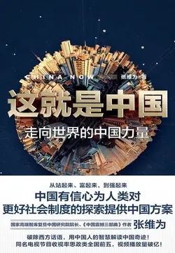

# 元数据

> [!abstract] 这就是中国：走向世界的中国力量
> - 
> - 书名：这就是中国：走向世界的中国力量
> - 作者：张维为
> - 简介：中国特色社会主义进入新时代，意味着中国模式拓展了发展中国家走向现代化的途径，给世界上那些既希望加快发展又希望保持自身独立性的国家和民族提供了全新选择，为解决人类问题贡献了中国智慧和中国方案。如何用中国智慧建构一套有解释力的话语？在本书中，张维为教授结合自身经历，从国内外热点、难点问题切入，将互联网思维融入中国话语体系，以生动鲜活的热点问题为切入口，建构出了一套政治领域的“中国标准”。从站起来、富起来，到强起来，中国有信心为人类对更好社会制度的探索提供中国方案。在中国精神、中国价值、中国定力的分析框架下，张维为教授用脍炙人口的观点、深入浅出的语言风格，建立了一套原创性极强的话语体系，既激发了受众读者的爱国情、强国志、报国行，更是以一种宽广的世界眼光、博大的人类情怀，为建设人类命运共同体提供了中国人的判断。
> - 出版时间：2019-08-01 00:00:00
> - ISBN：9787208159792
> - 分类：政治军事-政治
> - 出版社：上海人民出版社
> - 微信读书评分：86%
> - 阅读进度：0%
> - 阅读时长：6分钟
> - 最后阅读：2026-11-10
> - 微信读书：https://weread.qq.com/book-detail?type=1&v=f9e329c071906d4df9e1536

# 高亮划线

### 四大“超级因素”

> 📌 之后的中国，虽然经历了多次分裂，但历代的主流政治都寻求统一，之后的历代政治制度几乎都可追溯到秦汉时期，正如毛泽东所说，“百代都行秦政制”。中国“大一统”的传统自秦统一之后就一脉相承。
> ⏱ 2026-11-10 16:14:01
> 💭 所以说秦朝是一个伟大的朝代，秦朝的短命和秦始皇的暴政也掩盖不了其深远的影响。郡县制，古人思想也太超前了。所谓的暴政，一是后世其他亡国贵族的渲染。二是秦国对于大一统缺乏治理经验。秦始皇一生勤政，死也是在工作的路上。他真的一生在探索一个好制度建立千秋万世的国家。
> 🕰 2026-11-10 16:14:31

> 📌 中国超广阔的疆域国土是个“洲”的概念，就是飞机飞三个多小时，在欧洲已经飞过十几个国家，在中国却还在一个国家里边，还是讲中国话，吃中国菜，享受丰富多彩的中国文化，这是少有的精彩。
> ⏱ 2026-11-10 16:12:55
> 💭 记得看到一本写抗战的书，日本艰难打下了中国东边，往中部进军打到湖南边境时感慨了好一阵：妈呀，这越往内陆打抵抗强，重要的是打了下这么多城市，他妈的还是中国的领土，打到什么时候是个头啊！当然这是嘲讽小日本的，也从侧面说明了中国民众抗战的决心和国土战略纵深的先天优势
> 🕰 2026-11-10 16:13:47
> 💭 之前看《万古江河》许倬云老师也提到了，中国的发展其实就是一个消化和容纳的过程。这也使得中国不能照搬外国的体制，而是要走一条有中国特色的中国体制。
> 🕰 2026-11-10 16:13:06

> 📌 由于人口众多、地域广大、环境复杂等，中国人在治国理政方面形成了自己独特的传统。中国古代的治国理念就突出“民惟邦本，本固邦宁”“民以食为天”“治国先治吏”“居安思危”“宰相必起于州部，猛将必发于卒伍”等理念
> ⏱ 2026-11-09 23:22:34

> 📌 早在春秋战国时期，由血缘出身决定的土地垄断就被摧毁，这推动了土地的自由流转，但这导致了土地兼并、贫富两极分化的问题，所以历史上的许多朝廷都采取“常平仓”来储粮备荒，也就是运用价值规律，调剂粮食供应，稳定粮价。在粮价低的时候，进行收购，在粮价高的时候，适当降低价格出售粮食，以避免“谷贱伤农”，同时避免“谷贵伤民”
> ⏱ 2026-11-10 16:36:28
> 💭 早在春秋战国时期，我们就玩过贵族制了，什么公、候、伯、子、男，什么王公贵族。西方到现在还把这当宝贝供着，一些慕洋犬更是觉得看人家还有贵族，多稀罕啊！估计羡慕西方贵族的人，多半是目前社会地位或者经济条件不错的人，想把自己的社会地位千秋万代固化下来，好享受某些贵族特权吧。
> 🕰 2026-11-10 16:37:08

> 📌 第四，超深厚的文化积淀。
> ⏱ 2026-11-10 16:37:32

> 📌 中华民族在五千年绵延不断的文明历史进程中，创造了气势恢宏、内涵丰富、绵延不断的文化成就。这些成就包括中国人崇尚“天人合一”和整体主义，包括儒、道、释互补，儒、法、墨共存。这对于今天这个充满宗教冲突和对抗的世界仍有启发意义。
> ⏱ 2026-11-10 16:37:39
> 💭 中国从来没有发生过宗教战争，这可能也得益于秦始皇开创的大一统局面。如果中华大地上始终保持春秋战国形态，这些国家中又出现了几个宗教国家，难保之后会不会发生宗教战争。伊斯兰教和基督教没有过早传入中国并广泛流行可能也是一个因素。
> 🕰 2026-11-10 16:38:38
> 💭 所以这些经典必须好好读呀，不如就作为今年的主题吧，历史知识经过了两年的系统补充得到了很大的进步，那接下来的一年半就留给这些思想经典吧
> 🕰 2026-11-10 16:38:26

> 📌 截下任何一个历史断面，都可以开发出无数的题材和故事。这些都是包括好莱坞在内的西方影视文化所难以企及的，2018年中国电影票房国产片再次超越进口大片，有人说，“家国情怀燃了，现实主义火了，新锐导演热了”。
> ⏱ 2026-11-10 16:39:12
> 💭 这个我很早之前就想说，中国这么多年历史，真的有无数好剧本。而美国没有多久历史，好莱坞拍的电影大多数是虚构。漫威的电影看多了就没意思了，都是一个模子。
> 🕰 2026-11-10 16:39:23

> 📌 “文明型国家”既是一个国家，又是“百国之和”。
> ⏱ 2026-11-10 16:39:43
> 💭 同根同源的不同民族凝聚力和向心力，是美国那种东拼西凑全球种族之巢所无法比拟的。人之所以为人，是有文化认同感和民族归属感的。
> 🕰 2026-11-10 16:39:56

> 📌 如果中国放弃中国模式，转而照搬西方模式，中国自己“文明型国家”的优势恐怕就会消失得无踪无影，中国“文明型国家”的最大优势也可能会变成自己的最大劣势：“百国之和”变成“百国之异”，强调共识的政治变成强调对抗的政治。“百国之和”的人口将成为中国混乱动荡的温床，“百国之和”的疆土将成为四分五裂的土地，“百国之和”的传统将成为无数纷争和对抗的借口，“百国之和”的文化将成为不同文化族群大规模冲突的根源。
> ⏱ 2026-11-10 16:40:17
> 💭 所以对于美国的各种颜色革命和伪意识形态，腐朽价值观的输出要坚决抵制，不给其生根发芽的机会，如果有苗头要坚决消灭，绝不能让香港事件再次重演。
> 🕰 2026-11-10 16:40:29

### “文明型国家”崛起的历史基因

> 📌 一切在于比较，没有绝对的好，只是相对而言历史上的中国更加先进。就像今天，我讲中国成功，也是比较世界上绝大多数国家，中国干得更好，虽然实际上中国还可以做得更好。
> ⏱ 2026-11-10 17:13:17
> 💭 不自以为是，不自叹不如，实事求是，不卑不亢。一国需如此，为人亦如此。
> 🕰 2026-11-10 17:13:27

> 📌 在此之外，我们的先哲还提出许多民本、民富的具体政策。比方说，孔子及其弟子一直主张轻徭薄赋，重视农业和民生
> ⏱ 2026-11-10 17:12:10

> 📌 这些思想在17—18世纪传到欧洲，给欧洲的人文学者和统治者都带来了震撼，欧洲大经济学家魁奈（Quesnay）主张学习中国的重农政策和土地政策，法国和奥地利的国王也模仿中国皇帝在天坛举行亲耕仪式。
> ⏱ 2026-11-10 17:11:27
> 💭 一个问题，中国和土耳其埃及对于西方的影响相比谁更多？我不认为前者对后者有什么信息传递上的优势？文中说，这些思想是17-18世纪传入欧洲，也就是中国的清朝年间，彼时西方的航海技术已经成熟并在15世纪就开始了殖民扩张，而且郑和也已经下过西洋了，所以传播起来应该不难
> 🕰 2026-11-10 17:12:33

> 📌 拿破仑曾说过，权力背后总有某种不安，今天这种不安是否变得更强烈了，因为整个世界似乎都充满了某种不确定？
> ⏱ 2026-11-10 17:13:37
> 💭 我觉得他们的这种不安 来自于害怕 纵观历史 欧洲的发展离不开战争 他们发达是仗着赚了战争的钱 中国不一样 我们自力更生发展起来 他们以为我们发达了 会引发战争 不好意思 我们没空也没时间 飘过半个地球 去打你们 我们很忙 忙着自己过得很好 呵呵
> 🕰 2026-11-10 17:14:01

# 章节点评与书评

## 读书笔记

满满的自信与正能量，唱响中华，唱衰西方，适合给国人洗脑。

东西方比较研究，用数据说话，谈所见所闻，亲身感受，深入浅出，娓娓道来，虽有重复，不觉刺耳。

不足之处是略嫌表浅，深入研究分析不够，只谈成就，不谈问题，回避矛盾，有点讳疾忌医。

19年出版，那会儿疫情还没开始，现25年初，疫情结束两年，整个经济市场都在收缩，如果此书出版在现在，还会不会用如此自信与避重就轻的口吻。

现在国人都不需要用这样的书与语言来增加自信了，因为一件件案例都摆在眼前。

如果七八年前打开此书，我可能会有兴趣认真读下去，但这会儿满满的危机感，想从书中了解局势，完全没有答案，只有民族自豪感，所以暂时从书架退出吧～

> 记录于 2026-11-09 23:24:31
