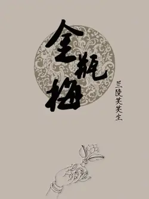

# 元数据

> [!abstract] 金瓶梅（别名：金瓶梅词话）
> - 
> - 书名：金瓶梅（别名：金瓶梅词话）
> - 作者：[明]兰陵笑笑生
> - 简介：《金瓶梅》书名由书中三个女主人公潘金莲、李瓶儿、庞春梅名字中各取一字合成。被列为明代"四大奇书"之首，小说由《水浒传》中武松杀嫂一段演化而来，通过对兼有官僚、恶霸、富商三种身份的市侩势力代表人物西门庆及其家庭罪恶生活的描述，再现了当时社会民间生活的面貌，揭露了明代中叶社会的黑暗和腐败，这是一部“世情书”，“描摹世态，见其炎凉”写日常生活，写世道人心。
> - 出版时间：2024-12-01 00:00:00
> - 分类：文学-古典文学
> - 微信读书评分：92%
> - 阅读进度：0%
> - 阅读时长：22分钟
> - 最后阅读：2026-11-13
> - 微信读书：https://weread.qq.com/book-detail?type=1&v=24532b00813ab97bbg014564

# 高亮划线

## 第二回 俏潘娘帘下勾情 老王婆茶坊说技

> 📌 白驹过隙，日月如梭，才见梅开腊底，又早天气回阳
> ⏱ 2026-11-13 03:40:10

> 📌 可意的人儿，风风流流从帘子下丢与个眼色儿。这个人被叉竿打在头上，便立住了脚，待要发作时，回过脸来看，却不想是个美貌妖娆的妇人
> ⏱ 2026-11-13 03:40:55

> 📌 但见他黑鬓鬓赛鸦鸰的鬓儿，翠弯弯的新月的眉儿，香喷喷樱桃口儿，直隆隆琼瑶鼻儿，粉浓浓红艳腮儿，娇滴滴银盆脸儿，轻袅袅花朵身儿，玉纤纤葱枝手儿，一捻捻杨柳腰儿，软浓浓粉白肚儿，窄星星尖翘脚儿，肉奶奶胸儿，白生生腿儿，更有一件紧揪揪、白鲜鲜、黑裀裀，正不知是甚么东西
> ⏱ 2026-11-13 03:42:23

> 📌 那人一见，先自酥了半边，那怒气早已钻入爪洼国去了，变做笑吟吟脸儿
> ⏱ 2026-11-13 03:42:02
> 💭 爪洼国是古代东南亚国名，主要在今印度尼西亚爪哇岛一带，唐时曾为佛教国，明清常被用来指极遥远的地方，《红楼梦》里“早吓的丢在爪洼国去了”便是此意。
> 🕰 2026-11-13 03:42:05

## 第四回 赴巫山潘氏幽欢 闹茶坊郓哥义愤

> 📌 一物从来六寸长，有时柔软有时刚。软如醉汉东西倒，硬似风僧上下狂。出牝入阴为本事，腰州脐下作家乡。天生二子随身便，曾与佳人斗几场。
> ⏱ 2025-05-19 01:34:58

## 第十三回 李瓶姐墙头密约 迎春儿隙底私窥

> 📌 月落花阴夜漏长，相逢疑是梦高唐。夜深偷把银缸照，犹恐憨奴瞰隙光。
> ⏱ 2026-11-13 03:39:27
> 💭 白话译文：
>
> 月色隐入花影，更漏滴答，长夜漫漫。二人仓促相逢，恍惚如同高唐一梦。深夜之中悄悄举起灯烛，心中还在担忧丫鬟借着灯火微光，暗中窥伺。
>
> 前两句渲染幽会的迷离气氛。
>
> 夜深人静，庭院沉寂。以“高唐”典故装点私情，一时间男女沉溺温存，竟分不清眼前相逢是真还是幻。诗词的雅致，给这场越轨私约蒙上一层如梦似幻的面纱。
>
> 后两句笔锋骤然跌落，落回现实的惶惧。
>
> “偷把银缸照”一个小动作，写尽偷情之人的心虚。他们自以为安排周密，锁闭门户、托付心腹，可心底依旧藏着挥之不去的惶恐。
>
> 极具讽刺的便是“犹恐憨奴瞰隙光”。
>
> 他们提防丫鬟迎春偷看，殊不知迎春早已立在暗处，将房内一切尽收耳目之中。主人们费尽心机严守的隐秘，最先泄露于仆婢之眼。
>
> 一桩私情，从开端便留下破绽。风声经由下人慢慢传开，往后宅内风波层层而起。
> 🕰 2026-11-13 03:39:36

## 第十九回 草里蛇逻打蒋竹山 李瓶儿情感西门庆

> 📌 ，因看见妇人上穿沉香色水纬罗对襟衫儿，五色绉纱眉子，下着白碾光绢挑线裙儿，裙边大红段子白绫高低鞋儿。头上银丝[插图]髻，金镶分心翠梅钿儿，云鬓簪着许多花翠。越显得红馥馥朱唇、白腻腻粉脸，不觉淫心辄起，搀着他两只手儿，搂抱在一处亲嘴
> ⏱ 2026-11-13 03:44:35

> 📌 不一时，春梅筛上酒来，两个一递一口儿饮酒咂舌。妇人一面抠起裙子，坐在身上，噙酒哺在他口里，然后纤手拈了一个鲜莲蓬子，与他吃
> ⏱ 2026-11-13 03:44:59

> 📌 西门庆道：“涩剌剌的，吃他做甚么？”妇人道：“我的儿，你就吊了造化了，娘手里拿的东西儿你不吃！”又口中噙了一粒鲜核桃仁儿，送与他，才罢了。西门庆又要玩弄妇人的胸乳。妇人一面摊开罗衫，露出美玉无瑕、香馥馥的酥胸，紧就就的香乳。揣摸良久，用口舐之，彼此调笑，曲尽“于飞”
> ⏱ 2026-11-13 03:45:11

## 第五十九回 西门庆露阳惊爱月李瓶儿睹物哭官哥

> 📌 饮够多时，郑爱香儿推更衣出去了，独有爱月儿陪着西门庆吃酒。先是西门庆向袖中取出白绫汗巾儿，上头束着个金穿心盒儿。郑爱月儿只道是香茶，便要打开，西门庆道：“不是香茶，是我逐日吃的补药。我的香茶不放在这里面，只用纸包着。”
> ⏱ 2026-11-13 03:49:52

> 📌 于是袖中取出一包香茶桂花饼儿递与他。那爱月儿不信，还伸手往他袖子里掏，又掏出个紫绉纱汗巾儿，上拴着一副拣金挑牙儿，拿在手中观看，甚是可爱
> ⏱ 2026-11-13 03:50:17

> 📌 说道：“我见桂姐和吴银姐都拿着这样汗巾儿，原来是你与他的。”西门庆道：“是我扬州船上带来的。不是我与他，谁与他的？你若爱，与了你罢。到明日，再送一副与你姐姐。
> ⏱ 2026-11-13 03:51:20

> 📌 说毕，西门庆就着钟儿里酒，把穿心盒儿内药吃了一服，把粉头搂在怀中，两个一递一口儿饮酒咂舌，无所不至。西门庆又舒手摸弄他香乳，紧紧就就赛麻圆滑腻
> ⏱ 2026-11-13 03:50:43

> 📌 一面扯开衫儿观看，白馥馥犹如莹玉一般。揣摩良久，淫心辄起，腰间那话突然而兴。解开裤带，令他纤手笼攥
> ⏱ 2026-11-13 03:50:55

> 📌 粉头见其粗大，唬的吐舌害怕，双手搂定西门庆脖项说道：“我的亲亲，你今日初会，将就我，只放半截儿罢！若都放进去，我就死了。你敢吃药养的这等大，不然，如何天生恁怪剌剌儿的——红赤赤，紫漒漒，好砢碜人子！
> ⏱ 2026-11-13 03:51:08

> 📌 西门庆笑道：“我的儿！你下去替我品品。”爱月儿道：“慌怎的，往后日子多如树叶儿。今日初会，人生面不熟，再来等我替你品。”说毕，西门庆欲与他交欢，爱月儿道：“你不吃酒了？”西门庆道：“我不吃了，咱睡罢。
> ⏱ 2026-11-13 03:52:00

> 📌 爱月儿便叫丫鬟把酒桌抬过一边，与西门庆脱靴，他便往后边更衣澡牝去了。西门庆脱靴时，还赏了丫头一块银子，打发先上床睡，炷了香，放在薰笼内
> ⏱ 2026-11-13 03:52:14

> 📌 良久，妇人进房，问西门庆：“你吃茶不吃？”西门庆道：“我不吃。”一面掩上房门，放下绫绡来，将绢儿安放在褥下，解衣上床
> ⏱ 2026-11-13 03:52:35

> 📌 两个枕上鸳鸯，被中鸂鷘。西门庆见粉头肌肤纤细，牝净无毛，犹如白面蒸饼一般，柔嫩可爱。抱了抱腰肢，未盈一掬。诚为软玉温香，千金难买
> ⏱ 2026-11-13 03:52:58

> 📌 于是把他两只白生生银条般嫩腿儿夹在两边腰眼间，那话上使了托子，向花心里顶入。龟头昂大，濡搅半晌，方才没棱。那爱月儿把眉头绉在一处，两手攀搁在枕上，隐忍难挨。朦胧着星眼，低声说道：“今日你饶了郑月儿罢！”西门庆听了，愈觉销魂，肆行抽送，不胜欢娱
> ⏱ 2026-11-13 03:53:28

> 📌 正是：春点桃花红绽蕊，风欺杨柳绿翻腰。
> ⏱ 2026-11-13 03:53:40

## 第七十五回 因抱恙玉姐含酸 为护短金莲泼醋

> 📌 那妇人一面吃毕药，与西门庆两个解衣上床同寝。西门庆在被窝内，替他手撒扑着酥胸，揣摸香乳，一手搂其粉项，问道：“我的亲亲，你心口这回吃下药觉好些？”妇人道：“疼便止了，还有些嘈杂。”西门庆道：“不打紧，消一回也好了。
> ⏱ 2026-11-13 03:54:55

# 章节点评与书评

## 读书笔记

不知道哪里看的：读懂了金瓶梅就读懂了中国社会，也就读懂了中国文化。我没读之前，真以为这部小说就是写性和淫秽的一部小说，所以为什么说越无知的人越自信，人还是要多读书，丰富自己的内心和认知，不然你就只能活在自己局限的世界里。

从人和动物的本性上来讲，我们不避开性的话题来讲，有性欲是动物生理本能，没有什么不对，因为人本身是有七情六欲的，看你从哪方面看待性问题，佛教讲究色即是空，空即是色，那是从动物性本能升华了一个更高境界。

从道德角度，西门庆的淫乱史和发家史是可耻的卑劣的，违背社会道德伦理三纲五常的，但从作者笔下的人物性格和心理状态这是当时的社会风气，而这种写法更是体现了这部小说的奇特，所以我们不只看到关于性的问题，那就太肤浅，所以这本书可以和红楼梦相提并论也有道理，更教化人众恶莫作，众善奉行，很生动，很全面，

人性的丑恶在动物界弱肉强食都有，贪财好色也是人性的弱点，但人之所以生而为人，还是要不断向善，种善因，才能结善果。

西门庆起家败家的故事，正如那句话："眼看他起朱楼，眼看他宴宾客，眼看他楼塌了。"塑造了一群世俗欲望人物，当每个人都被自己的欲望牵引时，人人都变得虚假了、疯狂了，正所谓：欲使其灭亡，必先使其疯狂！读金瓶梅而生怜悯心者，菩萨也；生畏惧心者，君子也；生欢喜心者，小人也；生效法心者，乃禽兽耳。

哈哈，我感觉我有时候像菩萨，有时候是君子，有时候是小人，有时候禽兽[偷笑][偷笑]

不过我有一点最真实的感悟，清心寡欲还是好的，努力向内求吧！

> 记录于 2026-11-13 03:38:41
