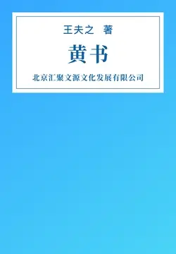

# 元数据

> [!abstract] 黄书
> - 
> - 书名：黄书
> - 作者：[明末清初]王夫之
> - 简介：本书通过评述历史阐发了作者的爱国主义思想，提出了民族利益高于一切的原则，强调仁义的最高意义在于维护民族利益‌
> - 出版时间：2015-09-01 00:00:00
> - 分类：历史-历史典籍
> - 出版社：北京汇聚文源文化发展有限公司
> - 微信读书评分：83%
> - 阅读进度：0%
> - 阅读时长：0分钟
> - 最后阅读：2026-11-13
> - 微信读书：https://weread.qq.com/book-detail?type=1&v=3a4327605c08673a48e475e

# 高亮划线

## 任官

> 📌 董子曰：「仁者人也，义者我也。』以仁爱人，以义制我。以仁爱人，不授以制而尽其私。以义制我，不私所爱而厚其疑。
> ⏱ 2026-11-13 03:32:58

# 章节点评与书评

## 读书笔记

帝王之书。主席读之，作《心之力》，以无限的革命热情投身民族解放事业！我读之，知清之亡，在于心不系天下苍生。《心之力》是教员写的，这是毋庸置疑的，但是原作找不到也是事实，普遍认为现在流传的是伪作，很重要的一点是这篇文章在教员过世之后才流传，很难去辨别啦。

这篇文章有些思想不符合教员的思维，但是人又是会发展变化的，所以很难说是不是。

> 记录于 2026-11-13 03:32:10

## 读书笔记

以外国为夷狄，这是自主的文明观，知道什么是华夏，什么是夷狄，才能够贵夏贱夷，进而化他国，建构天下秩序。明朝的海禁并没有限制本国人民与外国的交往，西学传入中国，大受欢迎，泰西之天文模型，被运用于历算方面；天主思想，也促使儒生们思考过去神灵谱系的优点和弊端。利氏者，被推为贤儒，其所服行，多为士人所称道。

明朝与外国的文化交流是很频繁的，但明儒有其自主自立的文化本位，不为夷狄所化，这是明儒的品质，相反清末维新士儒，就远不及了。

> 记录于 2026-11-13 03:32:32

## 读书笔记

在读《剑桥中国史》时，著者对王夫之的《黄书》颇为推崇，读起来确实内容很庞大，对历史、地理、为政、为官都有论述，对于朝代的兴替用“离合”进行总结。

注意到文中的两点：①未提及新疆，估计和明末清初新疆与中原的特殊关系有关，在此也能看到后来左宗棠收服新疆的不易；②以外国为夷狄，明朝清初的海禁，极大的限制了与外国的交流，《剑桥中国史》的英国学者，对于中国历史、人文、政治的了解，对这种读来挺生涩的书，也在其研究的范围，这内外的反差确实很大。

> 记录于 2026-11-13 03:32:43
